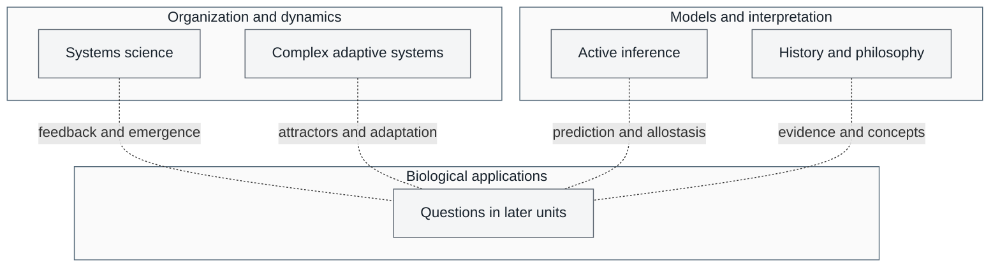

# Unit 0 — Systems Science for Biology: Introduction {#sec:unit_0_unit_intro .unnumbered}

**\nameref{sec:unit_0_unit_intro} · Introduction**

---

## Why This Unit Matters {.unnumbered}

The modern study of biology began by reducing living phenomena to their smallest parts — cells, molecules, genes. This reductionist strategy yielded extraordinary insight. Yet the more we learned about individual components, the clearer it became that biology cannot be explained by parts alone: a neuron firing is not a thought, a gene is not a behavior, a metabolic pathway is not a cell. What emerges from the *interaction* of parts — properties no single component possesses in isolation — is the subject of **systems science**.

\nameref{sec:unit_0_unit_intro} introduces four interlocking frameworks that recur in every subsequent unit:

1. **Systems science** — the general theory of organized complexity: how hierarchical systems form, how feedback governs their behavior, how new properties emerge.
2. **Complex adaptive systems** — how populations of agents with local rules give rise to robust, evolvable, collective behavior.
3. **Active inference and the free energy principle** — a mathematical modeling lens for selected questions about prediction, action, and physiological regulation.
4. **History and philosophy of biology** — the source-critical practice of asking where biological concepts came from, what they assume, and how evidence and values revise them.

Reading \nameref{sec:unit_0_unit_intro} is optional but recommended: it supplies vocabulary for comparing models of emergence, attractors, bifurcations, allostasis, and precision across \nameref{sec:unit_I_unit_intro} through \nameref{sec:unit_X_unit_intro}. These lenses do not constitute a single established theory of all living organization.

---

## Landmark Discoveries {.unnumbered}

| Year | Contribution | Significance |
| ---- | ------------ | ------------ |
| 1867 | Hermann von Helmholtz — \citep{helmholtz1867handbook} | First framing of perception as unconscious inference |
| 1932 | Walter Cannon — \citep{cannon1932} | Coined *homeostasis*; proposed regulated internal milieu |
| 1948 | Norbert Wiener — \citep{wiener1948} | Formalised feedback control; bridged engineering and biology |
| 1968 | Ludwig von Bertalanffy — \citep{bertalanffy1968} | Articulated open systems and hierarchy across disciplines |
| 1977 | Ilya Prigogine and Grégoire Nicolis — \citep{prigogine1977} | Dissipative structures and non-equilibrium self-organization |
| 1987 | Per Bak, Tang & Wiesenfeld — \citep{bak1987} | Self-organized criticality and power-law scaling in CAS |
| 1992 | John Holland — \citep{holland1992} | Genetic algorithms; formal CAS framework |
| 2010 | Karl Friston — \citep{friston2010} | Free energy principle as a unified theory of brain function |
| 2015 | Peter Sterling — \citep{sterling2015} | Predictive allostasis, contrasting error-correction homeostasis |

---

## Key Concepts and Connections {.unnumbered}

- **System** — a set of interacting components forming an integrated whole; open systems exchange matter and energy with their environment.
- **Emergence** — properties of a system that cannot be explained solely by properties of its components (e.g., consciousness emerges from neural circuits; life emerges from biochemistry).
- **Feedback** — output fed back as input, shaping future behavior; negative feedback stabilizes, positive feedback amplifies.
- **Attractor** — a region of phase space toward which trajectories converge; attractor switching and bifurcations describe distinct possible changes in dynamics.
- **Complex adaptive system (CAS)** — a system of adaptive agents whose collective behavior self-organizes without central control.
- **Variational free energy** — an information-theoretic upper bound on surprise within a specified generative model; it is not Gibbs free energy.
- **Homeostasis and allostasis** — feedback regulation and context-sensitive adjustment provide complementary descriptions of physiological control, not a passive-versus-active hierarchy.

These ideas offer comparisons across the textbook. Feedback appears in enzyme regulation (\nameref{sec:unit_I_unit_intro}), signaling cascades (\nameref{sec:unit_II_unit_intro}), metabolic flux (\nameref{sec:unit_III_unit_intro}), population dynamics (\nameref{sec:unit_X_unit_intro}), and neural control (\nameref{sec:unit_IX_unit_intro}). Attractor models can describe selected cell-fate decisions, genetic switches, and ecosystem states. Active inference offers one lens for prediction and physiological regulation; its explanatory value depends on the specified model and evidence.

---

## Current Evidence Thread {.unnumbered}

Systems-science and complexity claims are not evidenced the way a single-gene knockout is; the evidence is whether a model's assumptions survive contact with data. A claim earns confidence when its generative model exposes the parameters and boundary that matter, when a perturbation or time-series test could have falsified it but did not, and when an explicit null or alternative model fails where it succeeds. Across this unit — emergence, adaptive agents, active inference, and the history/philosophy of biological concepts — read each idea as such a model and ask what observation would move you. As you
move through the chapters, keep a two-column note: **claim** on the left,
**evidence that would change my confidence** on the right. By the end of the
unit, each major idea should be tied to a measurement, model, citation, or
paper-based lab decision.

## Four lenses for biological questions {.unnumbered}

<!-- alt: Graph showing four complementary lenses connect to later biological questions. Dotted connectors identify optional conceptual applications, not a prerequisite chain, causal proof, or a claim that one framework explains every biological system. -->

*Four complementary lenses connect to later biological questions. Dotted connectors identify optional conceptual applications, not a prerequisite chain, causal proof, or a claim that one framework explains every biological system.*

| Chapter | Core question | Key tools |
| ------- | ------------- | --------- |
| \cref{sec:unit_0_systems_science} | *How does organization arise from interaction?* | Feedback, hierarchy, Hill equation, delay oscillation |
| \cref{sec:unit_0_complex_adaptive_systems} | *How do simple local rules produce robust global behavior?* | Phase space, bifurcation, fitness landscape, power laws |
| \cref{sec:unit_0_active_inference} | *What do probabilistic agent models explain, and which assumptions must be tested?* | Bayesian inference, variational free energy, precision, model comparison |
| \cref{sec:unit_0_history_philosophy_biology} | *How did biology's concepts, evidence practices, and values become what they are?* | Source analysis, mechanism/function, individuality, model critique |

---

## Connections Across the Textbook {.unnumbered}

- **\nameref{sec:unit_I_unit_intro} — Chemistry of Life**: thermodynamic gradients (\cref{sec:unit_0_systems_science}) explain why proteins fold spontaneously; catalysis is a feedback-regulated modular system.
- **\nameref{sec:unit_II_unit_intro} — The Cell**: organelles are modules; the fluid-mosaic membrane is a self-organized phase; signaling cascades are hierarchical feedback loops.
- **\nameref{sec:unit_III_unit_intro} — Energy and Metabolism**: glycolysis and the TCA cycle are classic examples of allosteric feedback and feed-forward control.
- **\nameref{sec:unit_IV_unit_intro} and \nameref{sec:unit_V_unit_intro} — Genetics**: regulatory networks, bistable switches, and epigenetic memory provide examples for comparing systems models.
- **\nameref{sec:unit_VI_unit_intro} — Evolution**: fitness landscapes from \cref{sec:unit_0_complex_adaptive_systems} are the formal substrate of selection.
- **\nameref{sec:unit_VII_unit_intro} — Microbiology**: biological-self questions from \cref{sec:unit_0_history_philosophy_biology} clarify microbiomes, symbiosis, pathogens, and host boundaries.
- **\nameref{sec:unit_IX_unit_intro} — Physiology and Neuroscience**: allostasis and predictive models from \cref{sec:unit_0_active_inference} complement questions about homeostatic feedback; they do not by themselves replace feedback models.
- **\nameref{sec:unit_X_unit_intro} — Ecology**: phase transitions, alternative stable states, and tipping points apply the mathematics of \cref{sec:unit_0_complex_adaptive_systems} directly.

---

## Computational Toolbox — Unit 0 {.unnumbered}

The four \nameref{sec:unit_0_unit_intro} chapters are conceptual rather than algorithmic, but they motivate every piece of code and evidence check used later:

- **Hill cooperative binding:** cell-biology helpers, especially `hill_equation()`.
- **Receptor occupancy:** cell-signaling helpers for ligand binding and response.
- **Logistic dynamics:** ecology helpers for growth under carrying capacity.
- **Lotka–Volterra oscillation:** ecology helpers for predator–prey cycles.
- **Bayesian update:** neuroscience-style posterior inference, illustrated in \cref{sec:unit_0_active_inference}.
- **Source and citation closure:** table-of-contents, bibliography, cross-reference, and curriculum helpers that keep claims traceable across chapters, labs, and question banks.

Each concrete chapter later in the textbook either uses one of these helpers or gives the reader a chance to write the next one.

---

*Source modules: `src/biology/` (general framework across most domains).*
*Figures: `src/mermaid/biology_diagrams.py` — systems-level diagrams reused throughout the book.*

## Cross-Unit Integration {.unnumbered}

Gradients, feedback and emergence reappear in \nameref{sec:unit_I_unit_intro} as chemical mechanisms. Gibbs free energy has energy units and determines chemical equilibrium under specified conditions. Variational free energy in active inference is an information-theoretic functional, commonly expressed in nats; its minimization is not the same physical process. The shared name permits a qualified analogy, not an identity or proof that organisms implement a particular inference scheme.
