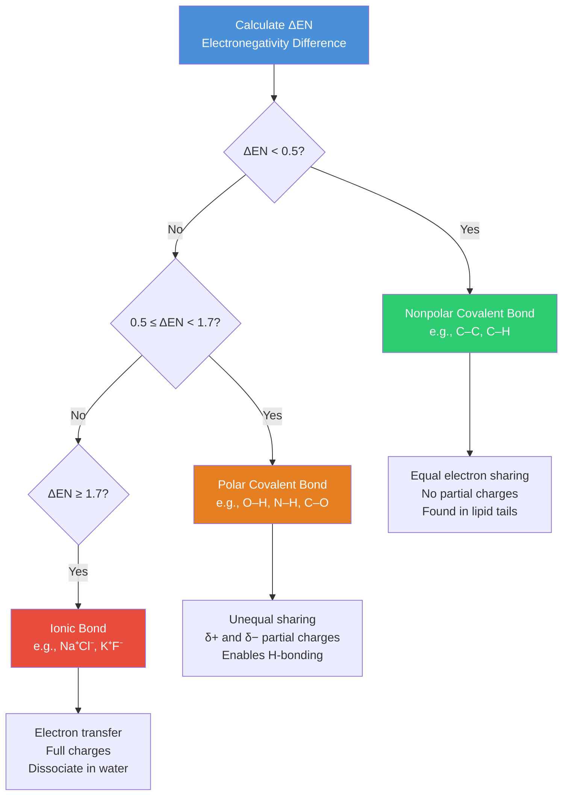
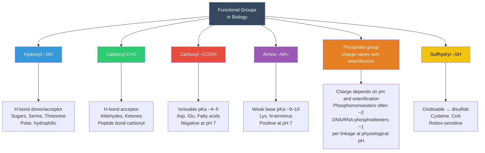
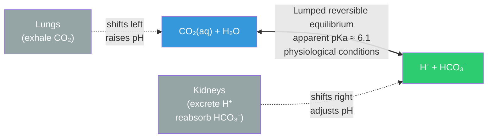

# Atoms, Molecules, and Chemical Bonds

\label{sec:unit_I_atoms_molecules}

\begin{figure}[htbp]
\centering
\includegraphics[width=0.9\textwidth]{../figures/electronegativity_bond_energy.png}
\caption{Quantitative chemistry behind biological molecules. The top panel shows Pauling electronegativities for the atoms most common in living matter (H, C, N, O, P, S, plus Na, K, Cl, Ca). The bottom panel shows representative bond dissociation energies on a log scale, color-coded by covalent versus noncovalent class. The order-of-magnitude separation explains why covalent backbones persist while noncovalent interactions can rearrange under physiological conditions.}
\label{fig:unit_I_electronegativity_bond_energy}
\end{figure}

<!-- alt: Two-panel figure. Top panel: vertical bars showing Pauling electronegativity values for ten biologically relevant atoms. Bottom panel: vertical bars on a log scale showing bond dissociation energies in kJ/mol for several covalent and noncovalent bond types, with covalent bonds clearly larger than hydrogen bonds and van der Waals interactions. -->


<!-- chapter-metadata-badge -->
> Level 1/3 · 40 min read · 50 min lecture · Prerequisites: none

## Learning Objectives

By the end of this chapter, you should be able to:

1. Describe the structure of an atom, including subatomic particles and their quantum mechanical behavior.
2. Explain how [**electronegativity**](#gl:electronegativity) governs covalent and ionic bond formation.
3. Distinguish between polar covalent, nonpolar covalent, and ionic bonds with biological examples.
4. Explain the roles of [**hydrogen bond**](#gl:hydrogen-bond)s and [**van der Waals forces**](#gl:van-der-waals-forces) in biological macromolecules.
5. Interpret the concept of [**pH**](#gl:ph), [**buffer**](#gl:buffer)s, and their physiological significance.
6. Describe [**chirality**](#gl:chirality) and stereoisomerism in biological molecules.
7. Explain redox reactions and their central role in bioenergetics.
8. Apply isotope chemistry to biomedical imaging and radiotherapy.

<!-- curriculum-scaffold-start -->
### Study Blueprint

- **Big idea:** Atomic structure constrains the bonds, charges, and geometries that make biological molecules possible.
- **Core concepts:** valence, electronegativity, formal charge, isotopes.
- **Framework alignment:** Vision & Change: Structure and function, Pathways and transformations of energy and matter; AP Biology: Energetics, Systems Interactions; NGSS-style topics: Matter and Energy in Organisms and Ecosystems, Structure and Function.
- **Model or quantitative lens:** Formal charge and electronegativity-difference reasoning.
- **Data skill:** Use tabular atomic data to predict polarity, solubility, and biological reactivity.
- **Practice cadence:** Concept Explanation, Statistical Tests and Data Analysis, Argumentation.
- **Common misconception to repair:** Weak interactions are not unimportant; many weak interactions together dominate structure and specificity.
- **Primary lab:** \nameref{sec:lab_unit_I_atoms_molecules}.
- **Question bank:** \nameref{sec:q_unit_I_atoms_molecules}.
- **Transfer task:** Use atomic reasoning to explain a medical tracer, enzyme cofactor, or membrane-solubility problem.
- **Bridge to computation:** `biology.biochemistry.biochemistry.atp_free_energy`.
<!-- curriculum-scaffold-end -->

---

> **Opening Vignette: The Radioactive Tracer That Exposed Cancer**
>
> In 1973, chemist Alfred Wolf and colleagues at Brookhaven National Laboratory synthesized a new
> molecule: fluorine-18-labeled deoxyglucose ($^{18}$F-FDG). Because $^{18}$F decays with a
> half-life of just 109.8 minutes, emitting a positron that collides with a nearby electron to
> produce a pair of detectable gamma rays, the molecule could be tracked in real time inside a
> living body. Because FDG mimics glucose, metabolically hungry cells take it up — and cancer cells,
> with their vastly elevated glucose consumption (the **Warburg effect**, first described by Otto
> Warburg in 1924 \citep{warburg1924carcinomzelle}), accumulate it at concentrations 2–10× higher than surrounding normal tissue.
>
> PET with fluorine-18 FDG supports cancer staging and treatment-response assessment. A single-center study is not a census of national annual scan volume; no national count is inferred here \citep{indrakanti2022multiplefdgpet}. FDG uptake is not cancer-specific, so inflammation and tissue-specific metabolism also affect interpretation.
> Interpreting the tracer therefore requires radioactive-decay physics, chemical identity and the biochemistry of glucose transport — the connected subjects of this chapter.
>
> *Primary sources: Warburg's tumor-metabolism report \citep{warburg1924carcinomzelle}, the first labeled FDG chemistry \citep{ido1978fdg}, and human PET validation with FDG \citep{phelps1979fdg}.*

---


Life is fundamentally chemistry. Every organism, from a bacterium to a blue whale, is composed of atoms obeying the same physical laws discovered in the nineteenth and twentieth centuries. Understanding life therefore begins with understanding atoms.

Of the 118 known elements, only about 25 are essential to life. Just six elements --- carbon, hydrogen, nitrogen, oxygen, phosphorus, and sulfur (CHNOPS) --- account for approximately 97% of the mass of a human body. Trace elements such as iron, zinc, copper, manganese, and selenium perform critical catalytic roles despite being present in minuscule quantities.

### Subatomic Particles and Atomic Identity

An atom consists of three primary subatomic particles:

: Subatomic Particles and Atomic Identity: Particle and Charge. {#tbl:unit_I_atoms_molecules_subatomic_particles_and_atomic_identity}
| Particle | Charge | Mass (Da) | Location |
| -------- | ------ | --------- | -------- |
| Proton | +1 | 1.007 | Nucleus |
| Neutron | 0 | 1.008 | Nucleus |
| Electron | −1 | 0.000549 | Orbital shells |

The **atomic number** (Z) equals the number of protons, defining the element. The **mass number** (A) equals protons plus neutrons. **Isotopes** share the same atomic number but differ in neutron count.

### Isotopes and Their Biological Applications

Isotopes are classified as **stable** or **radioactive** (radioisotopes). Radioisotopes undergo spontaneous nuclear decay, emitting alpha particles, beta particles, or gamma rays.

: Isotopes and Their Biological Applications: Isotope and Half-life. {#tbl:unit_I_atoms_molecules_isotopes_and_their_biological_applications}
| Isotope | Half-life | Decay Type | Biological/Medical Application |
| ------- | --------- | ---------- | ------------------------------ |
| $^{14}$C | 5,730 years | $\beta^-$ | Radiocarbon dating of fossils and archaeological specimens |
| $^{3}$H (tritium) | 12.3 years | $\beta^-$ | Tracing metabolic pathways in autoradiography |
| $^{32}$P | 14.3 days | $\beta^-$ | Labeling DNA/RNA in molecular biology |
| $^{18}$F | 109.8 min | $\beta^+$ | PET (positron emission tomography) imaging |
| $^{131}$I | 8.0 days | $\beta^-$, γ | Thyroid cancer radiotherapy |
| $^{99m}$Tc | 6.0 hours | γ | SPECT imaging of bones, heart, kidneys |

> **Clinical Connection: PET Imaging and $^{18}$F-FDG**
>
> Positron emission tomography (PET) exploits the short half-life of $^{18}$F. The glucose analog $^{18}$F-fluorodeoxyglucose ($^{18}$F-FDG) is taken up by metabolically active cells. Because cancer cells have elevated glucose uptake (the Warburg effect), PET scans reveal tumors as "hot spots." The emitted positron annihilates with a nearby electron, producing two 511 keV gamma photons detected by the scanner in coincidence.

> **Concept Check 1:** Carbon-14 has a half-life of 5,730 years. If a fossilised bone contains 12.5% of its original $^{14}$C, approximately how old is it? (Hint: How many half-lives reduce 100% to 12.5%?)

### Electron Shells, Orbitals, and Valence

Electrons occupy discrete energy levels called **shells** (principal quantum number n = 1, 2, 3, ...). Within each shell, electrons occupy **orbitals** --- three-dimensional regions of space where the probability of finding an electron exceeds 90%.

: Electron Shells, Orbitals, and Valence: Shell (n) and Subshells. {#tbl:unit_I_atoms_molecules_electron_shells_orbitals_and_valence}
| Shell (n) | Subshells | Orbitals | Max Electrons |
| --------- | --------- | -------- | ------------- |
| 1 | 1s | 1 | 2 |
| 2 | 2s, 2p | 4 | 8 |
| 3 | 3s, 3p, 3d | 9 | 18 |

The outermost occupied shell is the **valence shell** --- its electron count determines chemical reactivity. Atoms are most stable when their valence shell is complete (the **octet rule** for second-period elements).

**Key biological elements and their valences:**

: Electron Shells, Orbitals, and Valence: Element and Symbol. {#tbl:unit_I_atoms_molecules_electron_shells_orbitals_and_valence_2}
| Element | Symbol | Atomic Number | Valence Electrons | Typical Bonds |
| ------- | ------ | ------------- | ----------------- | ------------- |
| Hydrogen | H | 1 | 1 | 1 |
| Carbon | C | 6 | 4 | 4 |
| Nitrogen | N | 7 | 5 | 3 |
| Oxygen | O | 8 | 6 | 2 |
| Phosphorus | P | 15 | 5 | 5 |
| Sulfur | S | 16 | 6 | 2, 4, or 6 |

Carbon's four valence electrons allow it to form four strong covalent bonds in a tetrahedral geometry ($sp^3$ hybridization, bond angle 109.5 degrees), enabling virtually unlimited structural complexity --- the molecular foundation of life.

### Orbital Hybridization in Biological Molecules

Carbon's bonding versatility arises from orbital hybridization --- the linear combination of atomic $s$ and $p$ orbitals to form new hybrid orbitals matched to molecular geometry.

- **$sp^3$:** One $s$ + three $p$ orbitals -> four equivalent hybrid orbitals pointing to the corners of a tetrahedron (109.5 degrees). Each forms a single (σ) bond. Example: methane, saturated carbons in [**fatty acid**](#gl:fatty-acid) tails, the α-carbon of every amino acid.
- **$sp^2$:** One $s$ + two $p$ orbitals -> three coplanar hybrid orbitals (120 degrees) plus one unhybridised $p$ orbital perpendicular to the plane that overlaps with another $p$ orbital to form a π-bond. Example: C=C in unsaturated fatty acids, the carbonyl carbon of every [**peptide bond**](#gl:peptide-bond), aromatic rings.
- **$sp$:** One $s$ + one $p$ orbital -> two collinear hybrid orbitals (180 degrees) plus two $p$ orbitals available for two π-bonds. Example: C$\equiv$N in hydrogen cyanide; the C$\equiv$C of acetylene; rare in biology except in some natural products.

Nitrogen exhibits analogous hybridization: in primary amines (--NH$_2$) and the α-amino group of amino acids, nitrogen is $sp^3$ with one lone pair (pyramidal geometry, bond angle ~107 degrees). In the planar peptide bond, however, the nitrogen lone pair is delocalized into the carbonyl π system; the nitrogen behaves as effectively $sp^2$, locking the six atoms of the peptide unit (C$_\alpha$--C(=O)--N(H)--C$_\alpha$) into a plane.

The **peptide bond** between amino acids has partial double-bond character (~40%) because of resonance between the $sp^2$-hybridized C and N atoms, enforcing planarity and the *trans* configuration that constrains [**protein**](#gl:protein) backbone geometry. The *cis* form is destabilised by ~8 kJ/mol relative to *trans* (except before proline, where the steric penalty is smaller and ~5% of X-Pro bonds are *cis*).

### Lewis Structures and Formal Charge

A **Lewis structure** depicts every valence electron --- as bonding pairs (lines) or lone pairs (dots) --- making explicit which atoms share which electrons. The **formal charge** on an atom is what its charge would be if most bonds were nonpolar (electrons shared equally):

\begin{equation}
\text{Formal charge} = (\text{valence electrons}) - (\text{lone-pair electrons}) - \tfrac{1}{2}(\text{bonding electrons})
\label{eq:unit_I_formal_charge}
\end{equation}

Formal charges sum to the molecular charge and help select among possible Lewis structures: the best structure minimizes formal charges and places any negative formal charge on the most electronegative atom.

**Worked example --- formal charge on phosphate (PO$_4^{3-}$):** Phosphate has central P bonded to four O atoms. In the most common textbook structure, three P--O are single bonds (each O carries three lone pairs) and one P=O is a double bond (the doubly bonded O carries two lone pairs).

- *Phosphorus (group 5, 5 valence electrons):* 0 lone-pair electrons; 5 bonds $\times$ 2 electrons / 2 = 5 bonding electrons assigned. FC = 5 − 0 − 5 = **0**.
- *Each single-bonded O (with three lone pairs):* 6 lone-pair electrons; 1 bond $\times$ 2 / 2 = 1 bonding electron assigned. FC = 6 − 6 − 1 = **−1** ($\times$ 3 oxygens = −3).
- *Double-bonded O (with two lone pairs):* 4 lone-pair electrons; 2 bonds $\times$ 2 / 2 = 2 bonding electrons. FC = 6 − 4 − 2 = **0**.

Total: 0 + 3(−1) + 0 = −3, matching the overall charge. By symmetry the four oxygens are actually equivalent; resonance delocalizes the three negative charges and the double-bond character across the four P--O bonds, giving an average bond order of 1.25 and bond length 154 pm (intermediate between a P--O single bond at 163 pm and a P=O double bond at 145 pm). This delocalization explains why phosphate is such a stable leaving group --- a key feature exploited by ATP, GTP, and the DNA/RNA backbone.

### Electronegativity Drives Polarity in Biology

The Pauling **electronegativity** (χ) of an element predicts how strongly it pulls bonding electrons \citep{pauling1932electronegativity}. Differences in χ across a bond ($\Delta\chi$) determine the partial charges that drive [**hydrogen bond**](#gl:hydrogen-bond)ing, dipole--dipole interactions, and acid-base behavior throughout biology. The chapter-opening \cref{fig:unit_I_electronegativity_bond_energy} pairs the electronegativities for biologically common atoms with representative bond dissociation energies on a log scale.

: Electronegativity Drives Polarity in Biology: Element and χ (Pauling). {#tbl:unit_I_atoms_molecules_electronegativity_drives_polarity_in_biology}
| Element | χ (Pauling) | Period | Biological role |
| ------- | ---------------- | ------ | --------------- |
| F | 3.98 | 2 | Fluorinated drugs (5-FU, FDG) |
| O | 3.44 | 2 | Backbone of polar bonds in water, hydroxyl, carbonyl |
| N | 3.04 | 2 | Amino, amide, peptide, nucleobase H-bonds |
| Cl | 3.16 | 3 | Cl$^-$ ion (electroneutrality, gastric HCl) |
| S | 2.58 | 3 | Disulfides, Fe--S clusters; weaker H-bonds than O |
| C | 2.55 | 2 | Backbone of organic chemistry |
| P | 2.19 | 3 | Phosphate (most polarity comes from O, not P) |
| H | 2.20 | 1 | H-bond donor when bonded to N/O/F |
| Na | 0.93 | 3 | Forms ionic Na$^+$ in solution |
| K | 0.82 | 4 | Forms ionic K$^+$ in solution |

Three observations follow:

1. **C--H bonds are nearly nonpolar** ($\Delta\chi$ = 0.35), which is why the saturated tails of phospholipids and the methyl groups of valine/leucine/isoleucine drive the [**hydrophobic effect**](#gl:hydrophobic-effect).
2. **O--H and N--H bonds are strongly polar** ($\Delta\chi$ = 1.24 and 0.84), permitting conventional [**hydrogen bond**](#gl:hydrogen-bond) donation in suitable molecular environments. Acceptance requires an available electron-rich site: amide carbonyl O can accept, but amide N is not an ordinary acceptor. Polar groups favor hydration without making every alcohol or amide water-soluble; the rest of the molecule and conditions matter \citep{arunan2011hydrogenbond}.
3. **C=O is more polar than C--O** because in the carbonyl the π electrons pile up on oxygen; this polarity makes the carbonyl carbon electrophilic --- the site attacked by serine in trypsin, by water in [**hydrolysis**](#gl:hydrolysis), and by amine nucleophiles in transamination.

Peptide carbonyl O and N--H can form the backbone hydrogen-bond patterns that help stabilize usual α-helices and β-sheets. This donor/acceptor distinction does not make amide N an acceptor or reduce every form of protein secondary structure to a single interaction.

---

## Chemical Bonds as Biological Forces


<!-- alt: Flowchart showing electronegativity and bond type. Classification of chemical bonds by electronegativity difference (ΔEN). The boundaries (0.5 and 1.7) are approximate; real bonds exist on a continuum. -->

*Electronegativity and bond type. Classification of chemical bonds by electronegativity difference (ΔEN). The boundaries (0.5 and 1.7) are approximate; real bonds exist on a continuum.*

### Covalent Bonds and Molecular Stability

A **covalent bond** forms when two atoms share one or more pairs of electrons. The strength of a covalent bond is approximately 150--950 kJ/mol, far greater than thermal energy at body temperature (~2.5 kJ/mol), making them the primary structural bonds of organic molecules.

**Bond energies of biologically important bonds:**

: Covalent Bonds and Molecular Stability: Bond and Energy (kJ/mol). {#tbl:unit_I_atoms_molecules_covalent_bonds_and_molecular_stability}
| Bond | Energy (kJ/mol) | Bond Length (pm) | Biological Context |
| ---- | --------------- | ---------------- | ------------------ |
| C--C | 346 | 154 | Hydrocarbon chains |
| C=C | 614 | 134 | Unsaturated fatty acids |
| C--H | 413 | 109 | Ubiquitous in organics |
| C--O | 360 | 143 | Sugars, amino acids |
| C=O | 745 | 123 | Peptide bonds, carboxyl groups |
| C--N | 305 | 147 | Amino acids |
| O--H | 463 | 96 | Water, hydroxyl groups |
| N--H | 391 | 101 | Amino groups, peptide bonds |
| S--S | 266 | 205 | Disulfide bridges in proteins |
| P--O | 335 | 163 | DNA/RNA backbone, ATP |

**Electronegativity** is the tendency of an atom to attract electron pairs. The Pauling electronegativity scale (F = 3.98; O = 3.44; N = 3.04; C = 2.55; H = 2.20) governs bond polarity \citep{pauling1932electronegativity}:

- **Nonpolar covalent:** $\Delta\chi$ < 0.5 (e.g., C--C, C--H). Electrons shared equally. Found abundantly in lipid hydrocarbon tails.
- **Polar covalent:** $0.5 \le \Delta\chi < 1.7$ (e.g., O--H, N--H, C--O). Partial charges (δ+ and δ−) arise. Critical for hydrogen bonding.
- **Ionic:** $\Delta\chi \ge 1.7$ (e.g., Na$^+$Cl$^-$). One atom effectively captures the electron(s). In solution, ionic compounds dissociate.

**Worked example:** Water has polar O–H bonds because oxygen is more electronegative than hydrogen. The familiar -0.834e oxygen and +0.417e hydrogen values are partial charges in a particular water force-field model, not formal charges; all three atoms have zero formal charge in the usual Lewis structure.

### Ionic Interactions in Biological Solutes

Ionic bonds form when one atom transfers electrons to another, generating oppositely charged ions. In aqueous biological environments, ionic bonds are typically disrupted by water molecules competing for the ions. The **lattice energy** of NaCl is 787 kJ/mol, yet it dissolves readily because of the high dielectric constant of water ($\varepsilon \approx 80$).

In proteins, ionic interactions (**salt bridges**) between oppositely charged residues stabilize higher-order structure. Aspartate (Asp, D, --COO$^-$) and lysine (Lys, K, --NH$_3^+$) frequently form salt bridges in [**enzyme**](#gl:enzyme) active sites. A typical salt bridge contributes 5--20 kJ/mol to protein stability, with the strength depending on the local dielectric environment (buried salt bridges are stronger because of lower effective dielectric constant).

> **Concept Check 2:** Why do salt bridges buried in the hydrophobic core of a protein contribute more to stability than those on the protein surface? Consider the role of the dielectric constant.

### Hydrogen Bonds in Water, Proteins, and Nucleic Acids

A **hydrogen bond** forms when a hydrogen atom covalently bonded to an electronegative atom (N, O, or F) is attracted to another electronegative atom. The bond energy is 2--40 kJ/mol --- weaker than covalent bonds but stronger than van der Waals forces. Hydrogen bond strengths and distances vary systematically with donor and acceptor identity:

: Hydrogen Bonds in Water, Proteins, and Nucleic Acids: H-bond type and Donor--Acceptor distance (pm). {#tbl:unit_I_atoms_molecules_hydrogen_bonds_in_water_proteins_and_nucleic_acids}
| H-bond type | Donor--Acceptor distance (pm) | Energy (kJ/mol) | Biological occurrence |
| ----------- | ----------------------------- | --------------- | --------------------- |
| F--H$\cdots$F$^-$ (low-barrier) | 240 | 50--170 | Rare in biology; fluoride enzymes |
| O--H$\cdots$O$^-$ (charged) | 250--260 | 25--40 | Salt bridges with carboxylates |
| N$^+$--H$\cdots$O (charged) | 260--270 | 15--30 | Lys/Arg with Asp/Glu |
| O--H$\cdots$O (neutral) | 270--280 | 15--25 | Water, hydroxyl groups |
| N--H$\cdots$O=C (peptide) | 285--310 | 8--20 | α-helices, β-sheets |
| O--H$\cdots$N (neutral) | 280--295 | 10--20 | Ser--His in catalytic triads |
| C--H$\cdots$O (weak) | 320--350 | 1--4 | β-sheet edges, base stacking |
| S--H$\cdots$O | 320--360 | 4--10 | Cys hydrogen bonds (rare) |

Despite their individual weakness, hydrogen bonds collectively confer enormous structural stability:

- Water's liquid state at room temperature (vs. the expected gas-phase at ~−100 degrees C as predicted from homologous compounds H$_2$S, H$_2$Se)
- DNA double-helix stability: ~2 H-bonds per A--T base pair, ~3 H-bonds per G--C pair
- Protein secondary structure: α-helices (intrachain H-bonds every 4 residues), β-sheets (interchain H-bonds)
- Cellulose microfibrils: interchain H-bonds between glucose polymers create immense tensile strength

**Geometry of hydrogen bonds:**

```
D–H ···· A
```

Optimal: D--H$\cdots$A angle about 180 degrees; H$\cdots$A distance about 1.8--2.0 angstroms; D$\cdots$A distance about 2.7--3.0 angstroms. Deviations from linearity weaken the bond approximately as $\cos^2\theta$, where θ is the deviation from 180 degrees.

**Types of hydrogen bonds in biology:**

: Hydrogen Bonds in Water, Proteins, and Nucleic Acids: Type and Donor. {#tbl:unit_I_atoms_molecules_hydrogen_bonds_in_water_proteins_and_nucleic_acids_2}
| Type | Donor | Acceptor | Example |
| ---- | ----- | -------- | ------- |
| N--H$\cdots$O | Peptide N--H | Peptide C=O | α-helix backbone |
| O--H$\cdots$O | Water O--H | Carbonyl C=O | Hydration shells |
| N--H$\cdots$O | Adenine exocyclic N--H | Thymine carbonyl O | One A--T hydrogen bond |
| O--H$\cdots$N | Serine O--H | Histidine N | Enzyme active sites |

### Van der Waals Forces and Lipid Packing

Van der Waals forces arise from transient dipoles induced by quantum fluctuations in electron clouds. They are extremely weak (~0.1--10 kJ/mol) but ubiquitous. Because they scale with surface area, **nonpolar molecules with large surface areas** (such as cholesterol or hydrophobic protein cores) benefit significantly from van der Waals interactions.

There are three components of van der Waals forces:

1. **Keesom forces** (permanent dipole--permanent dipole): orientation-dependent attraction between polar molecules.
2. **Debye forces** (permanent dipole--induced dipole): a polar molecule induces a dipole in a nearby nonpolar molecule.
3. **London dispersion forces** (induced dipole--induced dipole): the main attractive forces available between nonpolar molecules; arise from instantaneous fluctuations in electron density.

The **van der Waals radius** defines the effective "size" of an atom. When two non-bonded atoms approach closer than the sum of their van der Waals radii, repulsive forces dominate (Pauli exclusion). This steric effect constrains the conformational space of macromolecules, as described by Ramachandran plots for proteins (see \cref{sec:unit_I_macromolecules}).

**London dispersion forces and lipid packing.** The strength of dispersion forces between two nonpolar surfaces grows roughly with the polarisability and the contact area: longer alkyl chains have more electrons whose instantaneous dipoles correlate more strongly. For two parallel hydrocarbon chains, the dispersion energy of attraction is approximately 2 kJ/mol per CH$_2$ pair --- modest individually but additive. A 16-carbon palmitic acid tail in close van der Waals contact with a neighboring tail in a phospholipid bilayer thus contributes ~30 kJ/mol of attractive interaction per chain pair, which (combined with the [**hydrophobic effect**](#gl:hydrophobic-effect); see \cref{sec:unit_I_water_and_life}) holds the bilayer together. Longer chains (24 carbons in sphingolipids) and saturated chains (which can pack closely) give more rigid membranes; introducing a single *cis* double bond into oleic acid kinks the chain by ~30 degrees, weakening dispersion contacts and raising membrane fluidity --- the molecular reason vegetable oils are liquid while butter is solid at room temperature.

These same forces explain why geckos can walk on walls: their toe pads have millions of setae maximizing van der Waals contact with smooth surfaces, generating up to 10 N/cm$^2$ of adhesive force.

---

## Functional Groups and Biomolecular Reactivity

Six major functional groups determine the chemical reactivity of organic molecules:


<!-- alt: Graph showing major functional groups. The six major functional groups of biological chemistry, their key properties, and representative biomolecules. -->

*Major functional groups. The six major functional groups of biological chemistry, their key properties, and representative biomolecules.*

: Van der Waals Forces and Lipid Packing: Functional Group and Structure. {#tbl:unit_I_atoms_molecules_van_der_waals_forces_and_lipid_packing}
| Functional Group | Structure | Properties | Biological Role |
| --------------- | --------- | ---------- | --------------- |
| Hydroxyl | --OH | Polar, H-bond donor/acceptor | Alcohols, sugars, serine |
| Carbonyl | C=O | Polar, H-bond acceptor | Ketones, aldehydes, amide bonds |
| Carboxyl | --COOH | Polar, ionisable (pKa~4--5) | Amino acids, fatty acids |
| Amino | --NH$_2$ | Polar, weak base, H-bond donor | Amino acids, [**nucleotide**](#gl:nucleotide)s, ATP |
| Phosphate | Monoester or diester phosphate | Charge depends on esterification and pH | DNA/RNA backbone, ATP, signaling |
| Sulfhydryl | --SH | Polar, oxidisable | Cysteine disulfide bridges |

The **phosphate group** deserves special attention in biochemistry. Charge depends on esterification and pH: phosphomonoesters often carry approximately two negative charges, whereas DNA/RNA phosphodiesters carry one per linkage at physiological pH. ATP hydrolysis has a negative standard transformed free-energy change (approximately $-30.5$ kJ/mol); cellular values depend on concentrations and other conditions. The favorable net reaction reflects stabilization of products relative to reactants, not energy released simply by breaking a repulsive bond (see \cref{sec:unit_III_bioenergetics_and_respiration}).

**Additional functional groups encountered in biochemistry:**

: Van der Waals Forces and Lipid Packing: Functional Group and Structure. {#tbl:unit_I_atoms_molecules_van_der_waals_forces_and_lipid_packing_2}
| Functional Group | Structure | Example |
| --------------- | --------- | ------- |
| Methyl | --CH$_3$ | DNA methylation (epigenetic silencing) |
| Ester | --COO-- | Triacylglycerols, phospholipids |
| Ether | --O-- | Ether lipids (plasmalogens in myelin) |
| Amide | --CONH-- | Peptide bonds, asparagine side chain |
| Thioester | --COS-- | Acetyl-CoA (high-energy bond) |
| Imine (Schiff base) | C=N | Retinal in rhodopsin, PLP-dependent enzymes |

> **Concept Check 3:** Acetyl-CoA contains a thioester bond (--COS--) with a $\Delta G^{\circ'}$ of hydrolysis of approximately --31.4 kJ/mol, comparable to ATP hydrolysis. Why might cells use thioester bonds as "activated" carriers of acyl groups?

---

## Resonance Structures and Delocalized Electrons

Many biologically important molecules cannot be accurately described by a single Lewis structure. **Resonance** occurs when electrons (particularly π electrons and lone pairs) are delocalized across multiple atoms.

### The Peptide Bond as a Resonance Hybrid

The peptide bond (C--N) in proteins has significant double-bond character because of resonance between two contributing structures:

**Structure I:** C=O with C--N single bond (nitrogen has a lone pair)

**Structure II:** C--O$^-$ with C=N$^+$ double bond (lone pair delocalized into π system)

The actual bond is a **resonance hybrid** --- the C--N bond length (132 pm) is intermediate between a single C--N (147 pm) and a double C=N (127 pm). This partial double-bond character enforces planarity and restricts rotation around the peptide bond, which is fundamental to protein backbone geometry.

### Resonance in Carboxylate Ions

When a carboxyl group (--COOH) loses its proton at physiological pH, the resulting carboxylate (--COO$^-$) has two equivalent C--O bonds (bond length 126 pm each) due to delocalization of the negative charge over both oxygen atoms. This resonance stabilization explains why carboxylate ions are weaker bases (pKa ~4--5) than alcohols (pKa ~16).

### Aromatic Systems in Biology

The aromatic amino acids phenylalanine, tyrosine, and tryptophan contain **aromatic rings** with fully delocalized π electrons. These systems absorb UV light at characteristic wavelengths:

: Aromatic amino acid absorbance maxima. {#tbl:unit_I_atoms_molecules_aromatic_systems_in_biology}
| Amino Acid | $\lambda_{max}$ (nm) | $\varepsilon$ (M$^{-1}$ cm$^{-1}$) | Application |
| ---------- | -------------------- | ----------------------------------- | ----------- |
| Tryptophan | 280 | 5,500 | Protein concentration (A280) |
| Tyrosine | 274 | 1,490 | Protein concentration |
| Phenylalanine | 257 | 200 | Minor contribution |

The adenine and guanine bases in nucleic acids are also aromatic heterocycles. Their π-stacking interactions contribute significantly to DNA double-helix stability (see \cref{sec:unit_I_macromolecules}).

---

## Chirality and Stereochemistry

### Enantiomers and Biological Specificity

A **chiral** (asymmetric) carbon is bonded to four different substituents. Such a carbon exists in two mirror-image forms called **enantiomers** that cannot be superimposed. Life is remarkably stereospecific:

- **L-amino acids** are used exclusively in proteins (D-amino acids are found primarily in bacterial cell walls and some antibiotics)
- **D-sugars** predominate in metabolism (D-glucose, D-ribose)
- Enzymes bind a single enantiomer --- the "wrong" one simply does not fit the active site

### R/S Configuration

The Cahn-Ingold-Prelog (CIP) system assigns **R** (rectus) or **S** (sinister) designations based on the priority of substituents around the chiral center. Priority rules:

1. Higher atomic number = higher priority
2. If tied, move outward until a difference is found
3. View from opposite the lowest-priority group: clockwise = R, anticlockwise = S

For α-amino acids, the L-configuration corresponds to S in most cases (except cysteine, which is R due to sulfur's high atomic number).

### Geometric Isomerism in Fatty Acids

Double bonds in unsaturated fatty acids adopt either **cis** (Z) or **trans** (E) configurations:

- **cis** double bonds introduce a ~30-degree kink, disrupting membrane packing and increasing fluidity
- **trans** double bonds (produced by industrial hydrogenation) behave like saturated chains, packing tightly

> **Clinical Connection: Thalidomide and Chirality**
>
> The drug thalidomide was prescribed as a racemic mixture (both R and S forms) in the 1950s as a sedative for pregnant women. While the R-enantiomer is an effective sedative, the S-enantiomer is teratogenic, causing severe birth defects. This tragedy revolutionised pharmaceutical regulation, leading to requirements for enantiomeric purity testing. Tragically, even administering the pure R-form would not have prevented harm, as thalidomide racemises *in vivo*.

> **Concept Check 4:** Why can't enzymes catalyse reactions on both enantiomers of a chiral substrate with equal efficiency? Consider the three-dimensional geometry of the active site.

---

## Redox Reactions in Biology

### Oxidation and Reduction

**Oxidation** is the loss of electrons; **reduction** is the gain of electrons. The mnemonic "OIL RIG" (Oxidation Is Loss, Reduction Is Gain) applies. In biology, redox reactions frequently involve the transfer of hydrogen atoms (H$^+$ + $e^-$) rather than bare electrons.

**Oxidation states of carbon:**

\begin{equation}
\text{CH}_4 \xrightarrow{-2e^-} \text{CH}_3\text{OH} \xrightarrow{-2e^-} \text{HCHO} \xrightarrow{-2e^-} \text{HCOOH} \xrightarrow{-2e^-} \text{CO}_2
\label{eq:unit_I_atoms_molecules_item_1}
\end{equation}


Each step represents a two-electron oxidation. Carbon in methane has oxidation state --4; in CO$_2$ it is +4. The complete oxidation of one mole of glucose releases 2,870 kJ:

\begin{equation}
\text{C}_6\text{H}_{12}\text{O}_6 + 6\text{O}_2 \rightarrow 6\text{CO}_2 + 6\text{H}_2\text{O} \quad \Delta G^{\circ'} = -2,870 \; \text{kJ/mol}
\label{eq:unit_I_atoms_molecules_item_2}
\end{equation}


### Reduction Potentials and Electron Transfer

The **standard reduction potential** ($E^{\circ'}$) measures the tendency of a half-reaction to gain electrons under standard biochemical conditions (pH 7, 25 degrees C, 1 M concentrations):

: Reduction potentials for selected biological half-reactions. {#tbl:unit_I_atoms_molecules_reduction_potentials_and_electron_transfer}
| Half-Reaction | $E^{\circ'}$ (V) |
| ------------- | ---------------- |
| O$_2$ + 4H$^+$ + 4$e^-$ -> 2H$_2$O | +0.816 |
| Cytochrome c (Fe$^{3+}$) + $e^-$ -> Cyt c (Fe$^{2+}$) | +0.254 |
| NAD$^+$ + H$^+$ + 2$e^-$ -> NADH | --0.320 |
| 2H$^+$ + 2$e^-$ -> H$_2$ | --0.414 |

The **free energy change** of a redox reaction is related to the potential difference:

\begin{equation}
\Delta G^{\circ'} = -nF\Delta E^{\circ'}
\label{eq:unit_I_atoms_molecules_item_3}
\end{equation}


where $n$ = number of electrons transferred and $F$ = Faraday constant (96,485 C/mol).

### Biological Electron Carriers

The major electron carriers in metabolism are:

- **NAD$^+$/NADH:** carries two electrons as a hydride ion (H$^-$); central to catabolic pathways
- **FAD/FADH$_2$:** carries two electrons; tightly bound to enzymes (flavoproteins)
- **NADP$^+$/NADPH:** carries two electrons; central to anabolic (biosynthetic) pathways
- **Ubiquinone (CoQ)/Ubiquinol:** lipid-soluble electron carrier in the mitochondrial inner membrane
- **Cytochromes:** iron-containing proteins that transfer single electrons via Fe$^{2+}$/Fe$^{3+}$ cycling

> **Concept Check 5:** In the electron transport chain, electrons flow from NADH ($E^{\circ'} = -0.320$ V) to O$_2$ ($E^{\circ'} = +0.816$ V). Calculate $\Delta G^{\circ'}$ for the transfer of 2 electrons. Is this process thermodynamically favorable?

---

> **Concept Check (Analysis):** Selenium (Se) is an essential trace element with electronegativity 2.55 (the same as carbon), but it replaces the sulfur in cysteine to form selenocysteine --- the 21st amino acid, encoded by UGA (normally a stop codon). (a) Given the near-identical electronegativities of Se and S, explain what chemical property makes Se(II) a superior nucleophile for glutathione peroxidase's catalytic mechanism. (b) Why would replacing selenocysteine with cysteine reduce catalytic efficiency by $\sim 100$-fold? (c) Selenium forms diselenide bonds (Se--Se) analogous to disulfide bonds but with a reduction potential of approximately $-0.39$ V vs $-0.23$ V for S--S. What does this tell you about selenoprotein redox function?

> **Worked Example — Radioactive decay:** For a synthetic one-compartment dose calculation, administer 740 MBq at $t=0$, with physical half-life 6 h and biological half-life 24 h. Effective half-life is 4.8 h; after 3 h activity is about 480 MBq. Integrating from administration to infinity gives $740(4.8)/\ln 2 = 5124.45$ MBq h. With the supplied illustrative source-to-target S value 0.0067 mGy/(MBq h), this gives 34.33 mGy. Integrating only from $t=3$ h to infinity gives 3322.80 MBq h and 22.26 mGy. These integration boundaries must not be mixed. Actual organ dosimetry needs organ-specific uptake, clearance and geometry; the arithmetic does not establish a universal safe diagnostic-dose limit.

---

## The Mole Concept and Molarity

The **mole** (mol) is the SI unit for amount of substance, equal to Avogadro's number ($N_A$):

\begin{equation}
N_A = 6.022 \times 10^{23} \; \text{mol}^{-1}
\label{eq:unit_I_atoms_molecules_item_4}
\end{equation}


**Molarity (M)** is defined as moles of solute per liter of solution:

\begin{equation}
[C] = \frac{n}{V} \quad \text{(mol L}^{-1}\text{)}
\label{eq:unit_I_atoms_molecules_item_5}
\end{equation}


In biochemistry, cellular concentrations are typically in the millimolar (mM) to micromolar (μM) range. ATP concentration in a liver cell is approximately 3--5 mM. The dissociation constant $K_d$ of a high-affinity antibody for its antigen might be $10^{-10}$ M (100 pM).

**Comparison of concentration scales used in biology:**

: Biological Electron Carriers: Unit and Abbreviation. {#tbl:unit_I_atoms_molecules_biological_electron_carriers}
| Unit | Abbreviation | Value | Typical Use |
| ---- | ------------ | ----- | ----------- |
| Molar | M | mol/L | Standard solutions |
| Millimolar | mM | $10^{-3}$ M | Metabolite concentrations |
| Micromolar | μM | $10^{-6}$ M | Enzyme concentrations |
| Nanomolar | nM | $10^{-9}$ M | [**Hormone**](#gl:hormone) concentrations |
| Picomolar | pM | $10^{-12}$ M | High-affinity ligand $K_d$ |

---

## pH and Buffers

### The pH Scale

Water autoionises:

\begin{equation}
\text{H}_2\text{O} \rightleftharpoons \text{H}^+ + \text{OH}^-
\label{eq:unit_I_atoms_molecules_item_6}
\end{equation}


In the ideal dilute-solution concentration approximation at 25 degrees C, $K_{w,c}\approx[\mathrm{H}^+][\mathrm{OH}^-]=10^{-14}\,\mathrm{M}^2$. Thermodynamic equilibrium constants instead use dimensionless activities.

The **pH** is defined using dimensionless hydrogen-ion activity $a_{\mathrm{H}^+}$ \citep{buck2002phdefinition}:

\begin{equation}
\text{pH} = -\log_{10}a_{\mathrm{H}^+}
\label{eq:unit_I_atoms_molecules_item_7}
\end{equation}


The familiar approximation is $a_{\mathrm{H}^+}\approx[\mathrm{H}^+]/c^\circ$, with $c^\circ=1\,\mathrm{mol\,L^{-1}}$ and activity coefficient near one. A pH change determines the same concentration ratio only if that coefficient is unchanged or its change is accounted for. Using the chapter's supplied 37 degrees C concentration-model value $K_{w,c}\approx2.4\times10^{-14}\,\mathrm{M}^2$ gives neutral pH about 6.81, not a universal cellular setpoint.

**Key physiological pH values:**

: The pH Scale: Compartment and pH. {#tbl:unit_I_atoms_molecules_the_ph_scale}
| Compartment | pH | Significance |
| ----------- | -- | ------------ |
| Blood plasma | 7.35--7.45 | Illustrative arterial reference range; pH alone does not identify the cause of a disturbance |
| Lysosomes | 4.5--5.0 | Acid hydrolases active |
| Gastric juice | 1.5--3.5 | Pepsin active; kills pathogens |
| [**Cytoplasm**](#gl:cytoplasm) (liver) | 7.2 | Most enzyme optima |
| Mitochondrial matrix | 7.8--8.0 | pH gradient drives ATP synthesis |
| Pancreatic secretions | 8.0--8.5 | Neutralizes gastric acid |

> **Clinical Connection: Diabetic Ketoacidosis**
>
> In uncontrolled diabetes mellitus, insufficient insulin causes the body to rely on fatty acid oxidation, producing excess acetoacetate and β-hydroxybutyrate (ketone bodies). These are moderately strong acids (pKa ~4.7), overwhelming the bicarbonate buffer system. Blood pH can drop to 7.0--7.1, a life-threatening emergency called **diabetic ketoacidosis (DKA)**. Treatment involves intravenous insulin, fluid replacement, and careful potassium monitoring.

### Henderson-Hasselbalch Equation

For $\mathrm{HA}\rightleftharpoons\mathrm{H}^++\mathrm{A}^-$, the activity form is $\mathrm{pH}=\mathrm{p}K_a+\log_{10}(a_{\mathrm{A}^-}/a_{\mathrm{HA}})$. The concentration-ratio form below is an ideal dilute approximation, or uses an apparent pKa appropriate to the specified medium and conditions:

\begin{equation}
\text{pH} = \text{pK}_a + \log_{10}\frac{[\text{A}^-]}{[\text{HA}]}
\label{eq:unit_I_henderson_hasselbalch}
\end{equation}

At fixed total concentration, a simple conjugate pair has greatest buffer-pair capacity near pH=pKa. The conventional pKa $\pm1$ working range describes changing proportions of the two forms, not a sharp boundary at which buffering vanishes. Available concentration and the conditions of the system also matter.

### Buffer Capacity in Physiological Fluids

The **buffer capacity** $\beta$ is the differential strong-base concentration added per unit pH increase. The equation below describes an ideal closed monoprotic buffer at fixed temperature and dissociation conditions, including water's contribution; it is not a complete model of an open physiological compartment:

\begin{equation}
\beta = \frac{dC_b}{d\text{pH}} = 2.303\left([\text{H}^+] + [\text{OH}^-] + \frac{C_T \, K_a [\text{H}^+]}{(K_a + [\text{H}^+])^2}\right)
\label{eq:unit_I_buffer_capacity}
\end{equation}

Here $C_T=[\mathrm{HA}]+[\mathrm{A}^-]$. The buffer-pair term, excluding the water terms, peaks at pH=pKa, giving $\beta_{\mathrm{pair,max}}\approx2.303C_T/4$. This distinction prevents the pair's maximum from being mistaken for a complete physiological buffer budget \citep{walter1999muscleatp,swietach2010rbcph}.

1. **The buffer-pair contribution scales with concentration at the same pH and dissociation conditions.** A 0.1 M pair contributes ten times as much as a 0.01 M pair under those matched conditions.
2. **Proximity to pKa alone cannot rank physiological buffers.** A CO$_2$/bicarbonate system that exchanges CO$_2$ has a different capacity constraint from a closed fixed-total pair; exchange, bicarbonate availability, transport and observation time must be specified.

**Worked buffer problem.** A biochemist needs to prepare 1.0 L of 0.1 M Tris buffer (pKa = 8.1) at pH 7.6 for an enzyme assay, starting from solid Tris base ($\text{A}^-$, MW 121) and 1 M HCl. How much of each is required?

*Solution:* From \cref{eq:unit_I_henderson_hasselbalch}: $7.6 = 8.1 + \log\frac{[\text{A}^-]}{[\text{HA}]}$, so $\log\frac{[\text{A}^-]}{[\text{HA}]} = -0.5$ and $[\text{A}^-]/[\text{HA}] = 10^{-0.5} = 0.316$. With $[\text{HA}] + [\text{A}^-] = 0.10\, \text{M}$:

$$[\text{A}^-] = 0.0240\,\text{M}, \quad [\text{HA}] = 0.0760\,\text{M}. \label{eq:unit_I_atoms_molecules_item_8}$$


Dissolve 0.10 mol $\times$ 121 g/mol = **12.1 g of Tris base** in ~800 mL water, then titrate with 1 M HCl until pH 7.6 (requiring ~76 mL HCl, since each mole of HCl converts one mole of A$^-$ to HA). Bring the volume to 1.0 L. Because pH is 0.5 units below pKa, $\beta \approx 0.45 \cdot 0.1 = 0.045\,\text{mol L}^{-1}\,\text{(pH unit)}^{-1}$ --- adding 4.5 mmol of strong acid would lower the pH by ~0.1 unit.


<!-- alt: Flowchart showing bicarbonate buffer is shown as a lumped reversible equilibrium, not the isolated acid dissociation of pure H_2CO_3. Its physiological apparent pKa is approximately 6.1. -->

*The bicarbonate buffer is shown as a lumped reversible equilibrium, not the isolated acid dissociation of pure H$_2$CO$_3$. Its physiological apparent pKa is approximately 6.1.*

The **bicarbonate buffer system** in blood operates at pH 7.4 with:

\begin{equation}
\text{CO}_2 + \text{H}_2\text{O} \rightleftharpoons \text{H}_2\text{CO}_3 \rightleftharpoons \text{H}^+ + \text{HCO}_3^-
\label{eq:unit_I_atoms_molecules_item_9}
\end{equation}


Here approximately 6.1 is an **apparent pKa of the lumped dissolved-CO$_2$/bicarbonate system**, not the dissociation pKa of intact H$_2$CO$_3$ \citep{pines2016carbonicacid}. Under the specified physiological approximation, pH 7.4 corresponds to a bicarbonate/dissolved-CO$_2$ ratio near 20. Exchange with blood and lungs can affect buffering, but does not imply that rapidly contracting muscle is held at fixed intracellular CO$_2$.

The **inorganic phosphate pair** H$_2$PO$_4^-$/HPO$_4^{2-}$ contributes to intracellular and urinary buffering. Apparent pKa near 6.8 is useful for this chapter's illustrative calculations; the contribution depends on conditions and the inorganic phosphate pool, which varies with compartment and metabolic state \citep{walter1999muscleatp,vinnakota2006muscleph}.

**Protein buffers** include protonatable histidine groups whose pKa values depend on their molecular environments. Hemoglobin is an important intrinsic buffer within red blood cells. Residue count alone does not determine effective titratable-site concentration or a universal percentage of whole-blood buffering \citep{swietach2010rbcph}.

### Comparison of Biological pH Buffering Systems

: Comparison of Biological pH Buffering Systems: System and Conjugate pair. {#tbl:unit_I_atoms_molecules_comparison_of_biological_ph_buffering_systems}
| System | Conjugate pair | Representative/apparent pKa | Concentration or site abundance | Compartment | Special features |
| ------ | -------------- | ------------------ | ------------- | ----------- | ---------------- |
| Bicarbonate | CO$_2$(aq) + H$_2$O / HCO$_3^-$ | About 6.1 in the specified physiological approximation | About 24 mM bicarbonate in the chapter's plasma illustration | Extracellular fluid; also present within cells | Depends on CO$_2$ exchange and bicarbonate availability |
| Inorganic phosphate | H$_2$PO$_4^-$ / HPO$_4^{2-}$ | About 6.8 in the illustrative model | Varies with cell type, compartment and metabolic state | Intracellular fluid and urine | Contribution depends on inorganic phosphate concentration and pH |
| Histidine imidazole | HisH$^+$ / His | Site-dependent; 6.0 is a simple illustrative value | Protein concentration and effective titratable sites | Cytoplasm, including hemoglobin in red cells | Site titration, not residue count alone, determines contribution |
| Ammonia | NH$_4^+$ / NH$_3$ | 9.25 | Variable | Renal tubule | H$^+$ excretion in acidosis |
| Carboxyl groups | --COOH / --COO$^-$ | Environment-dependent; commonly illustrated around 4--5 | Depends on available sites | Proteins and other molecules | Side-chain protonation is conditional on pH |
| Sulfonate | --SO$_3$H / --SO$_3^-$ | < 1 | Glycosaminoglycans | ECM | Typically ionized at cellular pH |

Blood and tissue buffers cannot be assigned universal percentage shares without defining compartment, pH, composition and CO$_2$-exchange conditions. Bicarbonate chemistry is coupled to ventilation and renal acid--base handling; hemoglobin and other protonatable groups also contribute. Immediate proton binding and subsequent regulation are distinct: exchange replenishes or removes components but does not make capacity infinite \citep{swietach2010rbcph,bangsbo1997protonexchange}.

> **Concept Check 6:** With bicarbonate briefly fixed at 24 mM, use pH=6.1+log10([HCO3-]/(0.03 pCO2)) to compare pCO2 40 and 25 mmHg. The predicted values are about 7.40 and 7.61: respiratory alkalosis. Hyperventilation requires assessment of its cause and oxygenation; paper-bag rebreathing is not recommended because it can cause hypoxemia \citep{bts2017oxygen}.

> **Concept Check 7:** You are designing a buffer for an enzyme that has its optimum at pH 6.5. Two candidates are available: 100 mM MES (pKa 6.15) and 100 mM HEPES (pKa 7.55). Using \cref{eq:unit_I_buffer_capacity}, decide which provides greater buffer capacity at pH 6.5 and explain your reasoning.

### Titration Curves and pKa Estimation

A titration curve plots pH against the volume of added base (or acid). For a monoprotic weak acid:

- At the **half-equivalence point**, pH = pKa (50% ionized)
- The **buffer region** extends from approximately pKa -- 1 to pKa + 1
- At the **equivalence point**, most acid has been converted to conjugate base

Amino acids with ionisable side chains show **multiphasic titration curves** with two or three pKa values:

: Titration Curves and pKa Estimation: Amino Acid and pKa_1 (α-COOH). {#tbl:unit_I_atoms_molecules_titration_curves_and_pka_estimation}
| Amino Acid | pKa$_1$ (α-COOH) | pKa$_2$ (α-NH$_3^+$) | pKa$_R$ (side chain) | pI |
| ---------- | ---------------------- | -------------------------- | -------------------- | -- |
| Glycine | 2.34 | 9.60 | --- | 5.97 |
| Aspartate | 2.09 | 9.82 | 3.86 (--COOH) | 2.77 |
| Histidine | 1.82 | 9.17 | 6.00 (imidazole) | 7.59 |
| Lysine | 2.18 | 8.95 | 10.53 (--NH$_3^+$) | 9.74 |

The **isoelectric point** (pI) is the pH at which the amino acid carries zero net charge. For amino acids without ionisable side chains, pI = (pKa$_1$ + pKa$_2$)/2.

---

## Worked Examples: Buffers, Redox, and Physiological pH

**Problem 1:** A solution contains 0.05 M acetic acid (CH$_3$COOH, pKa = 4.76) and 0.15 M sodium acetate. What is the pH?

*Solution:*
\begin{equation}
\text{pH} = 4.76 + \log\frac{0.15}{0.05} = 4.76 + \log 3 = 4.76 + 0.477 = 5.24
\label{eq:unit_I_atoms_molecules_item_10}
\end{equation}


**Problem 2:** Assume a histidine imidazole site has pKa=6.0 under the stated conditions. What fraction is protonated at pH 7.0? Do not transfer this stipulated pKa to every protein site.

*Solution:*
\begin{equation}
\frac{[\text{HA}]}{[\text{HA}] + [\text{A}^-]} = \frac{1}{1 + 10^{\text{pH} - \text{pK}_a}} = \frac{1}{1 + 10^{7.0 - 6.0}} = \frac{1}{11} \approx 0.091 = 9.1\%
\label{eq:unit_I_atoms_molecules_item_11}
\end{equation}


**Problem 3:** Calculate the free energy released when 2 electrons are transferred from NADH ($E^{\circ'} = -0.320$ V) to O$_2$ ($E^{\circ'} = +0.816$ V).

*Solution:*
\begin{equation}
\Delta E^{\circ'} = E^{\circ'}_{\text{acceptor}} - E^{\circ'}_{\text{donor}} = +0.816 - (-0.320) = +1.136 \; \text{V}
\label{eq:unit_I_atoms_molecules_item_12}
\end{equation}

\begin{equation}
\Delta G^{\circ'} = -nF\Delta E^{\circ'} = -(2)(96{,}485)(1.136) = -219{,}213 \; \text{J/mol} \approx -219.2 \; \text{kJ/mol}
\label{eq:unit_I_atoms_molecules_item_13}
\end{equation}


This large negative $\Delta G^{\circ'}$ drives [**oxidative phosphorylation**](#gl:oxidative-phosphorylation), ultimately producing ~2.5 ATP per NADH (see \cref{sec:unit_III_bioenergetics_and_respiration}).

**Problem 4:** A stipulated blood-buffer calculation uses [HCO$_3^-$]=12 mM, pCO$_2$=40 mmHg, [CO$_2$(aq)]=0.03 pCO$_2$ mM and apparent pKa=6.1. Calculate pH and compare it with the stated arterial reference range. Do not infer a complete physiological diagnosis from this calculation.

*Solution:*
\begin{equation}
[\text{CO}_2] = 0.03 \times 40 = 1.2 \; \text{mM}
\label{eq:unit_I_atoms_molecules_item_14}
\end{equation}

\begin{equation}
\text{pH} = 6.1 + \log\frac{12}{1.2} = 6.1 + \log 10 = 6.1 + 1.0 = 7.1
\label{eq:unit_I_atoms_molecules_item_15}
\end{equation}


The stipulated model gives pH 7.1, below the stated arterial reference range 7.35--7.45. This checks an acid--base relationship, not the cause, compensation or full clinical condition.

**Problem 5:** For an illustrative lactic-acid/lactate equilibrium, use concentration-form $K_{a,c}=1.38\times10^{-4}\,\mathrm{mol\,L^{-1}}$. Calculate pKa. Under the same ideal concentration approximation, what fraction of the total acid-plus-lactate pool is lactate at pH 6.8?

*Solution:*
\begin{equation}
\text{pK}_a = -\log_{10}(K_{a,c}/c^\circ) = -\log_{10}(1.38\times10^{-4}) \approx 3.86
\label{eq:unit_I_atoms_molecules_item_16}
\end{equation}

\begin{equation}
\frac{[\text{A}^-]}{[\text{HA}]} = 10^{\text{pH} - \text{pK}_a} = 10^{6.8 - 3.86} = 10^{2.94} = 871
\label{eq:unit_I_atoms_molecules_item_17}
\end{equation}

\begin{equation}
\text{Fraction ionized} = \frac{871}{1 + 871} \approx 0.9989 = 99.9\%
\label{eq:unit_I_atoms_molecules_item_18}
\end{equation}


This is equilibrium speciation, not net proton generation. Lactate dominates the stipulated pool, but its accumulation does not establish acid production by lactic-acid dissociation. The usual LDH reference reaction consumes H$^+$ when pyruvate is reduced to lactate; the net pH effect depends on coupled reactions, buffering and transport \citep{vinnakota2006muscleph,bangsbo1997protonexchange}.

---

## Key Comparison: Bond Types in Biology

: Titration Curves and pKa Estimation: Property and Covalent. {#tbl:unit_I_atoms_molecules_titration_curves_and_pka_estimation_2}
| Property | Covalent | Ionic | Hydrogen Bond | Van der Waals |
| -------- | -------- | ----- | ------------- | ------------- |
| **Strength (kJ/mol)** | 150--950 | 20--200 (in solution) | 2--40 | 0.1--10 |
| **Distance** | 0.1--0.2 nm | 0.2--0.3 nm | 0.2--0.3 nm | 0.3--0.5 nm |
| **Directionality** | Highly directional | Non-directional | Directional (about 180 degrees) | Non-directional |
| **In water** | Stable | Often disrupted | Dynamic | Very weak |
| **Biological role** | Molecular skeleton | Salt bridges, electrolytes | Structure, recognition | Packing, complementarity |
| **Thermal disruption at 37 degrees C** | No | Sometimes | Constantly breaking/reforming | Constantly fluctuating |

---

## Computational Bridge

Cellular [**thermodynamics**](#gl:thermodynamics) uses the same $\Delta G = \Delta G^\circ + RT\ln Q$ form as introductory chemistry. The project implements the concentration correction explicitly:

```python
from biology.biochemistry import atp_free_energy

# Ideal dilute activities, 1 M standard state: Q=(0.001*0.001)/0.001=0.001.
dg = atp_free_energy(atp_conc_mM=1.0, adp_conc_mM=1.0, pi_conc_mM=1.0, temperature_K=310.0)
print(round(dg, 2))  # approximately -48.30 kJ/mol
```

> **Clinical / systems note:** Arterial blood gas interpretation in critical care applies the same logarithmic definition of pH and buffer ratios you use with the Henderson–Hasselbalch equation; the machine-reported bicarbonate and CO$_2$ tension are coupled through an open buffer system analogous to the models in this chapter.

---

## Current Evidence and Frontier Biology: Atoms, Molecules, and Chemical Bonds

For **Atoms, Molecules, and Chemical Bonds**, frontier biology belongs inside the evidence logic of
the chapter. Chemistry-of-life claims now connect classical bonding and thermodynamics with AI-guided structure prediction and experimental validation. The core reading question is this: molecular claims need charge, polarity, geometry, concentration, and solvent context.

- **What to verify:** identify the observation, model, assay, or dataset that
  would make the claim stronger or weaker.
- **What to qualify:** state the scale, organism, cell type, environmental
  condition, or population where the claim is expected to hold.
- **What to compare:** test at least one alternative explanation, baseline, or
  null model before treating the pattern as causal.
- **What to cite:** distinguish primary evidence, review synthesis, public
  dataset, and institutional guidance; for recent or numeric claims, prefer
  the source closest to the measurement and state what has changed since it was
  published.

Treat biomolecular predictions as constrained hypotheses: compare confidence, conservation, solvent exposure, and assay evidence before claiming mechanism \citep{abramson2024alphafold3}.

**Source practice:** For structure and interaction claims, cite experimental structures when available and validate predictions with confidence metrics, conservation, mutagenesis, binding, or cryo-EM/X-ray/NMR evidence \citep{abramson2024alphafold3,velankar2026alphafolddb2025,emblebi2026alphafoldcomplexes}.

## Summary

- Atoms consist of protons (nuclear charge), neutrons (nuclear mass), and electrons (chemical reactivity).
- Electronegativity differences determine bond polarity: life exploits polar O--H and N--H bonds for hydrogen bonding.
- Carbon's tetravalency and capacity for $sp^3$/$sp^2$/$sp$ hybridization is the structural basis of most organic molecules.
- Resonance delocalization stabilizes peptide bonds, carboxylate ions, and aromatic rings.
- Chirality (L-amino acids, D-sugars) is a hallmark of biological specificity.
- Redox reactions (electron transfer) drive energy metabolism; $\Delta G^{\circ'} = -nF\Delta E^{\circ'}$.
- Isotopes serve as tracers (metabolic studies) and therapeutic agents (radiotherapy, PET imaging).
- pH = $-\log[\text{H}^+]$; buffers maintain physiological pH by resisting acid/base addition through weak acid/conjugate base pairs.
- The bicarbonate buffer system is an open system regulated by lungs (CO$_2$) and kidneys (HCO$_3^-$).
- **Connections:** See \nameref{sec:unit_III_unit_intro} (bioenergetics) for how exergonic hydrolysis of ATP couples to cellular work; \nameref{sec:unit_IX_unit_intro} (physiology) links blood gas chemistry to ventilation and renal compensation.

## Key Terms

- **Atomic number (Z):** Number of protons; defines the element
- **Isotope:** Atoms of the same element with different neutron counts
- **Electronegativity:** Tendency of an atom to attract bonding electrons
- **Polar covalent bond:** Unequal electron sharing producing partial charges
- **Hydrogen bond:** Weak bond between H bonded to N/O/F and another electronegative atom
- **Van der Waals force:** Weak attractions from transient or induced dipoles
- **Functional group:** Characteristic chemical group determining reactivity
- **Resonance:** Delocalization of electrons across multiple atoms
- **Chirality:** Property of a molecule with a non-superimposable mirror image
- **Enantiomer:** One of two mirror-image forms of a chiral molecule
- **Oxidation:** Loss of electrons
- **Reduction:** Gain of electrons
- **Reduction potential ($E^{\circ'}$):** Tendency of a half-reaction to gain electrons
- **Molarity:** Concentration in moles per liter
- **pH:** Negative base-10 logarithm of dimensionless hydrogen-ion activity; its concentration form is a stated approximation
- **Buffer:** Solution that resists pH change
- **Henderson-Hasselbalch equation:** Activity-ratio relation; concentration ratios require ideal dilute behavior or an appropriate apparent pKa
- **pI (isoelectric point):** pH at which a molecule has zero net charge

## Review Questions

1. Draw electron-dot structures for CH$_4$, NH$_3$, and H$_2$O. Predict the bond angles using VSEPR theory and explain any deviations from ideal tetrahedral geometry.
2. Why does the boiling point of water (100 degrees C) far exceed that of H$_2$S (--60 degrees C), despite both having similar molecular masses?
3. For a stipulated buffer pH of 7.25 and apparent pKa=6.1, calculate [HCO$_3^-$]/[CO$_2$(aq)]. State what the ratio does and does not establish about the underlying physiological processes.
4. Explain why phosphate groups in DNA confer structural stability while also making DNA polyanionic.
5. Carbon-11 ($^{11}$C) has a half-life of 20.4 minutes. Why is this isotope useful for PET imaging of brain metabolism but impractical for studies lasting several hours?
6. Explain why the peptide bond is planar. Include the concept of resonance in your answer, and describe how this planarity constrains protein structure.
7. A pharmaceutical company synthesizes a chiral drug as a racemic mixture. Explain why both enantiomers might not have the same therapeutic effect, and give a historical example.
8. Using the $\Delta G^{\circ'} = -nF\Delta E^{\circ'}$ relationship, predict whether the following reaction is spontaneous: cytochrome c (reduced) donating an electron to O$_2$. Refer to the table of standard reduction potentials.
9. Calculate the pI of aspartate (pKa$_1$ = 2.09, pKa$_R$ = 3.86, pKa$_2$ = 9.82). At pH 7.4, what is the net charge on aspartate?
10. A buffer is prepared with 0.1 M NaH$_2$PO$_4$ and 0.1 M Na$_2$HPO$_4$ (pKa = 6.8). Calculate the pH. If 10 mL of 1 M HCl is added to 1 L of this buffer, what is the new pH?
11. Using `reaction_free_energy` with ΔG°' = -30.5 kJ/mol, compute ΔG when [ADP][Pi]/[ATP] = 0.1 vs. 2.0 (take concentrations in a consistent molar basis). Which condition better matches a working muscle fiber?
12. Compare immediate proton binding in a closed phosphate buffer with a CO$_2$/bicarbonate system that can exchange CO$_2$ with blood and lungs. Which concentrations, transport conditions and observation times are needed to compare their pH changes or recovery rates?
13. Using the formal-charge formula \cref{eq:unit_I_formal_charge}, draw a Lewis structure for the carboxylate ion --COO$^-$ and assign the formal charge on each atom. Explain how resonance equalises the two C--O bond lengths.
14. Sort C--C, C=C, O--H, N--H, and C--H bonds by polarity using the Pauling electronegativity table. For each bond, predict whether the H atom (where present) can serve as a hydrogen bond donor.
15. Using the ideal closed-buffer model in \cref{eq:unit_I_buffer_capacity}, compare the buffer-pair contributions at pH 7.4 for 25 mM total concentration with apparent pKa 6.1 versus 6.8. Why cannot this fixed-total calculation alone predict the contribution of a physiological CO$_2$-exchanging system?

---


## Further Reading and Source Notes: Atoms, Molecules, and Chemical Bonds

- Henderson (1913). *The Fitness of the Environment*. Macmillan.
- Pauling (1932; 1939). Electronegativity and *The Nature of the Chemical Bond* \citep{pauling1932electronegativity}.
- Lewis (1916). The atom and the molecule. *Journal of the American Chemical Society*, 38.
- Atkins & de Paula (latest ed.). *Atkins' Physical Chemistry* (chapters on chemical bonding and molecular structure). Oxford University Press.
- Sanderson (1976). *Chemical Bonds and Bond Energy*. Academic Press.
- Schrödinger (1944). *What Is Life?* Cambridge University Press.

---

## Companion Source Module: Atoms, Molecules, and Chemical Bonds

**Atoms, Molecules, and Chemical Bonds** should leave a reproducible trail from a biological claim to
the code, figure, diagram, or paper-based activity that can test it. Use the
surfaces below to inspect the chapter's assumptions, rerun the relevant model,
or compare the manuscript explanation with companion labs and figures.

: Companion source surfaces for Atoms, Molecules, and Chemical Bonds. {#tbl:unit_I_atoms_molecules_companion_source_surfaces}
| Surface | Use it for |
| --- | --- |
| `src/biology/biochemistry/biochemistry.py` (`reaction_free_energy`, `atp_free_energy`) | Tie bonding and reaction direction to energy accounting. |
| `src/biology/cell/cell_biology.py` (`osmotic_pressure`, `diffusion_flux`) | Connect charge, solubility, and concentration gradients to cell-scale outcomes. |
| `src/mermaid/biology_diagrams.py` (`macromolecule_classification_diagram`) | Place atomic and bond-level concepts inside the larger biomolecule map. |

**Reproducibility check:** for every molecular claim, write the charge/polarity, solvent context, and unit-bearing quantity that would make the claim testable. **Cross-reference:** extend the same logic in \cref{sec:unit_I_water_and_life}, \cref{sec:unit_I_macromolecules}, and \cref{sec:unit_II_membrane_transport}.
