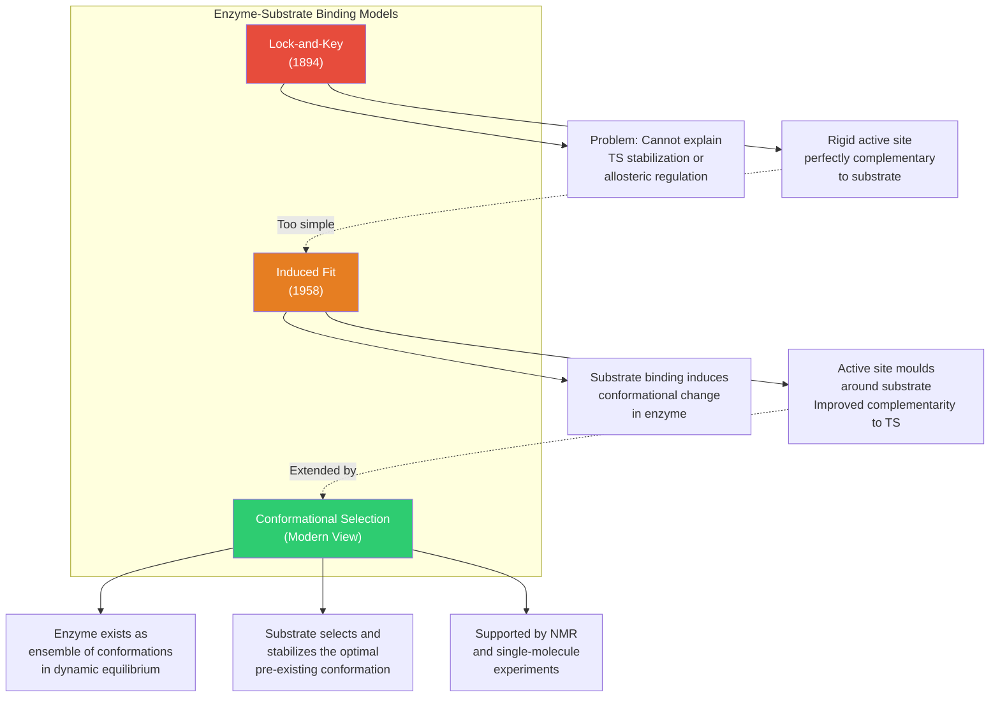
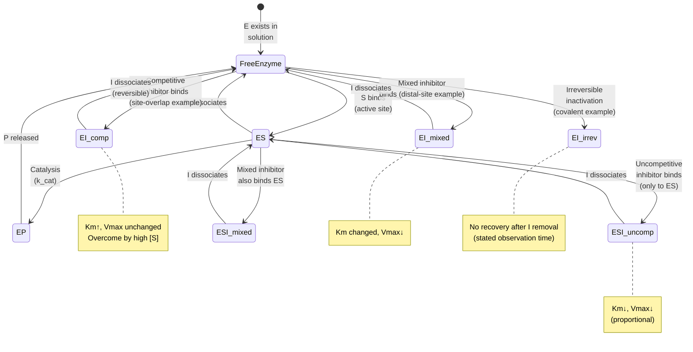
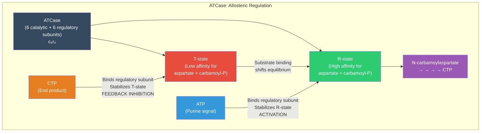

# Enzymes and the Kinetics of Catalysis

\label{sec:unit_I_enzymes_and_kinetics}


<!-- chapter-metadata-badge -->
> Level 3/3 · 60 min read · 75 min lecture · Prerequisites: \cref{sec:unit_I_macromolecules}

## Learning Objectives

1. Describe how [**enzyme**](#gl:enzyme)s lower activation energy without changing the [**thermodynamics**](#gl:thermodynamics) of a reaction.
2. Derive and interpret the Michaelis-Menten equation (\cref{eq:unit_I_enzymes_and_kinetics_item_7}) and its kinetic parameters using the steady-state assumption.
3. Explain competitive, uncompetitive, mixed, and irreversible inhibition with mathematical descriptions and clinical examples.
4. Describe [**allosteric**](#gl:allosteric) regulation and cooperativity using the Hill equation, with ATCase as a model system.
5. Explain how [**pH**](#gl:ph), temperature, and cofactors modulate enzyme activity.
6. Classify enzymes using the EC numbering system, including the seventh class (translocases).
7. Describe modern applications of enzymes in medicine and industry.

<!-- curriculum-scaffold-start -->
### Study Blueprint

- **Big idea:** Enzymes accelerate reactions by stabilizing transition states without changing thermodynamic endpoints.
- **Core concepts:** activation energy, Michaelis-Menten kinetics, inhibition, allostery.
- **Framework alignment:** Vision & Change: Structure and function, Pathways and transformations of energy and matter; AP Biology: Energetics, Systems Interactions; NGSS-style topics: Matter and Energy in Organisms and Ecosystems, Structure and Function.
- **Model or quantitative lens:** Michaelis-Menten, Lineweaver-Burk, and inhibition-pattern calculations.
- **Data skill:** Fit or interpret enzyme-rate data and identify which parameter changed.
- **Practice cadence:** Concept Explanation, Statistical Tests and Data Analysis, Argumentation.
- **Common misconception to repair:** A catalyst changes rate, not the equilibrium constant or the sign of delta G.
- **Primary lab:** \nameref{sec:lab_unit_I_enzymes_and_kinetics}.
- **Question bank:** \nameref{sec:q_unit_I_enzymes_and_kinetics}.
- **Transfer task:** Apply enzyme-kinetic reasoning to drug dosing, metabolic control, or diagnostic assays.
- **Bridge to computation:** `biology.biochemistry.biochemistry.michaelis_menten`.
<!-- curriculum-scaffold-end -->

---

> **Opening Vignette: The Enzyme That Beats Geological Time**
>
> Without the enzyme OMP decarboxylase, the spontaneous decarboxylation of orotidine
> 5′-monophosphate (OMP) would take approximately **78 million years** at body temperature —
> longer than the entire duration of dinosaur dominance of land vertebrates. OMP decarboxylase
> accomplishes the same reaction in 25 milliseconds. That is a rate enhancement of approximately
> $9.85\times10^{16}$-fold using these two times; this rate ratio is distinct from dimensionful catalytic proficiency (Radzicka & Wolfenden, 1995, *Science*).
>
> The mechanism is not conventional. OMP decarboxylase uses no metal ions, no cofactors, and
> performs general acid-base catalysis primarily through electrostatic destabilization of the
> substrate's ground state rather than direct stabilization of the transition state. Understanding
> how it achieves such a feat challenged enzymologists for decades and continues to inform the
> design of enzyme inhibitors as antifungal and antiprotozoal drugs. OMP decarboxylase is the
> essential enzyme in the pyrimidine biosynthesis pathway — block it, and pathogens cannot make
> the [**nucleotide**](#gl:nucleotide)s they need to replicate.
>
> *Primary source: Radzicka, A. & Wolfenden, R. (1995). A proficient enzyme. Science, 267(5194), 90–93.*

---


A **catalyst** accelerates a reaction without being consumed or changing its equilibrium. Most enzymes are proteins; some are catalytic RNA. The opening OMP example illustrates a rate ratio near 1e17 from its stated times, distinct from catalytic proficiency, which has concentration-dependent units.

The reaction free-energy change ($\Delta G$) determines thermodynamic favorability under specified conditions. Enzymes do not alter this difference between reactant and product states; they provide an alternative kinetic pathway with a lower activation free-energy barrier ($\Delta G^{\ddagger}$).

**Remarkable rate enhancements:**

: Illustrative enzyme-associated characteristic times and their arithmetic ratios. {#tbl:unit_I_enzymes_and_kinetics_study_blueprint}
| Enzyme | Uncatalyzed characteristic time | Catalyzed characteristic time | Illustrative time ratio (not necessarily a kinetic rate enhancement) |
| ------ | -------------------- | ------------------- | ---------------- |
| OMP decarboxylase | 78 million years | 25 ms | $9.85\times10^{16}$ |
| Staphylococcal nuclease | 130,000 years | ~1 ms | $4.10\times10^{15}$ |
| Alkaline phosphatase | 7 years | ~1 ms | $2.21\times10^{11}$ |
| Carbonic anhydrase | 5 seconds | ~1 μs | $5.0\times10^6$ |
| Chorismate mutase | 7.4 hours | ~1 ms | $2.66\times10^7$ |

These ratios divide the printed times (365.25 days/year). A half-life and a turnover time are different kinetic quantities: converting $t_{1/2}$ to a first-order rate uses $k=\ln2/t_{1/2}$, whereas a saturated enzyme turnover time is $1/k_{\mathrm{cat}}$. A mechanistic rate enhancement requires compatible rate definitions and conditions; the time ratios alone do not establish it.

OMP decarboxylase achieves the largest known rate enhancement: without this enzyme, the spontaneous decarboxylation of orotidine 5'-monophosphate would take 78 million years --- longer than the age of the dinosaurs.

### Transition State Theory

A reaction pathway can contain transition states, high-free-energy configurations along reaction coordinates. Activation free energy $\Delta G^{\ddagger}$ is distinct from Arrhenius activation energy $E_a$, which describes the temperature dependence of a rate constant. In transition-state theory:

\begin{equation}
k = \kappa\frac{k_{\mathrm B}T}{h}\,e^{-\Delta G^{\ddagger}/RT}
\label{eq:unit_I_enzymes_and_kinetics_item_1}
\end{equation}


Here $k_{\mathrm B}$ is Boltzmann's constant, $h$ is Planck's constant and $\kappa$ is a transmission coefficient. For a matched prefactor at about 298 K, lowering $\Delta G^{\ddagger}$ by 17 kJ/mol increases k by about $e^{6.86}\approx950$-fold; a 34 kJ/mol decrease gives roughly $9\times10^5$-fold. These are barrier-model predictions, not empirical rates for every enzyme.

**How enzymes lower $\Delta G^{\ddagger}$:**

1. **Proximity and orientation:** Substrates are brought together in optimal geometry at the active site, with the entropic cost already paid during binding. Effective concentration of reactants in the active site can exceed $10^8$ M.
2. **Transition state stabilization:** The enzyme active site binds the transition state *more tightly* than either substrate or product (complementarity to TS, not substrate). This is the single most important mechanism.
3. **General acid-base catalysis:** Amino acid side chains (His, Asp, Glu, Lys) donate/accept protons simultaneously with bond breaking/forming, stabilizing developing charges in the TS.
4. **Covalent catalysis:** Transient covalent enzyme-substrate intermediates (Ser proteases, Cys proteases, Lys in Schiff base enzymes). The covalent intermediate provides a lower-energy pathway.
5. **Metal ion catalysis:** Metal ions (Zn$^{2+}$, Mg$^{2+}$, Fe$^{2+/3+}$) stabilize negative charges, act as Lewis acids, or enable redox chemistry.
6. **Electrostatic catalysis:** The active site creates a microenvironment with a lower effective dielectric constant, enhancing electrostatic interactions.
7. **Desolvation:** Stripping water from substrate and active-site residues increases their reactivity (e.g., a "naked" carboxylate is a much stronger base than a hydrated one).

> **Concept Check 1:** Transition state analogs --- molecules that mimic the transition state geometry --- are potent enzyme inhibitors. Why are they typically much tighter binders than the substrate itself? (Hint: Consider what the active site is optimized to bind.)


<!-- alt: Graph showing enzyme–substrate binding models: lock-and-key (1894) emphasizes rigid complementarity, whereas induced fit (1958) includes conformational change upon binding. Conformational selection emphasizes binding to pre-existing conformations; induced fit and conformational selection can both contribute to a binding pathway. -->

*Enzyme–substrate binding models: lock-and-key (1894) emphasizes rigid complementarity, whereas induced fit (1958) includes conformational change upon binding \citep{fischer1894,koshland1958}. Conformational selection emphasizes binding to pre-existing conformations; induced fit and conformational selection can both contribute to a binding pathway.*

### Active Site Architecture

The **active site** comprises the enzyme's substrate-binding and catalytic features; its extent depends on the enzyme and the surface definition. Key features can include:

- **Specific geometry** complementary to the transition state (more so than to the substrate)
- **Hydrophobic microenvironment** that enhances nucleophilicity and acid/base strength
- **Flexibility:** conformational changes upon substrate binding (induced fit model)
- **Conserved residues:** catalytic residues are highly conserved across species, even when surrounding sequences diverge

The **lock-and-key model** \citep{fischer1894} viewed the active site as rigid. The **induced-fit model** \citep{koshland1958} recognized that substrate binding induces conformational changes that improve active-site complementarity --- validated by crystallographic structures. The modern **conformational selection model** proposes that the enzyme pre-exists in an ensemble of conformations, and the substrate selects the optimal one, shifting the equilibrium.

**Case study --- Hexokinase:** X-ray crystallography reveals that hexokinase undergoes a dramatic conformational change upon glucose binding: two lobes of the enzyme close around the substrate like a jaw, excluding water from the active site. This prevents the wasteful hydrolysis of ATP (which would occur if water could access the γ-phosphate).

---

## Enzyme Classification (EC Numbers)

The International Union of Biochemistry and Molecular Biology (IUBMB) classifies enzymes into **seven classes** by reaction type, each with a four-digit EC (Enzyme Commission) number:

: Active Site Architecture: EC Class and Name. {#tbl:unit_I_enzymes_and_kinetics_active_site_architecture}
| EC Class | Name | Reaction Type | Example | EC Number |
| -------- | ---- | ------------- | ------- | --------- |
| 1 | Oxidoreductases | Redox reactions | Lactate dehydrogenase | EC 1.1.1.27 |
| 2 | Transferases | Group transfer | Hexokinase (phosphoryl) | EC 2.7.1.1 |
| 3 | Hydrolases | Hydrolysis | Trypsin | EC 3.4.21.4 |
| 4 | Lyases | Non-hydrolytic bond cleavage / addition to double bonds | Fumarase | EC 4.2.1.2 |
| 5 | Isomerases | Isomerisation | Phosphoglucose isomerase | EC 5.3.1.9 |
| 6 | Ligases | Bond formation coupled to ATP/GTP hydrolysis | [**DNA ligase**](#gl:dna-ligase) | EC 6.5.1.1 |
| 7 | **Translocases** | Movement of ions/molecules across membranes | Na$^+$/K$^+$-ATPase | EC 7.2.2.6 |

The **seventh class (translocases)** was added in 2018, recognizing the catalytic nature of active transport. Enzyme names follow the pattern: **Substrate(s) + reaction type + "-ase"** (e.g., pyruvate kinase, lactate dehydrogenase).

> **Concept Check 2:** The Na$^+$/K$^+$-ATPase pumps 3 Na$^+$ out and 2 K$^+$ in per ATP hydrolysed. It was traditionally classified as an ATPase (EC 3.6). Why was reclassification to translocase (EC 7) considered more appropriate?

---

## The Michaelis-Menten Equation

> **Mathematical Background:** The Michaelis-Menten equation uses hyperbolic functions and dimensional analysis. For a review of logarithms and rate equations, see \nameref{sec:appendix_math_review}.

### Deriving the Michaelis-Menten Equation

In 1913, Leonor Michaelis and Maud Menten proposed a kinetic framework for enzyme-catalysed reactions. The basic mechanism:

\begin{equation}
\text{E} + \text{S} \underset{k_{-1}}{\overset{k_1}{\rightleftharpoons}} \text{ES} \overset{k_2}{\rightarrow} \text{E} + \text{P}
\label{eq:unit_I_enzymes_and_kinetics_item_2}
\end{equation}


**Step 1: Write rate equations.**

The rate of ES formation: $\frac{d[\text{ES}]}{dt} = k_1[\text{E}][\text{S}] - k_{-1}[\text{ES}] - k_2[\text{ES}]$

**Step 2: Apply the steady-state assumption** ($d[\text{ES}]/dt = 0$).

This assumes that after an initial transient, $[\mathrm{ES}]$ reaches a constant level because the rate of ES formation equals the rate of ES breakdown:

\begin{equation}
k_1[\text{E}][\text{S}] = (k_{-1} + k_2)[\text{ES}]
\label{eq:unit_I_enzymes_and_kinetics_item_3}
\end{equation}


**Step 3: Define the Michaelis constant.**

\begin{equation}
K_m = \frac{k_{-1} + k_2}{k_1}
\label{eq:unit_I_enzymes_and_kinetics_item_4}
\end{equation}


**Step 4: Express $[\mathrm{E}]$ in terms of measurable quantities.**

Total enzyme: $[\text{E}]_T = [\text{E}] + [\text{ES}]$, so $[\text{E}] = [\text{E}]_T - [\text{ES}]$

Substituting: $([\text{E}]_T - [\text{ES}])[\text{S}] = K_m[\text{ES}]$

\begin{equation}
[\text{ES}] = \frac{[\text{E}]_T[\text{S}]}{K_m + [\text{S}]}
\label{eq:unit_I_enzymes_and_kinetics_item_5}
\end{equation}


**Step 5: Calculate the initial velocity.**

\begin{equation}
v_0 = k_2[\text{ES}] = \frac{k_2[\text{E}]_T[\text{S}]}{K_m + [\text{S}]}
\label{eq:unit_I_enzymes_and_kinetics_item_6}
\end{equation}


Since $V_{max} = k_2[\text{E}]_T$ (maximum rate when most enzyme is saturated):

\begin{equation}
\boxed{v_0 = \frac{V_{max}[\text{S}]}{K_m + [\text{S}]}}
\label{eq:unit_I_enzymes_and_kinetics_item_7}
\end{equation}


This is the **Michaelis-Menten equation** --- a rectangular hyperbola (\cref{eq:unit_I_enzymes_and_kinetics_item_7}); plotting $v_0$ against $[\text{S}]$ traces the saturating curve shown in \cref{fig:unit_I_michaelis_menten}, where the velocity rises steeply at low substrate and asymptotically approaches $V_{max}$.

### Interpretation of Kinetic Parameters

**Km** is the substrate concentration giving half-maximal initial velocity in the Michaelis–Menten model. A lower Km gives half-response at lower substrate concentration, but does not in general establish tighter equilibrium binding: Km=(kminus1+kcat)/k1, whereas Kd=kminus1/k1.

Special cases:
- When $k_2 \ll k_{-1}$: $K_m \approx K_d = k_{-1}/k_1$ (true dissociation constant)
- When $k_2 \gg k_{-1}$: $K_m \approx k_2/k_1$ (the enzyme is so fast that ES rarely dissociates back to E + S)

**$V_{max}$ and $k_{cat}$:** In a concentration-rate convention, $V_{max}=k_{cat}[\text{E}]_T$ with matched concentration and time units. For an amount-per-time assay, use active-enzyme amount instead of concentration and convert seconds/minutes consistently. Specify whether turnover refers to catalytic centers or whole multimeric molecules; mass alone is not active-site concentration. The catalytic constant describes limiting turnover per declared catalytic unit under the assay conditions \citep{iubmb1981kinetics}.

**Specificity constant:** $k_{cat}/K_m$ (M$^{-1}$ s$^{-1}$) gives the low-substrate slope of rate per declared catalytic unit in the Michaelis–Menten model. At high substrate, the limiting turnover is $k_{cat}$ instead. Neither quantity alone ranks overall enzyme performance, cellular flux or organismal fitness; substrate identity, concentration and assay conditions matter \citep{iubmb1981kinetics}.

**Kinetic measurements require context:** Compare substrate identity, active-enzyme amount and assay conditions before interpreting parameters. Measurements from different protocols are not a matched experimental ranking; the table identifies information needed for a defensible comparison.

: Assay contexts for interpreting kinetic parameters. {#tbl:unit_I_enzymes_and_kinetics_interpretation_of_kinetic_parameters}
| Enzyme/substrate example | Context required for a meaningful measurement |
| ------------------------ | -------------------------------------------- |
| Carbonic anhydrase / CO$_2$ | Isoform, pH, temperature, buffer and hydration versus dehydration direction |
| Fumarase / fumarate | Reaction direction, substrate range and concentration of active enzyme |
| Acetylcholinesterase / acetylcholine | Organism/construct, readout and substrate-inhibition regime |
| Catalase / H$_2$O$_2$ | Defined active heme or whole-enzyme amount, peroxide range and inactivation during the assay |
| Lactate dehydrogenase / pyruvate | Isoenzyme, fixed NADH conditions and reaction direction |
| Hexokinase / glucose | Isoform, ATP/Mg conditions and product inhibition |
| Alcohol dehydrogenase / ethanol | Isoenzyme, NAD conditions and reaction direction |
| Lysozyme / carbohydrate | Exact substrate structure, readout, pH and active-enzyme amount |

> **Concept Check 3:** Two preparations have the same total protein mass but different active-enzyme fractions. What measurements are needed before comparing their $k_{cat}$ or $k_{cat}/K_m$? Explain why a large turnover number alone does not establish a cell's physiological demand for that activity.

**Worked comparison — stipulated enzymes, not measured reference constants:** Let A have $k_{cat}=1$ s$^{-1}$ and $K_m=1$ µM, and B have $k_{cat}=10$ s$^{-1}$ and $K_m=100$ µM. Their specificity constants are $10^6$ and $10^5$ M$^{-1}$ s$^{-1}$. At free substrate 0.001 µM, the model predicts turnover per catalytic unit of approximately 0.000999 s$^{-1}$ for A and 0.000100 s$^{-1}$ for B. At 10,000 µM, the predictions are approximately 0.9999 and 9.901 s$^{-1}$: the ranking reverses. Low-substrate specificity is not a universal performance ranking.

### Lineweaver-Burk Analysis


\begin{figure}[htbp]
\centering
\includegraphics[width=0.85\textwidth]{../figures/michaelis_menten.png}
\caption{Michaelis--Menten kinetics: initial velocity ($v_0$) versus substrate concentration with an uninhibited curve, a competitive-inhibitor curve, and the $V_{\max}$, $V_{\max}/2$, and $K_m$ reference lines annotated.}
\label{fig:unit_I_michaelis_menten}
\end{figure}
<!-- alt: Rectangular-hyperbola plot of enzyme initial velocity against substrate concentration. The uninhibited curve rises toward Vmax, while the competitive-inhibitor curve is shifted right with the same Vmax; reference lines mark Vmax, Vmax/2, and Km. -->


Inverting the Michaelis-Menten equation:

\begin{equation}
\frac{1}{v_0} = \frac{K_m}{V_{max}} \cdot \frac{1}{[\text{S}]} + \frac{1}{V_{max}}
\label{eq:unit_I_enzymes_and_kinetics_item_8}
\end{equation}


The **double-reciprocal (Lineweaver-Burk) plot** of $1/v$ vs. $1/[\text{S}]$ is linear:
- Slope = $K_m/V_{max}$
- $x$-intercept = $-1/K_m$
- $y$-intercept = $1/V_{max}$

**Worked example --- Determining $K_m$ and $V_{max}$:**

The following synthetic initial-rate teaching packet uses five substrate concentrations; it is not a newly measured enzyme assay:

: Synthetic Lineweaver–Burk teaching data: substrate concentration (mM), initial rate (μmol/min), and their reciprocals. {#tbl:unit_I_enzymes_and_kinetics_lineweaver_burk_analysis}
| $[\mathrm{S}]$ (mM) | $v_0$ (μmol/min) | 1/$[\mathrm{S}]$ (mM$^{-1}$) | $1/v_0$ |
| --------- | -------------------- | ------------------ | ------- |
| 0.5 | 1.67 | 2.0 | 0.60 |
| 1.0 | 2.50 | 1.0 | 0.40 |
| 2.0 | 3.33 | 0.5 | 0.30 |
| 4.0 | 4.00 | 0.25 | 0.25 |
| 10.0 | 4.55 | 0.10 | 0.22 |

From the Lineweaver-Burk plot:
- $y$-intercept = 0.20, so $V_{max} = 1/0.20 = 5.0$ μmol/min
- Slope = $(0.60 - 0.20)/(2.0 - 0) = 0.20$, and slope $= K_m/V_{max}$, so $K_m = 0.20 \times 5.0 = 1.0$ mM

**Limitations of the Lineweaver-Burk plot:** It distorts experimental error at low $[\mathrm{S}]$ (high 1/$[\mathrm{S}]$), giving those points excessive weight. Modern software uses nonlinear regression to fit the Michaelis-Menten equation directly, which is statistically superior.

---

## Enzyme Inhibition and Kinetic Signatures


<!-- alt: State diagram illustrating simple inhibitor-binding schemes and kinetic patterns. Site overlap, distal-site binding and covalent inactivation are example mechanisms, not class definitions. Irreversibility means no recovery after inhibitor removal over the stated observation time. -->

*State diagram illustrating simple inhibitor-binding schemes and kinetic patterns. Site overlap, distal-site binding and covalent inactivation are example mechanisms, not class definitions. Irreversibility means no recovery after inhibitor removal over the stated observation time.*

### Competitive Inhibition and Apparent Km

In the simple competitive binding scheme, inhibitor and substrate occupancy are mutually exclusive. Substrate resemblance and binding at the same physical site are possible mechanisms, but the kinetic pattern alone does not establish either:

\begin{equation}
E + I \rightleftharpoons EI \quad (K_i = [\text{E}][\text{I}]/[\text{EI}])
\label{eq:unit_I_enzymes_and_kinetics_item_9}
\end{equation}


The apparent Km increases (more substrate is needed for the same fractional rate), while Vmax is unchanged in the competitive model. This need not change the intrinsic dissociation constant of substrate binding to free enzyme:

\begin{equation}
v_0 = \frac{V_{max}[\text{S}]}{K_m\left(1 + \frac{[\text{I}]}{K_i}\right) + [\text{S}]}
\label{eq:unit_I_enzymes_and_kinetics_item_10}
\end{equation}


Defining $\alpha = 1 + [\text{I}]/K_i$:

\begin{equation}
v_0 = \frac{V_{max}[\text{S}]}{\alpha K_m + [\text{S}]}
\label{eq:unit_I_enzymes_and_kinetics_item_11}
\end{equation}


On a Lineweaver-Burk plot: same $y$-intercept ($1/V_{max}$), different slopes. Lines intersect on the $y$-axis.

**Clinical examples of [**competitive inhibition**](#gl:competitive-inhibition):**

: Competitive Inhibition and Apparent Km: Inhibitor and Target Enzyme. {#tbl:unit_I_enzymes_and_kinetics_competitive_inhibition_and_apparent_km}
| Inhibitor | Target Enzyme | Clinical Use |
| --------- | ------------- | ------------ |
| Methotrexate | Dihydrofolate reductase | Cancer chemotherapy |
| Statins (atorvastatin) | HMG-CoA reductase | Cholesterol-lowering |
| Sulfonamide antibiotics | Dihydropteroate synthase | Bacterial infection |
| Allopurinol | Xanthine oxidase | Gout |
| Ethanol | Alcohol dehydrogenase | Methanol/ethylene glycol poisoning |

> **Clinical Connection: Statins and Cardiovascular Disease**
>
> Statins (e.g., atorvastatin, rosuvastatin) are competitive inhibitors of HMG-CoA reductase, the rate-limiting enzyme in cholesterol biosynthesis. By mimicking the structure of HMG-CoA, statins bind the active site with $K_i$ values in the low nanomolar range (much lower than the $K_m$ for HMG-CoA, ~4 μM). This reduces hepatic cholesterol synthesis, upregulates LDL receptors, and lowers circulating LDL cholesterol by 30--50%. Statins are among the most widely prescribed drugs worldwide, with robust evidence for reducing cardiovascular events and mortality.

### Uncompetitive Inhibition and Coupled Km/Vmax Shifts

In the simple **uncompetitive inhibition** scheme, inhibitor binds only to the ES complex, not free enzyme; the kinetic class is defined by the proportional decreases in apparent $K_m$ and $V_{max}$:

\begin{equation}
v_0 = \frac{V_{max}[\text{S}]}{K_m + \alpha'[\text{S}]}
\label{eq:unit_I_enzymes_and_kinetics_item_12}
\end{equation}


where $\alpha' = 1 + [\text{I}]/K_i'$. Both apparent $K_m$ and $V_{max}$ are decreased proportionally --- the ratio $V_{max}/K_m$ is unchanged. On a Lineweaver-Burk plot: **parallel lines**: slope $K_m/V_{max}$ is unchanged, the y-intercept increases and the x-intercept becomes more negative.

Uncompetitive inhibition is rare in single-substrate reactions but important in two-substrate reactions and in multi-enzyme pathways. **Lithium** is an uncompetitive inhibitor of inositol monophosphatase, which may contribute to its therapeutic effect in bipolar disorder.

### Mixed (Noncompetitive) Inhibition

In the simple **mixed inhibition** scheme, inhibitor binds both free enzyme (E) and the ES complex. Binding at a site separate from the substrate site is one possible mechanism, not a location established by the kinetic pattern \citep{iubmb1981kinetics}:

\begin{equation}
v_0 = \frac{V_{max}[\text{S}]}{\alpha K_m + \alpha'[\text{S}]}
\label{eq:unit_I_enzymes_and_kinetics_item_13}
\end{equation}


where $\alpha = 1 + [\text{I}]/K_i$ and $\alpha' = 1 + [\text{I}]/K_i'$.

- If $\alpha = \alpha'$ ($K_i = K_i'$): **pure noncompetitive** inhibition. $K_m$ unchanged, $V_{max}$ decreased.
- If $\alpha \neq \alpha'$: **mixed** inhibition. Both $K_m$ and $V_{max}$ change.

On a Lineweaver-Burk plot: lines intersect to the left of the $y$-axis (not on it).

**Mechanism is not kinetic classification:** Heavy metal ions (Hg$^{2+}$, Pb$^{2+}$) can inhibit enzymes through interactions with cysteine residues. Neither metal identity nor a binding site distant from the active site establishes pure noncompetitive inhibition; that assignment requires the corresponding kinetic pattern under the stated assay conditions.

### Irreversible Inhibition and Covalent Inactivation

**Irreversible inhibition** means that activity does not recover after free inhibitor is removed (e.g., by dilution or dialysis) over the stated observation period and conditions. Covalent modification is one mechanism, not the definition; very slow dissociation can mimic irreversibility. The classification does not imply an eternally permanent bond or that recovery always requires new protein synthesis \citep{iubmb1981kinetics}.

: Irreversible Inhibition and Covalent Inactivation: Inhibitor and Target. {#tbl:unit_I_enzymes_and_kinetics_irreversible_inhibition_and_covalent_inactivation}
| Inhibitor | Target | Mechanism | Clinical Application |
| --------- | ------ | --------- | -------------------- |
| Aspirin (acetylsalicylate) | COX-1 and COX-2 | Acetylates Ser530 | Anti-inflammatory, antiplatelet |
| Penicillin / amoxicillin | Transpeptidase (DD-peptidase) | Acylates active-site Ser; persistence depends on deacylation | Antibiotic |
| DIPF / sarin | Acetylcholinesterase | Phosphorylates active-site Ser | Nerve agent (sarin) |
| Omeprazole (Prilosec) | H$^+$/K$^+$-ATPase | Disulfide bond with Cys813 | Proton pump inhibitor (acid reflux) |
| Clopidogrel (Plavix) | P2Y12 receptor | Disulfide bond | Antiplatelet |

> **Clinical Connection: Aspirin --- The Oldest Irreversible Enzyme Inhibitor**
>
> Aspirin (acetylsalicylic acid) irreversibly acetylates Ser530 in cyclooxygenase (COX), preventing the conversion of arachidonic acid to prostaglandins and thromboxane A$_2$. Platelets lack a nucleus but retain RNA and can translate some proteins. Irreversible COX-1 inhibition nevertheless persists in exposed platelets, with recovery of aggregate thromboxane production largely depending on turnover. This is why low-dose aspirin (75--100 mg/day) is an effective antiplatelet agent for preventing heart attacks and strokes, despite its short plasma half-life of ~20 minutes.

> **Clinical Connection: Penicillin and Bacterial Cell Wall Synthesis**
>
> Penicillin and related β-lactam antibiotics inhibit bacterial transpeptidases (penicillin-binding proteins, PBPs) that cross-link peptidoglycan strands in the cell wall. They acylate the catalytic serine, forming an acyl-enzyme intermediate whose persistence depends on the PBP, antibiotic and deacylation rate. Inhibition is operationally irreversible when activity fails to recover after free drug removal over the stated observation period, not because every adduct lasts forever. Impaired cross-linking weakens the cell wall and can lead to osmotic lysis. Resistance can arise through β-lactamases that hydrolyse the antibiotic's β-lactam ring.

### Lineweaver-Burk Patterns Summary

: Lineweaver-Burk Patterns Summary: Inhibition Type and Apparent K_m. {#tbl:unit_I_enzymes_and_kinetics_lineweaver_burk_patterns_summary}
| Inhibition Type | Apparent $K_m$ | Apparent $V_{max}$ | L-B Plot Pattern |
| --------------- | ------------- | ------------------ | ---------------- |
| Competitive | Increases ($\alpha K_m$) | Unchanged | Same $y$-intercept |
| Uncompetitive | Decreases ($K_m/\alpha'$) | Decreases ($V_{max}/\alpha'$) | Parallel lines |
| Pure noncompetitive | Unchanged | Decreases ($V_{max}/\alpha$) | Same $x$-intercept |
| Mixed | Changes | Decreases | Intersect left of $y$-axis |
| Irreversible (simple loss of active enzyme) | Unchanged for remaining active enzyme | Decreases (less active enzyme) | Same $K_m$, lower $V_{max}$ in this model; not diagnostic of irreversibility |

> **Concept Check 4:** An enzyme is studied in the presence and absence of an inhibitor. In the Lineweaver-Burk plot, the two lines are parallel. What type of inhibition is this? Does the inhibitor bind the free enzyme, the ES complex, or both?

---

> **Worked Example --- Competitive vs. Allosteric Inhibition Comparison:** Dihydrofolate reductase (DHFR) is the target of methotrexate (MTX, competitive inhibitor, $K_i = 1$ nM) and trimethoprim (TMP, competitive inhibitor, $K_i = 1$ $\mu$M for bacterial DHFR vs $100$ $\mu$M for human DHFR --- a 100-fold selectivity window). Given $K_m(\text{DHFR}, \text{dihydrofolate}) = 1$ $\mu$M, $V_\text{max} = 10$ nM/s, [substrate] = 5 $\mu$M, and [MTX] = 10 nM. *Without MTX:* $v = 10 \times 5/(1+5) = 8.33$ nM/s. *With MTX:* apparent $K_m' = K_m(1 + [I]/K_i) = 1(1 + 10/1) = 11$ $\mu$M, so $v = 10 \times 5/(11+5) = 3.13$ nM/s --- a 62% reduction at $[\text{MTX}]$ at just 10$\times$ its $K_i$, because the drug competes at nM while substrate is at $\mu$M. This illustrates why tight-binding competitive inhibitors can be more clinically effective than their raw $K_i$ value suggests, especially when substrate concentration is comparable to $K_m$.

> **Concept Check (Synthesis):** Allosteric enzymes like phosphofructokinase-1 (PFK-1) show sigmoidal kinetics with respect to fructose-6-phosphate (F6P). ATP at high concentrations inhibits PFK-1 allosterically (R-state stabilization by ADP/AMP; T-state stabilization by ATP). (a) Sketch the velocity vs $[\text{F6P}]$ curves for PFK-1 in the presence of 2 mM ATP, 0.2 mM ATP, and 2 mM AMP. (b) Why does sigmoidal kinetics make PFK-1 a better metabolic switch than a hyperbolic enzyme with the same $V_\text{max}$ and apparent $K_{0.5}$? Quantify using the Hill equation: compare the fold-change in activity when $[\text{F6P}]$ goes from $0.5 K_{0.5}$ to $2 K_{0.5}$ for $n=1$ vs $n=4$. (c) PFK-2 produces fructose-2,6-bisphosphate (F2,6BP), a potent allosteric activator of PFK-1. Draw the control logic connecting insulin signaling, PFK-2 activity, F2,6BP levels, and glycolytic flux.

## Multi-substrate Kinetics: Bi-Bi Mechanisms

The single-substrate Michaelis-Menten framework is a useful approximation, but most enzymes use *two* substrates (or one substrate plus a cofactor). Reactions of the form

$$\text{A} + \text{B} \rightleftharpoons \text{P} + \text{Q} \label{eq:unit_I_enzymes_and_kinetics_item_14}$$


are known as **Bi-Bi reactions**. Cleland (1963) classified them into three principal mechanisms based on the order in which substrates bind and products release.

### Sequential (Ternary Complex) Mechanisms

Both substrates must be bound to the enzyme *simultaneously* before any product is released. The enzyme thus passes through a ternary EAB complex.

- **Ordered Bi-Bi:** A binds before B; Q releases before P. Example: NAD$^+$-dependent dehydrogenases such as lactate dehydrogenase, where NAD$^+$ binds first and NADH leaves last.
- **Random Bi-Bi:** A and B can bind in either order; products can leave in either order. Example: creatine kinase.

A representative initial-rate form for a selected sequential Bi-Bi scheme is shown below. Both substrates remain finite variables here; saturation of B is a subsequent limiting case, not an assumption already imposed on this two-variable expression:

\begin{equation}
v_0 = \frac{V_{\max}\,[\text{A}]\,[\text{B}]}{K_{ia}K_b + K_b[\text{A}] + K_a[\text{B}] + [\text{A}][\text{B}]}
\label{eq:unit_I_bibi_sequential}
\end{equation}

Here $K_a$, $K_b$ and $K_{ia}$ are positive concentration parameters whose mechanistic interpretation depends on the scheme and assumptions; a fit alone does not generally establish microscopic dissociation constants. Within this form, reciprocal rate against $1/[\text{A}]$ at fixed $[\mathrm{B}]$ gives intersecting lines. Compare the specified alternative rate model before treating that pattern as evidence for a mechanism.

### Ping-Pong (Double-Displacement) Mechanism

In a simple **ping-pong cycle**, A reacts with the catalyst and product P is released before B completes the reaction and regenerates the initial catalytic form. The intervening form E* may involve a changed cofactor or a covalent intermediate, depending on the actual chemistry; the kinetic class alone does not prove a covalent protein adduct. The selected productive cycle lacks a ternary complex containing both reactant substrates, but that does not exclude every off-pathway binding complex \citep{iubmb1981kinetics}.

The rate equation:

\begin{equation}
v_0 = \frac{V_{\max}\,[\text{A}]\,[\text{B}]}{K_b[\text{A}] + K_a[\text{B}] + [\text{A}][\text{B}]}
\label{eq:unit_I_bibi_pingpong}
\end{equation}

The displayed ping-pong rate form lacks the $K_{ia}K_b$ denominator term and predicts parallel reciprocal-rate lines. That distinguishes these two selected rate forms under their assumptions; product inhibition, transient kinetics and chemical evidence are needed to discriminate real mechanisms.

: Ping-Pong (Double-Displacement) Mechanism: Feature and Sequential (Random or Ordered). {#tbl:unit_I_enzymes_and_kinetics_ping_pong_double_displacement_mechanism}
| Feature | Sequential (Random or Ordered) | Ping-Pong |
| ------- | ------------------------------ | --------- |
| Productive complex with both reactant substrates? | Present in the selected sequential scheme | Absent from the selected ping-pong cycle |
| Alternate free catalytic form between half-reactions? | Not required by this class description | Present; its chemistry requires independent evidence |
| Reciprocal-rate pattern in the displayed models | Intersecting lines | Parallel lines |
| Additional discriminating evidence | Binding, product inhibition and transient kinetics | The same, plus identification of the altered catalytic form |

> **Concept Check 5:** A hypothetical initial-rate dataset at varying $[\mathrm{A}]$ and several fixed $[\mathrm{B}]$ values gives parallel reciprocal-rate lines. Which displayed model is consistent with that result? Propose a changed catalytic intermediate and an experiment that could test its identity; explain why the lines alone do not establish covalent chemistry.

---

## Allosteric Regulation and Cooperativity

An **allosteric effector** acts through a site different from the active site. Allosteric regulation and cooperative kinetics are distinct properties: they can occur together, but neither implies the other. Some regulated enzymes have sigmoidal responses; others can have hyperbolic substrate curves. Oligomeric structure, an effector site or a steep response alone does not establish the microscopic mechanism \citep{iubmb1981kinetics}.

### The Hill Equation

A **Hill-form approximation** can describe a selected binding or kinetic response. Let $y$ denote the measured normalized response, with a fitted or stipulated exponent $n$, not a count of equivalent subunits:

\begin{equation}
y = \frac{[\text{S}]^n}{K_{0.5}^n + [\text{S}]^n}
\label{eq:unit_I_enzymes_and_kinetics_item_15}
\end{equation}


Here $K_{0.5}$ gives half of the chosen response. For binding data, $y$ may represent fractional occupancy; for initial-rate data, $y=v_0/V_{max}$. Those observables need not coincide. In this constant-exponent approximation:
- $n=1$ gives a hyperbola; that shape alone does not identify a one-site mechanism.
- $n>1$ gives a steeper Hill response, termed positive kinetic cooperativity for rate data.
- $n<1$ gives a shallower response. A fitted slope alone does not establish particular microscopic affinity changes or catalytic-center count; real Hill-plot slopes can vary with concentration \citep{iubmb1981kinetics}.

**Linearized Hill-form approximation:**

\begin{equation}
\log\frac{y}{1-y} = n\log[\text{S}] - n\log K_{0.5}
\label{eq:unit_I_enzymes_and_kinetics_item_16}
\end{equation}


For the stated constant-exponent model, a plot of $\log[y/(1-y)]$ against log concentration on a fixed reference scale is straight, with slope $n$ and half-response intercept at $\log K_{0.5}$. This is a model relation, not a guarantee that experimental binding or rate data form one straight line.

Hemoglobin binding can be approximated over a specified range with a Hill coefficient near 2.8 (see \cref{sec:unit_IX_circulation_respiration_homeostasis}); the fitted slope is not the four-site count. Steep kinetic responses can support switch-like sensitivity near their half-response, without by themselves establishing allostery, multiple stable states or cellular optimality.

**Worked example — stipulated kinetic fit:** Assume $y=v_0/V_{max}$ follows the Hill form with $K_{0.5}=5$ mM and $n=3$; these are teaching parameters, not measured subunit stoichiometry:

At $[\mathrm{S}]$ = 4 mM: $y = \frac{4^3}{5^3 + 4^3} = \frac{64}{125 + 64} = \frac{64}{189} = 0.339$ (33.9% of the stipulated limiting rate).

At $[\mathrm{S}]$ = 6 mM: $y = \frac{6^3}{5^3 + 6^3} = \frac{216}{125 + 216} = \frac{216}{341} = 0.634$ (63.4% of the stipulated limiting rate).

A 50% substrate increase nearly doubles normalized rate in this selected model and interval. It is not a measurement of binding occupancy or a general response of every allosteric enzyme.

### Concerted (MWC) and Sequential Models

Two models describe the molecular mechanism of cooperativity:

**Monod-Wyman-Changeux (MWC) Concerted Model:**
- Most subunits exist in either the T-state (tense, low affinity) or R-state (relaxed, high affinity)
- Most subunits transition simultaneously (concerted)
- Substrate preferentially binds R-state, shifting T$\rightleftharpoons$R equilibrium toward R
- Activators stabilize R; inhibitors stabilize T

**Koshland-Nemethy-Filmer (KNF) Sequential Model:**
- Each subunit can independently switch between T and R
- Substrate binding to one subunit induces conformational changes that propagate to adjacent subunits
- Explains negative cooperativity (which MWC cannot)

In reality, most allosteric systems show features of both models.

### Aspartate Transcarbamoylase (ATCase) --- A Model Allosteric Enzyme


<!-- alt: Flowchart showing aTCase allostery (CTP and ATP). Allosteric regulation of ATCase. CTP (the end product of the pyrimidine pathway) is a feedback inhibitor that stabilizes the T-state. ATP (a purine nucleotide) is an activator that stabilizes the R-state, coordinating purine and pyrimidine synthesis. -->

*ATCase allostery (CTP and ATP). Allosteric regulation of ATCase. CTP (the end product of the pyrimidine pathway) is a feedback inhibitor that stabilizes the T-state. ATP (a purine nucleotide) is an activator that stabilizes the R-state, coordinating purine and pyrimidine synthesis.*

ATCase (catalyses the first committed step of pyrimidine biosynthesis) is the textbook allosteric enzyme:
- **Structure:** 6 catalytic subunits (c$_3$)$_2$ + 6 regulatory subunits (r$_2$)$_3$ = c$_6$r$_6$ (~310 kDa)
- **Inhibited** by CTP (end-product of the pathway --- **feedback inhibition**)
- **Activated** by ATP (signals adequate purine availability -> coordinate pyrimidine synthesis)
- Hill coefficient $n \approx 2.5$ for N-carbamoylaspartate synthesis
- T->R transition involves a 12-angstrom expansion and 10-degree rotation of catalytic trimers

This allows the cell to precisely match nucleotide biosynthesis to demand. When CTP is abundant, ATCase is inhibited; when ATP is abundant (indicating nucleotide precursors are available), ATCase is activated.

### Why Cooperativity Improves Pathway Control

A first-glance question: why has evolution invested in elaborate allosteric machinery when simple Michaelis-Menten enzymes could in principle perform every metabolic task? The answer lies in the *control properties* of cooperative enzymes.

Compare a hyperbolic enzyme (Hill coefficient $n=1$) and cooperative enzymes over the specified **fourfold** substrate interval $0.5K_{0.5}\to2K_{0.5}$. The occupancy ratio over this interval is $2^n$:

: Effect of cooperativity on enzyme saturation near half-maximal substrate concentration. {#tbl:unit_I_enzymes_and_kinetics_why_cooperativity_improves_pathway_control}
| Enzyme | θ at $[S] = 0.5\,K_{0.5}$ | θ at $[S] = 2\,K_{0.5}$ | Sensitivity (ratio) |
| ------ | --------------------------------- | ------------------------------- | -------------------- |
| Michaelis-Menten ($n=1$) | 0.33 | 0.67 | 2.0$\times$ |
| Cooperative ($n=2$) | 0.20 | 0.80 | 4.0$\times$ |
| Cooperative ($n=4$) | 0.059 | 0.941 | 16$\times$ |
| Cooperative ($n=8$) | 0.0039 | 0.9961 | 256$\times$ |

An 8-fold increase in Hill coefficient (from n=1 to n=8) gives a 128-fold increase in switching sensitivity around $K_{0.5}$ — each doubling of n roughly squares the sensitivity ratio. This **ultrasensitivity** confers three regulatory advantages:

1. **Steeper response to small signal changes.** Glycolysis can be ramped up rapidly during exercise without requiring 10-fold changes in metabolite concentrations.
2. **A continuous response can be steep.** A sufficiently steep stipulated rate-response approaches its low and high limits sufficiently far below and above $K_{0.5}$; the interval depends on the exponent. Near $K_{0.5}$ it remains near half-response. The occupancy table alone does not establish pathway off/on states or flux.
3. **Noise depends on operating point.** A sufficiently low-input Hill regime can attenuate some concentration fluctuations, whereas a steep region can amplify them. Effects depend on baseline, fluctuation size and dynamics; a sigmoid alone does not guarantee noise insulation or stable biological switching.

Hemoglobin illustrates cooperative oxygen binding over a specified arterial-to-venous pressure interval. A quantitative unloading comparison with a hyperbolic carrier additionally requires that carrier's affinity; cooperativity alone does not imply a fixed 25% versus 10% difference. H+/CO2-dependent Bohr effects and the separate allosteric action of 2,3-BPG can further tune delivery.

> **Concept Check 6:** Phosphofructokinase-1 (PFK-1) is an allosteric enzyme in [**glycolysis**](#gl:glycolysis) that is activated by AMP and inhibited by ATP and citrate. Why does this regulatory pattern make metabolic sense? (Consider the energy charge of the cell.)

---

## Environmental Factors Affecting Enzyme Activity

### Temperature Effects on Enzyme Rate and Stability

Enzyme activity generally increases with temperature ($\uparrow$ kinetic energy -> $\uparrow$ collision frequency -> $\uparrow$ rate) according to the Arrhenius equation:

\begin{equation}
k = A \cdot e^{-E_a/RT}
\label{eq:unit_I_enzymes_and_kinetics_item_17}
\end{equation}


Q10≈2 illustrates an approximate doubling over a limited 10°C interval, not a universal law. Measured activity also depends on reversible conformational changes and time-dependent inactivation, so the apparent optimum depends on assay duration and conditions and need not equal the organism's usual temperature or the protein's unfolding midpoint.

**$Q_{10}$ calculation:**

\begin{equation}
Q_{10} = \left(\frac{k_2}{k_1}\right)^{10/(T_2 - T_1)}
\label{eq:unit_I_enzymes_and_kinetics_item_18}
\end{equation}


Q10 must be reported for a specified temperature interval and assay. Extrapolation can fail when the active enzyme fraction, substrate state or rate-limiting step changes.

**Extremophile enzymes (extremozymes):**
- *Thermus aquaticus* Taq polymerase is a thermostable enzyme used in PCR; a melting temperature and an activity optimum are different measurements.
- *Pyrococcus furiosus* Pfu polymerase provides a thermostable proofreading-polymerase example; fidelity and stability comparisons require specified assay conditions.
- Candidate stability mechanisms include ion-pair networks, core packing and loop constraints. Cold-adapted activity can involve altered flexibility, but no fixed Gly/Pro composition or universal inactivation at 37°C follows from psychrophily.

### pH Effects on Active-Site Chemistry

Activity–pH profiles can reflect catalytic-group ionization, substrate binding/ionization and structural stability. Bell-shaped profiles occur, but are not universal, and a profile alone cannot assign the responsible microscopic pKa or prove unfolding. Compare activity with independent structural and recovery measurements under matched conditions.

: pH Effects on Active-Site Chemistry: Enzyme and Location. {#tbl:unit_I_enzymes_and_kinetics_ph_effects_on_active_site_chemistry}
| Enzyme | Location | Optimum pH | Key Catalytic Residue |
| ------ | -------- | ---------- | -------------------- |
| Pepsin | Stomach | 1.5--2.5 | Asp (must be protonated) |
| Salivary amylase | Mouth | 6.7--7.0 | Glu (acid/base catalyst) |
| Trypsin | Intestine | 7.5--8.5 | His57 (must be deprotonated) |
| Alkaline phosphatase | Intestine/bone | 8--10 | Ser (phosphorylated intermediate) |
| Arginase | Liver | 9.5--10.0 | Mn$^{2+}$ (binuclear metal center) |

The bell-shaped curve reflects the requirement for specific protonation states: the ascending limb corresponds to deprotonation of one essential residue; the descending limb to deprotonation of another.

### Cofactors and Coenzymes

Many enzymes require non-protein cofactors for activity. The enzyme without its cofactor is the **apoenzyme**; the complete, active enzyme is the **holoenzyme**.

: Cofactors and Coenzymes: Type and Examples. {#tbl:unit_I_enzymes_and_kinetics_cofactors_and_coenzymes}
| Type | Examples | Function | Dietary Source |
| ---- | -------- | -------- | ------------- |
| **Metal ions** | Zn$^{2+}$ (carboxypeptidase) | Lewis acid catalysis | Red meat, shellfish |
| | Mg$^{2+}$ (kinases) | Stabilize ATP phosphate | Green vegetables |
| | Fe$^{2+/3+}$ (cytochromes) | Electron transfer | Red meat, lentils |
| | Cu$^{2+}$ (cytochrome c oxidase) | O$_2$ reduction | Liver, nuts |
| | Mn$^{2+}$ (SOD, arginase) | Redox, hydrolysis | Whole grains |
| | Mo (xanthine oxidase) | Oxygen atom transfer | Legumes |
| | Se (glutathione peroxidase) | Peroxide reduction | Brazil nuts |
| **Coenzymes** | NAD$^+$/NADH (from niacin, B3) | Hydride transfer | Meat, fish |
| | FAD/FADH$_2$ (from riboflavin, B2) | Hydride transfer | Dairy, eggs |
| | Coenzyme A (from pantothenate, B5) | Acyl group transfer | Widespread |
| | Pyridoxal phosphate (from pyridoxine, B6) | Amino group transfer | Poultry, fish |
| | Thiamine pyrophosphate (from thiamine, B1) | Decarboxylation | Whole grains |
| | Biotin (B7) | Carboxylation | Eggs, nuts |
| | Tetrahydrofolate (from folate, B9) | One-carbon transfer | Leafy greens |
| | 5'-deoxyadenosylcobalamin (from B12) | Rearrangements | Animal products |
| **Prosthetic groups** | Haem (contains Fe) | O$_2$ binding, electron transfer | Synthesized endogenously |
| | Lipoic acid | Acyl group transfer | Synthesized endogenously |

Most water-soluble vitamins (B vitamins) function as coenzyme precursors. This is why vitamin deficiencies cause enzyme dysfunction and disease:

: Cofactors and Coenzymes: Vitamin Deficiency and Coenzyme Affected. {#tbl:unit_I_enzymes_and_kinetics_cofactors_and_coenzymes_2}
| Vitamin Deficiency | Coenzyme Affected | Disease |
| ------------------- | ----------------- | ------- |
| B1 (Thiamine) | TPP | Beriberi, Wernicke-Korsakoff syndrome |
| B2 (Riboflavin) | FAD | Ariboflavinosis (angular stomatitis) |
| B3 (Niacin) | NAD$^+$ | Pellagra (dermatitis, diarrhea, dementia) |
| B6 (Pyridoxine) | PLP | Peripheral neuropathy |
| B9 (Folate) | THF | Megaloblastic anemia, neural tube defects |
| B12 (Cobalamin) | AdoCbl, MeCbl | Pernicious anemia, neurodegeneration |

> **Clinical Connection: ACE Inhibitors and Zinc-Dependent Catalysis**
>
> Angiotensin-converting enzyme (ACE) is a zinc metalloprotease that converts angiotensin I to angiotensin II (a potent vasoconstrictor) and degrades bradykinin (a vasodilator). **ACE inhibitors** (enalapril, lisinopril, ramipril) chelate the active-site Zn$^{2+}$, preventing catalysis. By blocking angiotensin II production and bradykinin degradation, ACE inhibitors reduce blood pressure and are first-line therapy for hypertension and heart failure. The side effect of dry cough (in ~10% of patients) is caused by bradykinin accumulation in the airways.

> **Concept Check 7:** Most water-soluble vitamins serve as coenzyme precursors. Explain why these vitamins must be obtained from the diet (unlike fat-soluble vitamins, which can be stored). What does this imply about the recommended frequency of intake?

---

## Industrial and Biotechnological Enzymes

Enzymes have transformed medicine and industry:

Modern enzyme biotechnology couples classical kinetics with structure-guided design, directed evolution, high-throughput screening, and increasingly AI-predicted interaction models. AlphaFold-class tools can nominate an active-site geometry or protein-complex interface, but an engineered-enzyme claim still needs measured $k_{cat}$, $K_M$, specificity, stability, expression yield, and performance under application conditions; a plausible structure is a hypothesis until kinetics and controls support it \citep{abramson2024alphafold3,velankar2026alphafolddb2025}.

### CRISPR-Cas9 as a Nuclease Enzyme

The Cas9 protein from *Streptococcus pyogenes* is an RNA-guided endonuclease:
- **Classification:** EC 3.1 (nuclease / hydrolase)
- **Mechanism:** The guide RNA (gRNA) forms a 20-nt complementary complex with the target DNA. Cas9 unwinds the DNA and cleaves both strands using two nuclease domains: RuvC cuts the non-target strand; HNH cuts the target strand
- **Specificity:** PAM (protospacer adjacent motif, 5'-NGG-3') is required adjacent to the target sequence
- **Applications:** [**Gene**](#gl:gene) editing and ex vivo therapeutic editing. SHERLOCK and DETECTR instead exploit collateral cleavage by Cas13 and Cas12, respectively; they are not Cas9 diagnostic mechanisms.
- **Nobel Prize 2020:** Jennifer Doudna and Emmanuelle Charpentier

### Industrial and Therapeutic Enzyme Applications

: Industrial and Therapeutic Enzyme Applications: Enzyme and Industry. {#tbl:unit_I_enzymes_and_kinetics_industrial_and_therapeutic_enzyme_applications}
| Enzyme | Industry | Application |
| ------ | -------- | ----------- |
| Lipases | Biodiesel, detergents | Transesterification, stain removal |
| Cellulases | Biofuel | Cellulosic ethanol production |
| Amylases | Food, brewing | Starch liquefaction, brewing |
| Proteases | Detergents, leather | Protein stain removal, dehairing |
| Lactase | Dairy | Lactose-free milk production |
| DNA polymerase (Taq) | Molecular biology | PCR amplification |
| Restriction enzymes | Biotechnology | Molecular cloning |
| Glucose isomerase | Food | High-fructose corn syrup |

### Enzyme Engineering Approaches

- **Directed evolution:** Random mutagenesis + screening/selection for improved properties. Frances Arnold received the **2018 Nobel Prize in Chemistry** for this approach.
- **Rational design:** Structure-guided [**mutation**](#gl:mutation) of specific residues based on mechanistic understanding.
- **Immobilised enzymes:** Enzymes attached to solid supports for continuous-flow industrial processes. Advantages: reusability, stability, easy product separation.

### Quantitative Metrics for Engineered Enzymes

When evaluating an engineered or evolved variant, several quantitative figures of merit are routinely compared against the wild-type enzyme:

: Quantitative Metrics for Engineered Enzymes: Metric and Definition. {#tbl:unit_I_enzymes_and_kinetics_quantitative_metrics_for_engineered_enzymes}
| Metric | Definition | What it tells you |
| ------ | ---------- | ----------------- |
| Fold-improvement in $k_{cat}$ | $k_{cat}^{\text{var}} / k_{cat}^{\text{WT}}$ | Speed-up at saturating $[\mathrm{S}]$ |
| Fold-change in $k_{cat}/K_m$ | $(k_{cat}/K_m)^{\text{var}} / (k_{cat}/K_m)^{\text{WT}}$ | Low-substrate specificity under matched conditions; not a general cellular-performance rank |
| Substrate scope | # of new substrates accepted | Breadth of activity |
| Enantioselectivity (E-value) | $\ln[(1 - c)(1 - ee_S)] / \ln[(1 - c)(1 + ee_S)]$ | Discrimination between enantiomers |
| Thermal stability ($T_{50}$, $T_m$) | Temp at half-activity / unfolding midpoint | Process robustness |
| Half-life under operating conditions | Time to lose 50% activity | Industrial economics |
| Specific activity | μmol/min/mg | Practical productivity |
| Total turnover number (TTN) | Total substrate molecules per enzyme before death | Catalyst longevity |

A successful directed evolution campaign will track several of these metrics simultaneously across many rounds; the best-known successes (e.g., engineered transaminases for sitagliptin manufacture) achieved 25,000-fold rate improvements and >10$^6$ TTN over ~10 evolutionary rounds.

---

## Worked Examples: Rates, Inhibition, and Catalytic Efficiency

**Problem 1:** An enzyme obeys Michaelis-Menten kinetics with $K_m$ = 2.0 mM and $V_{max}$ = 100 μmol/min. Calculate $v_0$ at $[\mathrm{S}]$ = 0.5 mM, 2.0 mM, 10 mM, and 200 mM.

*Solution:*

\begin{equation}
v_0 = \frac{100 \times [\text{S}]}{2.0 + [\text{S}]}
\label{eq:unit_I_enzymes_and_kinetics_item_19}
\end{equation}


: Synthetic Michaelis–Menten initial rates at stipulated substrate concentrations. {#tbl:unit_I_enzymes_and_kinetics_quantitative_metrics_for_engineered_enzymes_2}
| $[\mathrm{S}]$ (mM) | $v_0$ (μmol/min) | % of $V_{max}$ |
| --------- | -------------------- | -------------- |
| 0.5 | $100 \times 0.5 / 2.5 = 20.0$ | 20% |
| 2.0 | $100 \times 2.0 / 4.0 = 50.0$ | 50% (by definition, $[\mathrm{S}]$ = $K_m$) |
| 10.0 | $100 \times 10 / 12 = 83.3$ | 83.3% |
| 200.0 | $100 \times 200 / 202 = 99.0$ | 99.0% (near saturation) |

**Problem 2:** In the presence of a competitive inhibitor at $[\mathrm{I}]$ = 5 mM and $K_i$ = 2.5 mM, what is the new apparent $K_m$? At what $[\mathrm{S}]$ will $v_0$ = $V_{max}/2$?

*Solution:*
\begin{equation}
\alpha = 1 + \frac{[\text{I}]}{K_i} = 1 + \frac{5.0}{2.5} = 3.0
\label{eq:unit_I_enzymes_and_kinetics_item_20}
\end{equation}

\begin{equation}
K_m^{app} = \alpha K_m = 3.0 \times 2.0 = 6.0 \; \text{mM}
\label{eq:unit_I_enzymes_and_kinetics_item_21}
\end{equation}


$v_0 = V_{max}/2$ when $[\mathrm{S}]$ = $K_m^{app}$ = 6.0 mM. The inhibitor triples the substrate concentration needed for half-maximal velocity.

**Problem 3:** The Hill coefficient for hemoglobin is 2.8, and $K_{0.5}$ for O$_2$ is 26 mmHg. Calculate the fractional saturation at:
(a) pO$_2$ = 40 mmHg (venous blood)
(b) pO$_2$ = 100 mmHg (arterial blood)

*Solution:*
\begin{equation}
\theta = \frac{[\text{S}]^n}{K_{0.5}^n + [\text{S}]^n}
\label{eq:unit_I_enzymes_and_kinetics_item_22}
\end{equation}


(a) $\theta = \frac{40^{2.8}}{26^{2.8} + 40^{2.8}} = \frac{40^{2.8}}{26^{2.8} + 40^{2.8}}$

$40^{2.8} = e^{2.8 \ln 40} = e^{2.8 \times 3.689} = e^{10.33} = 30{,}600$

$26^{2.8} = e^{2.8 \ln 26} = e^{2.8 \times 3.258} = e^{9.12} = 9{,}160$

$\theta = \frac{30{,}600}{9{,}160 + 30{,}600} = \frac{30{,}600}{39{,}760} = 0.770$ (77.0%)

(b) $100^{2.8} = e^{2.8 \times 4.605} = e^{12.89} = 396{,}000$

$\theta = \frac{396{,}000}{9{,}160 + 396{,}000} = 0.977$ (97.7%)

The difference: hemoglobin loads O$_2$ to 97.7% in the lungs and unloads to 77.0% in tissues, delivering ~20% of its O$_2$ per circuit. During exercise (venous pO$_2$ drops to ~20 mmHg), delivery increases substantially due to the steep part of the sigmoidal curve.

---

## Computational Bridge

The Michaelis--Menten hyperbola is implemented directly on concentrations in µM:

```python
from biology.biochemistry import michaelis_menten

res = michaelis_menten(5.0, Vmax=120.0, Km=10.0)
print(res.reaction_rate, res.efficiency)  # v and v/Vmax
```

> **Clinical / systems note:** Many drugs are mechanism-based inhibitors that shrink effective $V_\mathrm{max}$ or raise apparent $K_m$; statins compete at HMG-CoA reductase's active site, illustrating competitive themes at a clinically relevant scale.

---

## Bridge to Systems: From Enzyme Kinetics to Metabolic Flux

A single enzyme's $K_m$, $V_{\max}$, and Hill coefficient become inputs to a higher-level question: what is the **flux** ($J$, in mol L$^{-1}$ s$^{-1}$) through a metabolic pathway, and which enzyme limits it? This question is the bridge from this chapter to \nameref{sec:unit_III_unit_intro} (bioenergetics and respiration).

### Pathway Flux is Set by Multiple Enzymes, Not One

The classical idea that a single "rate-limiting step" governs a pathway has been replaced by **metabolic control analysis** (MCA), developed in the 1970s by Heinrich, Rapoport, Kacser, and Burns. MCA assigns each enzyme $i$ a **flux control coefficient**:

\begin{equation}
C_i^J = \frac{\partial \ln J}{\partial \ln [E_i]}
\label{eq:unit_I_flux_control_coefficient}
\end{equation}

This is the fractional change in steady-state flux when the activity of enzyme $i$ is changed by a small fraction. The **summation theorem** states that for any pathway:

\begin{equation}
\sum_i C_i^J = 1
\label{eq:unit_I_summation_theorem}
\end{equation}

Three lessons follow:

1. **Control can be distributed.** Allocation depends on pathway and state; the summation theorem does not forbid one enzyme having $C_i^J=1$. Control requires a whole-system response measurement, not the label rate-limiting.
2. **Targeting the "rate-limiting" enzyme often disappoints.** Doubling PFK-1 primarily doubles flux if $C^J = 1$, which is rarely true. This is why metabolic engineering campaigns to improve product yields often increase one enzyme tenfold for a 1.5-fold flux gain.
3. **Allosteric regulation tunes the control distribution.** When ATP is high, AMP is low, and ATCase or PFK-1 sit in their T-state, $C^J$ for those enzymes rises toward 1; the cell concentrates control where it can respond quickly to demand changes.

### Enzyme Saturation Modes Determine Pathway Behavior

Michaelis–Menten substrate elasticity $\partial\ln v/\partial\ln S=K_m/(K_m+S)$ approaches zero at saturation. Enzyme flux control $C_E^J=\partial\ln J/\partial\ln E$ is distinct and measures the whole pathway after steady-state adjustment. A single saturated enzyme supplying the limiting flux has $J=E k_{cat}$ and $C_E^J=1$, despite near-zero substrate elasticity. Saturation alone does not determine pathway control.

### Branching Points and Connectivity

When a metabolite sits at a branch point (e.g., glucose-6-phosphate, fed into glycolysis or the pentose phosphate pathway), the control coefficient for one branch can exceed 1, balanced by a *negative* control coefficient on the other branch. Allosteric regulation at branch points (NADPH-mediated inhibition of glucose-6-phosphate dehydrogenase; citrate inhibition of PFK-1) allows the cell to apportion flux based on demand.

\nameref{sec:unit_III_unit_intro} revisits these concepts at the level of full pathways (glycolysis, TCA cycle, electron transport) and shows how phosphorylation cascades, [**hormone**](#gl:hormone)-driven changes in enzyme abundance, and substrate cycles allow flux to vary 100-fold between rest and exercise.

> **Concept Check 8:** In the liver isoform, insulin favors dephosphorylation of PFK-2/FBPase-2, raising fructose-2,6-bisphosphate; glucagon/PKA phosphorylation favors its lowering. Explain how activation of PFK-1 and inhibition of FBPase-1 shift flux without changing enzyme abundance. Why can neither a fixed tenfold response nor a flux-control coefficient be inferred from this mechanism alone?

---

## Current Evidence and Frontier Biology: Enzymes and the Kinetics of Catalysis

For **Enzymes and the Kinetics of Catalysis**, frontier biology belongs inside the evidence logic of
the chapter. Chemistry-of-life claims now connect classical bonding and thermodynamics with AI-guided structure prediction and experimental validation. The core reading question is this: enzyme claims should separate binding, catalysis, regulation, transport limits, and measurement conditions.

- **What to verify:** identify the observation, model, assay, or dataset that
  would make the claim stronger or weaker.
- **What to qualify:** state the scale, organism, cell type, environmental
  condition, or population where the claim is expected to hold.
- **What to compare:** test at least one alternative explanation, baseline, or
  null model before treating the pattern as causal.
- **What to cite:** distinguish primary evidence, review synthesis, public
  dataset, and institutional guidance; for recent or numeric claims, prefer
  the source closest to the measurement and state what has changed since it was
  published.

Treat biomolecular predictions as constrained hypotheses: compare confidence, conservation, solvent exposure, and assay evidence before claiming mechanism \citep{abramson2024alphafold3}.

Enzyme and pathway sources answer different parts of a mechanism. BRENDA in 2026 is the release-specific enzyme resource to cite for curated functional enzyme, ligand, kinetic, and organism-linked data; KEGG and BioCyc-style pathway databases place reactions into organism-aware pathway maps and pathway/genome databases. When a pathway diagram is used as evidence, record the EC number or reaction identifier, organism, database release or access date, and whether flux was measured experimentally or inferred from annotation \citep{hauenstein2026brenda,kegg2026,biocyc2026}.

**Source practice:** For structure and interaction claims, cite experimental structures when available and validate predictions with confidence metrics, conservation, mutagenesis, binding, or cryo-EM/X-ray/NMR evidence \citep{abramson2024alphafold3,velankar2026alphafolddb2025,emblebi2026alphafoldcomplexes}.

### Current Evidence Map: Enzyme Engineering Evidence Chain


<!-- alt: Flowchart showing enzyme-engineering claims need rate, specificity, stability, and context; a better active-site story is not enough without quantitative kinetics. -->

*Enzyme-engineering claims need rate, specificity, stability, and context; a better active-site story is not enough without quantitative kinetics.*

## Summary

- Most enzymes are proteins; some are catalytic RNA. They alter kinetic pathways and activation free-energy barriers without changing reaction equilibrium under the same conditions.
- Rate enhancement mechanisms include proximity/orientation, transition state stabilization, acid-base catalysis, covalent catalysis, and metal ion catalysis.
- Michaelis–Menten kinetics: $v_0=V_{max}[S]/(K_m+[S])$; Km is a kinetic half-response concentration and approximates Kd only in an appropriate rapid-equilibrium limit; kcat is turnover number and kcat/Km is a specificity constant.
- In the simple reversible inhibition models, competitive inhibition increases apparent $K_m$ without changing $V_{max}$; uncompetitive inhibition decreases both proportionally; mixed inhibition lowers $V_{max}$, with unchanged $K_m$ in the pure noncompetitive case. These kinetic patterns do not determine physical binding sites. Irreversible inhibition is failure to recover activity after inhibitor removal over the stated observation period, not necessarily covalent or permanent forever.
- Allosteric regulation and cooperative kinetics are distinct. A Hill form can approximate a chosen response, but its exponent does not identify subunit count, microscopic affinity or bistability; binding occupancy and normalized catalytic activity are separate observables.
- pH, temperature, and cofactor availability most modulate enzyme activity. Vitamin deficiencies impair coenzyme-dependent enzymes.
- Enzymes are classified into seven EC classes (the seventh, translocases, added in 2018).
- Modern enzyme applications include CRISPR-Cas9 gene editing, industrial biocatalysis, and directed evolution.
- **Connections:** See \nameref{sec:unit_III_unit_intro} (pathway-level flux and regulated enzymes), \nameref{sec:unit_IV_unit_intro} (polymerases and repair enzymes), and \nameref{sec:unit_VII_unit_intro} (antibiotic targets in bacterial metabolism).

## Key Terms

- **Activation free energy ($\Delta G^{\ddagger}$):** Free-energy barrier along a reaction pathway; distinct from Arrhenius activation energy $E_a$
- **Active site:** Region of enzyme that binds substrate and catalyses reaction
- **Transition state:** Barrier-top configuration along a specified elementary reaction coordinate, not a metastable reaction intermediate
- **Michaelis constant ($K_m$):** Substrate concentration at half-maximal initial velocity in the Michaelis–Menten model
- **Turnover number ($k_{cat}$):** Limiting turnover per declared catalytic unit and time under specified assay conditions
- **Specificity constant ($k_{cat}/K_m$):** Low-substrate rate-per-catalytic-unit slope for the specified substrate and conditions, not overall enzyme performance
- **Competitive inhibition:** Increased apparent $K_m$ with unchanged $V_{max}$; overcome at high $[\mathrm{S}]$ in the simple model, without establishing a physical binding site
- **Uncompetitive inhibition:** Proportional decreases in apparent $K_m$ and $V_{max}$; only ES binds inhibitor in the simple scheme
- **Mixed inhibition:** Decreased $V_{max}$ with apparent $K_m$ increased or decreased; unchanged $K_m$ in the pure noncompetitive special case; the simple scheme allows inhibitor binding to E and ES
- **Irreversible inhibition:** Activity fails to recover after free inhibitor removal under stated conditions and observation time; covalent modification is one possible mechanism
- **Allosteric regulation:** Modulation by effector binding at a site other than the active site
- **Hill coefficient ($n$):** Measure of cooperativity; $n > 1$ = positive cooperativity
- **Feedback inhibition:** End product inhibits an early enzyme in its biosynthetic pathway
- **Coenzyme:** Organic cofactor, often derived from a water-soluble vitamin
- **Prosthetic group:** Tightly bound cofactor (e.g., haem, FAD)
- **Holoenzyme:** Complete enzyme with most cofactors bound
- **Apoenzyme:** Enzyme protein without its cofactor
- **EC number:** Four-digit enzyme classification number assigned by IUBMB
- **Transition state analog:** Inhibitor that mimics the transition state geometry
- **Directed evolution:** Laboratory technique for engineering improved enzymes

## Review Questions

1. Explain, using transition state theory, why an enzyme that binds the transition state $10^6$-fold more tightly than the substrate achieves a rate enhancement of approximately $10^6$-fold.
2. Derive the Michaelis-Menten equation starting from the steady-state assumption. State the assumptions clearly.
3. An enzyme has $K_m$ = 0.2 mM and $V_{max}$ = 50 μmol/min. A competitive inhibitor ($K_i$ = 0.1 mM) is added at 0.5 mM. Calculate the apparent $K_m$ and the rate at $[\mathrm{S}]$ = 0.2 mM with and without inhibitor.
4. On a Lineweaver-Burk plot, two lines obtained with and without an inhibitor are parallel. Identify the type of inhibition and explain what molecular event is occurring.
5. The Hill coefficient for phosphofructokinase-1 is approximately 3.8. What does this tell you about the enzyme's response to changes in substrate concentration near $K_{0.5}$?
6. Explain how aspirin's mechanism of action (irreversible COX inhibition) accounts for both its anti-inflammatory properties and its use as an antiplatelet drug.
7. Why do statins lower blood cholesterol more effectively than simply reducing dietary cholesterol intake? Consider the relative contributions of endogenous synthesis and dietary absorption.
8. A food scientist wants to use an immobilised enzyme in a continuous-flow reactor. What are three advantages of enzyme immobilisation over using the free enzyme in solution?
9. CRISPR-Cas9 requires a PAM sequence (5'-NGG-3') adjacent to its target. Explain why this requirement exists and how it affects the enzyme's specificity. How does this relate to the concept of substrate recognition?
10. Pellagra (deficiency of niacin/vitamin B3) causes the "three Ds": dermatitis, diarrhea, and dementia. Given that niacin is the precursor to NAD$^+$, explain why this deficiency has such widespread systemic effects.
11. Using `michaelis_menten`, compute $v$ at $[S] = K_m/2$, $K_m$, and $2K_m$ for the same $V_\mathrm{max}$. Verify numerically that $v$ is **not** linear in $[S]$ even when $[S] \ll K_m$ is often approximated as linear.
12. Explain the low-substrate role of $k_\mathrm{cat}/K_m$ under specified assay conditions. Which substrate, co-substrate, concentration and performance measurements would be needed before inferring an evolutionary advantage or cellular flux from that ratio?
13. A hypothetical two-substrate rate dataset at varying $[\mathrm{A}]$ and fixed $[\mathrm{B}]$ gives intersecting reciprocal-rate lines. Compare \cref{eq:unit_I_bibi_sequential} and \cref{eq:unit_I_bibi_pingpong} under their assumptions. What additional evidence would be needed to identify the actual reaction mechanism?
14. For a stipulated Hill **occupancy** model, compare the fold-change in θ over $0.5K_{0.5}\to2K_{0.5}$ for $n=1,2,4,8$. Compare the twofold interval $0.5K_{0.5}\to K_{0.5}$: for $n=4$, θ rises from $1/17$ to $1/2$, an 8.5-fold change. Explain why the ratio must specify its interval, observable and model rather than identify binding-site count.
15. A directed-evolution campaign improves a transaminase's $k_{cat}/K_m$ by 100$\times$ over six rounds of mutation/selection. Discuss two metrics besides $k_{cat}/K_m$ that the campaign should monitor in parallel, and explain why $k_{cat}/K_m$ alone is not sufficient to declare success for an industrial process.
16. Using \cref{eq:unit_I_summation_theorem}, discuss local flux responses to small enzyme-activity changes. Why can a local control coefficient not by itself predict the result of doubling enzyme abundance? Propose conditions under which PFK-1 might have a coefficient near one, and the measurements needed to test that possibility.

---


## Further Reading and Source Notes: Enzymes and the Kinetics of Catalysis

- Fischer (1894). Einfluss der Configuration auf die Wirkung der Enzyme. *Berichte der deutschen chemischen Gesellschaft*, 27.
- Koshland (1958). Application of a Theory of Enzyme Specificity to Protein Synthesis. *Proceedings of the National Academy of Sciences*, 44.

---

## Companion Source Module: Enzymes and the Kinetics of Catalysis

**Enzymes and the Kinetics of Catalysis** should leave a reproducible trail from a biological claim to
the code, figure, diagram, or paper-based activity that can test it. Use the
surfaces below to inspect the chapter's assumptions, rerun the relevant model,
or compare the manuscript explanation with companion labs and figures.

: Companion source surfaces for Enzymes and the Kinetics of Catalysis. {#tbl:unit_I_enzymes_and_kinetics_companion_source_surfaces}
| Surface | Use it for |
| --- | --- |
| `src/biology/biochemistry/biochemistry.py` (`michaelis_menten`, `competitive_inhibition`, `enzyme_rate_curve`) | Reproduce saturation curves, inhibition shifts, and parameter interpretation. |
| `src/visualization/plots.py` (`plot_michaelis_menten`) | Check that graph shape, axes, and units match the kinetic equation. |
| `src/mermaid/biology_diagrams.py` (`enzyme_kinetics_diagram`) | Keep mechanism, substrate binding, and regulation visually aligned. |

**Reproducibility check:** report substrate range, enzyme amount, temperature, pH, and rate units before comparing kinetic parameters. **Cross-reference:** connect kinetics to \cref{sec:unit_III_metabolic_integration} and \cref{sec:unit_IV_gene_expression}.
