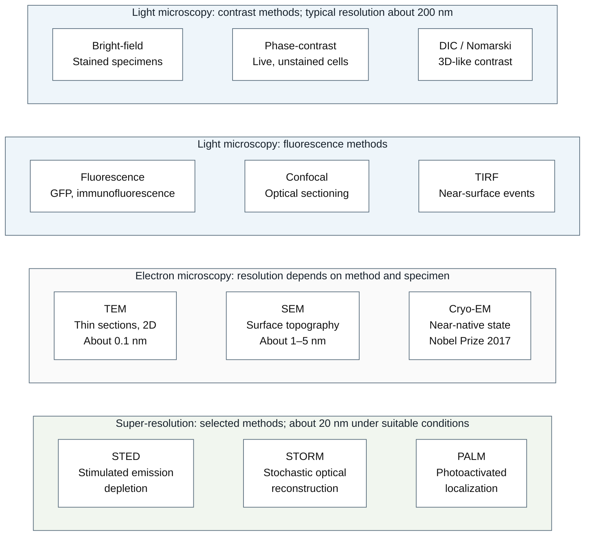
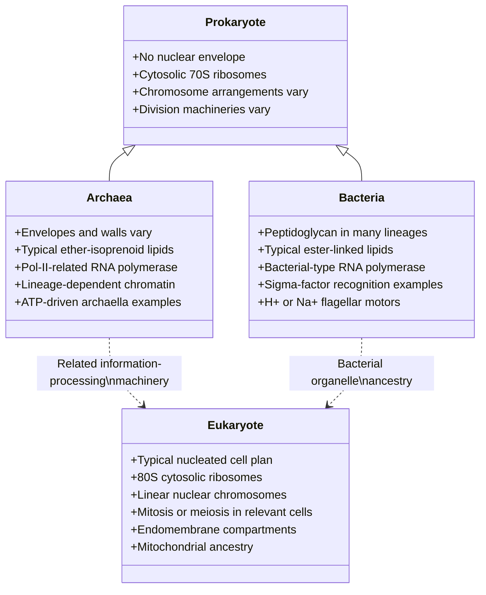

# Cell Theory and Cell Types

\label{sec:unit_II_cell_theory}


<!-- chapter-metadata-badge -->
> Level 1/3 · 45 min read · 50 min lecture · Prerequisites: \cref{sec:unit_I_macromolecules}

## Learning Objectives

1. State the three original tenets of cell theory (Schleiden, Schwann, Virchow) and the modern additions.
2. Compare the structural organization of prokaryotic, eukaryotic, and archaeal cells at the molecular level.
3. Describe the endosymbiotic \citep{margulis1967} theory and evaluate the molecular evidence supporting it.
4. Classify cells by metabolic lifestyle (autotrophic vs. heterotrophic) and oxygen relationship.
5. Quantify the surface-area-to-volume relationship and derive the mathematical constraints on cell size.
6. Explain microscopy techniques from bright-field to cryo-EM and super-resolution methods.
7. Describe the minimal cell concept (JCVI-syn3.0) and its implications for defining life.
8. Evaluate extremophile cells as evidence for the range of possible cellular adaptations and their relevance to astrobiology.

<!-- curriculum-scaffold-start -->
### Study Blueprint

- **Big idea:** Cells are bounded, evolving systems whose size and organization reflect physical constraints.
- **Core concepts:** cell theory, surface area, microscopy, prokaryote/eukaryote comparison.
- **Framework alignment:** Vision & Change: Structure and function, Systems, Information flow, exchange, and storage; AP Biology: Systems Interactions, Information Storage and Transmission; NGSS-style topics: Structure and Function.
- **Model or quantitative lens:** Surface-area-to-volume scaling.
- **Data skill:** Infer cellular constraints from measurements, micrographs, and scale bars.
- **Practice cadence:** Visual Representations, Questions and Methods, Argumentation.
- **Common misconception to repair:** Cells are not just small bags of fluid; boundaries and internal organization create function.
- **Primary lab:** \nameref{sec:lab_unit_II_cell_theory}.
- **Question bank:** \nameref{sec:q_unit_II_cell_theory}.
- **Transfer task:** Transfer scale reasoning to eggs, neurons, root hairs, and microbial colonies.
- **Bridge to computation:** `biology.cell.cell_biology.diffusion_flux`.
<!-- curriculum-scaffold-end -->

---

> **Opening Vignette: The First Cell You Ever Saw**
>
> In 1665, Robert Hooke pressed a thin sliver of cork against the lens of a compound microscope
> he had constructed himself and published his observations in *Micrographia* — a book so popular
> that Samuel Pepys stayed up until 2 a.m. reading it. Hooke saw a regular array of empty
> compartments — the remnant cell walls of dead plant cells — and named them **cellulae** (from
> Latin, "small rooms"). He had no idea that cells were alive. That insight required a further
> 174 years of microscopy, culminating in the cell theory formulations of \citet{schleiden1838}, Schwann
> (1839), and \citet{virchow1855}.
>
> Today, a single human body contains approximately 37.2 trillion cells (Bianconi et al., 2013,
> *Annals of Human Biology*) — a number so large that if laid end-to-end they would circle the
> Earth 200 times. Every one of those cells descended, by an unbroken chain of cell division, from
> a single fertilized egg roughly nine months before your birth. And every cell alive on Earth today
> is the product of 3.7 billion years of unbroken cell division since the origin of life — not one
> cell has ever been created from scratch by spontaneous generation since Leuwenhoek looked through
> his microscope in 1674.
>
> *Primary source: Bianconi, E. et al. (2013). An estimation of the number of cells in the human body. Annals of Human Biology, 40(6), 463–471.*

---

## The Cell as the Fundamental Unit of Life

### Historical Development of Cell Theory

The development of cell theory spans over two centuries and represents one of the most important unifying principles in biology.

**Robert \citet{hooke1665}** first observed "cells" (actually dead cell walls) in cork using a compound microscope he built himself. He published his observations in *Micrographia*, coining the term "cell" because the structures reminded him of monks' rooms (cellae) in a monastery.

**Antonie van Leeuwenhoek (1674-1683)** constructed single-lens microscopes achieving ~270x magnification and observed living cells for the first time --- bacteria ("animalcules"), protists, sperm cells, and red blood cells in capillary blood flow.

**Matthias \citet{schleiden1838}**, a botanist, concluded that most plant tissues are composed of cells and that the cell is the basic unit of plant structure.

**Theodor \citet{schwann1839}**, a zoologist and Schleiden's colleague, extended this principle to animals, proposing that most animal tissues are also composed of cells. Together, Schleiden and Schwann formulated the first two tenets of cell theory.

**Rudolf \citet{virchow1855}** contributed the third tenet with his famous dictum *omnis cellula e cellula* ("every cell from a cell"), establishing that cells arise primarily from pre-existing cells through division. This principle demolished the lingering notion of spontaneous generation and established the continuity of life.

```mermaid
graph LR
    A["Robert Hooke<br/>1665<br/>Observes 'cells' in cork"] --> B["van Leeuwenhoek<br/>1674<br/>First living cells observed"]
    B --> C["Robert Brown<br/>1831<br/>Discovers the nucleus"]
    C --> D["Schleiden<br/>1838<br/>All plants are cells"]
    D --> E["Schwann<br/>1839<br/>All animals are cells"]
    E --> F["Virchow<br/>1855<br/>Omnis cellula e cellula"]
    F --> G["Pasteur<br/>1859<br/>Disproves spontaneous<br/>generation"]
    G --> H["Margulis<br/>1967<br/>Endosymbiotic theory"]
    H --> I["Venter<br/>2016<br/>JCVI-syn3.0<br/>Minimal synthetic cell"]

    style A fill:#e6f3ff
    style D fill:#ffe6e6
    style E fill:#ffe6e6
    style F fill:#ffe6e6
    style I fill:#e6ffe6
```


<!-- alt: Timeline of key milestones in cell theory development, from Hooke's first observations to the modern synthetic minimal cell. -->

*Timeline of key milestones in cell theory development, from Hooke's first observations to the modern synthetic minimal cell.*

### The Three Original Postulates

The **cell theory**, formalised by \citet{schleiden1838}, \citet{schwann1839}, and \citet{virchow1855}, rests on three founding principles:

1. **Most living organisms are composed of one or more cells.**
2. **The cell is the basic structural and functional unit of cellular organisms.**
3. **Most cells arise from pre-existing cells** (*omnis cellula e cellula* --- Virchow, 1855).

A corollary of the third tenet is that life is a continuous lineage --- every cell on Earth today descends without interruption from the first cells, approximately 3.5--3.8 billion years ago. The oldest microfossils, found in Pilbara (Western Australia) and Barberton (South Africa), date to ~3.5 Ga and show morphologies consistent with filamentous prokaryotes.

### Modern Additions to Cell Theory

Modern cell biology has expanded the original three postulates:

4. **The cell contains heritable information (DNA) that directs its activities and is passed to daughter cells.** This was established by the work of Avery, MacLeod, and McCarty (1944) and confirmed by \citet{hershey1952}.

5. **Most cells have the same basic chemical composition.** Most known cells use DNA as genetic material, RNA as intermediary, [**protein**](#gl:protein)s as catalysts, and [**phospholipid bilayer**](#gl:phospholipid-bilayer)s as membranes.

6. **Energy flow (metabolism and biochemistry) occurs within cells.** Most metabolic transformations --- [**glycolysis**](#gl:glycolysis), the TCA cycle, [**oxidative phosphorylation**](#gl:oxidative-phosphorylation) --- take place within or across cell membranes.

7. **Cells contain the information necessary for their own reproduction.** The [**genome**](#gl:genome) encodes not just structural components but the regulatory logic for cell division, differentiation, and programmed cell death.

> **Clinical Connection: Virchow and the Origin of Cancer Biology**
> Virchow's principle *omnis cellula e cellula* had a profound clinical implication: if most cells come from pre-existing cells, then cancer cells must also arise from normal cells through transformation. Virchow himself applied this reasoning to pathology, founding the field of cellular pathology. Today, cancer biology rests on the understanding that [**mutation**](#gl:mutation)s accumulate in somatic cells, transforming them into malignant clones --- a direct intellectual descendant of Virchow's third postulate. see \cref{sec:unit_II_cell_signaling} (Cell Signaling) for oncogenes and tumor suppressors.

> **Concept Check 1:** Distinguish viral acellularity and dependence on host translation from the definition-dependent question of whether viruses are alive. Which viral properties are life-like, and which would a definition requiring autonomous cellular reproduction exclude?

---

## Size, Scale, and the Surface-to-Volume Constraint

### Orders of Magnitude in Biology

Biology spans an enormous range of scales. Understanding this range is essential for appreciating why cells occupy a specific size [**niche**](#gl:niche).

: Orders of Magnitude in Biology: Structure and Approximate size. {#tbl:unit_II_cell_theory_orders_of_magnitude_in_biology}
| Structure | Approximate size | Scale |
| --------- | ---------------- | ----- |
| Water molecule | 0.28 nm | Angstrom |
| Glucose molecule | 0.7 nm | Nanometre |
| Phospholipid bilayer thickness | 7--8 nm | Nanometre |
| [**Ribosome**](#gl:ribosome) | 25 nm | Nanometre |
| HIV virus | 120 nm | Nanometre |
| Mitochondrion | 1--5 μm | Micrometre |
| *E. coli* | 1--2 μm | Micrometre |
| Red blood cell | 7--8 μm | Micrometre |
| Typical animal cell | 10--30 μm | Micrometre |
| Typical plant cell | 30--100 μm | Micrometre |
| *Thiomargarita namibiensis* | 750 μm | Sub-millimetre |
| Frog egg | 1 mm | Millimetre |
| Ostrich egg (cell) | 15 cm | Centimetre |

### The Mathematics of Cell Size

Cells are small --- almost without exception. Why?

The rate of metabolism (nutrient consumption, waste generation) scales with **volume** ($V \propto r^3$). The rate of exchange with the environment (nutrient uptake, waste removal) scales with **surface area** ($A \propto r^2$). The ratio:

\begin{equation}
\frac{A}{V} = \frac{4\pi r^2}{\frac{4}{3}\pi r^3} = \frac{3}{r}
\label{eq:unit_II_cell_theory_worked_1}
\end{equation}

As $r$ increases, $A/V$ decreases. A sphere with $r = 1$ μm has $A/V = 3$ μm$^{-1}$. With $r = 1$ mm (1,000x larger), $A/V = 0.003$ μm$^{-1}$. Large cells simply cannot exchange nutrients fast enough for their metabolic demand.

## Worked Example: Surface-to-Volume Calculation

*Problem:* A spherical bacterium has radius $r = 0.5$ μm. Calculate (a) the surface area, (b) the volume, (c) the $A/V$ ratio. Then repeat for a spherical eukaryotic cell with $r = 10$ μm and compare.

*Solution:*

For the bacterium ($r = 0.5$ μm):

\begin{equation}
A = 4\pi r^2 = 4\pi(0.5)^2 = 3.14 \; \mu\text{m}^2
\label{eq:unit_II_cell_theory_worked_2}
\end{equation}

\begin{equation}
V = \frac{4}{3}\pi r^3 = \frac{4}{3}\pi(0.5)^3 = 0.524 \; \mu\text{m}^3
\label{eq:unit_II_cell_theory_worked_3}
\end{equation}

\begin{equation}
\frac{A}{V} = \frac{3.14}{0.524} = 6.0 \; \mu\text{m}^{-1}
\label{eq:unit_II_cell_theory_worked_4}
\end{equation}

For the eukaryotic cell ($r = 10$ μm):

\begin{equation}
A = 4\pi(10)^2 = 1,257 \; \mu\text{m}^2
\label{eq:unit_II_cell_theory_worked_5}
\end{equation}

\begin{equation}
V = \frac{4}{3}\pi(10)^3 = 4,189 \; \mu\text{m}^3
\label{eq:unit_II_cell_theory_worked_6}
\end{equation}

\begin{equation}
\frac{A}{V} = \frac{1,257}{4,189} = 0.30 \; \mu\text{m}^{-1}
\label{eq:unit_II_cell_theory_worked_7}
\end{equation}

The bacterium has a 20-fold higher $A/V$ ratio, enabling far more efficient diffusion-based exchange per unit metabolic volume.

### Diffusion Time and Cell Size

Diffusion time scales with the square of distance:

\begin{equation}
t = \frac{x^2}{2D}
\label{eq:unit_II_cell_theory_worked_8}
\end{equation}

where $D$ is the diffusion coefficient. For a small molecule ($D\approx10^{-9}$ m$^2$/s), the one-dimensional estimate is about 0.5 ms over 1 μm and 500 s over 1 mm. These scales constrain diffusion-dependent supply, but do not set a universal maximum cell size without transport geometry and metabolic demand.

### Exceptions to Small Cell Size

**Exceptions** to small cell size achieve large size by:
- **Increasing surface area:** intestinal cells have microvilli (amplify $A$ by ~600x); root hair cells extend long projections
- **Reducing metabolically active volume:** plant vacuoles occupy >80% of cell volume but are largely metabolically inert
- **Reducing effective diffusion distance:** nerve axons can be >1 m long but about 1--20 μm in diameter; active transport supplements diffusion
- **Cytoplasmic streaming:** in giant plant cells (e.g., *Chara* internodal cells, >10 cm), [**actin**](#gl:actin)-myosin-driven streaming circulates [**cytoplasm**](#gl:cytoplasm) at ~60 μm/s, overcoming diffusion limitations
- **Multinucleation:** skeletal muscle fibers (up to 30 cm long) contain hundreds of nuclei, each governing a local cytoplasmic domain

> **Concept Check 2:** Model a *Thiomargarita namibiensis* cell as a 750 μm-diameter sphere, giving $A/V\approx0.008$ μm$^{-1}$. How does its large nitrate-storage vacuole reduce active cytoplasmic volume and transport distances? Explain why geometry alone cannot establish whether exchange meets demand.

### The Cube Law and Conditional Cell-Size Constraints

The surface-to-volume problem can be sharpened into what physiologists call the **cube law of metabolism**. If we model a cell as a sphere of radius $r$, mass $m$, and uniform density ρ, then:

\begin{equation}
m = \rho \cdot \frac{4}{3}\pi r^3, \qquad A = 4\pi r^2
\label{eq:unit_II_cube_law_basis}
\end{equation}

Suppose every unit volume of cytoplasm consumes oxygen at a constant rate $q$ (mol O$_2$ s$^{-1}$ m$^{-3}$). The total metabolic demand $\dot{M}_\text{demand}$ scales as:

\begin{equation}
\dot{M}_\text{demand} = q \cdot V = q \cdot \tfrac{4}{3}\pi r^3
\label{eq:unit_II_cell_theory_worked_9}
\end{equation}

Maximum oxygen flux through the membrane is set by Fick's law and is bounded by surface area:

\begin{equation}
\dot{M}_\text{supply} = P_{O_2} \cdot \Delta[O_2] \cdot A = P_{O_2} \cdot \Delta[O_2] \cdot 4\pi r^2
\label{eq:unit_II_cell_theory_worked_10}
\end{equation}

A viable cell requires $\dot{M}_\text{supply} \ge \dot{M}_\text{demand}$. Setting these equal yields a **maximum admissible radius**:

\begin{equation}
r_\text{max} = \frac{3 \, P_{O_2} \, \Delta[O_2]}{q}
\label{eq:unit_II_rmax}
\end{equation}

For typical mammalian parameters ($P_{O_2} \approx 1\times10^{-4}$ m/s, $\Delta[O_2] \approx 0.2$ mM, $q \approx 1$ mol O$_2$ m$^{-3}$ s$^{-1}$), $r_\text{max} \approx 60$ μm — close to the upper bound for actively respiring animal cells. Larger cells must reduce $q$ (e.g., plant vacuoles), increase $A$ (microvilli, infoldings), or accept partial anoxia in their cores. This is the **cube law of metabolism**: demand scales with $r^3$, supply with $r^2$, so any uniform cell hits a hard ceiling on size.

> **Concept Check 3a:** Using \cref{eq:unit_II_rmax} with the parameters above, by what factor would $q$ have to drop to allow a 1 mm diameter respiring cell to survive without surface amplification?

### Quantitative Comparison: Prokaryote vs. Eukaryote

Prokaryotes and eukaryotes occupy fundamentally different scales of organization. The differences in linear dimension translate to even larger gaps in volume, surface area, and information content:

: Quantitative Comparison: Prokaryote vs. Eukaryote: Property and E. coli (prokaryote). {#tbl:unit_II_cell_theory_quantitative_comparison_prokaryote_vs_eukaryote}
| Property | *E. coli* (prokaryote) | HeLa cell (eukaryote) | Ratio (Euk/Prok) |
| -------- | ----------------------- | --------------------- | ---------------- |
| Length / diameter | 2 μm × 0.5 μm | ~20 μm | ~10–40 × |
| Volume | ~1 μm$^3$ | ~4,000 μm$^3$ | ~4,000 × |
| Surface area | ~6 μm$^2$ | ~1,257 μm$^2$ for a smooth r=10 μm sphere | ~210 × |
| $A/V$ | ~6 μm$^{-1}$ | ~0.30 μm$^{-1}$ | 0.05 × |
| Genome size | 4.6 Mbp | 6.4 Gbp for an illustrative diploid human cell, not an exact HeLa karyotype | ~1,400 × |
| Protein number | ~3 × 10$^6$ | ~2 × 10$^{10}$ | ~7,000 × |
| Doubling time | 20 min (rich media) | ~24 h | 70 × slower |
| ATP turnover (molecules/s) | ~10$^9$ | ~10$^{10}$ | ~10 × |

**Worked Example — Different membrane constraints:** A smooth sphere of radius 10 μm has A/V=3/r=0.30 μm^-1. Internal mitochondrial cristae increase respiratory reaction area but do not add plasma-membrane exchange area. Surface uptake, intracellular diffusion and respiratory capacity impose distinct constraints; extra internal membrane does not automatically solve all three.

> **Concept Check 3b:** A spherical eukaryotic cell with $r = 10$ μm has plasma-membrane area $A_\text{PM} \approx 1{,}260$ μm$^2$. If respiratory demand scales with cytoplasmic volume and the cell needs 6× the plasma-membrane area to support its metabolism, estimate the total inner membrane area its mitochondria must provide.

> **Concept Check (Analysis):** A spherical bacterial cell has radius r = 1 μm; a giant squid neuron axon has radius r = 500 μm. (a) Calculate the surface-area-to-volume (SA/V) ratio for each. (b) Diffusion of ATP from the cell center to the periphery takes time t ∝ r²/D where D(ATP) = 300 μm²/s. Calculate the diffusion time for each cell. (c) The squid axon uses active axonal transport (kinesin at 1 μm/s) rather than diffusion for cargo delivery. At what axon length does active transport become strictly necessary (say, when diffusion time exceeds 1 hour)?

> **Worked Example — Dimensionally consistent uptake:** Let membrane permeability P=0.04 cm/s, concentration difference deltaC=200 micromolar=2e-7 mol/cm^3 and spherical radius r=10 micrometers=0.001 cm. A=4pi r^2=1.257e-5 cm^2 and V=4pi r^3/3=4.189e-9 cm^3. Flux density P deltaC=8e-9 mol cm^-2 s^-1, so whole-cell uptake P A deltaC=1.005e-13 mol/s. A proposed consumption of 1e-10 mol/s would exceed this by about 995-fold and is incompatible with these inputs. Equivalently, uptake per volume is P(3/r)deltaC=2.4e-5 mol cm^-3 s^-1; compare only with consumption expressed per volume. At fixed consumption density, increasing radius worsens uptake per volume as 1/r. Internal oxygen diffusion can add another limitation; this calculation does not model it.


---

## Microscopy: Seeing the Cell

Understanding cells requires seeing them. The history of cell biology is inseparable from advances in microscopy.


<!-- alt: Four comparison panels group light-microscopy contrast and fluorescence methods, electron microscopy and super-resolution methods. Each technique retains its specimen or imaging role; TEM and SEM have different illustrative resolutions rather than one universal electron-microscopy value. -->

*Microscopy methods grouped into compact comparison panels: light techniques provide contrast, labeling and optical sections; electron microscopy reveals ultrastructure; super-resolution methods surpass conventional light-microscopy resolution. Quoted resolutions are illustrative and depend on method, specimen and acquisition conditions, not universal performance guarantees. DIC provides relief-like contrast rather than a direct three-dimensional reconstruction.*

### Light Microscopy, Contrast, and Resolution

The **resolution limit** of light microscopy is governed by the Abbe diffraction limit:

\begin{equation}
d = \frac{\lambda}{2 \cdot \text{NA}}
\label{eq:unit_II_cell_theory_worked_11}
\end{equation}

where λ is the wavelength of light and NA is the numerical aperture of the objective. For visible light ($\lambda \approx 550$ nm) and a high-quality oil-immersion objective (NA = 1.4): $d \approx 200$ nm.

**Bright-field microscopy:** Transmitted light; specimens typically stained (H&E, [**Gram stain**](#gl:gram-stain)). Simple but limited contrast for living cells.

**Phase-contrast microscopy:** Converts phase differences (from refractive index variations in transparent specimens) into amplitude differences visible as contrast. Ideal for observing living, unstained cells. Invented by Frits Zernike (Nobel Prize in Physics, 1953).

**Differential interference contrast (DIC/Nomarski):** Uses polarized light split into two beams that pass through slightly different optical paths in the specimen. Produces a pseudo-3D relief image with excellent contrast. Eliminates the "halo" artifact of phase-contrast.

**Fluorescence microscopy:** Specimens labeled with fluorophores (antibodies conjugated to FITC, Cy3, Cy5; or genetically encoded GFP and derivatives). Excitation light of specific wavelength causes fluorophore emission at a longer wavelength. Enables specific protein localization, live-cell imaging, and multiplexing (multiple colors simultaneously).

**Confocal laser scanning microscopy:** Uses a pinhole to reject out-of-focus light, producing optical sections ~0.5--1 μm thick. Z-stacks can be reconstructed into 3D images. Essential for thick specimens and co-localization studies.

**Total internal reflection fluorescence (TIRF):** Evanescent wave illuminates about 100 nm of the cell adjacent to the coverslip surface. Used to study membrane dynamics, vesicle fusion events, and single-molecule behavior at the plasma membrane.

### Electron Microscopy and Ultrastructure

**Transmission electron microscopy (TEM):** Electrons pass through ultrathin sections (~50--70 nm) stained with heavy metals (uranyl acetate, osmium tetroxide). Resolution ~0.1 nm. Reveals ultrastructural details of [**organelle**](#gl:organelle)s, membranes, and macromolecular complexes.

**Scanning electron microscopy (SEM):** Electrons scan the surface of gold- or platinum-coated specimens. Produces stunning 3D topographic images of cell surfaces, tissue architecture, and microorganisms. Resolution ~1--5 nm.

**Cryo-electron microscopy (cryo-EM):** Specimens flash-frozen in vitreous ice (no staining or fixation) and imaged at liquid nitrogen temperature. Single-particle analysis reconstructs 3D structures of proteins and complexes at near-atomic resolution (2--4 angstroms). Awarded the Nobel Prize in Chemistry 2017 (Jacques Dubochet, Joachim Frank, Richard Henderson). Cryo-EM has revolutionised structural biology, enabling structures of membrane proteins, ribosomes, and viral capsids that resist crystallisation.

> **Clinical Connection: Cryo-EM and Drug Discovery**
> Cryo-EM has become indispensable in pharmaceutical development. The structure of the SARS-CoV-2 spike protein was solved by cryo-EM within weeks of the pandemic onset, enabling rapid [**vaccine**](#gl:vaccine) design (Wrapp et al., 2020, *Science*). Drug binding sites on ion channels (e.g., TRPV1 pain receptor) and GPCRs have been mapped at near-atomic resolution, accelerating rational drug design. see \cref{sec:unit_II_membrane_transport} for membrane protein structures.

### Super-Resolution Microscopy

Super-resolution methods bypass the Abbe diffraction limit, achieving resolutions of 20--50 nm with light:

**STED (Stimulated Emission Depletion):** A donut-shaped depletion beam suppresses fluorescence from the periphery of the excitation spot, shrinking the effective point spread function. Resolution ~30--50 nm. Developed by Stefan Hell (Nobel Prize in Chemistry, 2014).

**STORM (Stochastic Optical Reconstruction Microscopy):** Individual fluorophores are stochastically activated, imaged, and precisely localized over thousands of frames. The composite image achieves ~20 nm resolution. Co-developed by Xiaowei Zhuang.

**PALM (Photoactivated Localization Microscopy):** Similar to STORM but uses photoactivatable fluorescent proteins (e.g., mEos, Dendra2). Particularly suited for live-cell imaging of genetically encoded constructs. Co-developed by Eric Betzig (Nobel Prize in Chemistry, 2014).

> **Concept Check 3:** A researcher wants to study the real-time dynamics of clathrin-coated pit formation at the plasma membrane of a living cell. Which microscopy technique would be most appropriate and why?

---

## Prokaryotic Cells and Cellular Economy

Prokaryotic cell organization lacks a membrane-bound nucleus. The term groups **Bacteria** and **[Archaea](#gl:archaea)** by this cellular feature; it is not a claim that they form a single evolutionary clade or lack every kind of internal compartment.

### Prokaryotic Cell Features and Constraints

: Representative bacterial and archaeal cell features; chromosome architecture, envelopes and molecular machinery vary among lineages. {#tbl:unit_II_cell_theory_prokaryotic_cell_features_and_constraints}
| Feature | Bacteria | Archaea |
| ------- | -------- | ------- |
| Cell size | Many examples are micrometer-scale; size varies | Size alone does not identify the domain |
| Nucleus | Absent; nucleoid region | Absent; nucleoid |
| DNA | Often one circular [**chromosome**](#gl:chromosome); linear and multipartite genomes also occur \citep{fraser1997borrelia,heidelberg2000vibriochromosomes} | Chromosome organization and genome copy number vary; [**histone**](#gl:histone)s are not universal |
| Cell wall | Peptidoglycan in many lineages; wall-less forms also occur | S-layers, pseudomurein in some methanogens, other envelopes or no wall |
| Ribosomes | 70S cytosolic ribosomes; rRNA sequence informs phylogeny | 70S cytosolic ribosomes; shared sedimentation class does not mean identical composition |
| Membrane lipids | Characteristic ester-linked fatty acids | Characteristic ether-linked isoprenoids; lipid architecture varies |
| [**Intron**](#gl:intron)s | Occur in selected genes, including group I tRNA examples \citep{kuhsel1990trnaintron} | Some tRNAs contain introns; incidence varies by lineage \citep{sugahara2008archaealtrna} |
| [**Transcription**](#gl:transcription) machinery | *E. coli* omega-containing core: five chains of four types \citep{minakhin2001rnacoreomega} | Multisubunit RNAP related to [**eukaryote**](#gl:eukaryote) Pol II; composition varies \citep{jun2014archaealpolymerase} |
| DNA replication | DnaA-dependent origin in the *E. coli* example | Related Orc1/Cdc6-family initiators in many species; origin arrangements vary |
| [**CRISPR-Cas**](#gl:crispr-cas) | Present in sampled lineages, not a universal feature | Occurrence also depends on lineage, dataset and detection criteria \citep{crawley2018crisprdisco} |


<!-- alt: Comparative cell-plan chart, not a phylogenetic tree or diagnostic checklist. Bacteria and archaea share absence of a nuclear envelope but vary in chromosomes, envelopes and division. Named bacterial, archaeal and eukaryotic features are representative; dotted links recall related information-processing machinery and bacterial organelle ancestry. -->

*Comparative cell plans and selected evolutionary relationships, not a phylogenetic reconstruction or diagnostic checklist. Traits vary among lineages and cell states: histones, chromosome shape and division machinery are not universal domain signatures. Dotted links recall molecular relatedness and bacterial organelle ancestry, not a directly observed sequence of eukaryogenesis.*

### Prokaryotic Cell Structure

- **Plasma membrane:** a lipid membrane with integral proteins. Bacterial examples usually have bilayers; archaeal diether and membrane-spanning tetraether architectures vary. Energy-transducing membranes support chemiosmotic ATP synthesis. Cyanobacterial thylakoids and purple-bacterial intracytoplasmic membranes are examples of photosynthetic membrane organization, not a shared cell plan for every prokaryote.
- **Cell wall:** structurally rigid; resists osmotic lysis.
  - **Gram-positive** bacteria: thick peptidoglycan layer (20--80 nm), teichoic acids, no outer membrane. Crystal violet stain retained (purple).
  - **Gram-negative** bacteria: thin peptidoglycan (~2--7 nm) + outer membrane with LPS (lipopolysaccharide). Crystal violet not retained (pink after safranin counter-stain). The periplasmic space between inner and outer membranes contains degradative [**enzyme**](#gl:enzyme)s and transport proteins.
- **Capsule:** polysaccharide layer external to cell wall; anti-phagocytic (evades immune system); [**biofilm**](#gl:biofilm) formation. *Streptococcus pneumoniae* with capsule is virulent; without capsule is avirulent (Griffith's transformation experiment, 1928).
- **Motility structures:** bacterial flagella use ion-gradient-powered rotary motors, including proton- and sodium-driven systems. Archaeal archaella are ATP-driven and are different assemblies; they should not be treated as bacterial flagella with a substituted fuel. Motor behavior depends on the organism and conditions.
- **Pili (fimbriae):** protein tubes for attachment, conjugation, biofilm; Type IV pili can retract to generate motile force ("twitching motility"); F-pili mediate DNA transfer during conjugation.
- **Nucleoid:** the chromosome-containing region without a nuclear envelope; chromosome topology, number and genome copy number vary. HU, H-NS, Fis and IHF are examples of bacterial nucleoid-associated proteins, not a complete inventory for bacteria or archaea.
- **Plasmids:** extrachromosomal replicons with varied sizes and circular or linear forms. They can carry accessory [**gene**](#gl:gene)s, including resistance, [**virulence**](#gl:virulence) or metabolic functions; mobility depends on the plasmid and cellular context. The sequenced *Borrelia burgdorferi* B31 example has both linear and circular plasmids \citep{fraser1997borrelia}.

> **Clinical Connection: Gram Staining Is Not Susceptibility Testing**
> Gram staining reveals a cell-envelope phenotype, not an organism's identity or antibiotic susceptibility. Beta-lactams inhibit susceptible penicillin-binding proteins (PBPs) involved in peptidoglycan cross-linking, but a thick wall does not guarantee susceptibility: Gram-positive MRSA can produce modified PBP2a with low affinity for many traditional beta-lactams \citep{cdc2025mrsalaboratories}. A Gram-negative outer membrane can restrict particular drugs, but permeability, efflux and resistance determinants vary; the stain alone cannot select an antibiotic class or regimen. Clinical interpretation also requires the infection site, patient context, organism identification, validated susceptibility testing and applicable guidance. See \cref{sec:unit_II_cell_structure} for membrane permeability.

> **Concept Check 4:** Why does the absence of bacterial peptidoglycan remove the canonical substrate/pathway for specified peptidoglycan-targeting antibiotics in archaea? Distinguish that target-based inference from a claim about every drug concentration or an organism's measured susceptibility.

### Prokaryotic Cytoskeletons: Structure, Cellular Function and Evolutionary Inference

Prokaryotes have diverse structural and dynamic filaments. Experiments distinguish a protein's fold, its cellular function and its evolutionary history: a homologous component does not by itself identify the donor of an entire eukaryotic machine or date the origin of compartmentalization.

: Selected prokaryotic cytoskeletal proteins: relationships and tested cellular roles, not a complete ancestral inventory. {#tbl:unit_II_cell_theory_the_prokaryotic_cytoskeleton_a_recent_revolution}
| Protein / family | Relationship | Selected cellular role | Evidence / limit |
| ----------------- | -------------------- | -------- | ---------------- |
| **FtsZ** | Tubulin-related GTPase | Division-site assemblies coordinate cytokinesis in studied bacteria | The 1998 structural comparison used archaeal *Methanococcus jannaschii* FtsZ; it did not identify a bacterial donor of the whole mitotic apparatus \citep{lowe1998ftsz} |
| **MreB** | Actin homolog | Rod-shaped growth and coordination with lateral wall synthesis | In studied *E. coli*, rotation required cell-wall assembly, not MreB polymerization alone \citep{vanteeffelen2011mrebrotation} |
| **Crescentin (CreS)** | Intermediate-filament-like coiled-coil protein | Curvature of *Caulobacter crescentus* | Loss and filament experiments establish a shape function, not a demonstrated lamin/cytokeratin ancestor \citep{ausmees2003crescentin} |
| **ParM** | Actin-like ATPase | Partition of the studied *E. coli* R1 plasmid | Polymerization and ParR/parC-dependent partition experiments; not every plasmid uses this system \citep{mollerjensen2002parm} |
| **Bactofilins (BacA/B)** | Bacterial scaffold family | Polar wall-synthase localization in *C. crescentus* | Selected assembly/localization experiments; roles differ among studied bacteria \citep{kuhn2010bactofilins} |

**FtsZ and cytokinesis.** FtsZ is a tubulin-related, GTP-dependent filament-forming protein. Bacterial division-site assemblies coordinate recruitment and activity of septal wall-synthesis machinery; FtsZ is not a universal inventory for every prokaryotic division system. Löwe and Amos's 1998 structure used recombinant archaeal *M. jannaschii* FtsZ and established structural relatedness to tubulin \citep{lowe1998ftsz}. That result does not establish that the whole eukaryotic mitotic apparatus descends directly from a bacterial donor, a universal treadmilling speed or the origin of all spindle components.

**MreB and rod-shaped growth.** In the studied *E. coli* system, actin-homolog MreB moved around the cell's long axis, and that rotation required peptidoglycan assembly rather than MreB polymerization alone \citep{vanteeffelen2011mrebrotation}. Thus coordinated movement with wall-synthesis machinery does not establish that MreB itself drags the machinery as a motor. Shape maintenance and filament dynamics are experimentally testable roles, not proof of identical bacterial and eukaryotic force-generation systems.

**Crescentin and curvature.** In *C. crescentus*, crescentin localizes along the inner curvature, and loss of the protein produces straight rods. Its filament formation and intermediate-filament-like properties support a cellular shape function \citep{ausmees2003crescentin}. These observations do not by themselves establish that crescentin is the ancestor of nuclear lamins or cytokeratins.

These studies refute the absence of prokaryotic cytoskeletons while leaving distinct historical questions open. Structural homology, analogous cellular roles and inferred ancestry are different conclusions. Dating a component's origin relative to compartmentalization requires an independently supported evolutionary analysis, not subtraction of unanchored age estimates.

> **Concept Check 4b:** A proposed antibacterial compound inhibits purified FtsZ or MreB. Which evidence would establish selectivity over human tubulin/actin and effects in intact bacterial cells? Explain why neither a homolog's name nor its importance for growth alone establishes a narrow spectrum, cellular entry or freedom from host/organelle effects.

### Detailed Comparison: Bacteria vs. Archaea

The discovery of Archaea by \citet{woese1977} as a separate domain transformed our view of life's deep structure. Archaea were initially described as "prokaryotes that live in extreme environments," but molecular phylogenetics revealed that Archaea share many features with eukaryotes that bacteria do not — a fact now central to debates about eukaryotic origin (the "Asgard archaea" hypothesis). The table below extends \cref{sec:unit_II_cell_theory} earlier comparison with molecular detail relevant to drug development, evolution, and astrobiology.

: Selected molecular comparisons across bacterial and archaeal lineages; related machinery does not establish identical assemblies, thermal limits or drug responses. {#tbl:unit_II_cell_theory_detailed_comparison_bacteria_vs_archaea}
| Feature | Bacterial examples | Archaeal examples | Interpretation / limit |
| ------- | -------- | ------- | -------------------------- |
| Cell wall | Typical peptidoglycan has NAG–NAM chains and peptide cross-links | Pseudopeptidoglycan, S-layers or other polymers, without bacterial peptidoglycan | Beta-lactams inhibit susceptible cross-linking enzymes; vancomycin binds appropriate D-Ala-D-Ala precursors. Target access and resistance also determine susceptibility |
| Typical glycerophospholipids | Glycerol-3-phosphate with ester-linked fatty acids | Glycerol-1-phosphate with ether-linked isoprenoids; diether/tetraether proportions vary | A characteristic biosynthetic contrast, not a growth-temperature assay |
| Membrane topology | Bilayer examples | Diether bilayers and membrane-spanning tetraether-rich architectures | Low proton permeability was measured in a specified tetraether-liposome preparation; composition and conditions matter \citep{komatsu1998tetraetherpermeability} |
| RNA polymerase | *E. coli* omega-containing core: α₂ββ′ω | An 11-chain *Thermococcus kodakarensis* RNAP was structurally characterized \citep{jun2014archaealpolymerase} | Specify components and preparation; neither five nor twelve is a universal domain count |
| Promoter recognition | Sigma-factor systems, including the *E. coli* example | TBP/TFB-related initiation machinery in studied archaeal systems | Evolutionary relatedness does not mean an identical eukaryotic complex \citep{gehring2016archaealtranscription} |
| Chromatin proteins | HU/H-NS in *E. coli*; histones also occur in studied bacteria \citep{hocher2023bacterialhistones} | Histone oligomers in studied lineages; other chromatin proteins in some lineages \citep{mattiroli2017archaealchromatin,guo2008cren7} | Shared folds and DNA geometry do not establish identical nucleosomes or an Asgard-wide assembly |
| Replication initiation | DnaA-dependent initiation at one origin in the *E. coli* chromosome | One-origin *Pyrococcus abyssi* and multiple-origin *Haloferax volcanii* examples \citep{matsunaga2003archaealorigin,hawkins2013replicationorigins} | Initiator family and origin count are different properties; engineered origin deletion is not a description of every wild archaeon |
| Topoisomerases | Gyrase and topoisomerase IV are examples; repertoires vary | Reverse gyrase in selected thermophiles | Reverse gyrase also occurs in bacteria; its presence is not an 80-°C threshold or a universal requirement \citep{brochier2007reversegyrase,atomi2004reversegyrase} |
| tRNA introns | Group I introns in studied cyanobacteria \citep{kuhsel1990trnaintron} | Introns and BHB-type processing in selected pre-tRNAs; lineage-dependent incidence \citep{sugahara2008archaealtrna} | Useful comparative characters, not a standalone domain diagnosis |
| Translation initiation | Formyl-methionine in standard bacterial cytosolic examples | Methionine in studied archaeal cytosolic systems | Specify the cellular system rather than extending this contrast to every organelle \citep{schmitt2020archaealinitiation} |
| CRISPR–Cas | Occurrence depends on the sampled genomes and detection criteria | The same denominator and detection constraints apply | A detected feature, a complete candidate system and demonstrated antiviral function are different endpoints \citep{crawley2018crisprdisco} |
| Energy metabolism | Diverse phototrophic, chemolithotrophic and heterotrophic examples | Methanogenesis, ammonia oxidation, sulfate reduction and other lineage-specific examples | Halophily is a salt adaptation, not an energy pathway; classical methanogenesis is distinct from every route of methane production |

**Count components, not labels.** The stated *E. coli* α₂ββ′ω core has five polypeptide chains of four types because α occurs twice. Adding a sigma factor forms an initiation holoenzyme. Historical four-chain α₂ββ′ descriptions and active omega-free *E. coli* preparations are not arithmetically wrong; components, organism and preparation must be specified. Omega contributes to assembly and is not biologically irrelevant \citep{minakhin2001rnacoreomega,minakhin2001rnareconstitution}. Archaeal Pol-II-related architecture likewise does not impose one invariant chain count.

**Molecular target is not whole-cell susceptibility.** The cited reconstitution study found different rifampin inhibition of *T. aquaticus* and *E. coli* RNAPs in vitro; both are bacterial enzymes, and those measurements were not whole-cell MICs \citep{minakhin2001rnareconstitution}. Chloramphenicol inhibited growth of tested *Halobacterium halobium*, and resistant 23S-rRNA mutants were isolated \citep{mankin1991chloramphenicol}. Anisomycin was structurally observed at the large-subunit peptidyl-transferase center of *Haloarcula marismortui* \citep{hansen2003anisomycin}; diphtheria toxin instead ADP-ribosylates diphthamide-bearing EF-2, a translation factor, in susceptible preparations \citep{lechner1988archaealef2}. These are distinct molecular and experimental endpoints. Target modification, drug entry and cellular context prevent either domain membership or a 70S label from replacing organism-specific susceptibility evidence.

**Why this matters.** Comparative sequence and molecular evidence distinguish related information-processing machinery from identical cell architecture. Phylogenomic studies support an Asgard-related archaeal contribution to the eukaryotic host, but finer placement depends on data and models \citep{eme2023heimdall,eme2026correction,zhang2025asgard}. Mitochondrial bacterial ancestry is a separate contribution; neither one trait nor a broad label assigns the origin of every nuclear gene or metabolic pathway.

> **Concept Check 4c:** Which canonical peptidoglycan cross-linking target/pathway explains the action of penicillin in susceptible bacteria, and why is that mechanism unavailable in cells without bacterial peptidoglycan? Explain why target absence and a Gram/domain label are not complete susceptibility tests.

---

## Eukaryotic Cells and Compartmentalization

Eukaryotic cells (**eu** = true; **karyon** = nucleus) contain membrane-bound organelles and a true nucleus. They include protists, fungi, plants, and animals.

### Eukaryotic Organelle Inventory

**Core eukaryotic organelles and functions:**

: Eukaryotic Organelle Inventory: Organelle and Membrane. {#tbl:unit_II_cell_theory_eukaryotic_organelle_inventory}
| Organelle | Membrane | Function | Unique to |
| --------- | -------- | -------- | --------- |
| Nucleus | Double (NE) | DNA storage; transcription | Eukaryotes |
| Mitochondria | Double | ATP synthesis; TCA cycle; [**apoptosis**](#gl:apoptosis) | Eukaryotes |
| Chloroplast | Double | [**Photosynthesis**](#gl:photosynthesis) | Plants, algae |
| Rough ER | Single | Protein synthesis and folding | Eukaryotes |
| Smooth ER | Single | Lipid synthesis; Ca$^{2+}$ storage | Eukaryotes |
| Golgi apparatus | Single | Protein modification, sorting, export | Eukaryotes |
| Lysosome | Single | Intracellular digestion ([**pH**](#gl:ph) 4.5) | Animals (mainly) |
| Vacuole | Single | Water regulation; storage | Plants (large) |
| Peroxisome | Single | Fatty acid beta-oxidation; H$_2$O$_2$ detox | Eukaryotes |
| Ribosome | None | [**Translation**](#gl:translation) | Most cells |
| [**Cytoskeleton**](#gl:cytoskeleton) | None | Structural; motility; intracellular transport | Eukaryotes |
| Centrosome | None (MTOC) | Microtubule organizing center | Animal cells |

This inventory should not be read as a set of isolated boxes. Eukaryotic organelles exchange lipids, ions, metabolites, and stress signals through membrane-contact sites; mitochondria divide and fuse, the ER wraps around many organelles, lysosomes function as nutrient-sensing hubs, and biomolecular condensates add non-membrane compartments for RNA, protein, and signaling control. A modern cell-biological explanation names the compartment, the traffic route, the time scale, and the evidence type: microscopy, perturbation, biochemical fractionation, or single-cell/spatial data.

### Compartmentalization: The Eukaryotic Advantage

The defining feature of eukaryotic cells is **compartmentalization** --- the segregation of biochemical processes into membrane-bound organelles. This provides several advantages:

1. **Incompatible reactions can occur simultaneously:** Protein synthesis (cytoplasm, pH 7.2) and protein degradation (lysosomes, pH 4.5) are separated by lysosomal membranes.
2. **Concentration of substrates and enzymes:** Mitochondrial matrix concentrates TCA cycle enzymes, increasing reaction rates.
3. **Regulation of gene expression:** The nuclear envelope separates transcription (nucleus) from translation (cytoplasm), enabling post-transcriptional regulation (splicing, mRNA export, mRNA stability).
4. **Expanded membrane surface area:** Internal membranes (ER, Golgi, mitochondria) provide enormous surface area for membrane-associated reactions.

---

## Endosymbiotic Theory and Organelle Origins

Lynn Margulis formalised the **endosymbiotic theory** (1967): mitochondria and chloroplasts are the descendants of free-living bacteria engulfed by a proto-eukaryotic host ~1.5--2 billion years ago.

### Evidence for Endosymbiosis

1. **Double membranes:** Both organelles have inner (bacterial plasma membrane) and outer (phagocytic membrane) bilayers.
2. **Circular DNA:** Mitochondrial and chloroplast genomes are circular, like bacterial chromosomes.
3. **Bacterial-derived translation:** Organelle ribosomes retain evidence of bacterial ancestry, but sedimentation coefficients vary: mammalian mitoribosomes are about 55S, whereas chloroplast ribosomes are typically 70S. Antibiotic sensitivity is drug- and organelle-specific.
4. **Division machinery:** Organelle division is coordinated with the host. Many plastids retain FtsZ-based components; mammalian mitochondrial fission instead uses host dynamin-related DRP1 machinery. FtsZ is not universal in mitochondria.
5. **Phylogenetics:** rRNA sequences of mitochondria are most similar to **alpha-proteobacteria** (e.g., *Rickettsia*); chloroplasts to **cyanobacteria**.
6. **Transfer of genes:** ~1,500 mitochondrial-origin genes now live in the nuclear genome (gene transfer to nucleus over evolutionary time).
7. **Cardiolipin:** The inner mitochondrial membrane contains cardiolipin, a lipid characteristic of bacterial membranes.
8. **Formylmethionine:** Mitochondrial protein synthesis initiates with N-formylmethionine, as in bacteria, not methionine as in eukaryotic cytoplasmic translation.

### Primary and Secondary Endosymbiosis

**Primary [**endosymbiosis**](#gl:endosymbiosis)** (mitochondrion; then chloroplast) explains the origin of eukaryotes. The mitochondrial endosymbiosis is believed to have occurred once in evolutionary history, as most known eukaryotes either possess mitochondria or have remnant mitochondria-derived organelles (hydrogenosomes, mitosomes).

**Secondary endosymbiosis** (a eukaryote with chloroplast engulfed by another eukaryote) explains secondary chloroplasts in dinoflagellates, euglenids, and kelp (evidenced by 3--4 bounding membranes). **Tertiary endosymbiosis** has also occurred in some dinoflagellates.

> **Concept Check 5:** If you treated a eukaryotic cell with chloramphenicol (an antibiotic that inhibits 70S ribosomes), which organelle's protein synthesis would be specifically affected? Would cytoplasmic protein synthesis be affected? Explain.

### LUCA: The Last Universal Common Ancestor

LUCA means the **Last Universal Common Ancestor**, more accurately an inferred ancestral population shared by surviving lineages. It is reconstructed from comparative evidence, not directly observed; it need not have been the first life.

1. **Conserved core:** Broadly shared translation components and the genetic code strongly constrain ancestral reconstructions. A proposed set of ancient gene families depends on sampling, phylogenetic criteria and horizontal-transfer assumptions; it is not a complete observed LUCA genome.

2. **Habitat hypotheses:** Metalloenzymes and metabolic reconstructions motivate hydrothermal/anaerobic hypotheses, but these are model-dependent inferences rather than uniquely established habitat or membrane architecture.

3. **Replication uncertainty:** The principal bacterial replicase Pol III is Family C; archaeal replicases include Families B and D. Different modern replication machinery motivates hypotheses about ancient replacement and the origin of DNA replication, but does not prove an RNA-genome LUCA or two independent inventions of DNA. Separate the strongly conserved translation core from contested genome-chemistry reconstructions.

The reconstruction has profound implications. LUCA was not the first cell — it was the last common one. Earlier lineages may have existed but left no descendants. The vast biochemical diversity of modern life (oxygenic photosynthesis, methanogenesis, eukaryotic compartmentalization) most evolved *after* LUCA, layered onto its conserved core.

> **Concept Check 5b:** If LUCA used naturally occurring proton gradients (from inorganic vent chemistry) rather than self-generated ones, which modern molecular machinery must have evolved *before* free-living cells became possible? (Consider what a free-living cell must do that a vent-bound consortium need not.)

### Viral Replication: Lytic vs. Lysogenic Cycles

Viruses are acellular entities that depend on host cells for productive replication and lack an autonomous ribosomal translation system. Virions may include enzymes, other proteins and lipids beyond genome and capsid. Their classification as alive depends on the chosen criteria; their replication strategies illuminate host-cell requirements. Bacteriophages—viruses that infect bacteria—provide the following examples.

**Lytic cycle (e.g., T4 bacteriophage):**
1. **Attachment:** tail fibers bind specific surface receptors (e.g., LPS, OmpC) — defines host range.
2. **Penetration:** the genome is injected into the [**cytoplasm**](#gl:cytoplasm) through a contractile tail; capsid remains outside.
3. **Hijacking:** within ~2 min, host RNA polymerase transcribes "early" phage genes that degrade the host chromosome (T4 gene 46/47 nucleases) and reprogramme cell metabolism toward phage production.
4. **Replication and assembly:** phage DNA is replicated (~100 copies per cell); structural proteins self-assemble into capsids; DNA is packaged via a portal motor (one of the strongest molecular machines known: ~57 pN of force, comparable to muscle myosin).
5. **Lysis:** ~25 min after infection, phage lysozyme + holin perforate the cell envelope. The cell bursts, releasing ~100–200 progeny phages. The host is dead.

The lytic cycle is the textbook image of viral infection: rapid, fatal, productive. The single-step **burst size** (200) and **latency time** (25 min) determine the kinetics of phage epidemics.

**Lysogenic cycle (e.g., lambda bacteriophage):**
1. **Attachment, penetration:** same as lytic.
2. **Integration:** the phage genome (linear at injection) circularises and integrates into the host chromosome at a specific site (*attB*) via phage integrase. The integrated genome is now a **prophage**.
3. **Quiescence:** the prophage is replicated passively with the host chromosome at every cell division. Lambda CI repressor blocks lytic gene expression. The bacterium grows and divides normally with the prophage as a stowaway. This state can persist for thousands of generations.
4. **Induction:** stressors (UV, mitomycin C, low nutrients) activate the host SOS response → RecA cleaves CI repressor → lytic genes are derepressed → prophage excises → enters lytic cycle.

The lysogenic cycle has profound consequences. **Specialized transduction** carries host genes between bacteria when imprecise excision packages chromosomal DNA. Many bacterial **virulence factors are phage-encoded**: diphtheria toxin (β-phage in *Corynebacterium diphtheriae*), cholera toxin (CTXφ in *Vibrio cholerae*), Shiga toxin (Stx phage in EHEC *E. coli* O157:H7), botulinum toxin types C and D. The lysogen-to-lytic switch — controlled by a single repressor — is the prototype for many developmental switches and inspired the operon model of \citet{jacob1961}.

> **Clinical Connection: Phage Therapy in the Antibiotic-Resistance Era**
> Lytic bacteriophages can target antibiotic-resistant bacteria with exquisite specificity (one phage typically infects one species or even strain). Compassionate-use phage therapy has cured otherwise-fatal infections (Steffanie Strathdee, *A. baumannii* sepsis, 2017; cystic fibrosis *Mycobacterium abscessus*, 2019). Phages are now in late-stage clinical trials for chronic urinary infections and prosthetic-joint infections. Phage cocktails — designed to evade host-resistance evolution by targeting multiple receptors — are the closest realization of the "magic bullet" concept since penicillin.

> **Concept Check 5c:** A *V. cholerae* strain loses its CTXφ prophage. The resulting strain can colonise the human gut but causes mild diarrhea. Why? What does this tell you about the relationship between cell theory's exclusion of viruses and the practical impact of viruses on cellular biology?

---

## The Minimal Cell: JCVI-syn3.0

In 2016, researchers produced **JCVI-syn3.0**, a top-down genome-minimization result with **473 genes** in 531 kb, using cycles of design, synthesis and testing based on *Mycoplasma mycoides* \citep{venter2016syn3}. The cells retained existing cellular machinery and required a supportive culture environment; the result was not an autonomous bottom-up protocell assembled from simple chemicals.

Key findings:
- The 2016 study reported **149 genes (31.5%) with unknown biological functions**; this historical count is not a statement that all remain uncharacterized
- The minimal gene set includes genes for DNA replication, transcription, translation, membrane synthesis, and central metabolism
- No genes for cell wall synthesis, stress responses, or secondary metabolism were required under laboratory conditions
- JCVI-syn3.0 grows more slowly than its parent organism, with a doubling time of ~3 hours

This work tests which genome functions support replication in a particular cellular and culture context, not a universal boundary between chemistry and life. RNA-catalyzed propagation and selection of hammerhead RNA supplies a different module-level result, not an integrated self-replicating protocell or autonomous polymerase replication \citep{papastavrou2024rna}.

> **Clinical Connection: Synthetic Biology and Minimal Cells**
> The minimal cell concept has direct applications in biotechnology. Engineered minimal cells could serve as "chassis" organisms for producing pharmaceuticals, biofuels, or industrial chemicals with predictable behavior and reduced metabolic complexity. Understanding essential gene sets also identifies new antibiotic targets --- genes essential for bacterial survival that have no human homologues.

---

## Extremophile Cells and Environmental Limits

Extremophiles are organisms (primarily archaea, but also some bacteria and eukaryotes) that thrive in environments previously considered incompatible with life. They demonstrate the remarkable adaptability of cellular organization.

### Extremophile Cell Strategies

Environmental values below are illustrative conditions, not universal cardinal growth temperatures or complete class definitions. Selected responses depend on the named organism and conditions; cold adaptation includes psychrotolerant organisms whose growth optimum is above 15 °C.

: Extremophile examples: environmental conditions and selected cellular responses, not universal limits or mechanisms. {#tbl:unit_II_cell_theory_extremophile_cell_strategies}
| Type | Illustrative environment | Named example | Selected cellular response |
| ------------------ | ------------------ | ------------------ | ------------------ |
| Thermophile | >60 °C | *Thermus aquaticus* | Thermostable DNA polymerase (Taq); the cited PCR assay is not a whole-cell growth limit \citep{saiki1988taq} |
| Hyperthermophile | >80 °C | *Pyrolobus fumarii* | Tetraether-rich lipids; its 1997 description reported growth up to 113 °C \citep{blochl1997pyrolobus} |
| Cold-adapted | Growth below 15 °C | *Psychrobacter arcticus* 273-4, a psychrotolerant example | More unsaturated, shorter-chain fatty acids at lower growth temperatures in the studied isolates \citep{ponder2005coldlipids,ayala2010psychrobacter} |
| Halophile | >2 M NaCl | *Halobacterium salinarum* R1 | Regulated KCl accumulation under the studied salt/potassium conditions \citep{strahl2008halophile} |
| Acidophile | pH <3 | *Ferroplasma acidarmanus* | Tetraether-rich membranes and maintenance of a large transmembrane pH gradient; not a zero-leak measurement \citep{macalady2004ferroplasma} |
| Alkaliphile | pH >9 | *Natronobacterium* | Intracellular pH and ion homeostasis; a genus label alone does not identify a tested transporter |
| Barophile/piezophile | >100 atm | *Thermococcus barophilus* MP | Pressure-dependent diether/tetraether lipid proportions in the studied cultures \citep{cario2015pressurelipids} |
| Radioresistant | High radiation | *Deinococcus radiodurans* | Efficient repair and Mn-associated protection against protein oxidation in the studied systems \citep{daly2007radioprotection} |

### Implications for Astrobiology

Extremophiles expand our understanding of habitable environments in the solar system:

- **Mars:** Psychrophilic and radiation-resistant organisms suggest that microbial life could persist in Martian subsurface brine environments
- **Europa (Jupiter's moon):** Halophilic and barophilic organisms thrive under conditions similar to those predicted for Europa's subsurface ocean
- **Enceladus (Saturn's moon):** Hydrothermal vent-associated chemolithoautotrophs provide models for life powered by water-rock chemistry
- **Titan:** While no known organisms thrive in liquid methane, the existence of extremophiles encourages consideration of exotic biochemistries

> **Concept Check 6:** *Ferroplasma acidarmanus* lives at pH 0 (equivalent to battery acid), yet its internal pH is ~5.6. Calculate the proton concentration gradient across its membrane. How many orders of magnitude difference is this?

---

## Cell Type Classification

### Nutritional Classification by Carbon and Energy Source

: Nutritional Classification by Carbon and Energy Source: Type and Carbon source. {#tbl:unit_II_cell_theory_nutritional_classification_by_carbon_and_energy_source}
| Type | Carbon source | Energy source | Examples |
| ------------------ | ------------------ | ------------------ | ------------------ |
| Photoautotroph | CO$_2$ | Light | Plants, cyanobacteria, algae |
| Photoheterotroph | Organic carbon | Light | Purple non-sulfur bacteria |
| Chemoautotroph | CO$_2$ | Inorganic chemicals | Nitrifiers, sulfur oxidisers |
| Chemoheterotroph | Organic carbon | Organic chemicals | Animals, fungi, most bacteria |

### Oxygen Requirements and Aerotolerance

- **Obligate aerobe:** requires O$_2$ (complex animals, *Mycobacterium tuberculosis*)
- **Facultative anaerobe:** can grow with or without O$_2$ (yeast, *E. coli*)
- **Obligate anaerobe:** killed by O$_2$ (*Clostridium botulinum*, methanogens)
- **Aerotolerant anaerobe:** not killed by O$_2$ but does not use it (*Lactobacillus*)
- **Microaerophile:** requires O$_2$ but at lower concentrations than atmospheric (*Campylobacter*, *Helicobacter pylori*)

> **Concept Check 7:** A chemoautotrophic bacterium living near a deep-sea hydrothermal vent uses H$_2$S as an electron donor and CO$_2$ as its carbon source. It rarely encounters sunlight. Is this organism ultimately dependent on solar energy? Explain.

---

## Computational Bridge

The codebase tags canonical organelle inventories by cell type --- useful when you compare compartmentalization across the three domains:

```python
from biology.cell import get_organelles_by_cell_type

animal = get_organelles_by_cell_type("animal")
plant = get_organelles_by_cell_type("plant")
print(len(animal), len(plant))
```

> **Clinical / systems note:** Antibiotic discovery still exploits differences between prokaryotic ribosomes, cell walls, and topoisomerases and their human counterparts --- the same structural dichotomy this unit formalises as cell theory.

---

## Current Evidence and Frontier Biology: Cell Theory and Cell Types

For **Cell Theory and Cell Types**, frontier biology belongs inside the evidence logic of
the chapter. Cell biology is increasingly measured as live, spatial, single-cell, and perturbational data rather than static diagrams alone. The core reading question is this: cell-theory evidence now includes microscopy, lineage tracing, omics, and synthetic-cell boundary tests.

- **What to verify:** identify the observation, model, assay, or dataset that
  would make the claim stronger or weaker.
- **What to qualify:** state the scale, organism, cell type, environmental
  condition, or population where the claim is expected to hold.
- **What to compare:** test at least one alternative explanation, baseline, or
  null model before treating the pattern as causal.
- **What to cite:** distinguish primary evidence, review synthesis, public
  dataset, and institutional guidance; for recent or numeric claims, prefer
  the source closest to the measurement and state what has changed since it was
  published.

Name the measurement scale, perturbation, and boundary condition before moving from cell-state pattern to causal explanation.

**Source practice:** For cell claims, distinguish microscopy, live-cell perturbation, single-cell sequencing, spatial transcriptomics, and biochemical assay evidence before making a causal statement.

Single-cell atlases are most useful when they clarify the sampled tissue, donor context, assay chemistry, and annotation uncertainty; Human Cell Atlas-style resources turn cell theory into a measurable census, but they do not remove the need for perturbation evidence \citep{regev2017humancellatlas,pan2024singlecellatlas}.

## Summary

- Cell theory: most organisms are cells; cells are the basic unit; cells come from cells. Modern additions include heritable DNA information and shared chemical composition.
- The surface-area-to-volume ratio ($A/V = 3/r$) constrains cell size; large cells must increase $A$ or reduce metabolic demand per unit volume. Diffusion time scales with $x^2$, imposing additional size limits.
- Microscopy techniques span light (bright-field, phase-contrast, DIC, fluorescence, confocal, TIRF), electron (TEM, SEM, cryo-EM), and super-resolution (STED, STORM, PALM) methods, with resolutions from ~200 nm to sub-nanometre.
- Prokaryotes (Bacteria + Archaea) lack membrane-bound organelles; Gram staining discriminates based on cell wall structure. Archaea share molecular features with eukaryotes.
- Eukaryotic organelles carry out compartmentalised functions; mitochondria and chloroplasts arose by endosymbiosis of bacterial ancestors.
- JCVI-syn3.0 (473 genes in the 2016 study) demonstrates context-dependent genome minimization, not the universal lower boundary of life; extremophiles demonstrate diverse cellular adaptations.
- **Connections:** See \cref{sec:unit_II_cell_structure} for organelle inventory, \nameref{sec:unit_VII_unit_intro} for prokaryotic diversity, and \nameref{sec:unit_VI_unit_intro} for common ancestry and LUCA reasoning.

---

## Review Questions

1. State the three original postulates of cell theory and the three modern additions. For each, identify the key experiment or discovery that established it.

2. A spherical cell has radius 5 μm. Calculate its surface area, volume, and $A/V$ ratio. If the cell doubles its radius, by what factor does $A/V$ change?

3. Compare and contrast the cell walls of Gram-positive bacteria, Gram-negative bacteria, and archaea. Why are archaea naturally resistant to penicillin?

4. List six lines of evidence supporting the endosymbiotic origin of mitochondria. Which single piece of evidence do you consider most compelling, and why?

5. Explain why TIRF microscopy would be preferred over confocal microscopy for studying single vesicle fusion events at the plasma membrane.

6. The diffusion coefficient of glucose in water is approximately $6.7 \times 10^{-10}$ m$^2$/s. Calculate the time required for glucose to diffuse across (a) a 2 μm bacterium and (b) a 100 μm plant cell.

7. JCVI-syn3.0 has 473 genes, of which 149 have unknown function. Discuss the implications of this finding for our understanding of the minimal requirements for life.

8. Describe how *Deinococcus radiodurans* survives radiation doses >1,000 times the lethal dose for humans. What cellular mechanisms enable this extreme resistance?

9. Compare the membrane lipids of bacteria, archaea, and eukaryotes. How do archaeal ether-linked isoprenoid lipids contribute to survival at extreme temperatures?

10. A pharmaceutical company is developing a new antibiotic. Using your knowledge of prokaryotic cell structure, suggest three molecular targets that are present in bacteria but absent in human cells.
11. Using `get_organelles_by_cell_type`, contrast the organelle lists for `"animal"` and `"prokaryote"`. Which entries best illustrate endosymbiotic theory?
12. A spherical bacterium and a spherical eukaryote both rely on diffusion. If the eukaryote is 20× larger in radius, by what factor does the surface-to-volume ratio change relative to the bacterium?
13. Using \cref{eq:unit_II_cube_law_basis} and \cref{eq:unit_II_rmax}, explain why every metabolically active animal cell is < 100 μm in radius unless it has internal membranes, microvilli, or partial anoxia. Identify two cell types that violate this rule and explain *how* they do so.
14. List three bacterial cytoskeletal proteins, their eukaryotic homologues, and the function of each. Why was the absence of "the cytoskeleton" in prokaryotes a textbook error rather than a fact?
15. Compare lytic and lysogenic phage cycles in terms of their (a) speed, (b) burst size, (c) consequences for the host cell, and (d) implications for evolution. Which strategy is more reminiscent of "infectious disease" and which of "horizontal gene transfer"?
16. Outline the three classes of evidence used to reconstruct LUCA. What does the absence of conserved DNA polymerase tell us about LUCA's information system?

---

## Discussion Questions

These questions have no single correct answer — they are designed to provoke debate, integrate concepts across sections, and connect cell biology to broader scientific and ethical questions.

1. **Defining life.** JCVI-syn3.0 replicates using a synthetic minimized genome in pre-existing cellular machinery and supportive medium. What does this establish about genome design, and what would additionally be needed to claim bottom-up construction of an autonomous cell? Distinguish these experimental questions from a definition of life.

2. **Cell theory under stress.** Cell theory states that most cells come from pre-existing cells. But somatic-cell nuclear transfer (cloning), induced pluripotent stem cells (iPSCs from skin fibroblasts), and now in-vitro-generated organoids (mini-brains, mini-livers) push this principle. Are organoids "organisms"? Do they have moral status if they begin to exhibit coordinated electrical activity?

3. **The 149-gene mystery.** The 2016 JCVI-syn3.0 study reported 149 genes of unknown biological function. Choose a functional-screening, structural, evolutionary or chemical-biology approach and explain how it could test a proposed function, rather than treating prediction as confirmation. What ethical or biosafety considerations follow?

4. **Astrobiology and the biosignature problem.** If life on Mars or Europa derives from a separate origin, it might lack DNA, ribosomes, and ATP — making it invisible to instruments designed around terrestrial biochemistry. How might cell theory be revised if we discovered non-cellular life elsewhere? Conversely, what *cellular* features might be comprehensive across any biochemistry (compartmentalization? polymer-based information storage? membranes?) and why?

5. **Endosymbiosis and modern biotechnology.** Some researchers propose engineering new endosymbionts: introducing nitrogen-fixing bacteria into plant cells to eliminate fertiliser dependence. What lessons from the natural mitochondrial endosymbiosis (gene transfer to host nucleus, metabolite exchange, intimate cell-cycle coupling) suggest what would be needed for such a designed symbiosis to be stable across generations?

6. **The phage-resistance arms race.** Bacteria evolve CRISPR-Cas defenses; phages evolve anti-CRISPR proteins (Acrs); bacteria evolve anti-anti-CRISPR systems. This Red Queen dynamic has continued for ~3 billion years. What does it predict about the long-term success of phage therapy for antibiotic-resistant infections in humans? How might phage-cocktail design exploit or sidestep this dynamic?

---


## Further Reading and Source Notes: Cell Theory and Cell Types

- Sagan (1967). On the origin of mitosing cells. *Journal of Theoretical Biology*, 14.
- Schleiden (1838). Beitr{\"a}ge zur Phytogenesis. *M{\"u}ller's Archiv f{\"u}r Anatomie, Physiologie und wissenschaftliche Medicin*.
- Virchow (1855). Die Cellularpathologie. *Archiv f{\"u}r pathologische Anatomie und Physiologie*, 8.
- Hooke (1665). *Micrographia*. Royal Society.
- Schwann (1839). *Mikroskopische Untersuchungen {\"u}ber die {\"U}bereinstimmung in der Struktur und dem Wachsthum der Thiere und Pflanzen*. Gebr{\"u}der Borntraeger.
- Hershey & Chase (1952). Independent functions of viral protein and nucleic acid in growth of bacteriophage. *Journal of General Physiology*, 36.

---

## Key Terms

: Oxygen Requirements and Aerotolerance: Term and Definition. {#tbl:unit_II_cell_theory_oxygen_requirements_and_aerotolerance}
| Term | Definition |
| ---- | ---------- |
| **Cell theory** | Foundational principle: most organisms are composed of cells, cells are the basic unit of life, most cells arise from pre-existing cells |
| **Surface-area-to-volume ratio** | The ratio $A/V = 3/r$ for a sphere; constrains maximum cell size |
| **Prokaryote** | Cell lacking a membrane-bound nucleus; Bacteria and Archaea |
| **Eukaryote** | Cell with a true membrane-bound nucleus and organelles |
| **Gram staining** | Differential envelope phenotype: typical Gram-positive cells retain crystal violet; typical Gram-negative cells decolorize and take up counterstain. Not organism identification or antibiotic susceptibility testing |
| **Endosymbiotic theory** | Mitochondria and chloroplasts originated from engulfed bacteria (alpha-proteobacteria and cyanobacteria, respectively) |
| **Photoautotroph** | Organism using light energy and CO$_2$ as carbon source |
| **Chemoheterotroph** | Organism using chemical energy from organic compounds |
| **Obligate anaerobe** | Organism killed by oxygen; uses [**anaerobic**](#gl:anaerobic) metabolism exclusively |
| **Nucleoid** | Condensed DNA-containing region of prokaryotic cells, not bounded by a membrane |
| **Peptidoglycan** | Polymer of NAG-NAM cross-linked by peptide bridges; structural component of bacterial cell walls |
| **Cryo-EM** | Electron microscopy of vitrified (flash-frozen) specimens; near-atomic resolution without staining |
| **JCVI-syn3.0** | Top-down minimized synthetic genome with 473 genes in the 2016 study; replication depends on its cellular and culture context |
| **Extremophile** | Organism thriving in extreme environments (temperature, pH, salinity, pressure, radiation) |
| **Diffusion limit** | Physical constraint on cell size imposed by the relationship $t = x^2/2D$ |
| **Compartmentalization** | Segregation of biochemical processes into membrane-bound organelles; a defining eukaryotic feature |

---

## Companion Source Module: Cell Theory and Cell Types

**Cell Theory and Cell Types** should leave a reproducible trail from a biological claim to
the code, figure, diagram, or paper-based activity that can test it. Use the
surfaces below to inspect the chapter's assumptions, rerun the relevant model,
or compare the manuscript explanation with companion labs and figures.

: Companion source surfaces for Cell Theory and Cell Types. {#tbl:unit_II_cell_theory_companion_source_surfaces}
| Surface | Use it for |
| --- | --- |
| `src/biology/cell/cell_biology.py` (`get_organelles_by_cell_type`, `count_membrane_bound_organelles`) | Turn cell-type comparisons into explicit feature lists rather than memorised diagrams. |
| `src/mermaid/biology_diagrams.py` (`organelle_function_diagram`) | Connect cell theory to structure-function evidence. |

**Reproducibility check:** identify the observation scale, specimen state, and imaging limit before deciding what counts as evidence for a cellular claim. **Cross-reference:** compare with \cref{sec:unit_II_cell_structure} and \cref{sec:unit_VII_bacteria_archaea_viruses}.
