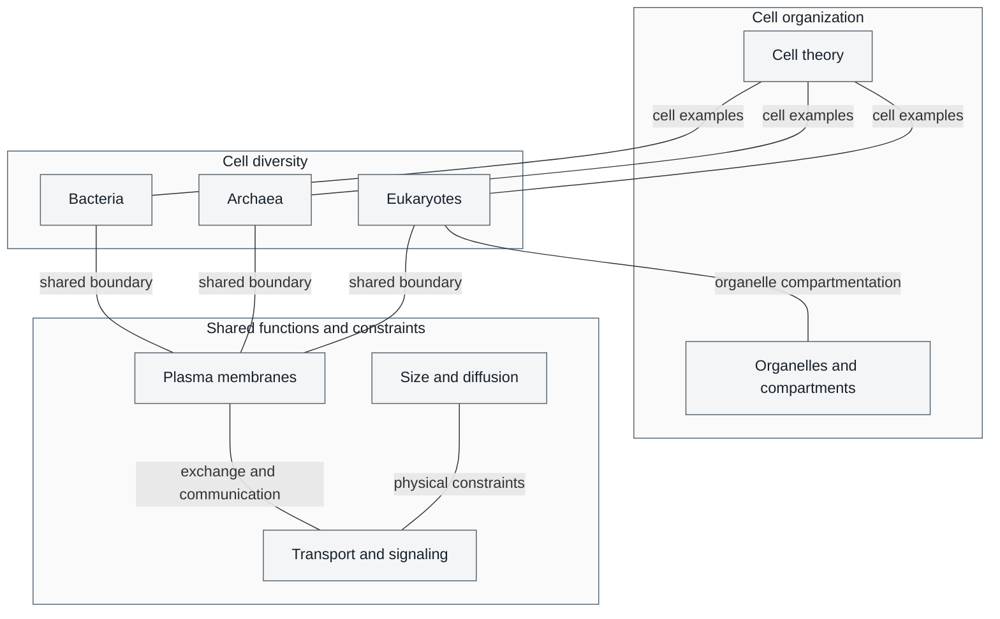

# Unit II — The Cell: Introduction {#sec:unit_II_unit_intro .unnumbered}


## Why This Unit Matters {.unnumbered}

In 1665, Robert Hooke pressed a thin sliver of cork against the lens of a compound microscope he had
built himself and saw, for the first time in human history, the architectural unit of life: the cell.
He called them *cellulae* — small rooms — because they reminded him of monks' chambers in a monastery.
What Hooke saw in cork were dead walls. Antoni van Leeuwenhoek, a decade later, saw living cells:
bacteria darting through pond water, human sperm, red blood cells coursing through capillaries. The
universe had grown smaller in every direction.

Today, three and a half centuries after those first observations, the cell remains the central unit of
biology — and it turns out to be far stranger and more sophisticated than Hooke could have imagined.
A diploid human nuclear genome of about 6.4 billion base pairs spans roughly 2.2 m at 0.34 nm/bp, not kilometers. Hepatocytes vary in ploidy and nuclear number, so their DNA content and organelle inventories are not one fixed count. Cells continuously coordinate metabolism, signaling, protein turnover and DNA repair; daily lesion estimates must not be misread as lesions repaired every second.

This unit examines the cell at three levels of resolution: the **cellular** (organelle inventory and
function), the **molecular** (membrane biophysics, signal transduction), and the **computational**
(mathematical models of cell size constraints, diffusion, and membrane potential). You will encounter
the endosymbiotic theory — one of the most elegant and evidence-rich hypotheses in biology — and the
minimal cell, which asks: what is the irreducible instruction set for life?

---

## Landmark Discoveries {.unnumbered}

| Discoverer(s) | Year | Journal / Source | Discovery | Significance |
| ------------- | ---- | ---------------- | --------- | ------------ |
| Robert Hooke | 1665 | \citep{hooke1665} | "Cells" in cork | Named and conceptualised the cellular unit; launched microscopy as a biological tool |
| Schleiden & Schwann | 1838–39 | \citep{schleiden1838,schwann1839} | Cell theory (plants + animals) | Classical postulates describe organisms as cellular and the cell as a basic unit of life |
| Rudolf Virchow | 1855 | \citep{virchow1855} | *Omnis cellula e cellula* | Cells arise from pre-existing cells; this postulate concerns cellular continuity, not the origin of the first cells |
| George Palade | 1953 | \citep{palade1955small} | Ribosome discovery via electron microscopy | Identified the protein synthesis machinery; Nobel Prize, 1974 |
| Peter Mitchell | 1961 | \citep{mitchell1961} | Chemiosmosis — proton-gradient-driven ATP synthesis | Explained mitochondrial ATP production; later became central to \nameref{sec:unit_III_unit_intro} |
| Lynn Margulis | 1967 | \citep{margulis1967} | Formal endosymbiotic theory | Proposed mitochondria and chloroplasts are descended from engulfed bacteria |
| J. Craig Venter et al. | 2016 | \citep{venter2016syn3} | JCVI-syn3.0: minimized synthetic genome (473 genes) | Tested genome requirements in an existing cellular and supportive culture context, not a universal lower boundary of life |

---

## Cell diversity, shared boundaries, and compartmentation {.unnumbered}


<!-- alt: Graph showing cell diversity is shown alongside shared membrane functions and physical constraints; organelle compartmentation is highlighted for eukaryotes. Labeled arrowless connectors identify selected relationships, not ancestry or a prerequisite order. Transport and signaling are not restricted to eukaryotes. -->

*Cell diversity is shown alongside shared membrane functions and physical constraints; organelle compartmentation is highlighted for eukaryotes. Labeled arrowless connectors identify selected relationships, not ancestry or a prerequisite order. Transport and signaling are not restricted to eukaryotes.*

---

## Current Evidence Thread {.unnumbered}

Read \nameref{sec:unit_II_unit_intro} as a measurement story: cell biology is now captured as live-cell biosensor and optogenetic recordings, cryo-electron tomograms, spatial and single-cell atlases, and perturbational screens rather than static diagrams alone. As you
move through the chapters, keep a two-column note: **claim** on the left,
**evidence that would change my confidence** on the right. By the end of the
unit, each major idea should be tied to a measurement, model, citation, or
paper-based lab decision.

## Chapter Roadmap {.unnumbered}

| Chapter | Title | Core Question | Key Equation / Model |
| ------- | ----- | ------------- | -------------------- |
| \cref{sec:unit_II_cell_theory} | Cell Theory and Cell Types | What is a cell, and how did cell theory transform biology? | $A/V = 3/r$; $t = x^2/2D$ |
| \cref{sec:unit_II_cell_structure} | Cell Structure and Organelles | How do eukaryotic organelles achieve compartmentalized function? | Nernst equation (membrane potential) |
| \cref{sec:unit_II_membrane_transport} | Membrane Transport | How do cells control passage across membranes? | Fick's First Law: $J = -D(dC/dx)$ |
| \cref{sec:unit_II_cell_signaling} | Cell Signaling | How do extracellular signals change intracellular behavior? | Hill equation (cooperativity); cAMP second messenger models |

---

## Connections Across the Textbook {.unnumbered}

- **Membranes and transport** (\cref{sec:unit_II_membrane_transport}) are the physical substrate for the proton-motive force of mitochondria and chloroplasts (\nameref{sec:unit_III_unit_intro}) and the action potential of neurons (\nameref{sec:unit_IX_unit_intro}).
- **Cell signaling** (\cref{sec:unit_II_cell_signaling}) reappears in \nameref{sec:unit_IV_unit_intro} (nuclear signaling and gene regulation), \nameref{sec:unit_V_unit_intro} (mitosis/meiosis checkpoints), \nameref{sec:unit_IX_unit_intro} (hormone receptor cascades), and oncogene/tumor-suppressor biology.
- **Endosymbiosis** directly informs \nameref{sec:unit_VI_unit_intro} (mitochondrial DNA as molecular clock), \nameref{sec:unit_VII_unit_intro} (organelle gene transfer to nucleus), and \nameref{sec:unit_VIII_unit_intro} (chloroplast inheritance).
- **Prokaryotic cell structure** (cell walls, flagella, pili) underpins \nameref{sec:unit_VII_unit_intro} (Microbiology) — antibiotic mechanisms, Gram staining, biofilm formation.

> **Key vocabulary introduced here:** prokaryote, eukaryote, organelle, nucleoid, plasma membrane, endosymbiosis, fluid-mosaic model, ligand, receptor, second messenger, autophagy.


## Computational Toolbox — Unit II {.unnumbered}

```python
from biology.cell import nernst_potential, goldman_equation, IonConcentration

# Nernst equation: equilibrium potential for K+ at 37°C
k_ion = IonConcentration(ion="K+", charge=1, inside_mM=150, outside_mM=4)
e_k = nernst_potential(k_ion, temperature_K=310.0)
print(f"E_K = {e_k:.1f} mV")
# Approximately -96.8 mV; equilibrium for K+ alone, not the mixed-ion resting potential.

# Goldman-Hodgkin-Katz equation: resting membrane potential
# Permeabilities at rest: P_K = 1.0, P_Na = 0.04, P_Cl = 0.45
ions = [
    IonConcentration(ion="K+", charge=1, inside_mM=150, outside_mM=4),
    IonConcentration(ion="Na+", charge=1, inside_mM=15, outside_mM=145),
    IonConcentration(ion="Cl-", charge=-1, inside_mM=10, outside_mM=120),
]
permeabilities = [1.0, 0.04, 0.45]  # same order as ions; monovalent ions only
v_rest = goldman_equation(ions, permeabilities, temperature_K=310.0)
print(f"V_rest (GHK) = {v_rest:.1f} mV")
# Approximately -71.1 mV from ratio 14.3/204.6.
```

> **Try it yourself:** Change the Na+ permeability entry from 0.04 to 0.6. The same fixed-concentration model depolarizes toward ENa (about +60.6 mV); it is not a full action-potential simulation.

---

*Source note: cell-biology helpers cover membrane biophysics, signal transduction, and organelle inventory. Mermaid diagrams and Nernst plots provide the visual companion.*

## Cross-Unit Integration {.unnumbered}

The membrane and transport concepts in \nameref{sec:unit_II_unit_intro} provide context for chemiosmosis in \nameref{sec:unit_III_unit_intro}. Distinguish the relevant membranes: mitochondrial inner membranes and chloroplast thylakoids support the gradients used by their ATP synthases. Selective permeability and energy-coupled transport matter; passive transport alone does not maintain those gradients. This is a conceptual connection, not a required reading order.
