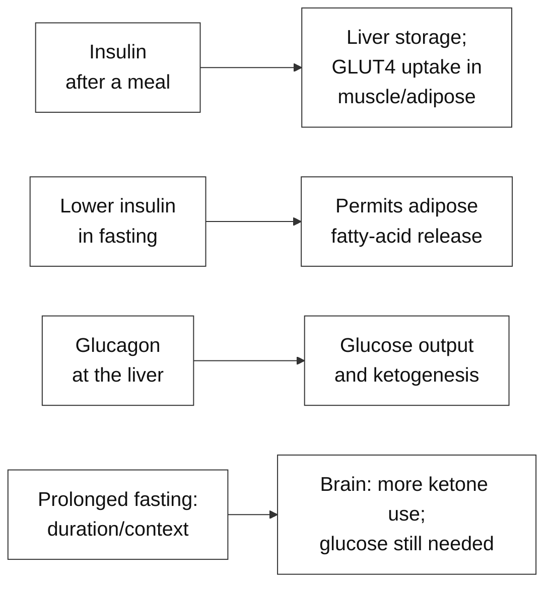
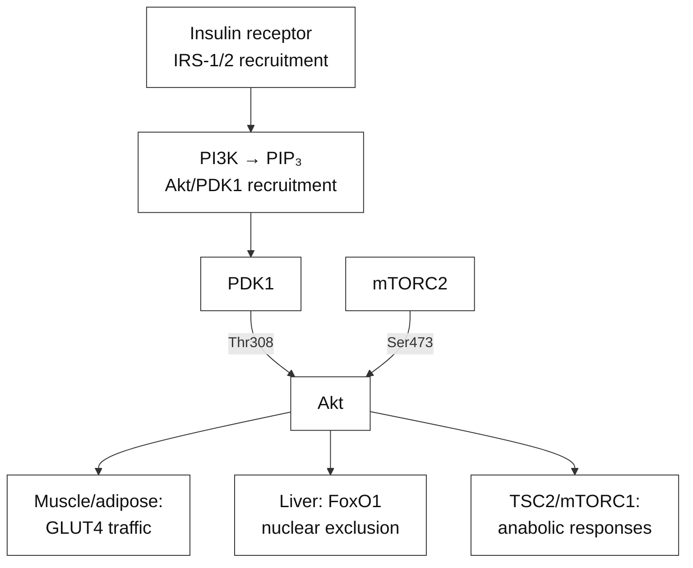
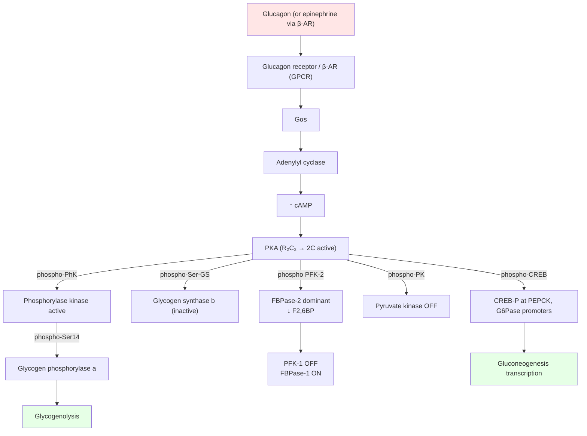
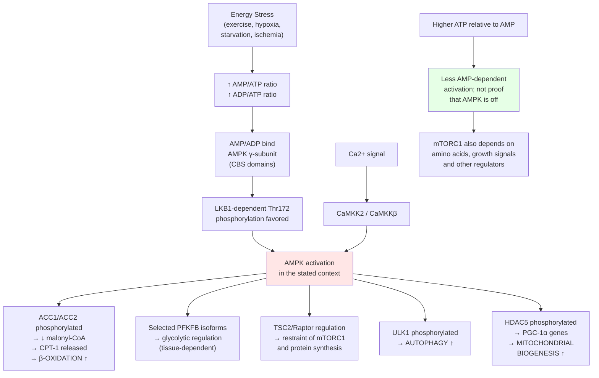
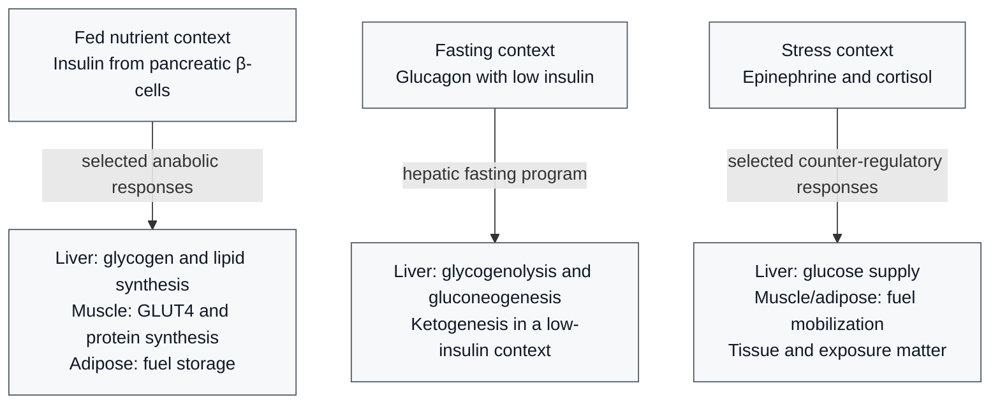

# Metabolic Integration and Regulation

\label{sec:unit_III_metabolic_integration}

\begin{figure}[htbp]
\centering
\includegraphics[width=0.9\textwidth]{../figures/atp_yield_comparison.png}
\caption{Two-component ATP accounting for glycolysis, lactate fermentation, the TCA cycle, and complete aerobic glucose oxidation. Glycolysis and fermentation each net 2 substrate-level ATP; two TCA turns yield 2 substrate-level and about 18 oxidative ATP. The complete glycerol-3-phosphate-shuttle example yields 4 substrate-level + 26 oxidative = 30 ATP; its shuttle adjustment is already included. Partial pathways are not alternative complete glucose-oxidation strategies.}
\label{fig:unit_III_atp_yield_comparison}
\end{figure}

<!-- alt: Stacked bars show substrate-level and oxidative ATP for two glycolytic pathways, the TCA contribution, and a complete aerobic glucose budget totaling thirty ATP with the glycerol-3-phosphate shuttle. -->


<!-- chapter-metadata-badge -->
> Level 3/3 · 60 min read · 100 min lecture · Prerequisites: \cref{sec:unit_III_bioenergetics_and_respiration}, \cref{sec:unit_III_photosynthesis}

## Learning Objectives

By the end of this chapter, you should be able to:

1. Trace how the cell coordinates catabolic and anabolic pathways through shared cofactors and [**allosteric**](#gl:allosteric) cross-regulation, and predict the metabolic state from cofactor and signal-molecule ratios.
2. Describe AMPK and mTORC1 as opposing energy-sensing hubs and explain how they toggle the metabolic state of the cell, including the molecular basis of mTOR's role as a nutrient sensor (Rag GTPases, Ragulator).
3. Describe the metabolic states of fed, post-absorptive, fasting, and starvation, including hormonal control and the timeline of fuel switching.
4. Explain insulin signaling in detail: the PI3K/Akt/mTOR pathway, [**GLUT4**](#gl:glut4) translocation mechanism, and glycogen synthesis.
5. Explain glucagon signaling: cAMP/PKA activation of glycogenolysis, gluconeogenesis, and the phosphorylase kinase cascade.
6. Distinguish allosteric from transcriptional metabolic regulation given an [**enzyme**](#gl:enzyme)-activity time-course, using gluconeogenesis bypass-enzyme control as the worked case.
7. Compare ATP yield and regulation of glucose versus fatty-acid oxidation, and calculate the net ATP yield from palmitoyl-CoA.
8. Explain ketone body metabolism and its role during starvation.
9. Describe AMPK structure (one catalytic α and one each of the regulatory β and γ subunits) and activation mechanisms (LKB1 vs CaMKKβ).
10. Trace flux control through the glucose-fatty-acid (Randle) cycle under fed versus fasted conditions, and predict the resulting respiratory quotient.
11. Define substrate (futile) cycles and explain their control advantages.
12. Explain obesity, metabolic syndrome, and insulin resistance at the molecular level, including visceral fat as an endocrine organ.
13. Apply metabolic control analysis (MCA): flux control coefficients $C_i^J$ and the summation theorem.
14. Calculate the adenylate energy charge from concentrations and predict the resulting AMPK activation state.
15. Describe modern metabolomics: NMR vs mass spectrometry approaches and identification challenges.

<!-- curriculum-scaffold-start -->
### Study Blueprint

- **Big idea:** Metabolism is a regulated network that reallocates flux across tissues, time, and nutrient states.
- **Core concepts:** flux, energy charge, hormonal control, fed/fasted states.
- **Framework alignment:** Vision & Change: Pathways and transformations of energy and matter, Systems; AP Biology: Energetics, Systems Interactions; NGSS-style topics: Matter and Energy in Organisms and Ecosystems.
- **Model or quantitative lens:** Energy charge, control points, and pathway-flux comparisons.
- **Data skill:** Use pathway evidence to infer which metabolic state or tissue is active.
- **Practice cadence:** Representing and Describing Data, Statistical Tests and Data Analysis.
- **Common misconception to repair:** A pathway is not a one-way assembly line; reversibility and regulation define the real route.
- **Primary lab:** \nameref{sec:lab_unit_III_metabolic_integration}.
- **Question bank:** \nameref{sec:q_unit_III_metabolic_integration}.
- **Transfer task:** Apply metabolic network reasoning to diabetes, fasting, exercise, or cancer metabolism.
- **Bridge to computation:** `biology.biochemistry.biochemistry.reaction_free_energy`.
<!-- curriculum-scaffold-end -->

---

> **Opening Vignette: The Brain on Ketones — Surviving Starvation**
>
> The human brain is extraordinarily metabolically demanding: it consumes roughly 20% of the
> body's resting energy budget despite constituting about 2% of body mass. Under normal conditions,
> it runs almost exclusively on glucose. But glucose stores — maintained as liver glycogen — last
> only about 12–24 hours of fasting. So how does the brain survive during prolonged starvation?
>
> The liver activates a metabolic program: free fatty acids released from adipose tissue are
> not completely oxidised within the liver itself. Instead, the liver packages their acetyl-CoA
> units into **ketone bodies** (acetoacetate and β-hydroxybutyrate) and exports them to the
> bloodstream. Ketone use develops progressively over days to weeks, while a glucose requirement
> persists. Owen and colleagues measured cerebral substrate exchange in **three obese patients
> after 5–6 weeks of starvation** and found ketone bodies had replaced glucose as the predominant
> brain fuel \citep{Owen1967}. That small, prolonged-starvation study does not establish a universal
> brain-fuel percentage after three days or a safe fasting prescription.
>
> *Primary source: Owen, O. E. et al. (1967). Brain metabolism during fasting. Journal of Clinical Investigation, 46(10), 1589–1595.*

---

## Metabolic Pathways as Coupled Flux Networks

[**Glycolysis**](#gl:glycolysis), the TCA cycle, beta-oxidation, and biosynthetic pathways do not operate independently. They share intermediates, co-factors (NAD$^+$/NADH, NADP$^+$/NADPH, CoA), and are subject to **allosteric cross-regulation**. Integration of these pathways defines the **metabolic state** of the cell.

The two fundamental modes:
- **Catabolism** --- break down nutrients → ATP + reduced cofactors (NADH, FADH$_2$)
- **Anabolism** --- use ATP + reduced cofactors (chiefly NADPH) → biosynthesis of macromolecules

These modes are reciprocally regulated because of shared cofactors and master regulatory kinases. The metabolic state is encoded in:

: Study Blueprint: Signal molecule and Fed state (high energy). {#tbl:unit_III_metabolic_integration_study_blueprint}
| Signal molecule | Fed state (high energy) | Fasted state (low energy) |
| --------------- | ---------------------- | ------------------------ |
| AMP/ATP ratio | Low | High |
| NADH/NAD$^+$ ratio | High | Low (in [**cytoplasm**](#gl:cytoplasm)) |
| Acetyl-CoA | High | Low (cytoplasmic) |
| Citrate | High | Low |
| Malonyl-CoA | High | Low |
| Insulin/Glucagon ratio | High | Low |


<!-- alt: Flowchart showing selected feeding and fasting programs, not timed on/off switches. Insulin favors fed-state storage and GLUT4 traffic; lower insulin permits adipose fatty-acid release, while glucagon's depicted targets are hepatic. During prolonged fasting, brain ketone use can increase without eliminating glucose demand. Tissue, other hormones, nutritional reserves and duration modulate these responses. -->

*Selected feeding and fasting programs, not timed on/off switches. Insulin favors fed-state storage and GLUT4 traffic; lower insulin permits adipose fatty-acid release, while glucagon's depicted targets are hepatic. During prolonged fasting, brain ketone use can increase without eliminating glucose demand. Tissue, other hormones, nutritional reserves and duration modulate these responses.*

### Fasting Physiology: Fuel Switch Timeline

The following stages are an orientation to changing fuel availability, not a programmed clock. Falling insulin, hepatic glucagon signaling, other hormones, activity and nutritional reserves shape overlapping, tissue-specific responses.

: Fasting Physiology: Fuel Switch Timeline: Time post-meal and Predominant fuel. {#tbl:unit_III_metabolic_integration_fasting_physiology_fuel_switch_timeline}
| Time post-meal | Predominant fuel | Liver process | Brain fuel | Notes |
| -------------- | --------------- | ------------- | ---------- | ----- |
| 0–4 h (absorptive) | Dietary glucose | Glycogenesis, lipogenesis | Glucose | Insulin high, glucagon low |
| 4–12 h (post-absorptive) | Liver glycogen | Glycogenolysis | Glucose | Glucagon rises |
| 12–24 h (early fasting) | Liver glycogen → muscle FA | Glycogen depleting; gluconeogenesis ramping | Glucose (mostly from GNG) | Liver glycogen mostly depleted by ~24 h |
| 1–3 days | Increasing fatty-acid oxidation | Gluconeogenesis and rising ketogenesis | Glucose plus increasing ketones | Adaptation varies by tissue and individual |
| Several days to weeks | Fatty acids and ketones | Sustained ketogenesis | Increasing ketone contribution, with persistent glucose requirement | Protein sparing develops progressively |
| Prolonged starvation | Depends on fat reserves and illness | Gluconeogenesis continues | Mixed glucose and ketones | Terminal protein wasting follows reserve depletion, not a fixed day |

This fuel-switching timeline is one of the most elegant examples of metabolic integration. It is also clinically relevant: bariatric surgery, ketogenic diets, and prolonged fasting interventions most exploit (or perturb) this same switch.

> **Concept Check 1:** Why is it essential that glycolysis and gluconeogenesis are reciprocally regulated and rarely fully active simultaneously? What would happen if both ran at maximum rate?

---

## Insulin Signaling: The PI3K/Akt/mTOR Pathway

Insulin is the master anabolic [**hormone**](#gl:hormone), secreted by pancreatic beta-cells in response to elevated blood glucose \citep{sanger1955insulin,yalow1959}. Its signaling cascade is one of the most important in metabolic regulation:

\begin{equation}
\text{Insulin} \to \text{IR (RTK)} \to \text{IRS-1/2} \to \text{PI3K} \to \text{PIP}_3 \to \text{PDK1 + mTORC2} \to \text{Akt (Thr308 + Ser473)}
\label{eq:unit_III_metabolic_integration_worked_1}
\end{equation}


<!-- alt: Flowchart showing selected insulin–Akt signaling routes and tissue-dependent outputs. GLUT4 traffic concerns responsive muscle and adipose cells; hepatic FoxO1 regulation is not an all-or-none switch for gluconeogenesis. The mTORC1-linked response also depends on nutrient and cellular context. -->

*Selected insulin–Akt signaling routes and tissue-dependent outputs. GLUT4 traffic concerns responsive muscle and adipose cells; hepatic FoxO1 regulation is not an all-or-none switch for gluconeogenesis. The mTORC1-linked response also depends on nutrient and cellular context.*

Akt is the central node of this selected receptor-to-output cascade, integrating PDK1 (Thr308) and mTORC2 (Ser473) phosphorylations. Its downstream routes favor glucose uptake, glycogen synthesis, lipogenesis, and protein synthesis in responsive tissues, rather than imposing the same metabolic program on every cell. The diagram omits intermediate targets retained below.

**Downstream Akt targets:**

: Selected Akt targets: tissue-dependent metabolic effects and context. {#tbl:unit_III_metabolic_integration_fasting_physiology_fuel_switch_timeline_2}
| Target | Akt effect | Outcome and tissue/context |
| ------ | ---------- | ----------------- |
| AS160 (TBC1D4) | Phosphorylation → Rab-GAP inactivated | **GLUT4 vesicle exocytosis** → glucose uptake in responsive muscle/adipose cells |
| GSK3 (glycogen synthase kinase 3) | Phosphorylation → inhibited | Favors **glycogen synthase activity** and glycogen synthesis in responsive tissues |
| FoxO1 | Phosphorylation → nuclear exclusion | In liver, reduces **PEPCK and G6Pase [**gene**](#gl:gene) expression**; not complete shutdown of gluconeogenesis |
| TSC2 | Phosphorylation → inhibited | Favors **mTORC1 activation**, [**protein**](#gl:protein) synthesis and lipogenesis when nutrient/cellular context permits |
| BAD | Phosphorylation → binds 14-3-3 | Favors **cell survival** in responsive cells |
| PDE3B | Phosphorylation → activated | **cAMP degradation** → reduces cAMP signaling in responsive cells |

**GLUT4 translocation mechanism (in detail):**

1. **Basal state.** GLUT4 is sequestered in specialized intracellular vesicles (GSVs, GLUT4 storage vesicles) ~95% of the time, with about 5% at the plasma membrane. The vesicles are tethered by the inhibitory Rab-GAP **AS160 (TBC1D4)**, which keeps Rab10 in its GDP-bound (inactive) state.
2. **Insulin signal.** Akt phosphorylates AS160 on multiple sites (Thr642 most important), inhibiting its GAP activity.
3. **Rab10 activation.** With AS160 off, Rab10 accumulates in the GTP-bound active state, promoting vesicle docking at the plasma membrane.
4. **SNARE-mediated fusion.** Synaptobrevin-2 (VAMP2) on GSVs engages plasma-membrane syntaxin-4 + SNAP-23, driving membrane fusion.
5. **GLUT4 exposure.** GLUT4 appears at the cell surface, increasing glucose uptake 10–20-fold.
6. **Endocytosis on signal termination.** When insulin signal ends, GLUT4 is endocytosed back to GSVs via clathrin-coated pits and a slow constitutive recycling pathway.

In type 2 diabetes, this cascade is disrupted at multiple levels (see clinical box below) so that GLUT4 translocation is impaired even at high circulating insulin.

> **Clinical Connection: Insulin Resistance and Type 2 Diabetes**
> In type 2 diabetes, insulin signaling is impaired at multiple levels:
> 1. **Lipid and inflammatory routes:** DAG/PKC, ceramide/phosphatase and stress-kinase mechanisms have been investigated in particular tissues and preparations; they do not imply that every IRS-1 serine phosphorylation is inhibitory.
> 2. **A site-specific counterexample:** Replacing mouse Irs1 Ser307 (human Ser312) with alanine worsened insulin resistance in the studied high-fat-fed mice, contrary to a universal inhibitory-site interpretation \citep{copps2010irs1}.
> 3. **Endpoint and tissue distinction:** Impaired muscle/adipose glucose uptake, hepatic glucose production and compensatory insulin secretion require different measurements; one phosphorylation marker cannot identify all three.
> These mechanisms can impair insulin signaling, but their importance depends on tissue and preparation; GLUT4 translocation concerns responsive muscle and adipose cells, not a universal hepatic glucose transporter. Metformin can lower hepatic glucose production without requiring AMPK in the studied mouse knockout preparations; AMPK activation is not proof of a unique drug mechanism \citep{foretz2010metformin}. See \cref{sec:unit_II_cell_signaling} for RTK signaling.

> **Concept Check 2:** Thiazolidinediones (e.g., rosiglitazone) activate PPAR-gamma in adipose tissue, increasing adipocyte differentiation and lipid storage. Explain how increasing fat storage in adipose tissue could paradoxically improve insulin sensitivity in muscle and liver.

---

## Glucagon Signaling: cAMP/PKA Pathway

Glucagon is secreted by pancreatic alpha-cells when blood glucose falls. It acts primarily on the **liver** (hepatocytes express glucagon receptors; muscle does not), where cyclic-AMP signaling translates hormone binding into metabolic control \citep{sutherland1958cyclicamp}:

**Glucagon → Glucagon receptor (GPCR) → G$_s$ → Adenylyl cyclase → cAMP → PKA**


<!-- alt: Flowchart showing glucagon and epinephrine activate GPCR-cAMP-PKA signaling, shifting liver metabolism toward glycogen breakdown and gluconeogenesis during fasting or stress. -->

*Glucagon and epinephrine activate GPCR-cAMP-PKA signaling, shifting liver metabolism toward glycogen breakdown and gluconeogenesis during fasting or stress.*

*Glucagon (or epinephrine) signaling cascade in the liver (Mermaid).* The cAMP/PKA cascade simultaneously activates glycogenolysis (via phosphorylase kinase) and gluconeogenesis (via CREB transcription) while suppressing glycolysis (via PFK-2/pyruvate kinase phosphorylation).

### The Phosphorylase Kinase Cascade — A Signal Amplifier

The chain glucagon → GPCR → cAMP → PKA → **phosphorylase kinase** (PhK) → glycogen phosphorylase illustrates catalytic amplification \citep{sutherland1958cyclicamp}. The following **synthetic integrated-count ledger** stipulates totals produced or activated in one 60 s window per continuously occupied receptor; it is not a measured hormone response. Counts are cumulative newly activated molecules, counted once, and require the named pools not to be limiting.

: The Phosphorylase Kinase Cascade — A Signal Amplifier: Step and Numerical amplification. {#tbl:unit_III_metabolic_integration_the_phosphorylase_kinase_cascade_a_signal_amplifier}
| Step | Stipulated count per receptor per 60 s window |
| ---- | ----------------------- |
| Occupied receptor (input) | 1 |
| Gα$_s$ activated | 10 |
| cAMP produced through adenylyl cyclase | 1,000 |
| PKA holoenzymes activated, assuming four cAMP bound each | 250 |
| Released PKA catalytic subunits, two per holoenzyme | 500 |
| PhK molecules activated, ten per PKA catalytic subunit | 5,000 |
| Glycogen phosphorylase molecules activated, ten per PhK | 50,000 |
| Glucose-1-P produced, ten per activated phosphorylase | 500,000 |

The stipulated count gain is $5\times10^5$ glucose-1-P molecules per occupied receptor per 60 s, requiring at least 500,000 accessible glycogen residues and the listed enzyme pools. PKA gating is not a catalytic rate gain. Actual counts require kinetic activation, deactivation and substrate measurements. Concentration conversion additionally requires compartment volumes: a femtomolar-to-millimolar concentration ratio is $10^{12}$, not $10^7$, and is not this count gain.

**PKA targets in the liver:**

: The Phosphorylase Kinase Cascade — A Signal Amplifier: Target and PKA effect. {#tbl:unit_III_metabolic_integration_the_phosphorylase_kinase_cascade_a_signal_amplifier_2}
| Target | PKA effect | Metabolic outcome |
| ------ | ---------- | ----------------- |
| Phosphorylase kinase | Activated | Glycogen phosphorylase activated → **glycogenolysis** |
| Glycogen synthase | Inhibited (phosphorylated) | Glycogen synthesis OFF |
| PFK-2/FBPase-2 | FBPase-2 activated → F2,6BP destroyed | **Glycolysis inhibited** |
| Pyruvate kinase | Inhibited (phosphorylated) | Glycolysis slowed |
| CREB | Activated | **PEPCK and G6Pase gene [**transcription**](#gl:transcription)** → gluconeogenesis |
| IP3R | Sensitised | Ca$^{2+}$ release from ER |
| HSL (adipose, via β-AR) | Activated | Lipolysis (in adipose; not liver) |

---

## Gluconeogenesis and Fasting Glucose Supply

Gluconeogenesis synthesizes glucose from non-carbohydrate precursors (lactate, glycerol, glucogenic amino acids). It occurs primarily in the **liver** and to a lesser extent in the **kidney cortex**.

Gluconeogenesis is NOT simply the reverse of glycolysis. Three irreversible glycolytic steps require **bypass enzymes**:

: The Phosphorylase Kinase Cascade — A Signal Amplifier: Glycolytic step (irreversible) and Gluconeogenic bypass. {#tbl:unit_III_metabolic_integration_the_phosphorylase_kinase_cascade_a_signal_amplifier_3}
| Glycolytic step (irreversible) | Gluconeogenic bypass | Location |
| ------------------------------ | -------------------- | -------- |
| Pyruvate kinase (PEP → Pyruvate) | **Pyruvate carboxylase** (Pyruvate → OAA; biotin, ATP) + **PEPCK** (OAA → PEP; GTP) | Mitochondria + cytoplasm |
| PFK-1 (F6P → F1,6BP) | **Fructose-1,6-bisphosphatase (FBPase-1)** | Cytoplasm |
| Hexokinase (Glucose → G6P) | **Glucose-6-phosphatase (G6Pase)** | ER membrane (liver, kidney primarily) |

**Cost:** 6 ATP equivalents per glucose synthesized (4 ATP + 2 GTP).

**Regulation of gluconeogenesis:**
- **Allosteric:** Pyruvate carboxylase activated by acetyl-CoA; FBPase-1 inhibited by AMP and F2,6BP
- **Hormonal:** Glucagon (via CREB) induces PEPCK and G6Pase genes; insulin (via FoxO1) represses them
- **Reciprocal with glycolysis:** F2,6BP activates PFK-1 (glycolysis) and inhibits FBPase-1 (gluconeogenesis), ensuring they do not run simultaneously

> **Concept Check 3:** Ethanol metabolism in the liver generates excess NADH (from alcohol dehydrogenase and aldehyde dehydrogenase). Predict the effect of heavy alcohol consumption on gluconeogenesis and the risk of hypoglycaemia.

---

## Glycogen Metabolism and Rapid Glucose Storage

### Glycogen Branching and Granule Architecture

Glycogen is a branched polymer of glucose units:
- **Alpha-1,4 linkages:** linear chains (~8--12 glucose units between branch points)
- **Alpha-1,6 linkages:** branch points (~every 8--12 residues)
- **Glycogenin:** self-glucosylating primer protein at the core

Liver glycogen (~100 g): blood glucose [**buffer**](#gl:buffer). Muscle glycogen (~400 g): local fuel for contraction (rarely exported as glucose because muscle lacks G6Pase).

### Glycogen Synthase and Glycogen Phosphorylase Regulation

**Glycogen phosphorylase:** Cleaves alpha-1,4 linkages from non-reducing ends, releasing glucose-1-phosphate. Regulated by:
- **Allosteric activation:** AMP (muscle); glucose (liver, inhibitory)
- **Covalent modification:** Phosphorylase kinase phosphorylates Ser14 → active **a** form
- **Hormonal cascade:** Glucagon/epinephrine → cAMP → PKA → phosphorylase kinase → phosphorylase a

**Glycogen synthase:** Adds UDP-glucose to non-reducing ends (alpha-1,4 linkages). Active when dephosphorylated (GSK3 phosphorylates → inactive; insulin inhibits GSK3 → GS active).

**Branching enzyme:** Transfers ~7-residue segments to create alpha-1,6 branches. Increases solubility and number of non-reducing ends (more rapid mobilization).

**Debranching enzyme:** Bifunctional: transferase activity moves 3 residues from branch, then alpha-1,6-glucosidase cleaves the branch point, releasing free glucose.

> **Clinical Connection: Glycogen Storage Diseases**
> | Type | Enzyme deficiency | Features |
> | ---- | ----------------- | -------- |
> | I (von Gierke) | Glucose-6-phosphatase | Severe hypoglycaemia, hepatomegaly, lactic acidosis |
> | II (Pompe) | Lysosomal alpha-glucosidase | Cardiac/skeletal myopathy; treated by ERT |
> | V (McArdle) | Muscle glycogen phosphorylase | Exercise intolerance; "second wind" phenomenon |
> | VII (Tarui) | Muscle PFK | Exercise intolerance, hemolytic anemia |

---

## Fatty Acid Oxidation (Beta-Oxidation)

Beta-oxidation occurs in the **mitochondrial matrix** and degrades fatty acyl-CoA by removing 2-carbon units (acetyl-CoA) per cycle.

### Activation and Transport

1. **Activation:** Fatty acid + CoA + ATP → Acyl-CoA + AMP + PP$_i$ (acyl-CoA synthetase; outer mitochondrial membrane; costs 2 ATP equivalents)
2. **Carnitine shuttle:** Acyl-CoA cannot cross the IMM. Instead:
   - **CPT-1** (outer face of IMM): acyl-CoA + carnitine → acylcarnitine + CoA
   - **Translocase (CACT):** acylcarnitine crosses IMM
   - **CPT-2** (inner face of IMM): acylcarnitine + CoA → acyl-CoA + carnitine

**CPT-1 is the rate-limiting step** of beta-oxidation. **Malonyl-CoA** (the first committed intermediate of fatty acid synthesis) **allosterically inhibits CPT-1**, ensuring that fatty acid synthesis and oxidation do not occur simultaneously.

### Beta-Oxidation Steps (Each Cycle)

: Beta-Oxidation Steps (Each Cycle): Step and Enzyme. {#tbl:unit_III_metabolic_integration_beta_oxidation_steps_each_cycle}
| Step | Enzyme | Reaction | Product |
| ---- | ------ | -------- | ------- |
| 1 | Acyl-CoA dehydrogenase | Acyl-CoA → trans-enoyl-CoA | **FADH$_2$** |
| 2 | Enoyl-CoA hydratase | trans-enoyl-CoA + H$_2$O → L-3-hydroxyacyl-CoA | -- |
| 3 | 3-Hydroxyacyl-CoA DH | L-3-hydroxyacyl-CoA → 3-ketoacyl-CoA | **NADH** |
| 4 | Thiolase | 3-ketoacyl-CoA + CoA → acyl-CoA(n-2) + acetyl-CoA | **Acetyl-CoA** |

Each cycle: removes 2 carbons as acetyl-CoA, produces 1 FADH$_2$ + 1 NADH.

### ATP Yield from Palmitoyl-CoA (C16:0)

Summing the products of complete fatty-acid oxidation makes the "fat is
energy-dense" claim quantitative; the chapter-opening \cref{fig:unit_III_atp_yield_comparison} already showed the corresponding glucose-substrate comparison across fermentative and aerobic strategies. Palmitoyl-CoA (16 carbons) undergoes 7 cycles
of beta-oxidation:

: ATP Yield from Palmitoyl-CoA (C16:0): Product and Quantity. {#tbl:unit_III_metabolic_integration_atp_yield_from_palmitoyl_coa_c16_0}
| Product | Quantity | ATP per unit | Total ATP |
| ------- | -------- | ------------ | --------- |
| Acetyl-CoA (via TCA) | 8 | 10 (3 NADH x 2.5 + 1 FADH$_2$ x 1.5 + 1 GTP) | 80 |
| FADH$_2$ (beta-oxidation) | 7 | 1.5 | 10.5 |
| NADH (beta-oxidation) | 7 | 2.5 | 17.5 |
| Activation cost from palmitoyl-CoA | Already paid before the stated substrate | 0 | 0 |
| **Total from palmitoyl-CoA** | | | **108** |

Starting from free palmitate requires ATP → AMP + PPi for activation, costing two ATP equivalents, so its net yield is 106. Both calculations use P/O = 2.5 and 1.5; the difference is substrate definition, not older P/O values.

> **Clinical Connection: MCAD Deficiency**
> Medium-chain acyl-CoA dehydrogenase (MCAD) deficiency is the most common inherited disorder of fatty acid oxidation (~1:10,000 births). During fasting, patients cannot oxidise medium-chain fatty acids, leading to hypoketotic hypoglycaemia (low ketones because acetyl-CoA production is impaired, low glucose because gluconeogenesis lacks acetyl-CoA stimulation of pyruvate carboxylase). Fatal Reye-like episodes can occur. Management: avoid prolonged fasting; ensure regular carbohydrate intake.

---

## Fatty Acid Synthesis

Fatty acid synthesis occurs in the **cytoplasm** and uses fundamentally different chemistry from beta-oxidation:

: ATP Yield from Palmitoyl-CoA (C16:0): Feature and Beta-oxidation. {#tbl:unit_III_metabolic_integration_atp_yield_from_palmitoyl_coa_c16_0_2}
| Feature | Beta-oxidation | Fatty acid synthesis |
| ------- | -------------- | -------------------- |
| Location | Mitochondrial matrix | Cytoplasm |
| Carrier | CoA | ACP (acyl carrier protein) |
| Reducing agent | FAD, NAD$^+$ (oxidised) | NADPH (reduced) |
| 2C unit | Acetyl-CoA (removed) | Malonyl-CoA (added) |
| Key enzyme | Multiple separate enzymes | **FAS** (fatty acid synthase, one large multifunctional enzyme in animals) |
| Regulation | Inhibited by malonyl-CoA | Activated by citrate; inhibited by palmitoyl-CoA |

**Acetyl-CoA carboxylase (ACC)** catalyses the committed step: acetyl-CoA + CO$_2$ + ATP → malonyl-CoA. This is the key regulatory enzyme:
- **Activated by:** citrate (allosteric), insulin (dephosphorylation)
- **Inhibited by:** palmitoyl-CoA (product inhibition), AMPK phosphorylation (energy depletion), glucagon (via PKA)

---

## Ketone Body Metabolism

During prolonged fasting (>24--48 h), the liver converts excess acetyl-CoA from fatty acid oxidation into **ketone bodies**: acetoacetate, beta-hydroxybutyrate, and acetone.

**Synthesis (liver mitochondria):**
1. 2 Acetyl-CoA → Acetoacetyl-CoA (thiolase)
2. Acetoacetyl-CoA + Acetyl-CoA → HMG-CoA (HMG-CoA synthase)
3. HMG-CoA → Acetoacetate + Acetyl-CoA (HMG-CoA lyase)
4. Acetoacetate → beta-Hydroxybutyrate (beta-hydroxybutyrate DH; uses NADH)
5. Acetoacetate → Acetone (non-enzymatic decarboxylation; exhaled)

**Utilization (brain, heart, muscle):**
Beta-hydroxybutyrate → acetoacetate → acetoacetyl-CoA (via succinyl-CoA transferase, also called thiophorase) → 2 acetyl-CoA → TCA cycle.

**Key points:**
- The liver **cannot use** ketone bodies (lacks thiophorase)
- The brain normally uses primarily glucose but during starvation adapts to derive **~60--70%** of its energy from ketone bodies, sparing muscle protein
- This protein-sparing effect is essential for survival during prolonged fasting
- Diabetic ketoacidosis (DKA): uncontrolled type 1 diabetes → absent insulin → massive lipolysis → excessive ketone body production → metabolic acidosis ([**pH**](#gl:ph) <7.3), dehydration, potentially fatal

> **Concept Check 4:** Why can the liver produce ketone bodies but not use them? What is the physiological advantage of this arrangement?

---

## AMPK --- The Cellular Energy Gauge

**AMPK** is an αβγ heterotrimer: one catalytic α, one scaffolding β, and one nucleotide-sensing γ subunit. α1/α2 and β1/β2 are alternative isoforms, not simultaneous copies in one holoenzyme. The γ CBS domains bind adenine nucleotides; occupancy and Thr172 phosphorylation integrate energy signals.


<!-- alt: Graph showing selected mammalian AMPK pathways: nucleotide and calcium inputs, context-dependent downstream effects, and the limits of an on/off cartoon. -->

*Selected mammalian AMPK pathways: nucleotide and calcium inputs, context-dependent downstream effects, and the limits of an on/off cartoon \citep{hardie2012ampk}.*

> **Concept Check (Analysis — Cross-Unit Connection):** Gibbs reaction free energy and variational free energy are different mathematical objects; a shared name does not establish mechanistic equivalence. (a) For the stated ideal 1-M standard-state ATP model at 310 K, calculate hydrolysis ΔG for ATP = 2 mM, ADP = 1 mM and phosphate = 1 mM. Why would an ADP:ATP ratio alone be insufficient? Distinguish thermodynamic favorability from reaction rate. (b) A variational account such as that introduced in \nameref{sec:unit_0_unit_intro} must specify observations, a generative model and a probability functional. Which additional model definitions and discriminating measurements would be needed before calling AMPK a biological implementation of that account? Biochemical energy sensing alone does not demonstrate such an implementation.

### AMPK Activation: LKB1 vs CaMKKβ

AMPK is activated when its catalytic α-subunit is phosphorylated at **Thr172**. Two upstream kinases phosphorylate this site under different physiological conditions:

: AMPK Activation: LKB1 vs CaMKKβ: Upstream kinase and Trigger. {#tbl:unit_III_metabolic_integration_ampk_activation_lkb1_vs_camkk}
| Upstream kinase | Trigger | Tissue distribution | Pathological connection |
| --------------- | ------- | ------------------- | ---------------------- |
| **LKB1** (STK11) | Energy stress (high AMP); allosterically primed by AMP binding to AMPK γ | Ubiquitous; constitutively active | Loss-of-function = Peutz-Jeghers syndrome, predisposes to gastrointestinal cancers |
| **CaMKKβ** | Elevated cytosolic Ca$^{2+}$ (independent of AMP) | Brain, muscle, T cells, endothelium | Important in T-cell activation, osmotic stress |
| **TAK1** | Inflammatory cytokines (TGF-β, TNF-α) | Limited | Crosstalk between inflammation and metabolism |

**LKB1 supplies an important activation-loop phosphorylation route during energy stress.** AMP binding can allosterically activate AMPK and promote net Thr172 phosphorylation; AMP and ADP can protect against dephosphorylation, whereas ATP competes at nucleotide-binding sites. These contributions are distinct, and their magnitude depends on isoform, localization and preparation \citep{hardie2012ampk}.

**CaMKKβ (CaMKK2) supplies a Ca$^{2+}$-linked activation route** in responsive preparations. It can activate AMPK without an initiating rise in AMP, so an energy-charge value does not uniquely identify either the upstream kinase or AMPK activity \citep{hardie2012ampk}.

### Adenylate Energy Charge and Metabolic State

The **adenylate energy charge (EC)** introduced by Atkinson is a normalized summary of adenylate phosphorylation state, not a direct measurement of ATP hydrolysis free energy or a complete description of an energy-sensing pathway \citep{atkinson1968}:

\begin{equation}
\text{E.C.} = \frac{[\text{ATP}] + \tfrac{1}{2}[\text{ADP}]}{[\text{ATP}] + [\text{ADP}] + [\text{AMP}]}
\label{eq:unit_III_energy_charge}
\end{equation}

Writing the ratio as $(2[\mathrm{ATP}]+[\mathrm{ADP}])/(2A_{\mathrm{total}})$ explains the half-weight on ADP. For a positive total pool with nonnegative components, $0\leq EC\leq1$: EC=0 requires all adenylate to be AMP, and EC=1 requires all adenylate to be ATP. Total adenylate is conserved only when the specified model or experimental conditions justify that assumption.

EC alone does not determine the AMP:ATP or ADP:ATP ratio unless additional constraints are supplied. AMPK also depends on nucleotide binding, activation-loop phosphorylation, upstream kinases and cellular context; there is no universal EC activation window that can be inferred from this formula \citep{hardie2012ampk}.

## Worked Example: Energy Charge and an Identifiability Limit

*Problem:* Construct two artificial 1-mM adenylate pools, A with ATP/ADP/AMP = 0.6/0.4/0 mM and B with 0.8/0/0.2 mM. No adenylate-kinase equilibrium is imposed. Calculate EC and AMP:ATP for each. Can EC alone identify the nucleotide composition or AMPK activity?

*Solution:* Both pools give the same normalized phosphorylation score:

\begin{equation}
EC_A=\frac{0.6+0.5(0.4)}{1.0}=0.8,\qquad EC_B=\frac{0.8+0.5(0)}{1.0}=0.8
\label{eq:unit_III_metabolic_integration_worked_2}
\end{equation}

Yet AMP:ATP is 0 in A and $0.2/0.8=0.25$ in B. These are algebraic teaching compositions, not measurements or claims about equilibrium cells. The scalar therefore cannot reconstruct all three pools without further assumptions. Neither score alone proves kinase activation: a biological study needs the actual preparation, nucleotide state and appropriate AMPK activity/phosphorylation readouts with controls.

> **Clinical Connection: Metformin, Mechanism and Outcome**
> Metformin is used in type 2 diabetes, but observing AMPK activation does not establish that AMPK uniquely mediates every drug effect. Foretz et al. found that metformin still inhibited glucose production in the studied AMPK-deficient mouse hepatocytes and liver models \citep{foretz2010metformin}. This is preparation-, genotype- and exposure-specific evidence, not a universal human mechanism or a prescribing recommendation. Mechanistic AMPK or mTORC1 results also do not by themselves establish anti-aging or anticancer benefit in patients.

> **Worked Example — EC Is Not ATP Hydrolysis Free Energy:** In a separate constructed model, fix ATP/ADP/AMP at 2/1/1 mM, so $EC=(2+0.5)/4=0.625$. At 310 K, increase inorganic phosphate from 1 to 10 mM while holding these pools and the ideal-activity, pH and magnesium assumptions fixed. EC stays 0.625, but ATP hydrolysis becomes less favorable by $RT\ln(10)\approx5.93$ kJ/mol. `biology.biochemistry.atp_free_energy` implements the stated 1-M standard-state approximation. This is a model comparison, not an ischemia experiment or an AMPK threshold.

> **Concept Check (Synthesis):** Aerobic glycolysis in cancer does not mean mitochondrial ATP production is absent. (a) Compare the net 2 ATP per glucose from glycolytic fermentation with the higher, coupling- and shuttle-dependent total from complete aerobic oxidation; distinguish yield, production rate, precursor demands and NADPH-generating routes. (b) Draw a deliberately simplified mTORC1 input model combining growth-factor, amino-acid and energy signals. Identify which additional measurements would be needed to predict a response to lower glucose rather than treating one input as a universal switch. (c) Explain why a drug-induced change in ATP pools, AMPK phosphorylation or mTORC1 signaling does not alone establish an anticancer clinical outcome.


---

## Worked Example: Flux Control Coefficient

*Problem:* A constructed steady-state pathway has baseline flux 10.00 µmol/min. In one independent perturbation, enzyme A activity rises from 100 to 101 activity units and flux rises to 10.03 µmol/min. In a second perturbation from the same baseline, transporter B activity rises from 100 to 101 units and flux rises to 10.01 µmol/min. Other external parameters are held fixed and internal metabolites re-equilibrate. Estimate the local flux control coefficients; these are synthetic teaching inputs, not hepatocyte measurements.

*Solution:*

**Step 1 — State the local approximation.** For sufficiently small perturbations about the same smooth steady state, the logarithmic derivative is approximated by a ratio of fractional changes. Finite perturbations estimate rather than exactly determine that derivative:

\begin{equation}
C_i^J \approx \frac{\Delta J / J}{\Delta e_i / e_i}
\label{eq:unit_III_metabolic_integration_worked_3}
\end{equation}

**Step 2 — Enzyme A:** $\Delta e/e=1/100=0.01$ and $\Delta J/J=0.03/10=0.003$:

\begin{equation}
C_A^J\approx\frac{0.003}{0.01}=0.30
\label{eq:unit_III_metabolic_integration_worked_4}
\end{equation}

**Step 3 — Transporter B:** $\Delta e/e=0.01$ and $\Delta J/J=0.01/10=0.001$:

$$C_B^J\approx\frac{0.001}{0.01}=0.10$$

**Step 4 — Interpret within the model.** A has the larger estimated local response under these constructed conditions. If the classical summation assumptions apply, the unmeasured coefficients sum to approximately $1-0.30-0.10=0.60$; their individual values and signs remain unknown. This does not establish a universal glycolytic-control range, rule out dominance elsewhere, or predict a large drug perturbation from a local derivative.

---

## mTORC1 --- The Growth Integrator and Nutrient Sensor

**mTORC1** (mechanistic Target of Rapamycin Complex 1) integrates amino acid, glucose, oxygen, and growth factor signals:

: Adenylate Energy Charge and Metabolic State: Input and Sensing mechanism. {#tbl:unit_III_metabolic_integration_adenylate_energy_charge_and_metabolic_state}
| Input | Sensing mechanism | Outcome |
| ----- | ----------------- | ------- |
| Amino acids (Leu, Arg) | Sestrin2/CASTOR1-linked Rag regulation promotes lysosomal recruitment | Permits one input arm; not activation by itself |
| Insulin/IGF-1 | PI3K--Akt regulation of TSC2 can support Rheb-GTP | Can support activation when recruitment and other conditions permit |
| Glucose/energy stress | AMPK and other sensing routes can restrain signaling | Context-dependent restraint, not a fixed one-input OFF switch |
| Oxygen | Hypoxia can signal through REDD1--TSC and other routes | Preparation- and state-dependent restraint |

### Amino Acid Sensing: The Ragulator Complex and Lysosome

In the conventional mammalian lysosomal signaling model, the Ragulator scaffold anchors Rag GTPases; amino-acid-dependent Rag states recruit mTORC1 through Raptor. Recruitment and Rheb-dependent activation are distinct regulatory steps \citep{saxton2017mtor}:

1. **Specific amino acid sensors** detect intracellular concentrations:
   - **Sestrin2** binds and is inhibited by **leucine** — when Leu is high, Sestrin2 is displaced and stops inhibiting GATOR2.
   - **CASTOR1** binds and is inhibited by **arginine** — same logic.
   - **SAMTOR** senses S-adenosylmethionine (a proxy for methionine).
   - **SLC38A9** senses lysosomal arginine and signals from the lysosomal membrane.
2. **GATOR1/2 regulatory complexes.** GATOR1 is a GAP for RagA/B; GATOR2 inhibits GATOR1 rather than serving as an interchangeable Rag GEF. Amino-acid sensors regulate this arm of the network; RagA/B and RagC/D nucleotide states are controlled by distinct regulators.
3. **Active Rag GTPases** (RagA/B-GTP + RagC/D-GDP) bind Raptor (a subunit of mTORC1) and recruit mTORC1 to the lysosomal surface.
4. **At the lysosome**, mTORC1 encounters Rheb-GTP — provided that growth factor signaling has activated it via Akt → TSC2 inhibition → Rheb-GTP accumulation.
5. **Rheb-GTP fully activates mTORC1** kinase activity. Both signals (amino acids → Rag → lysosomal positioning *and* growth factors → Rheb-GTP) must converge.

This dual-input gating is why mTORC1 is sometimes described as a **coincidence detector**: it primarily signals "build" when both raw materials (amino acids) and external commands (insulin/IGF-1) are present.

### Rapamycin: Mechanism of Action

**Rapamycin** is a macrolide originally isolated from *Streptomyces hygroscopicus* on Easter Island (Rapa Nui). It binds to the immunophilin **FKBP12** in the cytoplasm; the FKBP12-rapamycin complex then binds to the FRB domain of mTOR within mTORC1, allosterically inhibiting kinase activity *primarily in the mTORC1 complex* (mTORC2 is largely unaffected on short timescales). This inhibition:
- Can suppress cap-dependent translation by reducing mTORC1-dependent 4E-BP phosphorylation, leaving 4E-BP bound to eIF4E
- Can reduce S6K signaling and ribosome-biogenesis programs
- Can relieve mTORC1-dependent restraint of autophagy
- Has been studied for lifespan effects in model organisms; signaling changes alone do not establish a human longevity benefit

Rapamycin analogs have product-specific immunosuppressive and cancer indications. TAME concerns metformin, not a rapalogue; proposed longevity studies do not establish lifespan extension in humans.

AMPK-mediated inhibition of mTORC1 is an important regulatory interaction, not by itself evidence of a reciprocal, bistable switch. Demonstrating bistability requires specified dynamics and two stable states under the same inputs; a two-state pathway cartoon does not supply that evidence.

---

## The Randle Cycle (Glucose-Fatty Acid Cycle)

Proposed by Randle et al. (1963, *The Lancet*), the Randle cycle describes **reciprocal inhibition** between glucose and fatty acid oxidation in heart and skeletal muscle:

**When fatty acids are high → glucose utilization is suppressed:**
1. Beta-oxidation → elevated acetyl-CoA → **PDH kinase (PDK) activated** → PDH phosphorylated/inactivated → less pyruvate oxidation
2. Beta-oxidation → elevated citrate (exported to cytoplasm) → **PFK-1 allosterically inhibited** → glycolysis slows
3. Elevated intracellular acyl-CoA → PKC-theta (in muscle) → serine phosphorylation of **IRS-1** → impaired insulin signaling → reduced GLUT4 translocation

**When glucose is high → fatty acid oxidation is suppressed:**
1. Insulin → ACC activated → malonyl-CoA synthesis increases → **CPT-1 inhibited** → beta-oxidation blocked
2. Elevated NADH from glycolysis → inhibits beta-oxidation dehydrogenases

### Metabolic Flexibility Across Feeding and Fasting

**Metabolic flexibility** is the capacity to adjust substrate use when nutrient availability and hormonal conditions change. At the level of metabolic reactions, the respiratory quotient (RQ) is:

\begin{equation}
RQ = \frac{\text{CO}_2 \text{ produced}}{\text{O}_2 \text{ consumed}}
\label{eq:unit_III_metabolic_integration_worked_5}
\end{equation}

- Complete glucose oxidation gives RQ = 6/6 = 1; complete palmitate oxidation gives RQ = 16/23 ≈ 0.70. These are stoichiometric examples, not patient measurements.
- Whole-body gas exchange measures the respiratory exchange ratio (RER). Relating it to tissue RQ or substrate-oxidation rates requires a specified model and measurement conditions. Net lipogenesis, gluconeogenesis, and imbalances in ketone or lactate production/utilization can confound simple fuel-fraction calculations \citep{frayn1983substrateoxidation}.

A fixed RQ/RER value is not a diagnosis of obesity, insulin resistance or type 2 diabetes. Compare responses to defined feeding/fasting or substrate challenges with matched conditions; distinguish the measured gas-exchange response from the inferred pathway fluxes.

---

## Hormonal Coordination at the Whole-Organism Level


<!-- alt: Flowchart showing selected fed, fasting and stress programs, not a complete inventory of hormone actions. The fasting card combines hepatic glucagon signaling with a low-insulin context; FFA mobilization is not evidence of a direct human-adipose glucagon effect. Tissue and exposure matter. -->

*Selected fed, fasting and stress programs, not a complete inventory of hormone actions. The fasting card combines hepatic glucagon signaling with a low-insulin context; FFA mobilization is not evidence of a direct human-adipose glucagon effect. Tissue and exposure matter.*

: Hormonal coordination: stimulus, target tissue and context-dependent metabolic responses. {#tbl:unit_III_metabolic_integration_metabolic_flexibility_across_feeding_and_fasting}
| Hormone | Stimulus | Liver | Muscle | Adipose |
| ------- | -------- | ----- | ------ | ------- |
| Insulin | Nutrient availability | Favors glycogen/lipid storage; suppresses glucose output | GLUT4 recruitment; glycogen and protein synthesis | Glucose uptake/storage; reduced lipolysis |
| Glucagon | Fasting context | Glycogenolysis and gluconeogenesis; ketogenesis with low insulin | Predominantly indirect systemic effects | No lipolysis increase in the cited physiological-dose human protocol |
| Epinephrine | Stress/exercise | Supports hepatic glucose output | Glycogenolysis; response depends on activity | Adrenergic regulation of lipolysis; receptor balance and depot matter |
| Cortisol | Sustained stress/exposure | Context-dependent transcriptional support for glucose production | Context-dependent protein turnover and amino-acid supply | Lipid mobilization/storage and distribution depend on exposure |

In the cited glucagon experiment, seven healthy young men underwent controlled hormone infusions with abdominal subcutaneous microdialysis. Increased glucagon did not increase interstitial glycerol under that protocol; this is not a result for every species, adipose depot, dose or endocrine state \citep{gravholt2001glucagonlipolysis}.

Brain fuel use provides a separate context: glucose is important, and ketones can contribute during prolonged fasting \citep{Owen1967}. Leptin adds an adiposity-related signal to hypothalamic feeding circuits rather than a liver-specific appetite switch. Its central role should be distinguished from preparation-specific peripheral effects, not placed in the liver column as a fixed response.

---

## Substrate (Futile) Cycles

A **substrate cycle** involves two opposing metabolic reactions operating simultaneously:

\begin{equation}
\text{Fructose-6-P} + \text{ATP} \xrightarrow{\text{PFK-1}} \text{Fructose-1,6-BP} + \text{ADP}
\label{eq:unit_III_metabolic_integration_worked_6}
\end{equation}

\begin{equation}
\text{Fructose-1,6-BP} + \text{H}_2\text{O} \xrightarrow{\text{FBPase-1}} \text{Fructose-6-P} + \text{P}_i
\label{eq:unit_III_metabolic_integration_worked_7}
\end{equation}

Net reaction: ATP → ADP + P$_i$ (energy dissipated as heat)

**Why substrate cycles are useful (Newsholme hypothesis, 1984):**

\begin{equation}
\text{Amplification factor} = \frac{v_{\text{PFK}} + v_{\text{FBPase}}}{v_{\text{PFK}} - v_{\text{FBPase}}}
\label{eq:unit_III_metabolic_integration_worked_8}
\end{equation}

For an explicit flux ledger, let forward PFK flux be 50 and reverse FBPase flux 49 μmol/min. Net forward flux is then 1 μmol/min. Increasing forward flux alone by 10% to 55 while holding reverse flux at 49 yields net 6: a $(6-1)/1=500\%$ increase relative to the original net. Equal opposing fluxes of 50 would instead give zero net, for which a relative percentage change is undefined. This held-reverse-flux example illustrates a rheostat at an ATP cost; it is not a universal response to changing both enzymes. The displayed amplification factor is 99 for the 50/49 baseline and pertains to equal fractional changes in opposite directions, not the forward-only 10% perturbation just calculated.

**Thermogenic substrate cycles:**
- **Brown adipose tissue (BAT):** UCP1 short-circuits the ETC proton gradient → heat (non-shivering thermogenesis)
- **Sarcolipin/SERCA cycle** in skeletal muscle: sarcolipin uncouples SERCA Ca$^{2+}$ pumping from Ca$^{2+}$ retention, dissipating ATP as heat
- **Insect flight muscle:** glycolytic futile cycles generate heat rapidly to reach flight temperature (~40 degrees C)

---

## Obesity and Metabolic Syndrome

Metabolic syndrome is a cluster of conditions (central obesity, insulin resistance, dyslipidaemia, hypertension, hyperglycaemia) that dramatically increase cardiovascular disease risk.

### Visceral Fat as an Endocrine Organ

The shift in our understanding of adipose tissue — from "passive triglyceride storage depot" to "active endocrine organ" — is one of the most consequential paradigm changes in metabolism research of the last 30 years. **Visceral adipose tissue (VAT)**, the fat depot surrounding intra-abdominal organs, behaves very differently from subcutaneous adipose tissue (SAT):

: Visceral Fat as an Endocrine Organ: Property and Subcutaneous adipose (SAT). {#tbl:unit_III_metabolic_integration_visceral_fat_as_an_endocrine_organ}
| Property | Subcutaneous adipose (SAT) | Visceral adipose (VAT) |
| -------- | -------------------------- | ---------------------- |
| Adipocyte size | Smaller, more uniform | Hypertrophic, heterogeneous |
| Lipolysis sensitivity to catecholamines | Modest | High (β$_3$-AR-driven) |
| Insulin sensitivity | High | Low |
| Drainage | Systemic circulation | **Hepatic portal vein** (direct to liver) |
| Macrophage infiltration | Low (fed state) | High (M1-skewed) |
| Adipokine output | Adiponectin > leptin | Leptin > adiponectin; ↑ TNF-α, IL-6, RBP4, MCP-1 |
| Cardiovascular disease risk | Modest | High |

The portal-vein drainage means that VAT lipolytic products (FFAs, glycerol) and pro-inflammatory cytokines (TNF-α, IL-6) hit the liver at much higher concentrations than they do peripheral tissues — driving hepatic insulin resistance, NAFLD, and a chronic low-grade systemic inflammatory state.

**Key adipokines:**

: Visceral Fat as an Endocrine Organ: Adipokine and Direction in obesity. {#tbl:unit_III_metabolic_integration_visceral_fat_as_an_endocrine_organ_2}
| Adipokine | Direction in obesity | Effect |
| --------- | -------------------- | ------ |
| **Leptin** | ↑ (proportional to fat mass) | Hypothalamic POMC/AgRP signaling — appetite suppression; resistance develops with chronic elevation |
| **Adiponectin** | ↓ in obesity | Insulin-sensitizing; AMPK activator; anti-inflammatory |
| **TNF-α** | ↑ (from infiltrating macrophages) | IRS-1 Ser phosphorylation via JNK/IKK-β |
| **IL-6** | ↑ | Hepatic CRP induction; insulin resistance in liver |
| **MCP-1** | ↑ | Recruits more macrophages → vicious cycle |
| **RBP4** | ↑ | Promotes hepatic gluconeogenesis |

**Molecular mechanisms of insulin resistance in obesity:**
1. **Lipid overflow:** Adipose tissue capacity exceeded → ectopic lipid deposition in liver (NAFLD) and muscle
2. **DAG accumulation** → PKC-epsilon (liver) / PKC-theta (muscle) → IRS-1 Ser phosphorylation
3. **Ceramide accumulation** → PP2A activation → Akt dephosphorylation
4. **Adipose inflammation:** Hypertrophic adipocytes secrete TNF-alpha, IL-6, MCP-1 → macrophage infiltration → chronic low-grade inflammation → JNK/IKK-beta activation → IRS-1 serine phosphorylation
5. **ER stress:** Lipid overload overwhelms ER folding capacity → UPR → JNK → IRS-1 serine phosphorylation
6. **Mitochondrial dysfunction:** Incomplete fatty acid oxidation → ROS → oxidative stress → insulin resistance

> **Clinical Connection: GLP-1 Receptor Agonists**
> Glucagon-like peptide-1 (GLP-1) receptor agonists (semaglutide, liraglutide, tirzepatide) have revolutionised treatment of both type 2 diabetes and obesity. They:
> - Enhance glucose-dependent insulin secretion
> - Suppress glucagon secretion
> - Slow gastric emptying (satiety)
> - Act on hypothalamic appetite centers (weight loss of 15--20%)
> - Reduce cardiovascular events and NAFLD progression
> Tirzepatide is a dual GIP/GLP-1 receptor agonist achieving even greater weight loss (~22.5% in trials).

> **Concept Check 5:** Explain why [**aerobic**](#gl:aerobic) exercise improves insulin sensitivity even without weight loss. Consider the effects of exercise on AMPK, GLUT4, mitochondrial biogenesis, and intramyocellular lipid turnover.

---

## Metabolic Control Analysis

**Metabolic control analysis (MCA)** studies how a specified steady-state flux responds to changes in enzyme activities and other system components. Its classical framework is not the adenylate energy-charge formula \citep{kacser1973flux}; experimental control estimates also require a defined preparation and perturbation protocol \citep{torres1986flux}.

**Flux control coefficient ($C_i^J$):** For positive enzyme activity $e_i$ and an oriented positive steady-state flux $J$, vary that activity while holding other enzyme activities and external parameters fixed, allowing internal metabolites to reach the new steady state:

\begin{equation}
C_i^J = \frac{e_i}{J} \cdot \frac{\partial J}{\partial e_i} = \frac{\partial \ln J}{\partial \ln e_i}
\label{eq:unit_III_metabolic_integration_worked_9}
\end{equation}

The coefficient is a dimensionless local sensitivity, not a probability or a fractional allocation that must lie between 0 and 1. Negative values and values above 1 can occur in appropriate networks; their meaning depends on the chosen flux, state and perturbation.

**Classical summation theorem:** When the steady-state model satisfies the enzyme-scaling assumptions (reaction capacities scale with the relevant enzyme activities while external conditions remain fixed), the coefficients sum to 1:

\begin{equation}
\sum_i C_i^J = 1
\label{eq:unit_III_mca_summation}
\end{equation}

This constrains the sum, not the number of nonzero terms, their positivity, or equal sharing. One step may dominate in a particular state; irreversible chemistry alone does not identify its flux control. A local derivative also need not predict the effect of a large inhibition or a transition to another state.

Do not assign a universal 0.1--0.3 control band to glycolytic enzymes or infer a clinical drug response from an unsourced coefficient list. Estimate control in the actual model or preparation and distinguish local sensitivity from intervention efficacy.

### Metabolomics: Measuring the Metabolic State

**Metabolomics** measures metabolite pools and provides constraints complementary to flux and control measurements. Concentrations alone generally do not determine flux. Control coefficients can be estimated from controlled perturbations and flux readouts or calculated from an explicit kinetic model; metabolomics is not a prerequisite for every such calculation.

: Metabolomics approaches: information and measurement conditions. {#tbl:unit_III_metabolic_integration_metabolomics_measuring_the_metabolic_state}
| Approach | Signal/quantification constraints | Information | Strengths | Limits |
| -------- | --------------------------------- | ----------- | --------- | ------ |
| **NMR** | Nucleus, field, probe, sample volume and acquisition conditions | Chemical-shift and coupling information | Calibration and structural information | Signal overlap and sensitivity depend on the experiment |
| **LC-MS** | Extraction, chromatography, ionization and internal standards | Mass, retention and fragmentation information | Broad targeted or untargeted profiling | Matrix effects; exact mass or MS/MS alone does not identify every isomer |
| **GC-MS** | Volatility, stability and any derivatization | Retention and mass-spectral information | Mature spectral libraries and targeted methods | Many metabolites require derivatives or remain unsuitable |
| **CE-MS** | Charge, electrophoretic separation and interface conditions | Polar/charged-metabolite profiles | Complementary separation selectivity | Method-dependent reproducibility and matrix effects |
| **Imaging MS** | Pixel size, ionization, matrix and sampling geometry | Spatially resolved mass signals | Tissue localization | Quantification and identity need validation; no universal detection limit |

**Key challenges:**

1. **Identification.** An LC-MS feature is not necessarily a distinct metabolite: adducts, isotopes, fragments and isomers complicate assignment. Report the actual feature/analyte denominator, standards and identification evidence rather than a universal confidently identified fraction.
2. **Compartmentation.** Metabolomics typically homogenises tissue, losing information about which metabolites were in mitochondria vs cytoplasm vs lysosome. Subcellular metabolomics (genetically encoded sensors, organelle isolation) is an emerging frontier.
3. **Flux ≠ concentration.** A high intermediate concentration can reflect increased supply or reduced removal. Stable-isotope tracing can constrain fluxes under a specified model, but it is not the only method: direct substrate/product rates and perturbation experiments can also measure appropriate pathway fluxes \citep{torres1986flux}.

Reconstructing control coefficients from fluxes and elasticities requires a specified network, applicable local kinetics, adequate observations and boundary conditions. Selected in-vitro elasticities do not automatically identify every in-vivo coefficient; direct enzyme perturbation with a measured new steady-state flux provides a different route to local estimation.

> **Concept Check 6:** In a constructed dimensionless response model, $J(e,b)=e^2/b+9b$ for positive relative activities $e,b$. At $e=b=1$, $J=10$, $C_e^J=0.2$ and $C_b^J=0.8$. Calculate the local linear estimate for a 50% increase in $e$, then the actual finite change from this stipulated function. Why does \cref{eq:unit_III_mca_summation} not make the linear estimate an upper bound? This is an algebraic countermodel, not an empirical hexokinase rate law.

> **Concept Check 7:** A case describes elevated cytoplasmic NADH/NAD$^+$ and impaired gluconeogenesis but supplies no adenylate pools. Explain why \cref{eq:unit_III_energy_charge} cannot determine EC from those observations; name the ATP/ADP/AMP measurements needed. Discuss redox effects on gluconeogenic precursor availability and fasting risk separately, without inferring a patient's EC or AMPK activity from the redox ratio alone.

---

## Computational Bridge

Drug effects on pathway enzymes are often framed like competitive inhibitors shifting apparent $K_m$. The biochemistry module exposes both curves numerically:

```python
from biology.biochemistry import michaelis_menten, competitive_inhibition

base = michaelis_menten(4.0, Vmax=100.0, Km=5.0)
blocked = competitive_inhibition(4.0, 100.0, 5.0, inhibitor_conc=5.0, Ki=2.5)
print(round(base.reaction_rate, 2), round(blocked.reaction_rate, 2))
```

> **Clinical / systems note:** Metformin, SGLT2 inhibitors, and GLP-1 agonists reshape the same integrative network (hepatic glucose output, peripheral uptake, renal glucose loss) that insulin and glucagon command --- illustrating multi-node control rather than a single "rate-limiting" hormone.

---

## Current Evidence and Frontier Biology: Metabolic Integration and Regulation

For **Metabolic Integration and Regulation**, frontier biology belongs inside the evidence logic of
the chapter. Metabolism is now studied as a regulated network constrained by energy, redox balance, compartmentation, and environment. The core reading question is this: metabolic integration depends on compartmentation, hormone state, nutrient availability, and time scale.

- **What to verify:** identify the observation, model, assay, or dataset that
  would make the claim stronger or weaker.
- **What to qualify:** state the scale, organism, cell type, environmental
  condition, or population where the claim is expected to hold.
- **What to compare:** test at least one alternative explanation, baseline, or
  null model before treating the pattern as causal.
- **What to cite:** distinguish primary evidence, review synthesis, public
  dataset, and institutional guidance; for recent or numeric claims, prefer
  the source closest to the measurement and state what has changed since it was
  published.

A strong metabolic-integration claim names the organ, hormone signal, substrate flux, fed-fasting state, and timescale of compensation.

**Source practice:** For whole-body metabolism claims, connect pathway logic to fluxomics, hormone measurements, tissue state, or clinical biomarkers rather than pathway membership alone.

## Summary

- **AMPK** (heterotrimer with one α, one β, and one γ subunit) is activated by elevated AMP/ATP and ADP/ATP through Thr172 phosphorylation by **LKB1** (energy stress) or **CaMKKβ** (Ca$^{2+}$); it promotes catabolism (β-oxidation, glycolysis) and inhibits mTORC1 and anabolism; activates autophagy (via ULK1) and mitochondrial biogenesis (via PGC-1α).
- **mTORC1** (activated by insulin + amino acids + oxygen) is positioned at the lysosome by Rag GTPases bound to the **Ragulator complex**; full activation requires both amino acid–driven lysosomal recruitment *and* growth factor–driven Rheb-GTP. **Rapamycin** (FKBP12 complex) inhibits mTORC1.
- **Energy charge** \cref{eq:unit_III_energy_charge} is a normalized phosphorylation-state score from 0 to 1. It does not uniquely determine nucleotide composition, ATP-hydrolysis free energy or AMPK activity; a universal physiological window is not imposed here.
- **Insulin** engages PI3K–Akt signaling with tissue-specific outputs. Akt regulation of TBC1D4/AS160 contributes to GLUT4 traffic in muscle/adipose cells, and GSK3 regulation supports glycogen synthesis; phosphorylase kinase is not a characteristic direct Akt effector.
- **Glucagon** (cAMP/PKA cascade) promotes glycogenolysis (via phosphorylase kinase), gluconeogenesis (via CREB transcription), and ketogenesis. Catalytic amplification must state integrated input/output counts, time and finite pools; the synthetic 60 s ledger gives $5\times10^5$ glucose-1-P molecules per occupied receptor, not a hormone/metabolite concentration ratio.
- **Gluconeogenesis** uses four bypass enzymes (pyruvate carboxylase, PEPCK, FBPase-1, G6Pase) and costs 6 ATP equivalents per glucose.
- **Beta-oxidation** yields ~108 ATP per palmitoyl-CoA (106 from free palmitate); CPT-1 is rate-limiting and inhibited by malonyl-CoA.
- **Ketone bodies** (acetoacetate, β-hydroxybutyrate) sustain the brain during starvation; liver produces but cannot use them. Fasting fuel switching varies with nutritional reserves, tissue, illness, and duration rather than a fixed terminal timeline from glycogen → fatty acids → ketones over hours-to-weeks.
- **Randle cycle:** fatty acid–glucose reciprocal inhibition; disrupted in type 2 diabetes.
- **Substrate cycles** enable ultrasensitive flux control and thermogenesis; amplification factor = (v$_1$ + v$_2$)/(v$_1$ - v$_2$).
- **Metabolic flexibility** is context-dependent adjustment of substrate use. Stoichiometric RQ examples, measured whole-body RER and cellular oxygen-consumption/acidification readouts require different assumptions and controls; none is a stand-alone diagnosis of obesity or type 2 diabetes.
- **Metabolic control analysis** (\cref{eq:unit_III_mca_summation}) permits distributed control but does not exclude a dominant step. Coefficients describe a specified state and perturbation boundary, not universal intervention limits.
- **Metabolomics** measures pools; flux measurements, perturbations and adequately specified kinetic/isotope models provide complementary information. None alone automatically identifies every network control coefficient.
- **Visceral adipose** is a metabolically active endocrine organ whose portal-vein drainage drives hepatic insulin resistance, NAFLD, and chronic systemic inflammation.
- **Connections:** See \cref{sec:unit_II_cell_signaling} for [**signal transduction**](#gl:signal-transduction) to mTOR, \nameref{sec:unit_IX_unit_intro} for endocrine first messengers, and \cref{sec:unit_I_enzymes_and_kinetics} for enzyme-level kinetics.

---

## Review Questions

1. A patient presents with an inherited loss-of-function [**mutation**](#gl:mutation) in LKB1 (the primary AMPK upstream kinase). Predict four metabolic consequences in skeletal muscle during fasting.

2. Derive the energy charge equation (\cref{eq:unit_III_energy_charge}). For ATP/ADP/AMP = 3.5/0.8/0.2 mM, calculate EC and AMP:ATP. What further measurements would be needed to determine AMPK activity?

3. Describe the insulin signaling cascade from receptor binding to GLUT4 translocation, including the role of AS160, Rab10, and the SNARE complex. At which steps does insulin resistance develop in type 2 diabetes?

4. Compare gluconeogenesis with glycolysis. Identify the three bypass reactions and explain why they are necessary.

5. Calculate the ATP yield from complete oxidation of palmitoyl-CoA (C16:0) to CO$_2$ and H$_2$O, showing most sources of ATP.

6. Explain ketone body synthesis and utilization. Why can the brain use ketone bodies but the liver cannot? Sketch the fuel-switching timeline from fed to 30-day fast.

7. The Randle cycle operates in heart muscle. In a patient with type 2 diabetes and chronically elevated plasma FFA: predict changes in cardiac PDH activity, cardiac efficiency, and susceptibility to ischemia.

8. Compare the amplification advantages of the PFK-1/FBPase-1 substrate cycle in liver with UCP1-mediated thermogenesis in brown adipose tissue.

9. Explain why metformin-induced changes in Complex I, adenylate pools, AMPK and hepatic glucose production must be separated experimentally. What does persistence of an effect in the studied AMPK-deficient mouse preparations establish, and what does it not establish about humans?

10. Compare DAG/PKC, ceramide/Akt-phosphatase and inflammatory signaling explanations of insulin resistance. State tissue/preparation and discriminating measurements; explain why these routes must not all be assigned to one inhibitory IRS-1 phosphorylation site, using the cited Irs1 Ser307 mouse counterexample.

11. Using the [**competitive inhibition**](#gl:competitive-inhibition) example in the bridge, explain why simply raising substrate concentration can overcome some drug interactions but not others (hint: $K_m^{app}$ vs. $V_\mathrm{max}$).

12. Estimate EC for ATP/ADP/AMP = 2/1.5/0.5 mM. Explain why comparison with an unspecified pool having EC = 0.9 cannot by itself rank measured AMPK activity. Propose appropriate biochemical readouts and controls.

13. Describe how mTORC1 is recruited to the lysosomal surface by amino acid availability. What is the role of Sestrin2, GATOR1/2, and the Rag GTPases? Why is mTORC1 a "coincidence detector" rather than a single-input sensor?

14. Sketch the phosphorylase kinase amplification cascade and estimate the end-to-end signal gain from a single glucagon binding event to released glucose-1-phosphate. Why is this amplification physiologically necessary?

15. Compare the contributions of subcutaneous and visceral adipose tissue to whole-body insulin resistance in obesity. Why does visceral fat have a disproportionate effect on hepatic outcomes?

16. Compare NMR and LC-MS as metabolomics platforms. Which is preferable for (a) absolute quantification of glucose in serum, (b) discovery of unknown lipid species in muscle biopsies, (c) compartment-resolved metabolomics in subcellular fractions?

---


## Further Reading and Source Notes: Metabolic Integration and Regulation

- \citet{atkinson1968} — Adenylate energy charge and feedback regulation; the actual bibliographic work is identified in the reference list.
- Mitchell (1961). Coupling of phosphorylation to electron and hydrogen transfer by a chemi-osmotic type of mechanism. *Nature*, 191 \citep{mitchell1961}.
- \citet{hardie2012ampk} — Nucleotide sensing, phosphorylation and AMPK regulation.
- \citet{saxton2017mtor} — mTOR signaling in growth, metabolism and disease.
- Randle, Garland, Hales & Newsholme (1963). The glucose fatty-acid cycle. *The Lancet*, 281.

---

## Key Terms

: Metabolomics: Measuring the Metabolic State: Term and Definition. {#tbl:unit_III_metabolic_integration_metabolomics_measuring_the_metabolic_state_2}
| Term | Definition |
| ---- | ---------- |
| **AMPK** | AMP-activated protein kinase; principal energy-sensing kinase; activated by elevated AMP/ATP via LKB1 or by Ca$^{2+}$ via CaMKKβ |
| **mTORC1** | Mechanistic target of rapamycin complex 1; growth-promoting kinase; activated by insulin, amino acids, and growth factors at the lysosomal surface |
| **Ragulator** | Lysosomal scaffold (LAMTOR1–5) that anchors Rag GTPases and recruits mTORC1 in response to amino acid availability |
| **Energy charge (EC)** | ([ATP] + 1/2[ADP]) / ([ATP]+[ADP]+[AMP]); normalized score in [0,1], not a unique AMPK-activity or ATP-free-energy measurement |
| **Insulin** | Anabolic hormone from beta-cells; PI3K/Akt/mTOR pathway; drives glucose uptake, glycogen synthesis, lipogenesis |
| **Glucagon** | Catabolic hormone from alpha-cells; cAMP/PKA; drives glycogenolysis, gluconeogenesis, ketogenesis |
| **Gluconeogenesis** | Synthesis of glucose from non-carbohydrate precursors; liver and kidney; costs 6 ATP |
| **CPT-1** | Carnitine palmitoyl transferase-1; rate-limiting for mitochondrial fatty acid import; inhibited by malonyl-CoA |
| **Ketone bodies** | Acetoacetate, beta-hydroxybutyrate, acetone; liver-produced; brain fuel during starvation |
| **Phosphorylase kinase** | Multi-subunit kinase activated by PKA; phosphorylates glycogen phosphorylase to active "a" form |
| **Randle cycle** | Reciprocal inhibition of glucose and fatty acid oxidation in heart and muscle |
| **Substrate cycle** | Two opposing reactions running simultaneously; amplifies flux control; generates heat |
| **Metabolic flexibility** | Context-dependent capacity to adjust substrate use as nutrient supply and demand change; measured gas exchange requires defined conditions and controls |
| **SIRT1** | NAD$^+$-dependent deacetylase; caloric restriction sensor; activates PGC-1alpha |
| **Metabolic syndrome** | Cluster of central obesity, insulin resistance, dyslipidaemia, hypertension, hyperglycaemia |
| **Visceral adipose tissue** | Fat depot draining via portal vein to liver; endocrine organ secreting TNF-α, IL-6, RBP4 |
| **Adipokines** | Hormones secreted by adipose tissue (leptin, adiponectin, resistin, RBP4); regulate appetite and insulin sensitivity |
| **Warburg effect** | Aerobic glycolysis in cancer cells; rapid ATP + biosynthetic precursors |
| **Metabolic control analysis** | Quantitative framework for flux control distribution; summation theorem: sum of $C_i^J$ = 1 |
| **Metabolomics** | Systematic measurement of small-molecule metabolites; NMR and LC-MS as principal platforms |

---

## Companion Source Module: Metabolic Integration and Regulation

**Metabolic Integration and Regulation** should leave a reproducible trail from a biological claim to
the code, figure, diagram, or paper-based activity that can test it. Use the
surfaces below to inspect the chapter's assumptions, rerun the relevant model,
or compare the manuscript explanation with companion labs and figures.

: Companion source surfaces for Metabolic Integration and Regulation. {#tbl:unit_III_metabolic_integration_companion_source_surfaces}
| Surface | Use it for |
| --- | --- |
| `src/biology/biochemistry/biochemistry.py` (`glycolysis_summary`, `atp_free_energy`, `reaction_free_energy`) | Connect pathway summaries to energy and redox constraints. |
| `src/biology/physiology/physiology.py` (`homeostasis_response`) | Compare cellular flux regulation with organism-level homeostasis. |
| `src/mermaid/biology_diagrams.py` (`glycolysis_pathway_diagram`, `hormone_signaling_diagram`) | Link metabolic pathways to endocrine control. |

**Reproducibility check:** state fed/fasted status, tissue, compartment, and time scale before predicting pathway priority. **Cross-reference:** use \cref{sec:unit_III_bioenergetics_and_respiration}, \cref{sec:unit_I_enzymes_and_kinetics}, and \cref{sec:unit_IX_endocrine_signaling,sec:unit_IX_immune_system_defense}.
