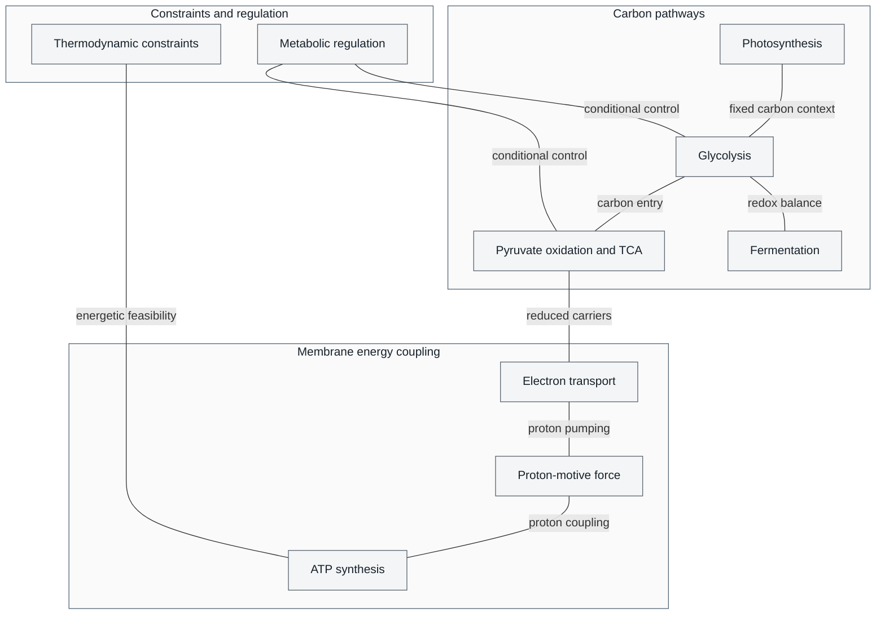

# Unit III — Energy and Metabolism: Introduction {#sec:unit_III_unit_intro .unnumbered}


## Why This Unit Matters {.unnumbered}

Life maintains local organization without violating the second law of thermodynamics. Total entropy
cannot decrease in an isolated system. A closed system can exchange heat and decrease its own entropy;
living organisms are open systems that maintain organization while exporting entropy to their surroundings. A resting human
adult dissipates approximately 80 watts — the same as an incandescent light bulb — in the form of body
heat, CO₂, and metabolic waste. Every breath you take, every protein you synthesize, every ion you pump
against its gradient, uses energy extracted from the oxidation of food.

The molecular currency of this energy economy is ATP (adenosine triphosphate). At any moment, your
cells contain ~50 g of ATP, yet you consume roughly 40 kg of ATP every day at rest. This means each
ATP molecule is recycled approximately 800 times — phosphorylated from ADP in mitochondria, hydrolysed
to ADP in the cytoplasm, and regenerated in an endless chemical cycle. During vigorous exercise, ATP
turnover in muscle can exceed 0.5 kg per minute.

This unit traces energy from its entry point — sunlight captured by chlorophyll, or chemical bonds in
food — through the interconnected pathways of glycolysis, the TCA cycle, oxidative phosphorylation,
and photosynthesis, to its exit as heat and CO₂. Each pathway is treated quantitatively: you will
derive ATP yields, calculate free energy changes, and model the regulatory logic that switches
metabolism between fed and fasted states. The central thread is Peter Mitchell's chemiosmosis
(Nobel Prize 1978): ion gradients across membranes couple electron flow to ATP synthesis, and the
same principle operates in both mitochondria and chloroplasts.

---

## Landmark Discoveries {.unnumbered}

| Discoverer(s) | Year | Journal / Source | Discovery | Significance |
| ------------- | ---- | ---------------- | --------- | ------------ |
| Hans Krebs | 1937 | \citep{krebs1937} | Citric acid (Krebs/TCA) cycle | Identified the central hub of aerobic catabolism; Nobel Prize 1953 |
| Otto Warburg | 1923–1930 | \citep{warburg1924carcinomzelle} | Respiratory enzyme and Warburg effect | First measured oxygen consumption in cancer; discovered aerobic glycolysis |
| Peter Mitchell | 1961 | \citep{mitchell1961} | Chemiosmotic hypothesis | Proposed proton gradients drive ATP synthesis; revolutionary paradigm shift; Nobel Prize 1978 |
| Paul Boyer & John Walker | 1994–1997 | \citep{boyer1997} | Binding-change mechanism of ATP synthase | Explained rotary catalysis of F₁F₀-ATP synthase; Nobel Prize 1997 |
| Melvin Calvin, Andrew Benson & James Bassham | 1950 | \citep{calvin1961} | Calvin cycle (carbon fixation) | Traced ¹⁴C through photosynthesis; established the biochemistry of C₃ fixation; Nobel Prize 1961 |
| Racker & Stoeckenius | 1974 | \citep{racker1974} | Bacteriorhodopsin + ATP synthase reconstitution | Direct experimental proof of Mitchell's chemiosmosis using purified components |

---

## Carbon pathways, redox balance, and energy coupling {.unnumbered}


<!-- alt: Graph showing selected relationships connect carbon processing, redox balance, membrane coupling, and regulation. This is not a reaction sequence or shared-compartment diagram. Proton-motive force has electrical and pH contributions; coupling and numerical ATP yields require specified system assumptions. Fermentation-linked redox balance is not an extra universal ATP yield added to glycolysis. -->

*Selected relationships connect carbon processing, redox balance, membrane coupling, and regulation. This is not a reaction sequence or shared-compartment diagram. Proton-motive force has electrical and pH contributions; coupling and numerical ATP yields require specified system assumptions. Fermentation-linked redox balance is not an extra universal ATP yield added to glycolysis.*

---

## Current Evidence Thread {.unnumbered}

Read this unit as one regulated network rather than three separate pathways: respiration, the integrated fasting/fed economy, and photosynthesis are most constrained by the same currencies of energy charge, redox poise, and compartmentation, and a claim in one chapter is primarily as strong as the flux, sensor, and condition it specifies. Metabolism is now studied as a regulated network constrained by energy, redox balance, compartmentation, and environment. As you
move through the chapters, keep a two-column note: **claim** on the left,
**evidence that would change my confidence** on the right. By the end of the
unit, each major idea should be tied to a measurement, model, citation, or
paper-based lab decision.

## Chapter Roadmap {.unnumbered}

| Chapter | Title | Core Question | Key Equation / Model |
| ------- | ----- | ------------- | -------------------- |
| \cref{sec:unit_III_bioenergetics_and_respiration} | Bioenergetics and Cellular Respiration | How do cells extract and convert chemical energy from glucose? | $\Delta G = \Delta G^{\circ\prime} + RT\ln Q$; P/O ratios |
| \cref{sec:unit_III_photosynthesis} | Photosynthesis | How do plants capture solar energy and fix CO₂? | Light-harvesting cross-section; Z-scheme; Calvin cycle stoichiometry |
| \cref{sec:unit_III_metabolic_integration} | Metabolic Integration | How do hormones and allosteric signals coordinate anabolic and catabolic pathways? | AMPK activation; insulin/glucagon signaling logic |

---

## Connections Across the Textbook {.unnumbered}

- **ATP and free energy** introduced here underpin most driven processes in \nameref{sec:unit_IV_unit_intro} (DNA replication, transcription, translation), \nameref{sec:unit_VIII_unit_intro} (active transport in phloem), and \nameref{sec:unit_IX_unit_intro} (Na⁺/K⁺-ATPase in neurons).
- **The TCA cycle as metabolic hub** is integrated in \cref{sec:unit_III_metabolic_integration} and connects to amino acid catabolism (\nameref{sec:unit_IV_unit_intro}), fatty acid oxidation, and nucleotide synthesis.
- **Proton-motive force** is the conceptual bridge between mitochondrial ATP synthesis (this unit) and chloroplast ATP synthesis (\cref{sec:unit_III_photosynthesis}), and between bacterial physiology (\nameref{sec:unit_VII_unit_intro}) and the evolution of eukaryotes (\nameref{sec:unit_II_unit_intro}, endosymbiosis).
- **Warburg effect** (cancer cells performing aerobic glycolysis) appears in \nameref{sec:unit_II_unit_intro} (cell signaling oncogenes), \nameref{sec:unit_IV_unit_intro} (genomic instability), and the clinical connection sections throughout.

> **Key vocabulary introduced here:** free energy, enthalpy, entropy, ATP hydrolysis, glycolysis, oxidative phosphorylation, proton-motive force, chemiosmosis, electron transport chain, substrate-level phosphorylation, fermentation, Calvin cycle, Warburg effect.


## Computational Toolbox — Unit III {.unnumbered}

```python
from biology.biochemistry import atp_free_energy, glycolysis_summary

# Selected ideal-dilute 1-M standard-state model, not measured cellular activities
delta_g = atp_free_energy(atp_conc_mM=3.0, adp_conc_mM=1.0, pi_conc_mM=10.0)
print(f"ΔG (ATP hydrolysis) = {delta_g:.1f} kJ/mol")
# Expected: ΔG (ATP hydrolysis) ≈ -45.2 kJ/mol
# Fixed standard ΔG°' = -30.5 kJ/mol; the supplied mass-action ratio changes ΔG.
# The function does not model full pH/Mg speciation.

# Comparing aerobic vs anaerobic ATP yield
aerobic = glycolysis_summary()
print(f"Glycolysis only: {aerobic.net_atp} ATP per glucose")
# 2 ATP (substrate-level only); complete aerobic oxidation adds 2 TCA substrate-level ATP plus about 26–28 oxidative ATP

# Two explicitly different cytosolic-NADH transfer budgets, using the stated P/O values:
total_nadh_shuttle = aerobic.net_atp + 2 + 10*2.5 + 2*1.5
total_q_shuttle = aerobic.net_atp + 2 + 8*2.5 + 4*1.5
print(f"NADH-producing shuttle illustration: {total_nadh_shuttle:.0f} ATP/glucose")
print(f"Q-linked shuttle illustration: {total_q_shuttle:.0f} ATP/glucose")
# 32 versus 30: two cytosolic electron pairs enter at different coupling levels.
```

> **Try it yourself:** Under P/O assumptions 2.5 for mitochondrial NADH and 1.5 for Q-linked electron pairs, identify the two cytosolic pairs reassigned between these budgets. Why is 32 a conditional accounting result rather than a universal theoretical maximum, and why must shuttle adjustment not be subtracted twice?

---

*Source modules: `src/biology/biochemistry/biochemistry.py` — `glycolysis_summary()`, `atp_free_energy()`, `michaelis_menten()`.*
*Figures: `src/visualization/` (ETC diagrams, ATP yield tables); `src/mermaid/biology_diagrams.py` (metabolic pathway diagrams).*

## Cross-Unit Integration {.unnumbered}

The pathways of \nameref{sec:unit_III_unit_intro} provide energy carriers and carbon skeletons for cellular processes, including genome copying and expression in \nameref{sec:unit_IV_unit_intro}. Replication, transcription, and translation consume nucleotide triphosphates in their respective reactions. Metabolic state can also influence regulation: acetyl-CoA, SAM, and alpha-ketoglutarate participate in mechanisms affecting histone acetylation, DNA methylation, and TET-mediated demethylation. Their availability is one influence among regulatory and compartment-specific constraints, not a sufficient controller of gene expression. Keep those boundaries in view when comparing energy budgets with molecular genetics.
