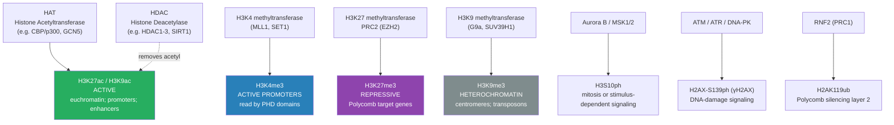
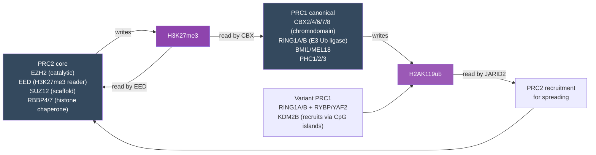
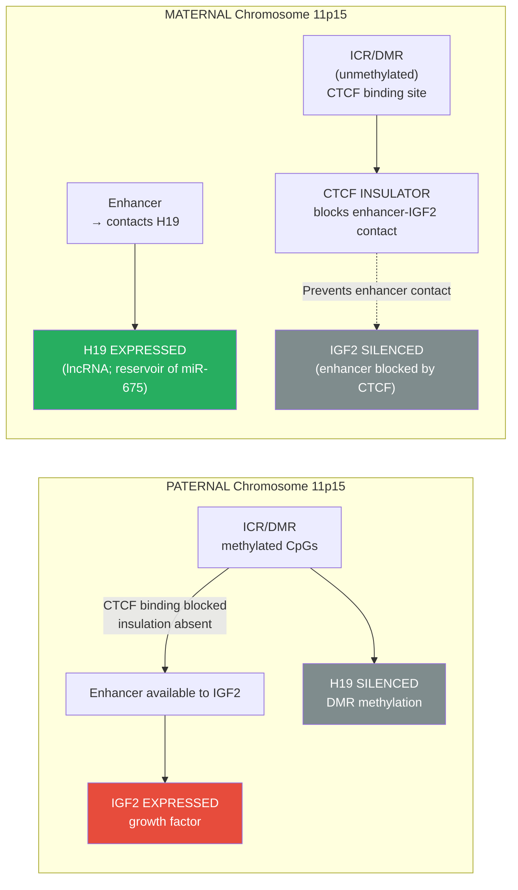
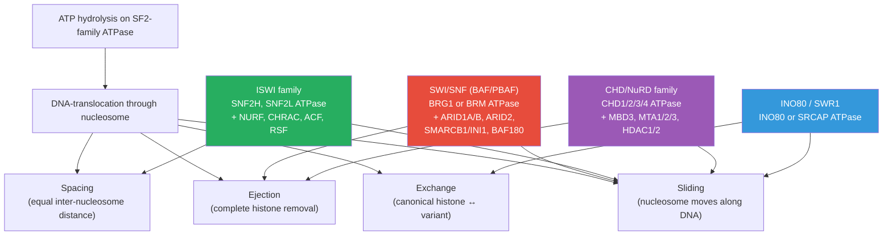
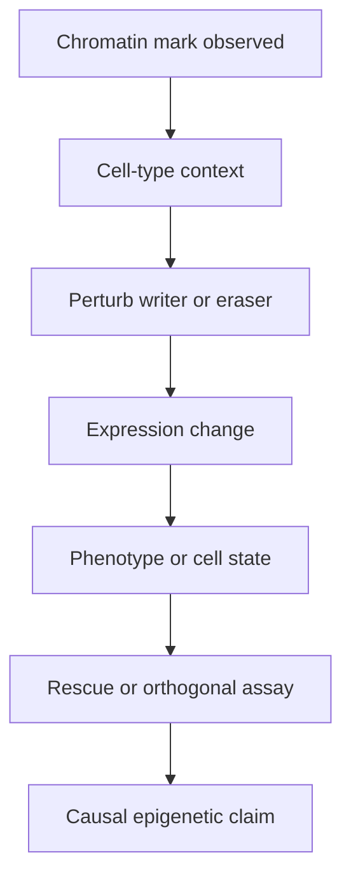

# Chromatin and Epigenetic Mechanisms

\label{sec:unit_IV_chromatin_and_epigenetic_mechanisms}

<!-- chapter-metadata-badge -->
> Level 3/3 · 28 min read · 40 min lecture · Prerequisites: \cref{sec:unit_IV_gene_expression}

## Learning Objectives

1. Define [**epigenetics**](#gl:epigenetics) and distinguish epigenetic modifications from DNA sequence changes.
2. Describe [**nucleosome**](#gl:nucleosome) structure and the levels of [**chromatin**](#gl:chromatin) compaction from the 11-nm fiber to the metaphase [**chromosome**](#gl:chromosome).
3. Explain the major classes of [**histone**](#gl:histone) modifications (acetylation, methylation, phosphorylation, ubiquitination, sumoylation) and how they are written, erased, and read.
4. Describe the mechanism and function of DNA methylation, including [**CpG island**](#gl:cpg-island)s, the DNMT1/3A/3B [**enzyme**](#gl:enzyme)s, TET-mediated demethylation, and the role of methylation in [**gene**](#gl:gene) silencing.
5. Distinguish Polycomb (PRC1/PRC2) and Trithorax (MLL/COMPASS) systems and explain how they maintain repressive and activating states.
6. Compare ATP-dependent chromatin remodeling families (SWI/SNF, ISWI, CHD/NuRD, INO80) and their distinct mechanisms.
7. Explain X-chromosome inactivation (Lyonization) and the role of the XIST lncRNA, escape genes, and skewing.
8. Describe genomic imprinting using IGF2/H19 and Prader–Willi/Angelman as paradigms.
9. Explain how 3D genome organization — TADs, loops, compartments, and biomolecular condensates — shapes transcription.
10. Explain microRNA (miRNA \citep{fire1998}) biogenesis and the mechanism of RISC-mediated post-transcriptional silencing.
11. Model the maintenance of DNA methylation and Polycomb marks across cell divisions quantitatively, and predict the consequences of perturbing each layer.
12. Evaluate evidence for transgenerational epigenetic inheritance in humans, the mechanism of mitotic and meiotic transmission of epigenetic marks, and the clinical implications of epigenetic dysregulation in cancer and neurodevelopmental disease.

\begin{figure}[htbp]
\centering
\includegraphics[width=0.85\textwidth]{../figures/methylation_heatmap.png}
\caption{Illustrative synthetic CpG methylation heatmap across indexed loci (rows) and indexed samples (columns). The color scale reports beta methylation fraction from 0 to 1; the lower-methylation row band is a deterministic teaching pattern, not patient or cell-line data.}
\label{fig:unit_IV_methylation_heatmap}
\end{figure}

<!-- alt: Heatmap with CpG locus index on rows and sample index on columns. Color encodes beta methylation fraction from low to high, with a lower-methylation band across the middle loci. -->

<!-- curriculum-scaffold-start -->
### Study Blueprint

- **Big idea:** Cells create stable yet reversible expression states through chromatin, DNA marks, and regulatory circuits.
- **Core concepts:** chromatin, methylation, histone modification, enhancers.
- **Framework alignment:** Vision & Change: Information flow, exchange, and storage, Structure and function; AP Biology: Information Storage and Transmission, Systems Interactions; NGSS-style topics: Inheritance and Variation of Traits, Structure and Function.
- **Model or quantitative lens:** Regulatory-state and expression-ratio reasoning.
- **Data skill:** Interpret chromatin or expression evidence from simple regulatory datasets.
- **Practice cadence:** Concept Explanation, Questions and Methods, Argumentation.
- **Common misconception to repair:** Epigenetic does not mean independent of DNA sequence or permanently inherited.
- **Primary lab:** \nameref{sec:lab_unit_IV_chromatin_and_epigenetic_mechanisms}.
- **Question bank:** \nameref{sec:q_unit_IV_chromatin_and_epigenetic_mechanisms}.
- **Transfer task:** Apply regulation logic to differentiation, imprinting, cancer, or environmental responses.
- **Bridge to computation:** `biology.genetics.genetics.cpg_methylation_remaining`.
<!-- curriculum-scaffold-end -->

---

> **Opening Vignette — The Landscape That Changed Genetics**
>
> In 1942, the developmental biologist Conrad Waddington drew a diagram that would define a science. He sketched a marble rolling down a hillscape of ridges and valleys — each valley representing a stable cell fate, each ridge a threshold that once crossed was difficult to reverse. He called this the **epigenetic landscape**: the topology of developmental possibilities. Waddington coined "epigenetics" from the Greek *epi-* (above) to describe the heritable changes in gene expression that occurred *above* or *beyond* the DNA sequence — changes that could not be explained by Mendelian genetics alone. He had no idea of the molecular mechanisms. That understanding would come forty years later.
>
> In 1961, Mary Lyon \citep{lyon1961} noticed something peculiar in female mice [**heterozygous**](#gl:heterozygous) for coat-color [**mutation**](#gl:mutation)s: their fur was a mosaic, not intermediate. She proposed that in every cell of a female mammal, one of the two X chromosomes is randomly and permanently silenced — a hypothesis proven so thoroughly that it was renamed Lyonization. The silenced X does not have a different DNA sequence. It has a different *chemistry*: dense methylation, hypoacetylated histones, and a long non-coding RNA called XIST that coats the entire chromosome. This was the first clear demonstration that a whole chromosome could be heritably silenced without changing a single base pair. Epigenetics had found its molecular identity.
>
> Three more revolutions followed. In 2000, Strahl and Allis \citep{strahl2000} proposed that distinct combinations of histone modifications — a "histone code" — encode regulatory information beyond the DNA sequence itself, predicting an entire pharmacology of writers, erasers, and readers that has now produced FDA-approved drugs. In the 2000s, chromosome-conformation-capture (Hi-C) revealed that the genome is folded into stereotyped contact domains (TADs) where enhancers find their cognate promoters, and that disrupting these domains can mis-wire developmental control. And in the 2010s, biomolecular condensates and phase separation reframed the nucleus as a collection of liquid-like assemblies that concentrate transcriptional machinery at super-enhancers. These insights together turned epigenetics from a metaphor into a quantitative, druggable discipline.

## Chromatin Structure and Nucleosome Organization

### The Nucleosome as the Fundamental Chromatin Unit

Eukaryotic DNA is not naked; it is complexed with [**protein**](#gl:protein)s to form **chromatin**. The fundamental repeating unit is the **nucleosome**:

- **Histone octamer:** 2 copies each of H2A, H2B, H3, H4 — forming a spool-like protein disk
- **DNA wrapping:** ~147 bp of DNA wound 1.65 times around the histone octamer in a left-handed superhelix
- **Linker DNA:** 10–80 bp connecting adjacent nucleosomes; associated with histone H1
- **Bead-on-a-string:** nucleosomes connected by linker DNA form an 11-nm fiber — the first level of compaction

**Core histone structure:** Each core histone has:
- A **globular domain** forming the nucleosome disc surface through the **histone fold** motif (three α-helices linked by two short loops; pairs of histones form four-helix bundles: H3–H4 and H2A–H2B)
- An unstructured **N-terminal tail** extending beyond the disc (4–35 residues depending on histone) — this is where most post-translational modifications occur
- A short **C-terminal tail** (especially prominent on H2A and H2B) that also accepts modifications including ubiquitination

**Histone variants:** In addition to canonical H2A/H2B/H3/H4, mammalian cells express variant histones that confer specialized properties on chromatin where they are deposited:

: The Nucleosome as the Fundamental Chromatin Unit: Variant and Replaces. {#tbl:unit_IV_chromatin_and_epigenetic_mechanisms_the_nucleosome_as_the_fundamental_chromatin_unit}
| Variant | Replaces | Deposition machinery | Function |
| ------- | -------- | -------------------- | -------- |
| H3.3 | H3 | HIRA (gene bodies); ATRX/DAXX (heterochromatin) | Replication-independent; marks transcribed/active regions |
| CENP-A (CenH3) | H3 | HJURP | Centromere identity; foundation for kinetochore assembly |
| H2A.Z | H2A | SRCAP, INO80/SWR1 | Promoter-proximal; poises genes for activation; insulates from heterochromatin |
| H2A.X | H2A | RAD51 / S139ph at DSBs | DNA-damage signaling (γH2AX); foci visible by immunofluorescence |
| macroH2A | H2A | ATRX-dependent | Inactive X enrichment; gene silencing |
| H2A.B (Bbd) | H2A | unclear | Active transcription; testis enriched |

### Higher-Order Chromatin Compaction

The table juxtaposes structural scales and historical compaction models; it is not a mandatory sequence of in-vivo intermediates. In particular, regular 30-nm fibers are condition-dependent, while human-cell ChromEMT observations show disordered chromatin chains with variable packing \citep{ou2017chromemt}. Loops, domains and compartments describe organization at different scales, not one fixed fiber diameter in every cell.

: Higher-Order Chromatin Compaction: Level and Structure. {#tbl:unit_IV_chromatin_and_epigenetic_mechanisms_higher_order_chromatin_compaction}
| Level | Structure | Diameter | Compaction factor | Mechanism |
| ----- | --------- | -------- | ----------------- | --------- |
| 0 | Naked DNA (B-form helix) | 2 nm | 1× | Watson–Crick base-pairing |
| 1 | Nucleosome fiber ("beads on a string") | 11 nm | ~6× | Histone octamer wrapping |
| 2 | 30-nm fiber (disputed *in vivo*) | 30 nm | ~40× | Nucleosome–nucleosome compaction |
| 3 | Chromatin loops / TADs | 300 nm | ~1,000× | CTCF + cohesin-defined loops; TADs |
| 4 | A/B compartments | — | variable | Active (A) vs. repressive (B) genomic neighborhoods |
| 5 | Chromatid (mitotic chromosome) | 700 nm | ~10,000× | SMC condensin-mediated compaction |

### Topologically Associating Domains (TADs)

Chromatin organizes into DNA loops of 100 kb–1 Mb delineated by **CTCF** (insulator protein) binding sites and **cohesin** ring complexes. Within TADs, enhancers preferentially contact [**promoter**](#gl:promoter)s of the same TAD. TAD boundaries are largely conserved across cell types and species. The dominant model for TAD formation is **loop extrusion**: cohesin loads on chromatin and reels DNA through its ring lumen ATP-dependently until it stalls at convergently oriented CTCF binding sites, leaving behind a chromatin loop. Quantitatively, mammalian genomes contain ~3,000–10,000 TADs (~1 Mb median), and knockdown of CTCF or cohesin (RAD21, NIPBL) blurs or abolishes most boundaries within hours.

\begin{equation}P_{\text{contact}}(s) \propto s^{-\alpha}, \quad \alpha \approx 1.0\text{–}1.2 \text{ for fractal globule (interphase)}\label{eq:hic_scaling}\end{equation}

**Hi-C methodology in detail.** Hi-C is a chromosome-conformation-capture variant that measures contact frequency between every pair of genomic loci genome-wide. The protocol:

1. **Cross-link** chromatin with formaldehyde (1 % for 10 min), preserving protein-mediated DNA contacts.
2. **Restriction digest** with a 4-cutter (DpnII, MboI) or 6-cutter (HindIII), creating sticky-ended fragments still tethered by cross-linked proteins.
3. **Fill-in with biotinylated nucleotides** to mark cleaved ends, then **proximity ligate** at low DNA concentration so that intermolecular ligations are improbable — primarily fragments held together by cross-linked proteins (i.e., physically proximal *in vivo*) ligate.
4. **Streptavidin pulldown** enriches biotinylated junction reads, paired-end Illumina sequencing identifies which genomic loci were joined.
5. **Heatmap normalization** (ICE, KR-balanced) yields a contact matrix; diagonal-rich blocks are TADs; off-diagonal stripes identify loop anchors at convergent CTCF.

Derivative methods refine the assay: **Micro-C** uses MNase digestion to nucleosome resolution; **Capture-Hi-C** enriches for promoter-anchored contacts (4DN consortium); **HiChIP / PLAC-seq** combines ChIP for an active mark (H3K27ac) with proximity ligation; **ChIA-PET** uses paired-end tagging on antibody-immunoprecipitated chromatin; **Hi-C 3.0 / Pore-C** uses long-read multi-way contact mapping.

Disruption of TAD boundaries (e.g., by large deletions, inversions, or single-nucleotide CTCF site disruptions) can cause misregulation of developmental genes — a mechanism termed **enhancer hijacking**. Lupiáñez et al. (2015) showed that microdeletions removing TAD boundaries near *EPHA4* fuse adjacent regulatory landscapes, mis-targeting limb enhancers to *PAX3* or *WNT6* and producing congenital limb malformations (brachydactyly, syndactyly).

**Loop extrusion — the dynamic model.** Single-molecule imaging and live-cell Hi-C now support a kinetic loop-extrusion model with quantitative parameters:
- Cohesin (SMC1/SMC3 + RAD21/SCC1 + STAG1/STAG2) is loaded onto chromatin by **NIPBL/MAU2** (the loader complex).
- It extrudes DNA into a growing loop at ~0.5–2 kb/s, consuming ATP at the SMC ATPase head.
- **WAPL** unloads cohesin (residence time ~20 min unloaded by WAPL, vs. > 1 h for the **cohesin-STAG2** "stalled" form at CTCF anchors).
- CTCF binds asymmetrically (a 19-bp consensus with a defined orientation): convergent CTCF pairs trap extruding cohesin, generating loops with measured loop sizes ~100 kb to 2 Mb.
- Acute auxin-induced degron depletion of RAD21 dissolves most loops within ~15 min; restoration takes ~30–60 min — confirming that TADs and loops are dynamic, not static structures.

### A/B Compartments

At the megabase scale, the genome partitions into two interaction "compartments":

- **A compartment** — gene-rich, active (H3K4me3, H3K27ac, accessible chromatin), positioned toward the nuclear interior
- **B compartment** — gene-poor, repressed (H3K9me3, lamina-associated), positioned at the nuclear periphery

Compartment switching during cell-fate transitions correlates with replication timing changes (early-replicating ↔ late-replicating) and with large-scale gene expression remodeling. Hi-C (and its derivatives Micro-C, Capture-Hi-C, ChIA-PET) measures these contacts genome-wide.

> **Concept Check 1:** A patient harbors a balanced inversion that breaks a CTCF site at the boundary of a TAD containing the *SHH* limb enhancer (ZRS, ~1 Mb upstream of *SHH*). Predict the developmental phenotype if the inversion places ZRS into a TAD containing an unrelated proto-oncogene. What chromosome-conformation-capture experiment would confirm enhancer hijacking?

---

## Histone Modifications — The Histone Code

Histone tails are subject to a large number of post-translational modifications (PTMs). The **[histone code](#gl:histone-code) hypothesis** \citep{strahl2000} proposes that specific combinations of marks specify distinct chromatin states and downstream outcomes.

<!-- alt: Flowchart showing histone modification writers and the states they produce. Green = active marks; blue = active promoters; purple = Polycomb repression; gray = constitutive heterochromatin. -->

*Histone modification writers and the states they produce. Green = active marks; blue = active promoters; purple = Polycomb repression; gray = constitutive [**heterochromatin**](#gl:heterochromatin).*

### Histone-Code Reference Table

The histone-code reference table below systematically catalogs > 25 modifications recurrently studied in mammalian chromatin biology, paired with the **writer enzyme**, **eraser enzyme**, **reader domain** that recognizes the mark, the **histone position** (nucleosome face, exposed N-terminal tail, C-terminal tail), the typical **genomic location**, and the **functional effect** (activation, repression, or context-dependent). This is the chromatin biologist's periodic table — the working vocabulary of writers, readers, and erasers that defines every targeted therapy in clinical epigenetics.

**Active methylation marks**

: Histone-Code Reference Table: Mark and Writer / eraser. {#tbl:unit_IV_chromatin_and_epigenetic_mechanisms_histone_code_reference_table}
| Mark | Writer / eraser | Main readers | Meaning |
| ---- | --------------- | ------------ | ------- |
| H3K4me1 | MLL3/4 writes; LSD1 erases | BAF45c PHD, CHD7 | Poised or active enhancers |
| H3K4me2 | MLL1/2 and SET1 write; LSD1 erases | CHD1, BPTF PHD | Active promoters and 5-prime gene bodies |
| H3K4me3 | MLL/SET1 COMPASS writes; KDM5 removes | TAF3 PHD, ING1, BPTF | Active promoters; recruits TFIID |
| H3K36me1/2 | NSD and ASH1L write; KDM2 removes | LEDGF PWWP, MRG15 | Gene bodies and active enhancers |
| H3K36me3 | SETD2 writes; KDM2/KDM4 remove | DNMT3 PWWP, MRG15, LEDGF | Transcribed gene bodies; suppresses cryptic initiation and recruits MMR |
| H3K79me2/3 | DOT1L writes | Reader assignments require methyl-state-specific binding evidence; do not infer 53BP1 recruitment from this row | Active gene-body association; DOT1L important in MLL-fusion leukaemia |

**Active acetylation and ubiquitination marks**

: Histone-Code Reference Table: Mark and Writer / eraser. {#tbl:unit_IV_chromatin_and_epigenetic_mechanisms_histone_code_reference_table_2}
| Mark | Writer / eraser | Main readers | Meaning |
| ---- | --------------- | ------------ | ------- |
| H3K9ac | GCN5/PCAF/p300 write; HDAC1-3 and SIRT1/6 erase | BRD4, TAF1 | Active promoters; loosens histone-DNA contacts |
| H3K14ac | GCN5/PCAF write; HDAC1-3 erase | Bromodomains | Active promoters; cooperates with H3K4me3 |
| H3K18ac and H3K23ac | p300/CBP write; HDACs erase | Bromodomains | Promoters and enhancers; active transcription |
| H3K27ac | p300/CBP write; HDAC1-3 erase | BRD4, YEATS | Active enhancers and super-enhancers |
| H3K56ac | p300/CBP write; HDAC1/SIRT1/SIRT6 erase | no dominant reader | Newly synthesized H3; chromatin assembly |
| H4K5ac, H4K8ac, H4K12ac | HAT1/p300/CBP write; HDACs erase | Bromodomains | Replication-coupled H4 deposition |
| H4K16ac | MOF writes; SIRT1/2 erase | context-dependent | Disrupts 30-nm fiber compaction; active gene bodies |
| H2BK120ub | RNF20/40 writes; USP22 erases | crosstalk readers | Required for H3K4me3 and H3K79me deposition |

**Repressive methylation and Polycomb marks**

: Histone-Code Reference Table: Mark and Writer / eraser. {#tbl:unit_IV_chromatin_and_epigenetic_mechanisms_histone_code_reference_table_3}
| Mark | Writer / eraser | Main readers | Meaning |
| ---- | --------------- | ------------ | ------- |
| H3K9me1 | G9a/GLP/SETDB1 write; KDM3 removes | weak / context-dependent | Active gene bodies; cooperates with elongation marks |
| H3K9me2 | G9a/GLP write; KDM3/LSD1 remove | HP1, CDYL | Facultative heterochromatin and silenced euchromatin |
| H3K9me3 | SUV39H and SETDB1 write; KDM4 removes | HP1 alpha/beta/gamma, CBX1/3/5 | Constitutive heterochromatin; centromeres; transposons |
| H3K27me1/2 | EZH2 writes; UTX/JMJD3 remove | EED for me2/3 contexts | Active gene bodies at low level; me2 prevents inappropriate enhancer activation |
| H3K27me3 | EZH2/PRC2 writes; UTX/JMJD3 remove | EED and CBX-PRC1 | Polycomb domains; developmental-gene repression |
| H4K20me1 | SET8/PR-Set7 writes; PHF8 demethylates in tested nucleosome/cell contexts | L3MBTL1; condensin-II subunits in tested mitotic cells | Cell-cycle-dependent chromatin regulation \citep{Liu2010PHF8} |
| H4K20me2 | SUV4-20H enzymes act after monomethylation | 53BP1 tandem Tudor (peptide $K_d=19.7$ μM in the reported assay) | DNA-damage recognition requires the correct methyl state and chromatin context \citep{Botuyan2006H4K20} |
| H4K20me3 | SUV4-20H enzymes write; PHF8 is not established here as its eraser | JMJD2A hybrid Tudor binds tested me3 peptide; not the preferred 53BP1 target | Pericentric heterochromatin; distinct from me2-dependent 53BP1 recognition \citep{Botuyan2006H4K20} |
| H2AK119ub | RNF2/RING1B writes; BAP1 removes | JARID2-associated PRC2.2 | Stable Polycomb silencing layer |

**Dynamic damage, cell-cycle, and metabolic marks**

: Histone-Code Reference Table: Mark and Writer / eraser. {#tbl:unit_IV_chromatin_and_epigenetic_mechanisms_histone_code_reference_table_4}
| Mark | Writer / eraser | Main readers | Meaning |
| ---- | --------------- | ------------ | ------- |
| H3S10ph | Aurora B/MSK write; PP1/PP2A erase | 14-3-3 proteins | Mitosis and immediate-early gene activation |
| H3T3ph | Haspin writes; PP1 erases | Survivin/CPC | Inner-centromere recruitment during mitosis |
| H2A.X-S139ph (gamma-H2AX) | ATM/ATR/DNA-PK write; PP2A/WIP1 erase | MDC1 BRCT | Double-strand-break signaling foci |
| H3T6ph | PRK1 writes; PP1 erases | context-dependent | Androgen-receptor targets; H3K4 demethylation crosstalk |
| H4K12su and H2BK34su | PIAS/MMS21 write; SENP erases | SIM-containing readers | Polycomb and DNA-damage coordination |
| H2A/H4 ADP-ribosylation | PARP1/2 write; PARG/ARH3 erase | Macrodomain proteins | Chromatin relaxation for DNA repair |
| H3K18la | p300 writes; HDAC1-3 erase | YEATS domains | Lactate-linked macrophage polarization |
| H3K9bhb | p300 writes; HDAC1-3 erase | YEATS domains | Ketosis and fasting response |
| H3K9cr, H3K9su, H3K4but | p300 or metabolic enzymes write; HDAC/sirtuin systems erase | YEATS-family readers | Metabolism-linked activation in enhancers, promoters, and gametogenesis |

The bottom rows reflect a major recent expansion of the histone code: short-chain acyl-CoAs derived from intermediary metabolism (lactate, β-hydroxybutyrate, crotonyl-CoA, succinyl-CoA, butyryl-CoA) are deposited by the same KAT/HAT enzymes (especially p300) that write acetyl marks, directly coupling **metabolic state** to chromatin state. The lactyl mark, in particular, has become the molecular signature of the Warburg-effect–polarized tumor-associated macrophage.

### Histone Acetylation and Open Chromatin

**Writers:** Histone acetyltransferases (HATs) — CBP/p300, GCN5/PCAF, TIP60, MOF.
**Erasers:** Histone deacetylases (HDACs) — 18 human HDACs in four classes (Class I/II/III/IV, where Class III = NAD⁺-dependent sirtuins SIRT1–7).
**Readers:** Bromodomains (e.g., BRD4, TFIID subunit TAF1, BAF180 of PBAF, BPTF). YEATS domains (AF9, ENL) read both acetyl and longer acyl marks.

**Mechanism:** Acetylation of lysine ε-amino groups by transfer from acetyl-CoA. Neutralizes the positive charge on lysine, **weakening histone–DNA electrostatic interactions**, loosening chromatin and facilitating [**transcription**](#gl:transcription) factor binding.

\begin{equation}\text{Lys-NH}_3^+ + \text{acetyl-CoA} \xrightarrow{\text{HAT}} \text{Lys-NH-COCH}_3 + \text{CoA-SH} + \text{H}^+\label{eq:hat}\end{equation}

**Key active marks:**
- **H3K27ac:** Marks active enhancers (distinguishes active from poised enhancers, which carry H3K27me3)
- **H3K9ac, H3K14ac, H4K16ac:** Found at active promoters and transcribed gene bodies

> **Clinical Connection — HDAC inhibitors (U.S. indication status as of 2026-11-07 unless specified):** Distinguish historical approvals from current product–indication status.
> - **Vorinostat (SAHA)** — FDA approved 2006 for cutaneous T-cell lymphoma (CTCL). Hydroxamate pan-HDACi. Median time to response ~2 months; objective response ~30 %.
> - **Romidepsin (Istodax)** — CTCL approval dates to 2009. Its separate 2011 accelerated approval for previously treated PTCL was **withdrawn July 30, 2021**; this is not a withdrawal of CTCL. Cyclic depsipeptide; class-I selective \citep{fda2026withdrawncancer}.
> - **Panobinostat (Farydak)** — Historical 2015 accelerated approval with bortezomib and dexamethasone for specified previously treated multiple myeloma was **withdrawn March 24, 2022**. Do not list that U.S. indication as current \citep{fda2026withdrawncancer}.
> - **Belinostat (Beleodaq)** — FDA 2014 for PTCL.
> - **Tucidinostat (Chidamide)** — China-approved 2014 for PTCL; first benzamide HDACi.
>
> Mechanism in cancer: re-activation of silenced tumor-suppressor genes (p21, gelsolin, RhoB, BCL6); accumulation of acetylation on non-histone targets (HSP90 chaperone client release, p53 stabilization, NF-κB inhibition). Combination with **DNMT inhibitors** is being explored to reverse layered silencing, a theme developed later in the cancer-epigenetics discussion.

### Histone Methylation and Context-Dependent Silencing or Activation

**Writers:** Histone methyltransferases (HMTs) — most contain SET domains (except DOT1L, which has a 7β-strand methyltransferase fold derived from class V methyltransferases).
**Erasers:** Histone demethylases — KDM1/LSD1 (FAD-dependent; works on me1 and me2 primarily; cannot demethylate me3 because it requires a free lysine ε-amino lone pair); KDM2–7 (Jumonji-domain, Fe(II)/αKG-dependent; can remove me3 by hydroxymethyl-amine intermediate that decomposes to formaldehyde and demethylated lysine).
**Readers:** Chromodomains (HP1 reads H3K9me3; CBX2/4/6/7/8 of PRC1 read H3K27me3); PHD fingers (TAF3, BPTF, ING proteins read H3K4me3); Tudor domains (53BP1 reads H4K20me2; SMN reads symmetrical R-methylation); MBT domains; WD40 (EED reads H3K27me3); PWWP domains (read H3K36me3).

Unlike acetylation (typically activating), **methylation is context-dependent**: the same modification on different residues has opposite effects.

: Histone Methylation and Context-Dependent Silencing or Activation: Mark and Enzyme. {#tbl:unit_IV_chromatin_and_epigenetic_mechanisms_histone_methylation_and_context_dependent_silencing_or_activation}
| Mark | Enzyme | State | Function |
| ---- | ------ | ----- | -------- |
| H3K4me1 | MLL3/4 | Active | Enhancer elements (poised or active) |
| H3K4me3 | MLL1/SET1 | Active | Active promoters; read by TAF3 PHD |
| H3K36me3 | SETD2 | Active | Transcribed gene bodies; prevents cryptic initiation |
| H3K27me3 | EZH2 (PRC2) | Repressive | Polycomb targets; poised/silent developmental genes |
| H3K9me3 | SUV39H1/H2 | Repressive | Constitutive heterochromatin; [**centromere**](#gl:centromere)s; transposons |
| H4K20me3 | SUV4-20H | Repressive association | Pericentric heterochromatin; distinguish H4K20me2 recognition by 53BP1 |

**Bivalent domains:** In embryonic stem cells, many developmental gene promoters carry **both H3K4me3 and H3K27me3** simultaneously — a "bivalent" state. These genes are poised for either rapid activation (upon H3K27me3 removal by KDM6A/UTX) or repression (upon H3K4me3 removal) during differentiation. About 2,500 promoters are bivalent in human ES cells; most resolve to monovalent during lineage commitment.

### Phosphorylation and Ubiquitination

**H3S10ph (H3 Ser10 phosphorylation):**
- Writer: Aurora B kinase ([**mitosis**](#gl:mitosis)), MSK1/2 (mitogenic signaling)
- Function: Chromosome condensation during mitosis; gene activation by 14-3-3 reader binding

**H2AX-S139ph (γH2AX):**
- Writer: ATM/ATR kinases at double-strand breaks
- Function: Marks DSB sites; recruits MDC1 and DNA repair machinery; visible as bright immunofluorescence foci at break sites

**H2AK119ub (H2A monoubiquitination):**
- Writer: RNF2/RING1B (part of PRC1 complex)
- Function: Represses transcription elongation; part of Polycomb silencing; read by Polycomb-like proteins

> **Concept Check 2:** A cancer-associated EZH2 gain-of-function mutation leads to [**genome**](#gl:genome)-wide hypermethylation of H3K27 and silencing of tumor-suppressor genes. To what extent would an HDAC inhibitor (which increases histone acetylation) be expected to re-activate these silenced loci? Explain by reference to the dependencies between acetylation, methylation, and DNA methylation described above — and argue for a rational combination therapy.

> **Concept Check 3:** Predict the genome-wide consequence of a homozygous knockout of **SETD2** (the H3K36me3 writer) in an embryonic stem cell. Consider effects on (i) cryptic intragenic transcription, (ii) DNA mismatch repair recruitment, and (iii) DNMT3B-mediated gene-body methylation. Which of these phenotypes most directly explains why *SETD2* loss-of-function is the most frequent driver mutation in clear-cell renal cell carcinoma after VHL?

---

## Polycomb and Trithorax — Cellular Memory Systems

The **Polycomb (PcG)** and **Trithorax (TrxG)** group proteins were discovered in *Drosophila* as gene families whose loss-of-function alleles cause homeotic transformations of body segments. They constitute the cell's principal **cellular memory systems**: once a developmental gene is set ON or OFF in a progenitor, PcG/TrxG complexes propagate that state through most subsequent mitotic divisions of the lineage.

### Polycomb Repressive Complexes — Structural Detail

<!-- alt: Flowchart showing polycomb silencing operates as a feedback-amplified two-mark system: PRC2 writes H3K27me3, which recruits more PRC2 (positive feedback) and recruits canonical PRC1 (via CBX) which writes H2AK119ub. Variant PRC1 acts upstream at unmethylated CpG islands and seeds H2AK119ub which itself recruits PRC2. The mutual reinforcement explains how Polycomb domains span hundreds of kilobases and persist through cell divisions. -->

*Polycomb silencing operates as a feedback-amplified two-mark system: PRC2 writes H3K27me3, which recruits more PRC2 (positive feedback) and recruits canonical PRC1 (via CBX) which writes H2AK119ub. Variant PRC1 acts upstream at unmethylated CpG islands and seeds H2AK119ub which itself recruits PRC2. The mutual reinforcement explains how Polycomb domains span hundreds of kilobases and persist through cell divisions.*

**PRC1 — comprehensive subunit inventory:**
- Catalytic core: **RING1A** (RNF1) or **RING1B** (RNF2) E3 ubiquitin ligase + a PCGF partner (PCGF1, PCGF2/MEL18, PCGF3, PCGF4/BMI1, PCGF5, PCGF6).
- **Canonical PRC1 (cPRC1):** RING1A/B + PCGF2/4 (MEL18/BMI1) + a **CBX** (CBX2/4/6/7/8) chromobox subunit + PHC1/2/3 + SCMH1/L2. The CBX chromodomain reads H3K27me3, anchoring cPRC1 onto Polycomb-marked chromatin. PHC SAM-domain polymerization drives **chromatin compaction in cis** (head-to-tail oligomerisation creates a phase-separated Polycomb body).
- **Variant PRC1 (vPRC1):** RING1A/B + PCGF1/3/5/6 + RYBP (or YAF2) instead of CBX. Recruited to **unmethylated CpG islands** via KDM2B (PCGF1 complex, "ncPRC1.1") or via E2F6 (PCGF6). Deposits H2AK119ub *upstream* of H3K27me3 — a key insight: vPRC1 acts first, then PRC2.2 reads H2AK119ub via JARID2.

**PRC2 — comprehensive subunit inventory:**
- Catalytic core: **EZH2** (or paralog **EZH1**; SET-domain methyltransferase). EZH2 is faster but EZH1 is dominant in non-dividing cells.
- **EED** binds H3K27me3 product → allosteric activation of EZH2 (the **read-write feedback** that generates broad Polycomb domains).
- **SUZ12** scaffold links the SET-domain catalytic core to the DNA/RNA-recognition modules.
- **RBBP4/7** histone chaperone presents the H3 tail substrate.
- **Accessory subunits define context-dependent variants:**
  - **PRC2.1:** PCL1/2/3 (PHF1, MTF2, PHF19) + EPOP or PALI1. The PHF Tudor domains read H3K36me3, restricting PRC2.1 from active gene bodies.
  - **PRC2.2:** AEBP2 + JARID2. JARID2 reads H2AK119ub deposited by variant PRC1 and stimulates PRC2 activity (closing the recruitment loop).
- **Reaction kinetics:** H3K27 → H3K27me1 (k₁ ≈ 0.05 s⁻¹) → H3K27me2 (k₂ ≈ 0.02 s⁻¹) → H3K27me3 (k₃ ≈ 0.005 s⁻¹), with each step ~3-fold slower; EED-allosteric stimulation increases k₃ by ~6-fold on neighboring nucleosomes carrying me3.
- **Recruitment hierarchy:** unmethylated CpG islands (via PRC2.2/JARID2 reading H2AK119ub from variant PRC1, *or* via PRC2.1/PCL with KDM2B); broad gene-body recognition by EED reading existing me3; lncRNA recruitment (HOTAIR, XIST repA, KCNQ1OT1, ANRIL).

**Mechanism of Polycomb–Trithorax antagonism:** PRC2.1 cannot act on H3K36-methylated chromatin (PCL Tudor reads H3K36me3 antagonistically — the CPL paradox). Conversely, **ASH1L** (the Trithorax-group H3K36 methyltransferase) deposits H3K36me2 at active gene bodies, blocking PRC2 spreading. The cell uses this as a positive/negative selection: H3K36me-active = Polycomb-restricted; H3K36me-absent = Polycomb-permissive.

### Trithorax Group (TrxG) — Antagonising Polycomb

: Trithorax Group (TrxG) — Antagonising Polycomb: TrxG complex and Activity. {#tbl:unit_IV_chromatin_and_epigenetic_mechanisms_trithorax_group_trxg_antagonising_polycomb}
| TrxG complex | Activity | Role |
| ------------ | -------- | ---- |
| MLL/COMPASS family (MLL1–4, SET1A/B) | H3K4 methyltransferase | Marks active and poised promoters/enhancers |
| ASH1L | H3K36 methyltransferase | Antagonises Polycomb spread into active genes |
| KDM6A/UTX, KDM6B/JMJD3 | H3K27me3 demethylases | Remove Polycomb marks during differentiation |
| SWI/SNF (BAF) | ATP-dependent remodeling | Evicts PRC1/2; opens chromatin |

**The COMPASS family — six MLL/SET1 complexes in mammals:**
- **MLL1/KMT2A** (mixed-lineage leukaemia 1) — large promoter H3K4me3 deposition; MLL1-AF4/AF9/ENL fusions cause infant acute lymphoblastic or acute myeloid leukaemia.
- **MLL2/KMT2B** — closely related to MLL1; redundant at most loci; selective at others.
- **MLL3/KMT2C** and **MLL4/KMT2D** — write enhancer H3K4me1 (poised and active enhancers); KMT2D is among the most frequently mutated chromatin-regulator genes in cancer (~10 % of B-cell lymphoma and bladder cancer).
- **SET1A/KMT2F** and **SET1B/KMT2G** — write the bulk of promoter H3K4me3 in adult tissues; SET1A loss-of-function in MDS and CHIP.

The six complexes share a **WRAD module** (WDR5–RbBP5–ASH2L–DPY30) that allosterically activates the SET-domain catalytic subunit by ~600-fold. This makes WRAD a tractable allosteric drug target — small-molecule WDR5–MLL interface inhibitors (OICR-9429) are in early-phase trials for MLL-rearranged leukaemia.

**The Polycomb–Trithorax balance** is maintained dynamically. Differentiation cues that activate gene expression typically deploy three concurrent steps: (i) UTX/JMJD3 removes H3K27me3, (ii) MLL/COMPASS deposits H3K4me3, and (iii) BAF complexes evict residual PRC1. Conversely, lineage repression deposits PRC1/PRC2 marks at the relevant promoter.

**Clinical translation — EZH2 inhibitors:**
- **Tazemetostat (Tazverik)** inhibits the EZH2 SET domain. Its two U.S. accelerated approvals (epithelioid sarcoma and follicular lymphoma, 2020) were withdrawn June 22, 2026; it is a historical example, not a current FDA-approved option \citep{fda2026withdrawncancer}. FDA's May 11, 2026 safety notice reported 18/318 (5.7%) hematologic second primary malignancies on tazemetostat in SYMPHONY-1 versus none reported in controls; this follicular-lymphoma safety cohort differs from the 62-patient sarcoma study \citep{fda2026tazsafety}. The 62-patient, open-label single-arm INI1-loss sarcoma cohort had 9/62 responses (15%), median PFS 5.5 months, and median time to response 3.9 months. There was no placebo arm \citep{gounder2020tazemetostat}.
- EZH1/2 inhibitors illustrate the need to specify product, indication, jurisdiction, and date; a target class does not carry a universal approval status.

The mechanism is paradigmatic of **synthetic lethality** in chromatin: tumors with SWI/SNF loss become dependent on Polycomb silencing of cell-cycle inhibitors, so EZH2 inhibition selectively re-activates suppressors primarily in the cancer cells.

> **Worked Example 1 — Constant Recruitment versus Read-Write Feedback**
>
> A synthetic 50-nucleosome domain begins with two marked nucleosomes. Suppose division halves occupancy and an external recruiter deposits a constant $k$ marks per generation: $m_{n+1}=\min(50,m_n/2+k)$. Before saturation, $m_\infty=2k$: $k=1,2,5$ gives 2, 4, 10 marks (4%, 8%, 20%). Maintaining at least 45 requires $k\ge22.5$. This is constant recruitment, not mark-dependent EED feedback; it creates marks even from zero seeds.
>
> A distinct read-write toy model would instead add marks proportional to post-division occupancy, $m_{n+1}=\min(50,(1+k)m_n/2)$, with dimensionless $k$. Without a source of de novo nucleation, zero seeds stay zero. Neither model establishes actual spatial spreading, enzyme kinetics, or a clinical silencing threshold.

---

## DNA Methylation and Stable Transcriptional Repression

### CpG Methylation Mechanism

In mammals, DNA methylation occurs almost exclusively on cytosine in the context **5′-CpG-3′** dinucleotides (the "p" denotes the phosphodiester bond between C and G). The methylated form is [**5-methylcytosine (5mC)**](#gl:5-methylcytosine), often called the "fifth base."

\begin{equation}\text{Cytosine} + \text{S-adenosylmethionine} \xrightarrow{\text{DNMT}} \text{5-methylcytosine} + \text{S-adenosylhomocysteine}\label{eq:DNMT}\end{equation}

### The DNA Methylation Machinery — In Depth

**Maintenance methyltransferase — DNMT1:** the workhorse enzyme that ensures heritability of CpG methylation across cell divisions.
- DNMT1 has a two-domain architecture: an N-terminal regulatory domain (containing CXXC, BAH1/2, and replication-foci targeting RFTS subdomains) and a C-terminal catalytic domain.
- **Substrate specificity:** preferentially methylates **hemi-methylated CpGs** — sites where the parental strand carries 5mC but the newly synthesized daughter strand is unmodified. Affinity for hemi-methylated CpGs is ~10–40-fold higher than for unmethylated CpGs.
- **Recruitment — the UHRF1–DNMT1 axis:** the protein **UHRF1** ("ubiquitin-like with PHD and RING finger domains 1") is the molecular bridge that targets DNMT1 to replicating heterochromatin. UHRF1 has **five domains**: UBL (ubiquitin-like), TTD (Tudor — reads H3K9me2/3), PHD (reads unmethylated H3R2), SRA (reads hemi-methylated CpG via base-flipping), and RING (E3 ubiquitin ligase). The dual recognition of (a) hemi-methylated CpG (via SRA) AND (b) H3K9me2/3 (via TTD) ensures that DNMT1 propagates methylation primarily at chromatin states already marked for repression.
- **The mechanism cycle (per CpG):**
  1. UHRF1 SRA domain flips the 5mC out of the helix, exposing the unmethylated daughter cytosine.
  2. UHRF1 RING ubiquitinates H3K18 (H3 tail) — creating a docking site for DNMT1's RFTS domain.
  3. DNMT1 RFTS binds H3K18ub; DNMT1 catalytic domain transfers a methyl group from SAM to the daughter cytosine.
  4. SAH (S-adenosyl-homocysteine) released; UHRF1 dissociates; cycle repeats.
- **Quantitative parameters:** maintenance efficiency per CpG ε ≈ 0.95 in healthy cells. Each replication fork carries ~50 CpGs/s of unmethylated daughter DNA into the lumen — DNMT1 must fix them within minutes before chromatin reassembly.
- **Loss-of-function:** mouse Dnmt1-knockout embryos die at E9.5 with genome-wide demethylation, ectopic gene expression, and replication-fork instability. Conditional knockouts in tissue-specific contexts produce lineage-specific failures (hematopoietic stem-cell exhaustion; intestinal epithelial collapse).

**De novo methyltransferases — DNMT3A, DNMT3B:**
- Both have an N-terminal regulatory PWWP domain (reads H3K36me3) and an ADD domain (reads unmethylated H3K4 = H3K4me0). PWWP recognition couples *de novo* methylation deposition to gene-body H3K36me3-marked regions; ADD ensures methylation deposition is excluded from H3K4me3-marked active promoters (a fundamental safeguard against silencing active genes).
- Establish *new* methylation patterns during germline development, gametogenesis, and early embryogenesis.
- **DNMT3L** is a catalytically inactive regulatory partner, not a universal requirement for DNMT3A/3B catalysis. In human 293/EBNA1 expression experiments, Dnmt3a alone methylated 8.3% of assayed SNRPN CpGs versus 34.3% with DNMT3L; DNMT3B stimulation was not appreciable in that experiment. This is stimulation in a defined assay, distinct from DNMT3L's requirement for maternal imprint establishment in the studied mouse germline \citep{Chedin2002DNMT3L}. H3K4me0 recognition can couple recruitment to an unmethylated histone state; neither a fixed stimulation factor nor absolute cofactor dependence applies across all tissues and assays.
- DNMT3A: predominant in oocyte, embryonic stem cells, hematopoietic stem cells; loss-of-function mutations are frequent in **clonal hematopoiesis** (~5 % of healthy individuals over age 70) and AML (~20 % of cytogenetically normal AML); also Tatton-Brown–Rahman syndrome (germline DNMT3A loss with overgrowth).
- DNMT3B: predominant in B cells, embryonic stem cells; loss-of-function causes **ICF syndrome** (immunodeficiency, centromeric instability, facial anomalies) due to demethylation of pericentromeric satellites.

**Demethylation — TET family enzymes — the active demethylation pathway:**
- TET1, TET2, TET3 are Fe(II)/α-ketoglutarate-dependent dioxygenases (each ~2,000 amino acids) with conserved C-terminal catalytic domains. They sequentially oxidise:

\begin{equation}5\text{mC} \xrightarrow{\text{TET}} 5\text{hmC} \xrightarrow{\text{TET}} 5\text{fC} \xrightarrow{\text{TET}} 5\text{caC} \xrightarrow{\text{TDG/BER}} \text{C}\label{eq:tet_oxidation}\end{equation}

- **Reaction details:** TET enzymes consume O₂ and αKG, producing CO₂ and succinate. Each oxidation step transfers an oxygen atom from O₂ to the methyl carbon of cytosine.
- **Active demethylation by base excision repair:** 5-formylcytosine (5fC) and 5-carboxylcytosine (5caC) are recognized and excised by **thymine DNA glycosylase (TDG)**, which has a 100-fold preference for 5fC/5caC over 5mC. TDG cleaves the N-glycosidic bond, leaving an abasic (AP) site. **APE1** then makes a single-nucleotide cut; **DNA Pol β** fills the gap with unmodified cytosine; **DNA ligase III + XRCC1** seal the nick. This is the canonical BER pathway adapted for methyl-cytosine erasure.
- **5hmC is itself a stable modification with distinct biology, not merely an intermediate.** Its abundance varies by cell type and must state the denominator (total cytosines versus modified cytosines). A dedicated 5hmC assay is not interchangeable with standard bisulphite methylation profiling: the latter does not separate 5mC from 5hmC. In particular, the CCGA3 Galleri-development assay below used targeted methylation bisulphite sequencing, not a selective 5hmC-depletion readout \citep{Klein2021CCGA3}.
- **Tissue-specific TET expression:** TET1 in stem cells (regulates pluripotency); TET2 in hematopoietic cells (clonal hematopoiesis); TET3 in zygote and neurons (post-fertilization paternal demethylation; neural plasticity).
- **Clinical relevance:** TET2 loss-of-function is found in myeloid malignancies and clonal hematopoiesis; TET2 is a cytosine-oxidation enzyme, not a methylation writer. Mutant IDH1/2 produces R/D-2-hydroxyglutarate, which can inhibit TET and selected Jumonji demethylases and contribute to hypermethylation. Response is enzyme-, enantiomer- and context-dependent: R-2HG stimulated EglN/PHD activity and reduced HIF in the tested human astrocytes, so inhibition of every αKG-dependent enzyme cannot be inferred \citep{Koivunen2012R2HG}.

**Methodological caveat:** Standard bisulfite sequencing **cannot distinguish 5mC from 5hmC**: both are generally read as C, whereas unmodified C, 5fC and 5caC are generally read as T. Conversion failures and side reactions require controls; the following methods do not have interchangeable measurement targets \citep{huang2012cms,wu2016camab,schutsky2018ace}.

: The DNA Methylation Machinery — In Depth: Method and Signal. {#tbl:unit_IV_chromatin_and_epigenetic_mechanisms_the_dna_methylation_machinery_in_depth}
| Method | Signal | Resolution | Distinguishes |
| ------ | ------ | ---------- | ------------- |
| Bisulfite-seq (BS-seq) | Bisulfite deamination | Single-base | Combined 5mC/5hmC C signal; unmodified C/5fC/5caC generally read as T |
| oxBS-seq | Oxidize 5hmC to 5fC before bisulfite treatment | Single-base | 5mC C signal; infer 5hmC by comparison with matched BS-seq |
| TAB-seq | Glucosylate 5hmC, then TET-oxidize 5mC before bisulfite treatment | Single-base | Protected 5hmC C signal, subject to reaction controls |
| ACE-seq | APOBEC-coupled enzymatic deamination with glucosylated 5hmC protection | Single-base | 5hmC; not chemical deamination |
| Anti-CMS profiling | Convert 5hmC to cytosine-5-methylenesulfonate and immunoprecipitate CMS-bearing fragments | Fragment-level enrichment | 5hmC-enriched regions, not single-base 5fC mapping |
| caMAB-seq | Reduce 5fC to 5hmC, methylate unmodified CpGs with M.SssI, then bisulfite-convert | Single-base at CpGs | 5caC T signal; incomplete methylation/conversion can produce false positives |
| EM-seq | Enzymatic oxidation/protection and deamination rather than bisulfite treatment | Single-base | Combined 5mC/5hmC signal, not their separation |

**Clinical liquid-biopsy translation:** In the **2021 CCGA substudy-3 validation of the refined targeted methylation bisulphite-sequencing assay supporting Galleri development**, the locked classifier was evaluated in a confirmed-status case-control analysis set of 2,823 cancer and 1,254 non-cancer participants. Overall cancer-signal sensitivity was **1,453/2,823=51.5%**; stage-I sensitivity was **143/849=16.8%**; specificity was **1,248/1,254=99.5%**. Top-1 signal-origin accuracy was **1,273/1,435=88.7%**, conditional on a positive cancer signal and excluding unknown-primary cases. The **593/877=67.6%** result applies only to stages I–III in 12 prespecified cancer classes, not all cancers/stages. These assay-version/cohort-specific detection and conditional localization endpoints are not screening positive predictive value or evidence of reduced cancer mortality \citep{Klein2021CCGA3,klein2021validation}.

### CpG Islands and Gene Regulation

**CpG islands (CGIs):** ~28,000 regions in the human genome (~500 bp–2 kb) with:
- Observed/expected CpG ratio > 0.6
- CG content > 55%
- Located near ~70% of mammalian gene promoters

**Normally unmethylated** in somatic cells. Methylation at CGI promoters is strongly associated with **stable transcriptional silencing**; the illustrative methylation heatmap in \cref{fig:unit_IV_methylation_heatmap} should be read as a beta-value pattern across loci and samples, not as patient or cell-line evidence. In empirical data, silencing operates by:
1. Steric blockade of TF binding (e.g., methylation at Sp1 sites)
2. Recruitment of methyl-CpG binding proteins (MBD family: MBD1, MBD2, MBD3, MBD4; MeCP2; Kaiso)
3. MBD-associated **NuRD complex** (MBD2/3-CHD4-HDAC1/2) → deacetylation → chromatin compaction

**CpG depletion in the rest of the genome:** Methylated CpGs are mutation hotspots (5mC → T deamination produces a C→T transition). Over evolutionary time, most CpGs outside islands have been lost — explaining the genome-wide CpG suppression. CpG islands have escaped depletion because methylation is normally absent and the deamination → mutation pressure is removed.

### Quantitative Maintenance Through Replication

Let $f_n$ be the fraction of eligible cytosines methylated after division and maintenance, with no de novo methylation or active removal. Half the DNA is old strand; maintenance restores a fraction $\epsilon$ of daughter-strand sites opposite old methylated cytosines:

\begin{equation}f_{n+1}=f_n\frac{1+\epsilon}{2},\qquad f_n=f_0\left(\frac{1+\epsilon}{2}\right)^n\label{eq:methyl_decay}\end{equation}

Here $0\le\epsilon\le1$: zero gives passive halving, one preserves the initial fraction, and $n=0$ returns $f_0$. For constant efficiency below one this model has no positive floor. It is a cytosine-fraction model, not the probability that an entire CpG dyad remains fully methylated.

> **Worked Example 2 — DNMT1 efficiency and the kinetics of clonal demethylation**
>
> **Setup:** A synthetic cell line starts at $f_0=0.95$ and divides every 24 h. Maintenance efficiency is reduced to $\epsilon=0.50$. Use 0.30 as an expressly hypothetical assay threshold, not a general threshold for transcription.
>
> **Solution:** $f_n=0.95(0.75)^n$. At division 4, $f_4=0.30058594$; at division 5, $f_5=0.22543945$, so the first crossing is division 5 (five days at the assumed doubling time). With complete maintenance inhibition, $0.95/2^n$ crosses after two divisions (0.2375); after three divisions it is 0.11875.
>
> This toy dilution model cannot predict azacitidine/decitabine clinical response timing: tissue turnover, exposure, de novo methylation, clonal selection, and other repression layers are omitted.

> **Clinical Connection:** In cancer, two genome-wide patterns are consistently found:
> 1. **Global hypomethylation**: Repetitive elements (LINE-1, SINE) become unmethylated → chromosomal instability, reactivation of transposons, mis-regulated lineage genes.
> 2. **Focal CGI hypermethylation**: Tumor-suppressor gene promoters (BRCA1, MLH1, VHL, CDKN2A/p16, MGMT, DAPK) become methylated → silencing.
>
> **DNMT inhibitors** (azacitidine, decitabine) are nucleoside analogs incorporated into DNA; trapped DNMT1 forms a covalent adduct, causing passive demethylation. Approved for myelodysplastic syndrome (MDS) and AML. Combination with **HDAC inhibitors** is actively trialled.
> **Liquid biopsies:** Distinguish methylation-based multi-cancer signal detection/localization (the CCGA3 example above) from post-treatment residual-disease assays. Performance depends on assay version, stage, cancer class and cohort; origin accuracy conditional on detection does not equal early-stage sensitivity or mortality benefit.

> **Concept Check 4:** A patient is treated with decitabine for high-risk MDS. After 4 cycles, the bone-marrow blast count is unchanged. Bisulphite sequencing of blast DNA shows the targeted *p15/CDKN2B* CGI is now 30 % methylated (from 90 % at baseline), but transcript levels remain undetectable. Propose three independent mechanisms that could explain transcriptional silencing despite DNMT1 inhibition, and design a bench experiment to distinguish them.

> **Concept Check (Analysis):** (a) In a synthetic CpG-rich region with 70 CpGs/kb, a fork advances at 1,000 bp/s and one DNMT1 methylates 10 sites/s. Compare the 70-sites/s arrival rate with single-enzyme capacity: at least seven continuously active enzymes are needed under these simplified assumptions; actual maintenance also depends on recruitment, timing and chromatin access. (b) Trace TET oxidation of 5mC through 5hmC, 5fC and 5caC to TDG/base-excision repair; distinguish a chemical intermediate from loss of the modified base. (c) In neurons the maternal UBE3A allele is normally expressed and the paternal allele is silenced by UBE3A-ATS. Explain why loss of maternal UBE3A expression can cause Angelman syndrome, whereas loss of the normally expressed paternal 15q11–q13 gene cluster causes Prader–Willi syndrome. Do not describe normal maternal UBE3A as imprinted off.

> **Worked Example — Clone Size and Methylation:** In a synthetic tumor of $10^9$ cells, 12% methylated means $1.2\times10^8$ methylated cells. Expansion from one cell requires about $\log_2(10^9)=29.9$ doublings, not 50. If a neutral lineage acquires a mark with probability $10^{-7}$ per division and retains it perfectly, its 30-division probability is $1-(1-10^{-7})^{30}\approx3\times10^{-6}$; across $10^9$ endpoint cells the expected count is about 3,000. Shared ancestry makes endpoints correlated. This simple model does not explain 12%; selection, earlier founder events, different rates, or other mechanisms would be needed.

---

## Genomic Imprinting — Mechanisms and Reciprocal Phenotypes

**Genomic imprinting** produces parent-of-origin-dependent expression at particular loci, tissues and stages, often through germline-established imprint-control methylation. Monoallelic expression is a common outcome, not a statement about every transcript from an imprinted locus. Counts of imprinted genes and clusters depend on tissue, developmental stage and annotation criteria.

### Imprint Control Regions (ICRs) — The Master Switch

ICRs are **differentially methylated regions (DMRs)** that are:
1. Established in the germline in a sex-specific pattern (paternal ICRs in spermatogenesis; maternal ICRs in oogenesis).
2. Maintained throughout somatic lineages — they escape post-fertilization reprogramming via specialized protective mechanisms (e.g., **ZFP445** + **TRIM28/KAP1** + **DPPA3** = the ICR-protection triad in early embryos).
3. Read by sequence-specific factors (e.g., **CTCF** at unmethylated maternal IGF2/H19 ICR; methyl-binding proteins at methylated paternal ICRs).

**The CTCF insulator model — the canonical mechanism at IGF2/H19:** CTCF binds CCCTC consensus motifs in the unmethylated ICR. CTCF blocks the enhancer–promoter looping interaction by recruiting cohesin to form a chromatin loop "barrier." When the ICR is methylated, CTCF cannot bind (its zinc fingers fail to recognize methylated CpGs), so the enhancer is free to loop over and contact the *IGF2* promoter.

### The IGF2/H19 Locus — Insulator-based Imprinting (Detailed Mechanism)

The canonical **IGF2/H19 locus** model on chromosome 11p15 below describes imprinted promoter usage, not every IGF2 transcript. \citet{vu1994igf2} found promoter-specific imprinting and biallelic P1 expression in adult human liver.

<!-- alt: Flowchart showing canonical IGF2/H19 imprinted-promoter model: paternal ICR methylation reduces CTCF insulation and permits IGF2 enhancer access, whereas maternal unmethylated ICR binds CTCF and favors H19 expression. This does not describe every promoter or tissue. -->

*Canonical IGF2/H19 imprinted-promoter model: paternal ICR methylation reduces CTCF insulation and permits IGF2 enhancer access, whereas maternal unmethylated ICR binds CTCF and favors H19 expression. This does not describe every promoter or tissue.*

**Functional consequences of the locus:**
- **IGF2** (insulin-like growth factor 2): a fetal growth factor with paternal expression from specified imprinted promoters; adult human liver includes biallelic promoter usage. IGF1R mediates growth signaling, whereas IGF2R has an important ligand-clearance role.
- **H19**: maternally expressed; a 2.3-kb spliced lncRNA; reservoir of miR-675 (which targets *IGF1R*, creating a feedback loop). In some tissues H19 itself acts as a tumor suppressor by inhibiting IGF1R signaling.

### The 15q11–q13 Locus — Prader–Willi / Angelman Mechanism

A different mechanism operates at the **15q11–q13** imprinted cluster:

: The 15q11–q13 Locus — Prader–Willi / Angelman Mechanism. {#tbl:unit_IV_chromatin_and_epigenetic_mechanisms_the_15q11_q13_locus_prader_willi_angelman_mechanism}
| Gene | Imprint pattern | Mechanism |
| ---- | --------------- | --------- |
| *SNRPN, NDN, MAGEL2* | Paternally expressed | Maternal copies silenced by methylation at the SNRPN ICR |
| *UBE3A* | Maternally expressed (in neurons) | Paternal *UBE3A* silenced by an antisense lncRNA *UBE3A-ATS* expressed primarily from the paternal allele |

**Mechanism details:**
- The **SNURF-SNRPN ICR** sits ~30 kb upstream of *SNRPN* and is methylated on the maternal allele (silencing maternal *SNRPN, NDN, MAGEL2*) and unmethylated on the paternal allele (where these genes are expressed).
- The unmethylated paternal ICR drives transcription of a long polycistronic transcript that extends ~600 kb to produce *SNRPN, SNORD-cluster snoRNAs* (SNORD115, SNORD116), and *UBE3A-ATS* (the antisense to *UBE3A*).
- *UBE3A-ATS* transcription on the paternal allele suppresses paternal *UBE3A* expression — *primarily in neurons*. This is the most surprising aspect of the locus: the imprint is **brain-specific**.

**Phenotypes — the parental-conflict reciprocal:**
- **Prader–Willi syndrome**: Loss of **paternal** 15q11–q13 expression — by paternal deletion (~70%), maternal uniparental disomy (~25%), or imprinting center defect (~3%). Phenotype: neonatal hypotonia, hyperphagia and obesity, intellectual disability, hypogonadism, growth-hormone deficiency. The hypothalamic phenotype (especially the SNORD116 loss) drives the food-intake dysregulation.
- **Angelman syndrome**: Loss of **maternal** *UBE3A* expression in the same region — by maternal deletion (~70%), paternal uniparental disomy (~5%), imprinting center defect (~5%), or *UBE3A* point mutation (~10%). Phenotype: severe intellectual disability, seizures, ataxic gait, "happy puppet" demeanour, absence of speech. UBE3A is an E3 ubiquitin ligase critical for synaptic plasticity; loss in neurons disrupts excitatory/inhibitory balance.

**Therapeutic angle — antisense oligonucleotide reactivation:** Activation of the silenced paternal *UBE3A* by antisense oligonucleotides targeting *UBE3A-ATS* is in clinical trials for Angelman syndrome (Ionis/Biogen ION-582/GTX-102, Phase 1/2 trials underway 2024). The strategy: deplete the antisense lncRNA → de-repress paternal *UBE3A* → restore neuronal UBE3A protein. Intrathecal delivery is required because UBE3A imprinting is brain-specific.

### Beckwith–Wiedemann and Silver–Russell — Reciprocal Disorders

Disruption of the IGF2/H19 ICR can contribute to reciprocal growth phenotypes; these mechanisms account for subsets of heterogeneous syndromes:

- **Beckwith–Wiedemann syndrome (BWS), an IGF2/H19 mechanism:** maternal ICR hypermethylation can reduce CTCF insulation and increase maternal IGF2 expression, contributing to overgrowth. Other molecular etiologies involve the second 11p15 imprinting domain, CDKN1C or paternal UPD; a single IGF2 measurement is not a complete diagnosis or universal tumor-risk estimate.
- **Silver–Russell syndrome (SRS), an IGF2/H19 mechanism:** paternal ICR hypomethylation can increase insulation and reduce IGF2 expression, contributing to growth restriction. Maternal UPD7 and other molecular etiologies are distinct; neither syndrome is defined by a universal deletion or complete loss of all IGF2 transcripts.

**Parental-conflict (kinship) theory** makes conditional evolutionary predictions from parent-of-origin relatedness asymmetries, commonly illustrated by multiple paternity. These are hypotheses about resource allocation, not a rule that every paternal gene promotes growth or every maternal gene restrains it.

> **Concept Check 5:** A child is born with severe IUGR, characteristic facial features, and asymmetric limbs. Methylation analysis shows that both the paternal and maternal copies of the 11p15.5 ICR are *hypomethylated*. Predict the likely diagnosis. Explain why hypermethylation versus hypomethylation at the *same* ICR produces *opposite* phenotypes (BWS vs SRS).

---

## X-Chromosome Inactivation (Lyonization) — In Depth

In female placental mammals, dosage compensation for ~900 X-linked genes is achieved by transcriptionally silencing one of the two X chromosomes in nearly every somatic cell (subject to the ~15–25% of X-linked genes that escape inactivation, discussed below).

**Key features:**
- **Random choice:** Either the maternal or paternal X can be inactivated in each cell (choice is random in each blastomere nucleus). Imprinted paternal X-inactivation occurs in mouse extra-embryonic lineages but not in humans.
- **Clonal maintenance:** Once established (~day 4.5 in human embryo), the inactive state is mitotically heritable in most daughter cells — the same X is silenced across essentially every descendant in a lineage, with rare stochastic exceptions and age-related skewing in tissues such as blood.
- **Barr body:** The inactive X (Xi) forms a dense heterochromatic body (Barr body) visible by interphase cytology.
- **Incomplete:** Escape varies among genes, tissues and individuals. Many PAR1 genes escape, but not every pseudoautosomal gene follows one rule, and escapees also occur outside PARs. \citet{tukiainen2017xci} found incomplete XCI affecting at least 23% of assessed X-chromosomal genes in their multi-tissue study; that denominator is not a universal tissue-specific percentage.

**Molecular mechanism — a hierarchical cascade (timing and milestones):**

: Beckwith–Wiedemann and Silver–Russell — Reciprocal Disorders: Time after initiation and Event. {#tbl:unit_IV_chromatin_and_epigenetic_mechanisms_beckwith_wiedemann_and_silver_russell_reciprocal_disorders}
| Time after initiation | Event | Molecular outcome |
| --------------------- | ----- | ----------------- |
| 0 min | Choice made; Xist transcription up-regulated on future Xi | Allele-specific Xist transcription begins |
| 0–60 min | Xist RNA spreads in cis | Coats 165 Mb Xi; entry sites at LINE-1-rich domains |
| 1–6 h | Repeat A recruits SPEN/SHARP | SPEN recruits HDAC3 → genome-wide deacetylation |
| 1–6 h | Repeat B/C/D recruits PRC2 | EZH2 deposits H3K27me3 on Xi |
| 6–24 h | Repeat E recruits PTBP1, MATR3 | Nuclear matrix tethering of Xi |
| 6–24 h | PRC1 recruited downstream | RING1B writes H2AK119ub |
| 1–7 days | DNMT3A/3B methylate CpG-island promoters | Stable maintenance of silencing |
| 2–14 days | Histone variants accumulate | macroH2A and H2A.Z reinforce heterochromatin |
| 7–21 days | LBR anchors Xi to nuclear lamina | Xi enters B compartment (nuclear periphery) |

**XIST regulation by TSIX:** The antisense lncRNA *TSIX* (transcribed across XIST in the opposite direction) keeps XIST repressed on the future active X (Xa). The mutual exclusion of XIST/TSIX between alleles enforces monoallelic XIST expression. *TSIX* itself is regulated by *XITE* (X-inactivation intergenic transcription element) and by chromatin-state asymmetries between the two alleles in early embryogenesis.

**Reactivation in iPSC reprogramming:** When somatic female cells are reprogrammed to induced pluripotent stem cells (iPSCs), the inactive X reactivates — XIST is silenced, H3K27me3 is lost, DNA methylation is removed, and both alleles express X-linked genes again. This is a unique window for studying XCI dynamics. iPSCs derived from female patients with X-linked disease may have variable X-inactivation patterns after differentiation, complicating disease modeling.

**Clinical implications — X-linked diseases in heterozygous females:**

\begin{equation}\text{P(affected)} \approx \int_0^1 g(x) \cdot \mathbf{1}[x \le x_{\text{threshold}}] \, dx\label{eq:xci_skew}\end{equation}

where $g(x)$ is the distribution of X-inactivation skewing across cells. **Skewed X-inactivation** (where one allele is silenced in >75 % of cells) explains why heterozygous female carriers of X-linked diseases (Duchenne muscular dystrophy, Rett syndrome, X-linked agammaglobulinaemia) show variable severity. Skewing arises when:
- Random inactivation by chance produces an extreme distribution
- Cell-autonomous selection eliminates clones with the active mutant allele (e.g., immunodeficiencies)
- A *XIST* or *XIC* mutation biases choice
- Skewing is age-dependent: fraction of women with > 75 % skewing rises from ~5 % at birth to ~25 % by age 60 (clonal drift in hematopoiesis).

**Lyon's evidence** \citep{lyon1961}: Female mice heterozygous for coat-color mutations show patchy (mosaic) coat color — a direct consequence of random X-inactivation producing patches of cells expressing one allele or the other. The same mosaicism is seen in human female carriers of X-linked albinism, X-linked anhidrotic ectodermal dysplasia (Christ–Siemens–Touraine, with patchy sweat glands), and X-linked retinoschisis (patchy retinal involvement).

> **Worked Example 3 — Predicting penetrance from XCI skewing**
>
> **Setup:** This synthetic calculation is not a validated DMD penetrance model. A fiber contains 20 independent nuclei; each expresses the mutant allele with probability 0.5. Define a hypothetical affected fiber as one with more than 10 mutant-expressing nuclei.
>
> **Solution:** $K\sim\mathrm{Binomial}(20,0.5)$. Symmetry gives $P(K>10)=[1-\binom{20}{10}/2^{20}]/2\approx0.4119$. A continuous symmetric distribution would place half its mass strictly above its mean; increasing symmetric variance alone does not imply 0% then 25% above 0.5.
>
> Real fibers share precursor clones and dystrophin can act across nuclear domains. Correlation, tissue-specific XCI, nuclear number, and a biologically validated response threshold must be measured before predicting symptoms; a blood XCI assay is not a direct muscle-fiber readout.

> **Concept Check 6:** A 4-year-old girl is diagnosed with severe Rett syndrome. Sequencing reveals a heterozygous loss-of-function mutation in *MECP2*. XCI analysis shows 95 % skewing toward inactivation of the *wild-type* allele. Explain (i) why this skewing pattern produces severe disease, (ii) why some Rett patients with the same mutation are mildly affected, and (iii) whether modulating XCI skewing therapeutically could be a treatment strategy.

---

## Chromatin Remodeling Complexes — Mechanism in Detail

In addition to covalent modifications, chromatin structure is actively remodeled by ATP-dependent complexes that slide, eject, or restructure nucleosomes. The four families share a conserved **Snf2-family ATPase** (SF2 helicase superfamily) but couple ATP hydrolysis to distinct nucleosome operations.

### The Four Major Remodeller Families

<!-- alt: Flowchart showing four ATP-dependent remodeling families, each with a distinct nucleosome operation. SWI/SNF: large bursts of sliding and ejection that expose regulatory DNA. ISWI: short, regular spacing for nucleosome arrays. CHD/NuRD: repressive sliding with HDAC coupling. INO80/SWR1: histone variant exchange (H2A.Z ↔ H2A) at promoters and DNA damage sites. -->

*Four ATP-dependent remodeling families, each with a distinct nucleosome operation. SWI/SNF: large bursts of sliding and ejection that expose regulatory DNA. ISWI: short, regular spacing for nucleosome arrays. CHD/NuRD: repressive sliding with HDAC coupling. INO80/SWR1: histone variant exchange (H2A.Z ↔ H2A) at promoters and DNA damage sites.*

: The Four Major Remodeller Families: Family and Prototype complex. {#tbl:unit_IV_chromatin_and_epigenetic_mechanisms_the_four_major_remodeller_families}
| Family | Prototype complex | ATPase | Mechanism | Function | Disease |
| ------ | ----------------- | ------ | --------- | -------- | ------- |
| SWI/SNF | BAF, PBAF (mammals); SWI/SNF (yeast); BAP, PBAP (*Drosophila*) | BRG1 (SMARCA4) or BRM (SMARCA2) | Large-scale sliding and ejection | Activate transcription; prepare enhancers; required for stem cell self-renewal | ARID1A mutated in ~10% cancers; SMARCB1/INI1 lost in malignant rhabdoid tumor; SMARCA4 in lung cancer |
| ISWI | NURF, CHRAC, ACF, RSF, NoRC | SNF2H (SMARCA5), SNF2L (SMARCA1) | Nucleosome spacing — generates regular arrays | Chromatin assembly post-replication; heterochromatin maintenance; transcriptional repression | Williams syndrome (BAZ1B/WSTF deletion) |
| CHD / NuRD | NuRD (CHD3/4 + MBD3 + MTA1/2/3 + HDAC1/2 + RBBP4/7) | CHD1, CHD3 (Mi-2α), CHD4 (Mi-2β) | Nucleosome sliding coupled to histone deacetylation | Gene repression; lineage commitment; Polycomb-related silencing | CHD7 in CHARGE syndrome; CHD8 in autism |
| INO80 / SWR1 | INO80, SWR1 (yeast); SRCAP (mammals) | INO80, SRCAP | Histone variant exchange (H2A.Z ↔ canonical H2A; H2A.X ↔ H2A) | Promoter-proximal H2A.Z deposition; DSB repair (γH2AX exchange); centromere identity | Floating-Harbor syndrome (SRCAP mutations) |

**Mechanism in detail — the "wave" model of DNA translocation:** Most remodellers translocate DNA through the nucleosome by alternately gripping minor groove with two RecA-like ATPase lobes. Each ATP cycle introduces a 1-bp DNA bulge that propagates around the histone surface, effectively pulling DNA into the nucleosome from one side and ejecting it from the other. The size of the ATP-driven movement varies (1–10 bp per cycle) and explains the family-specific outcomes (single-nucleosome repositioning vs. processive slides vs. ejection). Substrate recognition differs:
- **SWI/SNF** binds at SHL-2 (superhelical location -2 from the dyad), gripping nucleosomal DNA ~20 bp from the histone–DNA boundary.
- **ISWI** binds the linker DNA flanking the nucleosome and uses an autoinhibitory AutoN domain that is released by H4-tail acetylation.
- **CHD/NuRD** binds via a tandem chromodomain that reads H3K9me3 (CHD3) or H3K4me0 (CHD4), targeting the complex to silenced chromatin.
- **INO80** binds the H2A.Z-H2B dimer for selective exchange.

### SWI/SNF Specifically — The Cancer-Most-Mutated Remodeller

The mammalian BAF complex contains 12–15 subunits, including ATPase BRG1 or BRM, ARID1A/B (DNA-binding), and SMARCB1/INI1. Its assembly is highly cell-type-specific (npBAF in neural progenitors → nBAF in post-mitotic neurons, with subunit swap at *MIR9* induction; esBAF in embryonic stem cells). BAF:
- **Evicts PRC1/PRC2 from enhancers within minutes** (this is the basis for the synthetic-lethal sensitivity of SWI/SNF-mutant tumors to EZH2 inhibitors).
- Generates nucleosome-depleted regions (NDRs) at enhancers and promoters
- Recruits transcription factors (e.g., pioneer TFs FOXA1, GATA4) by exposing their motifs
- Specific complexes:
  - **canonical BAF (cBAF):** contains ARID1A or ARID1B and DPF1/2/3
  - **polybromo BAF (PBAF):** contains BAF180/PBRM1, ARID2, and BRD7 — required for IFN response and differentiation
  - **non-canonical BAF (ncBAF/GBAF):** contains BRD9, GLTSCR1/L, and BRG1 — found in synovial sarcoma (where SS18-SSX fusions hijack ncBAF)

### Targeted Epigenome Editing with dCas9 Fusions

The CRISPR toolkit extends beyond DNA cutting. Catalytically dead **dCas9** (D10A + H840A) retains guide-directed DNA binding without Cas9 nuclease activity. Fusing a chromatin enzyme aims to enrich writer or eraser activity near a selected locus; intended targeting does not establish exclusive local activity, durable effects or clinical safety. Compare non-targeting guides, dCas9-only and catalytic-dead fusions, and measure target and off-target marks, expression and phenotype \citep{doudna2014}:

: Targeted Epigenome Editing with dCas9 Fusions: Fusion and Function. {#tbl:unit_IV_chromatin_and_epigenetic_mechanisms_targeted_epigenome_editing_with_dcas9_fusions}
| Fusion | Function | Experimental / clinical use |
| ------ | -------- | --------------------------- |
| dCas9–DNMT3A | Programmable DNA methylation | **CRISPRoff** (heritable silencing without cutting DNA) |
| dCas9–TET1 | Programmable DNA demethylation | Rescue of fragile-X *FMR1* silencing; reactivation of tumor suppressors |
| dCas9–p300 | Programmable H3K27 acetylation | Programmable enhancer activation |
| dCas9–KRAB | Recruits KAP1 → SETDB1 → H3K9me3 | **CRISPRi** — stable repression of any gene |
| dCas9–LSD1 | H3K4me1/2 demethylation | Enhancer decommissioning |
| dCas9–VPR (VP64-p65-Rta) | Transcriptional activation | **CRISPRa** — ~10-to-1000-fold induction |
| dCas9–PRC1 (RING1B–PCGF4) | H2AK119ub deposition | Polycomb-style silencing |

In a 2025 preclinical study, dCas9-TET1 removed methylation at fetal-globin promoters, alone or with CBP-dCas9 acetylation, and reactivated γ-globin in patient-derived erythroid cells, including sickle-cell disease cells \citep{amistadi2025hbf}. This was not treatment of adult patients with a DNMT3A fusion: DNMT3A writes promoter methylation and would test repression instead. Delivery, durability, off-target activity, and cell-state dependence remain translational constraints.

> [!NOTE]
> Unlike Cas9-mediated gene editing, epigenome editing is **reversible**: the perturbation fades unless it is self-reinforcing through mitotic heritability of DNA methylation. This makes it attractive as a research tool (transient perturbation) and a therapy (tunable, removable), but means durable clinical effects require either continuous dCas9 expression or recruitment of self-propagating chromatin states (e.g., H3K27me3 spreading by PRC2).

> **Clinical Connection:** **SWI/SNF subunits are mutated in ~20% of human cancers**, the highest mutation frequency of any single chromatin regulator. ARID1A (~10%), SMARCA4/BRG1 (~5%), SMARCB1/INI1 (childhood rhabdoid tumors, near-almost universally biallelic loss), PBRM1 (~40% of clear-cell renal cell carcinoma). Many SWI/SNF-mutant tumors become **synthetically lethal with EZH2** (PRC2) inhibition because they over-rely on Polycomb repression of cell-cycle inhibitors when SWI/SNF cannot evict PRC1/2.

---

## Current Evidence and Frontier Biology: Chromatin and Epigenetic Mechanisms

For **Chromatin and Epigenetic Mechanisms**, frontier biology belongs inside the evidence logic of
the chapter. Frontier work on chromatin is mechanistic and structural: cryo-EM now resolves nucleosome-engaging machines (PRC2, SWI/SNF remodelers, the DNMT and TET enzymes), many chromatin domains are understood to form by phase separation, single-cell ATAC-seq and CUT&RUN map accessibility and histone marks at cell-type resolution, and epigenetic editing (dCas9–writer/eraser fusions) tests causality directly. The core reading question is this: a chromatin mark is correlational until a targeted writer- or eraser-perturbation, with cell-type and timing controls, shows it drives the expression change.

- **What to verify:** identify the observation, model, assay, or dataset that
  would make the claim stronger or weaker.
- **What to qualify:** state the scale, organism, cell type, environmental
  condition, or population where the claim is expected to hold.
- **What to compare:** test at least one alternative explanation, baseline, or
  null model before treating the pattern as causal.
- **What to cite:** distinguish primary evidence, review synthesis, public
  dataset, and institutional guidance; for recent or numeric claims, prefer
  the source closest to the measurement and state what has changed since it was
  published.

For reference-dependent genetic claims, ask whether read length, structural variation, ancestry representation, phasing, or clinical validation changes the interpretation \citep{humanpangenome2023,fda2023casgevy,fda2024casgevythalassemia}.

**Source practice:** For genomics and editing claims, distinguish discovery from clinical actionability, and cite reference resources, regulatory records, or primary editing studies close to the claim \citep{humanpangenome2023,fda2026casgevy,chalumeau2025primeediting}.

### Current Evidence Map: Epigenetic Causality Ladder

<!-- alt: Flowchart showing an epigenetic mark is not automatically a cause; causal claims need perturbation, timing, cell-type specificity, expression readout, and rescue or orthogonal evidence. -->

*An epigenetic mark is not automatically a cause; causal claims need perturbation, timing, cell-type specificity, expression readout, and rescue or orthogonal evidence.*

## Summary

- Define **epigenetics** and distinguish epigenetic modifications from DNA sequence changes.
- Describe **nucleosome** structure and the levels of **chromatin** compaction from the 11-nm fiber to the metaphase **chromosome**.
- Explain the major classes of **histone** modifications (acetylation, methylation, phosphorylation, ubiquitination, sumoylation) and how they are written, erased, and read.
- Describe the mechanism and function of DNA methylation, including **CpG island**s, the DNMT1/3A/3B **enzyme**s, TET-mediated demethylation, and the role of methylation in **gene** silencing.
- Distinguish Polycomb (PRC1/PRC2) and Trithorax (MLL/COMPASS) systems and explain how they maintain repressive and activating states.
- Compare ATP-dependent chromatin remodeling families (SWI/SNF, ISWI, CHD/NuRD, INO80) and their distinct mechanisms.
- Explain X-chromosome inactivation (Lyonization) and the role of the XIST lncRNA, escape genes, and skewing.
- Describe genomic imprinting using IGF2/H19 and Prader–Willi/Angelman as paradigms.

## Further Reading and Source Notes: Chromatin and Epigenetic Mechanisms

- Fire et al. (1998). Potent and specific genetic interference by double-stranded {RNA} in {Caenorhabditis elegans}. *Nature*, 391.
- Lyon (1961). Gene action in the {X}-chromosome of the mouse ({Mus musculus L.}). *Nature*, 190.
- Strahl & Allis (2000). The language of covalent histone modifications. *Nature*, 403.
- Doudna & Charpentier (2014). The new frontier of genome engineering with {CRISPR-Cas9}. *Science*, 346.

---

## Companion Source Module: Chromatin and Epigenetic Mechanisms

**Chromatin and Epigenetic Mechanisms** should leave a reproducible trail from a biological claim to
the code, figure, diagram, or paper-based activity that can test it. Use the
surfaces below to inspect the chapter's assumptions, rerun the relevant model,
or compare the manuscript explanation with companion labs and figures.

: Companion source surfaces for Chromatin and Epigenetic Mechanisms. {#tbl:unit_IV_chromatin_and_epigenetic_mechanisms_companion_source_surfaces}
| Surface | Use it for |
| --- | --- |
| `src/biology/genetics/genetics.py` (`cpg_methylation_remaining`, `histone_modification_state`) | Convert methylation maintenance and histone-mark claims into explicit state checks. |
| `src/visualization/plots.py` (`plot_methylation_heatmap`) | Inspect whether heatmap interpretation depends on color alone or includes labels. |
| `src/mermaid/biology_diagrams.py` (`mirna_biogenesis_diagram`, `x_inactivation_diagram`) | Compare RNA-mediated and chromatin-mediated regulation. |

**Reproducibility check:** require cell type, developmental time, perturbation evidence, and inheritance control before calling a mark causal. **Cross-reference:** use \cref{sec:unit_IV_gene_expression}, \cref{sec:unit_IV_mutations_and_genomics}, and \cref{sec:unit_V_chromosomal_inheritance}.
