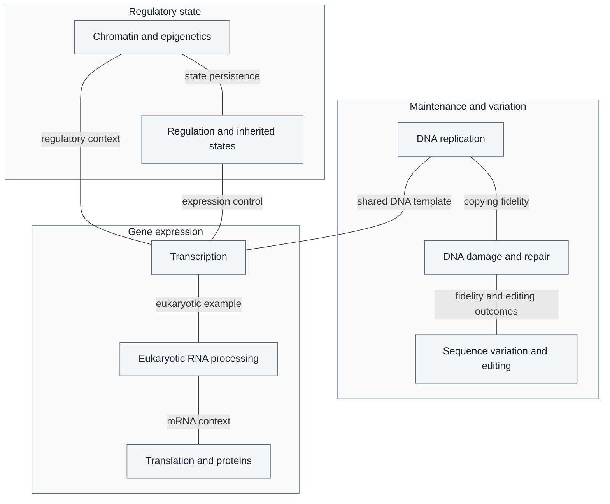

# Unit IV — Molecular Genetics: Introduction {#sec:unit_IV_unit_intro .unnumbered}


## Why This Unit Matters {.unnumbered}

In 1944, Oswald Avery, Colin MacLeod, and Maclyn McCarty performed one of the most transformative
experiments in the history of science. They showed that the \"transforming principle\" that could convert
harmless *Streptococcus pneumoniae* into a lethal strain was DNA rather than protein. Their work
challenged protein-centered explanations of inheritance. A four-base chemical vocabulary raised a
central question: how could DNA sequence encode biological variety? The later double-helix model
provided structural context for that question.

The answer, revealed over the next three decades, is linguistic in structure: a four-letter alphabet
(A, T, G, C) organized into three-letter codons, read in a linear sequence, encoding twenty amino acids,
assembled by ribosomes into an effectively unlimited number of proteins. This is the molecular logic
of gene expression: DNA is transcribed to RNA and translated to protein, with regulation at each step.
Crick's central dogma concerns residue-by-residue sequence-information transfer out of protein, not a ban on RNA-to-DNA synthesis \citep{crick1958,crick1970}.

This unit examines the molecular machinery that reads, copies, and expresses genetic information.
You will study multiprotein complexes that replicate DNA, regulated transcription, and ribosomes
that interpret the genetic code. Numerical summaries such as fewer than one replication mistake per
10⁹ base pairs, a 2.5 MDa ribosome, or ~15 amino acids per second require organism and experimental
context; they are not universal machinery specifications. You will also examine how mutations contribute to evolution and disease, how the
genome is structurally organized, and how RNA-guided editing led to defined clinical applications,
such as the ex vivo stem-cell editing in Casgevy's dated 2023 approval \citep{doudna2014,fda2023casgevy}.

---

## Landmark Discoveries {.unnumbered}

| Discoverer(s) | Year | Journal / Source | Discovery | Significance |
| ------------- | ---- | ---------------- | --------- | ------------ |
| Avery, MacLeod & McCarty | 1944 | \citep{avery1944} | DNA is the genetic material | Overturned protein hypothesis; opened molecular genetics |
| Watson & Crick | 1953 | \citep{watson1953} | Double-helix structure of DNA | Anti-parallel complementary strands implied replication mechanism |
| Meselson & Stahl | 1958 | \citep{meselson1958} | Semi-conservative DNA replication | Definitive proof of how DNA is copied; used ¹⁵N density-gradient experiment |
| Nirenberg & Matthaei | 1961 | \citep{nirenberg1961} | Deciphering the genetic code | Used cell-free translation of poly-U to show UUU = phenylalanine; cracked the codon table |
| Jacob & Monod | 1961 | \citep{jacob1961} | *lac* operon — gene regulatory model | First demonstration of gene circuit logic; inducer-repressor-operator model |
| Alec Jeffreys | 1984 | \citep{jeffreys1984} | DNA fingerprinting (RFLP-based) | Transformed forensic science, paternity testing, and population genetics |
| Jinek, Chylinski and colleagues | 2012 | \citep{doudna2012} | RNA-programmable Cas9 double-stranded DNA cleavage | Demonstrated guide-complementary, PAM-compatible cleavage in vitro; Doudna and Charpentier received the Nobel Prize in 2020 |

---

## Genome maintenance, expression, and regulation {.unnumbered}


<!-- alt: Graph showing genome maintenance, expression, and regulatory state are related but distinct. RNA processing is a eukaryotic example, not an organism-independent pipeline. Labeled arrowless relationships do not imply that fixed mutations are generally reversed by repair or that every regulatory state is inherited. -->

*Genome maintenance, expression, and regulatory state are related but distinct. RNA processing is a eukaryotic example, not an organism-independent pipeline. Labeled arrowless relationships do not imply that fixed mutations are generally reversed by repair or that every regulatory state is inherited.*

---

## Current Evidence Thread {.unnumbered}

Read this unit as molecular genetics built from stacked evidence layers: DNA sequence and replication fidelity, transcription and translation output, the chromatin and methylation state that gates that output, and the variant calls and clinical interpretations that follow from these layers. Molecular genetics now spans single-reference sequences, telomere-to-telomere assemblies, pangenome graphs, long-read sequencing, CRISPR medicines, and ethical deployment. As you
move through the chapters, keep a two-column note: **claim** on the left,
**evidence that would change my confidence** on the right. By the end of the
unit, each major idea should be tied to a measurement, model, citation, or
paper-based lab decision.

## Chapter Roadmap {.unnumbered}

| Chapter | Title | Core Question | Key Equation / Model |
| ------- | ----- | ------------- | -------------------- |
| \cref{sec:unit_IV_dna_replication_and_cell_cycle} | DNA Replication and the Cell Cycle | How do replication, repair, and checkpoints maintain DNA across cell divisions? | Fidelity depends on organism, assay, and repair context; checkpoint models |
| \cref{sec:unit_IV_gene_expression} | Gene Expression | How is genetic information transcribed, processed, and translated? | Expression-rate models; transcription–translation coupling where biologically appropriate |
| \cref{sec:unit_IV_mutations_and_genomics} | Mutations, CRISPR, and Genomics | How do DNA damage, repair, and replication affect sequence variation, and what does the human reference genome reveal? | Sequence-distance assumptions; mutation probability with stated site and generation units |
| \cref{sec:unit_IV_chromatin_and_epigenetic_mechanisms} | Chromatin and Epigenetic Mechanisms | How do chromatin, methylation, and regulatory RNAs tune gene expression without changing DNA sequence? | Methylation state; histone modification; regulatory network logic |
| \cref{sec:unit_IV_epigenetic_inheritance_and_disease} | Epigenetic Inheritance and Disease | Which states persist, and what evidence links them to disease? | Generation controls; clinical endpoints |

---

## Connections Across the Textbook {.unnumbered}

- **DNA replication** directly links to \nameref{sec:unit_V_unit_intro} (meiosis and crossing-over in \cref{sec:unit_V_chromosomal_inheritance}) and \nameref{sec:unit_VI_unit_intro} (molecular clock calculations using sequence divergence).
- **Gene regulation** (operons, TFs, miRNA) reappears in \nameref{sec:unit_VIII_unit_intro} (plant hormone signal transduction) and \nameref{sec:unit_IX_unit_intro} (endocrine control of gene expression via steroid receptors).
- **Sequence variation and DNA repair** provide molecular context for \nameref{sec:unit_VI_unit_intro}, where selection, drift, mutation, and gene flow have distinct roles, and for oncogene/tumor-suppressor biology in \nameref{sec:unit_II_unit_intro} and \nameref{sec:unit_IX_unit_intro}. DNA lesions and mismatches are not interchangeable with fixed mutations.
- **CRISPR-Cas9** appears in clinical connection boxes throughout — gene therapy (\nameref{sec:unit_V_unit_intro}), antibiotic resistance (\nameref{sec:unit_VII_unit_intro}), and plant engineering (\nameref{sec:unit_VIII_unit_intro}).

> **Key vocabulary introduced here:** nucleotide, base pair, template strand, coding strand, codon, anticodon, spliceosome, intron, exon, promoter, enhancer, transcription factor, epigenome, proto-oncogene, restriction enzyme, CRISPR.


## Computational Toolbox — Unit IV {.unnumbered}

```python
from biology.genetics import translate_mrna, dna_complement, punnett_square

# Translate an mRNA sequence into amino acids
mrna = "AUGUUUGAAGAACUUUAG"
protein = translate_mrna(mrna)
print(f"mRNA:    {mrna}")
print(f"Protein: {'-'.join(protein)}")
# Expected: Protein: Met-Phe-Glu-Glu-Leu (stop at UAG)

# Generate the DNA complement of a coding sequence
dna_template = "ATGTTCGAAATG"
complement = dna_complement(dna_template)
print(f"5'→3' complement: {complement}")
# Expected: 5'→3' complement: CATTTCGAACAT  (antiparallel)

# Punnett square: monohybrid cross Aa × Aa
result = punnett_square("Aa", "Aa")
print(f"Genotype ratios: {result.genotype_ratios}")
print(f"Phenotype ratios: {result.phenotype_ratios}")
# Expected:
# Genotype ratios: {'AA': 0.25, 'Aa': 0.5, 'aa': 0.25}
# Phenotype ratios: {'dominant': 0.75, 'recessive': 0.25}
```

> **Try it yourself:** Change the mRNA to `AUGCAGUGA` — note that UGA is a stop codon.
> Compare proteins produced from synonymous codon changes using the `GENETIC_CODE` dictionary.

---

*Source modules: `src/biology/genetics/` — `translate_mrna()`, `dna_complement()`, `punnett_square()`, `hardy_weinberg()`.*
*Figures: `src/mermaid/biology_diagrams.py` (central dogma diagrams, CRISPR mechanism).*

## Cross-Unit Integration {.unnumbered}

\nameref{sec:unit_IV_unit_intro} established how genetic information is stored, copied, and expressed within a single cell. \nameref{sec:unit_V_unit_intro} scales that story to populations and generations: how independently assorting alleles produce Mendelian ratios, how linkage modifies them, how chromosomal abnormalities arise from meiotic errors, and how allele frequencies behave across whole populations under Hardy–Weinberg equilibrium. The transcriptional regulation and epigenetic mechanisms you saw at the molecular level reappear in \nameref{sec:unit_V_unit_intro} as the proximate machinery underlying incomplete penetrance, variable expressivity, and parent-of-origin (imprinting) effects. As Mendelian patterns introduce dominance, recessiveness, and complementation, ask which \nameref{sec:unit_IV_unit_intro} molecular events would produce each pattern — \nameref{sec:unit_V_unit_intro} is essentially \nameref{sec:unit_IV_unit_intro} running across pedigrees.
