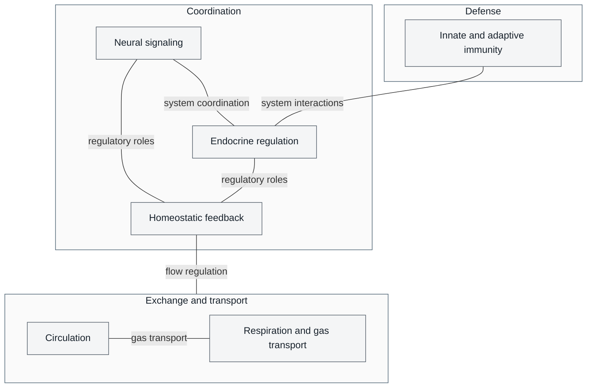

# Unit IX — Zoology and Systems Physiology: Introduction {#sec:unit_IX_unit_intro .unnumbered}


## Why This Unit Matters {.unnumbered}

In 1628, William Harvey published *Exercitatio Anatomica de Motu Cordis et Sanguinis in Animalibus*
(On the Motion of the Heart and Blood in Animals) and overturned nearly 1,500 years of Galenic medicine.
Harvey combined quantitative reasoning with anatomical and experimental evidence for recirculation,
challenging accounts of blood continually generated and consumed. A teaching illustration makes
the accounting clear: at a stipulated 1.8 liters per minute, an unreturned outflow would exhaust
a 5-liter volume in under 3 minutes. These numbers illustrate a circulation argument; they are not
presented as a reconstruction of Harvey's measurements or as proof from reasoning alone.
Physiological models require evidence about both flow and mechanism.

Modern systems physiology is even more mathematical. The Hodgkin-Huxley model (1952) describes the
action potential as a set of four coupled nonlinear ordinary differential equations and was solved
numerically before computers capable of doing so efficiently were widely available. Today, the same
mathematical framework underlies cardiac electrophysiology, pharmacological ion channel modeling, and
the design of neural prosthetics. Homeostasis — regulation of internal conditions — can be
modeled with negative feedback involving detection and effector responses. Any comparison with
engineering control requires specified variables, mechanisms, and operating conditions.

This unit covers four major physiological systems — circulatory, nervous, endocrine, and immune —
with quantitative models throughout. You will apply the Hodgkin-Huxley equations to the action
potential, calculate Starling forces for capillary filtration, model hormonal negative feedback with
Hill equations, and contrast innate and adaptive immune responses as computational pattern-recognition
systems. Clinical connections appear in every section: from cardiac arrhythmias to diabetes mellitus,
from anaphylaxis to Parkinson's disease.

---

## Landmark Discoveries {.unnumbered}

| Discoverer(s) | Year | Journal / Source | Discovery | Significance |
| ------------- | ---- | ---------------- | --------- | ------------ |
| William Harvey | 1628 | \citep{harvey1628} | Systemic circulation: heart as pump | Quantitative physiology; disproved Galenic humoral theory |
| Claude Bernard | 1854–1879 | \citep{bernard1865} | Internal milieu and homeostasis | Defined the concept of regulated internal environment |
| Ernest Starling | 1918 | \citep{starling1914} | Frank-Starling law of the heart | Relates cardiac filling and mechanical response under specified conditions, not a universal output–return proportionality |
| Alan Hodgkin & Andrew Huxley | 1952 | \citep{hodgkin1952quantitative} | Mathematical model of nerve action potential | Four ODEs describing Na⁺/K⁺ conductance; Nobel Prize 1963 |
| Barry Marshall & Robin Warren | 1984 | \citep{marshall1984} | *Helicobacter pylori* causes peptic ulcers | Disproved \"acid stress\" dogma; Nobel Prize 2005; key discovery in gastrointestinal physiology |
| Rosalyn Yalow & Solomon Berson | 1959 | \citep{yalow1959} | Radioimmunoassay (RIA) for insulin | Enabled measurement of hormone concentrations at picomolar levels; Nobel Prize 1977 |
| César Milstein & Georges Köhler | 1975 | \citep{milstein1975} | Monoclonal antibody production (hybridoma) | Foundation of modern immunotherapy, diagnostics, and targeted cancer therapy; Nobel Prize 1984 |

---

## Organ-system coordination and physiological models {.unnumbered}


<!-- alt: Graph showing organ-system relationships connect transport, neural and endocrine coordination, and immune defense. Homeostatic feedback is a model theme, not a complete control circuit drawn here. Connectors identify selected functions, not causal proof, a reading order, or mathematical identity with population regulation. -->

*Organ-system relationships connect transport, neural and endocrine coordination, and immune defense. Homeostatic feedback is a model theme, not a complete control circuit drawn here. Connectors identify selected functions, not causal proof, a reading order, or mathematical identity with population regulation.*

---

## Current Evidence Thread {.unnumbered}

Read this unit as physiology that is known because it has been measured: every claim about action potentials, circulation, hormones, immunity, and neural circuits rests on a recording, an image, a perturbation, or a clinical measurement, and the strength of the claim is no better than the method behind it. Physiology now blends mechanism with allostasis, immune-endocrine-neural coupling, wearable data, and individualized risk without reducing bodies to simple machines. As you
move through the chapters, keep a two-column note: **claim** on the left,
**evidence that would change my confidence** on the right. By the end of the
unit, each major idea should be tied to a measurement, model, citation, or
paper-based lab decision.

## Chapter Roadmap {.unnumbered}

| Chapter | Central question | Quantitative lens |
| --- | --- | --- |
| \cref{sec:unit_IX_circulation_respiration_homeostasis} | How are flow, gas exchange, and fluid balance regulated? | Cardiac output, Fick principle, oxygen content |
| \cref{sec:unit_IX_nervous_system} | How do circuits integrate sensory and motor signals? | GHK and passive cable attenuation |
| \cref{sec:unit_IX_action_potential_synapses} | How do spikes and synapses encode signals? | HH dynamics and release statistics |
| \cref{sec:unit_IX_endocrine_signaling} | How do hormone axes coordinate physiology? | Clearance and feedback models |
| \cref{sec:unit_IX_immune_system_defense} | How do recognition, selection, and tolerance organize defense? | Controlled immune readouts and endpoint comparisons |

---

## Connections Across the Textbook {.unnumbered}

- **Ion channels and membrane potential** (this unit) build directly on membrane transport (\cref{sec:unit_II_membrane_transport}) and electrochemistry (\nameref{sec:unit_I_unit_intro}).
- **Hemoglobin cooperativity** (Hill equation; illustrative $n \approx 2.8$, not a universal coefficient) connects to allosteric binding models (\cref{sec:unit_I_enzymes_and_kinetics}) and protein structure (\cref{sec:unit_I_macromolecules}); this is not enzyme catalysis.
- **Immune system** connects to \nameref{sec:unit_VII_unit_intro} (innate response to bacteria/viruses) and \nameref{sec:unit_IV_unit_intro} (recombination of V(D)J gene segments in antibody diversity).
- **Endocrine regulation** (steroid hormones acting on nuclear receptors) links to \nameref{sec:unit_IV_unit_intro} (gene regulation) and \nameref{sec:unit_III_unit_intro} (metabolic regulation by insulin/glucagon vs. AMPK).
- **Feedback** offers comparisons with metabolic regulation (\nameref{sec:unit_III_unit_intro}) and population models (\nameref{sec:unit_X_unit_intro}), but shared mathematical motifs do not establish identical mechanisms or control systems.

> **Key vocabulary introduced here:** homeostasis, action potential, resting membrane potential, ion channel, neurotransmitter, synapse, GPCR, second messenger, cardiac output, stroke volume, preload, afterload, Frank-Starling law, hemoglobin cooperativity, Bohr effect, hormone, receptor tyrosine kinase, antigen, MHC, clonal selection, innate immunity, adaptive immunity.


## Computational Toolbox — Unit IX {.unnumbered}

```python
from biology.physiology import oxygen_saturation
from biology.neuroscience import action_potential_hh

# Haemoglobin oxygen saturation (Hill equation): arterial vs venous
# Hill coefficient n=2.7; P50=26 mmHg for adult HbA at 37°C, pH 7.4
arterial = oxygen_saturation(pO2_mmHg=100, p50_mmHg=26, hill_coefficient=2.7)
venous = oxygen_saturation(pO2_mmHg=40, p50_mmHg=26, hill_coefficient=2.7)
print(f"Arterial SO2  (PO2=100 mmHg): {arterial.saturation:.1%}")
print(f"Venous   SO2  (PO2=40  mmHg): {venous.saturation:.1%}")
print(f"O2 extraction ratio: {(arterial.saturation - venous.saturation) / arterial.saturation:.1%}")
# Expected:
# Arterial SO2:  97.4%
# Venous   SO2:  76.2%
# O2 extraction: 21.8%  (about 5 mL O2 per 100 mL blood at rest)

# Hodgkin-Huxley action potential simulation (10 µA/cm² stimulus, 50 ms)
hh = action_potential_hh(stimulus_current_µA=10.0, t_end_ms=50.0)
peak_V = max(hh.voltage_mV)
print(f"Peak membrane voltage: {peak_V:.1f} mV")
print(f"Firing threshold crossed: {hh.fired}")
# Expected:
# The computed peak and hh.fired are model outputs, not clinical thresholds.
# Repeat with a finer time grid before interpreting peak amplitude.
```

> **Try it yourself:** Reduce `stimulus_current_µA` to 5 µA/cm² — the membrane depolarizes
> but may not reach threshold. Compare the model’s threshold flag and peak under matched pulse duration and finer resolution; this probes the **all-or-none principle**, not a fixed universal current threshold.

---

*Source modules: `src/biology/physiology/` and `src/biology/neuroscience/` — `oxygen_saturation()`, `poiseuille_flow()`, `homeostasis_response()`, `action_potential_hh()`.*
*Figures: `src/visualization/` (action potential traces, hemoglobin saturation curves, hormone feedback oscillators); `src/mermaid/biology_diagrams.py` (nervous system diagrams, immune response cascades).*

## Cross-Unit Integration {.unnumbered}

Feedback offers a useful comparison between \nameref{sec:unit_IX_unit_intro} and the ecology of \nameref{sec:unit_X_unit_intro}, but the model variables and mechanisms differ. In a logistic model, carrying capacity describes specified environmental conditions; it is not automatically a sensed, defended physiological set point. Density dependence and predator–prey dynamics can be compared with regulatory and oscillatory physiology models only after identifying the relevant assumptions. Similar mathematical motifs do not establish identical control systems.
