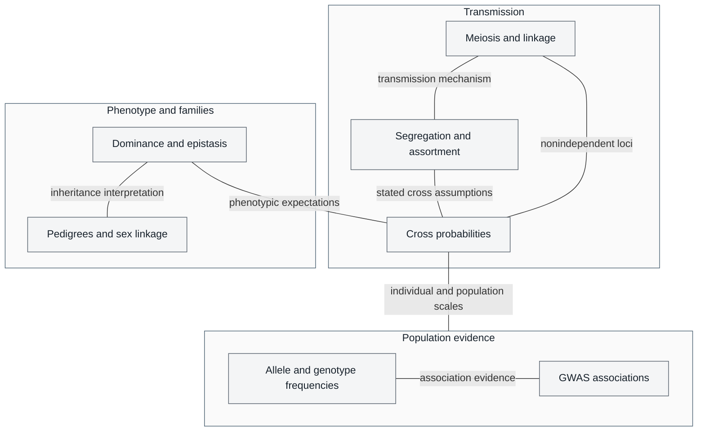

# Unit V — Classical Genetics and Heredity: Introduction {#sec:unit_V_unit_intro .unnumbered}


## Why This Unit Matters {.unnumbered}

In 1866, an Augustinian friar in Brno published a mathematical analysis of 29,000 pea plants he had
grown in the monastery garden. Gregor Mendel showed that heritable traits are passed from parent to
offspring with model-based expectations: 3:1 for an Aa × Aa cross with complete dominance, and
9:3:3:1 for an AaBb × AaBb cross with independently assorting loci and complete dominance at each.
These are expected phenotypic ratios under stated assumptions, not universal outcomes. Mendel's work
became central to genetics after renewed attention around 1900. Chromosomal theory and Morgan's
fruit fly experiments later connected inheritance patterns to chromosomes, providing mechanisms
against which cross predictions could be tested.

The synthesis of Mendel's mathematical laws with chromosomal theory, and later with population
genetics, constitutes one of the great intellectual achievements of twentieth-century science. It
unified patterns of inheritance visible to naked-eye observation with the molecular machinery of DNA
replication and meiosis. It transformed agriculture, medicine, forensic science, and evolutionary
theory. Today, genome-wide association studies (GWAS) identify trait-associated loci, without
establishing causal variants by association alone; pedigree analysis evaluates inheritance and risk;
and population-genetic models examine drug-resistance evolution under stated assumptions.

This unit bridges the gap between the molecular genetics of \nameref{sec:unit_IV_unit_intro} and the evolutionary dynamics of
\nameref{sec:unit_VI_unit_intro}. You will derive Mendelian ratios from first principles, work through the mathematics of
incomplete dominance, codominance, and epistasis, map gene positions using recombination frequencies,
and apply the Hardy-Weinberg equations to natural populations.

---

## Landmark Discoveries {.unnumbered}

| Discoverer(s) | Year | Journal / Source | Discovery | Significance |
| ------------- | ---- | ---------------- | --------- | ------------ |
| Gregor Mendel | 1866 | \citep{mendel1866} | Laws of segregation and independent assortment | Mathematical foundation of genetics; rediscovered 1900 |
| Walther Flemming | 1882 | \citep{flemming1882} | Chromosomes during mitosis (\"chromatin\") | First visualization of chromosomal segregation |
| Thomas Hunt Morgan | 1910 | \citep{morgan1910} | Sex-linked inheritance in *Drosophila* | Proved genes reside on chromosomes; Nobel Prize 1933 |
| Alfred Sturtevant | 1913 | \citep{sturtevant1913} | First genetic map (6 X-linked *Drosophila* genes) | Used recombination to infer gene order and distance; simple proportionality is limited to short intervals |
| Barbara McClintock | 1950 | \citep{mcclintock1950} | Transposable elements (\"jumping genes\") | Showed genomes are dynamic; Nobel Prize 1983 |
| Hardy & Weinberg | 1908 | \citep{weinberg1908} | Population genetic equilibrium | Genotype-frequency expectations at specified allele frequencies; allele-frequency constancy is a separate question |
| Human Genome Project Consortium | 2001 | \citep{lander2001humangenome} | Draft human genome sequence | ~3.2 Gb; ~20,000 protein-coding genes; foundation for GWAS |

---

## Transmission, phenotype, and population variation {.unnumbered}


<!-- alt: Graph showing transmission mechanisms, phenotype relationships, and population evidence answer different questions. Cross ratios require specified parents and dominance assumptions; genotype proportions, allele-frequency change, and association are not interchangeable evidence. Connectors identify selected relationships, not causal proof or a reading order. -->

*Transmission mechanisms, phenotype relationships, and population evidence answer different questions. Cross ratios require specified parents and dominance assumptions; genotype proportions, allele-frequency change, and association are not interchangeable evidence. Connectors identify selected relationships, not causal proof or a reading order.*

---

## Current Evidence Thread {.unnumbered}

Treat inheritance in this unit as something that is *evidenced*, not just asserted: pedigrees and controlled crosses test transmission rules, allele-frequency time series test which evolutionary force is acting, and biobank-scale association data test whether a 'Mendelian' trait is really single-gene. Classical genetics remains essential, but modern interpretation adds penetrance, polygenicity, structural variation, ancestry-aware inference, and uncertainty in risk prediction. As you
move through the chapters, keep a two-column note: **claim** on the left,
**evidence that would change my confidence** on the right. By the end of the
unit, each major idea should be tied to a measurement, model, citation, or
paper-based lab decision.

\clearpage

## Chapter Roadmap {.unnumbered}

| Chapter | Core question | Quantitative lens |
| --- | --- | --- |
| \cref{sec:unit_V_mendelian_principles} | How does segregation generate cross probabilities? | Product and binomial rules; fixed-ratio chi-square |
| \cref{sec:unit_V_mendelian_extensions_and_human_genetics} | What changes genotype-to-phenotype predictions? | Epistasis, penetrance, conditional pedigree risk |
| \cref{sec:unit_V_chromosomal_inheritance} | How does phase determine linkage evidence? | Labeled haplotypes and three-point maps |
| \cref{sec:unit_V_population_genetics} | What does a population sample establish? | HWE expectations, drift, selection and clocks |

---

## Connections Across the Textbook {.unnumbered}

- **Meiosis and crossing-over** (\cref{sec:unit_V_chromosomal_inheritance}) build directly on DNA replication and chromosome structure from \nameref{sec:unit_IV_unit_intro}, and provide the mechanistic basis for recombination in \nameref{sec:unit_VI_unit_intro} (evolution).
- **Hardy–Weinberg genotype proportions** (\cref{sec:unit_V_population_genetics}) provide expectations at specified allele frequencies; selection (\cref{sec:unit_VI_evolution_and_selection}) and drift (\cref{sec:unit_VI_genetic_drift_and_speciation}) instead model changes in those frequencies across generations.
- **Pedigree analysis** and **inheritance patterns** reappear throughout \nameref{sec:unit_IX_unit_intro} (genetic basis of cardiovascular disease, endocrine disorders, immune deficiencies).
- **Epistasis and polygenic traits** link to \nameref{sec:unit_VI_unit_intro} (quantitative trait loci, QTL mapping) and \nameref{sec:unit_X_unit_intro} (population-level phenotypic variation in ecology).

> **Key vocabulary introduced here:** allele, locus, genotype, phenotype, dominant, recessive, homozygous, heterozygous, test cross, chi-square test, centimorgan (cM), Hardy-Weinberg equilibrium, inbreeding coefficient, linkage disequilibrium, aneuploidy, nondisjunction.


## Computational Toolbox — Unit V {.unnumbered}

```python
from biology.genetics import hardy_weinberg, hamming_distance, chi_squared_test

# Synthetic autosomal-recessive teaching population (not a CF prevalence estimate)
# q is the allele frequency, not the carrier frequency; carriers have frequency 2pq.
hw = hardy_weinberg(p=0.955, q=0.045)
print(f"AA (unaffected non-carrier): {hw.p_squared:.4f} = {hw.p_squared*100:.1f}%")
print(f"Aa (carrier):               {hw.two_pq:.4f} = {hw.two_pq*100:.1f}%")
print(f"aa (affected):              {hw.q_squared:.5f} = 1 in {1/hw.q_squared:.0f}")
# Expected:
# AA (unaffected non-carrier): 0.9120 = 91.2%
# Aa (carrier):               0.0860 = 8.6%  (≈ 1 in 11.63)
# aa (affected):              0.00203 = 1 in 494

# Sequence distance between two short alleles
dist = hamming_distance("ATGCTAGC", "ATGATAGT")
print(f"Sequence differences: {dist}")
# Expected: Sequence differences: 2

# Chi-square test: 3:1 vs observed 290:110 (n=400 plants)
chi = chi_squared_test(observed=[290, 110], expected=[300, 100])
print(f"χ² = {chi.chi_squared:.2f}, p ≈ {chi.p_value_approx:.3f}")
# Expected: χ² ≈ 1.33, p ≈ 0.25 (not significant; consistent with 3:1)
```

> **Try it yourself:** Set allele frequency `q = 0.02` and `p = 0.98`. Compute carriers ($2pq=0.0392$) and affected homozygotes ($q^2=0.0004$). For a stipulated carrier fraction of 1/22, solve $2q(1-q)=1/22$ for the rare-allele root rather than assigning $q=1/22$.

---

*Source note: genetics helpers support Punnett squares, Hardy-Weinberg checks, sequence distances, and chi-squared tests.*
*Figures: `src/visualization/` (Mendelian ratio histograms, Hardy-Weinberg surface plots).*

## Cross-Unit Integration {.unnumbered}

The inheritance and population accounting in \nameref{sec:unit_V_unit_intro} distinguish genotype proportions from allele-frequency dynamics. Random mating gives Hardy–Weinberg genotype expectations at specified allele frequencies; selection, drift, mutation, and gene flow can change allele frequencies across generations. Nonrandom mating can alter genotype proportions without necessarily changing allele frequencies. In \nameref{sec:unit_VI_unit_intro}, use the model and sampling stage appropriate to the question rather than treating every departure from Hardy–Weinberg proportions as an evolutionary trajectory. Allele frequency, heterozygosity, and effective population size remain useful quantities across both units.
