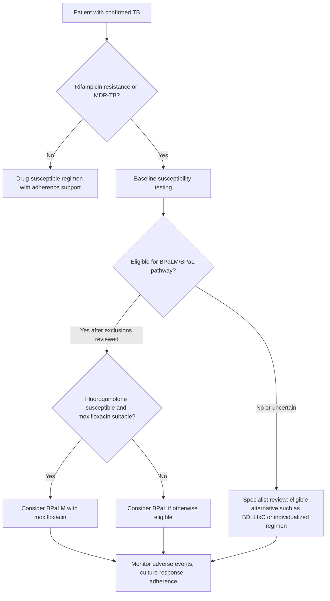
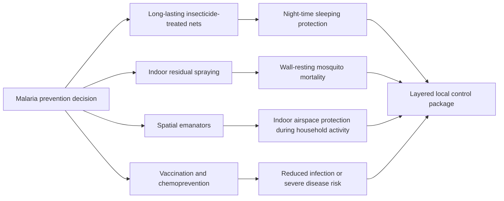
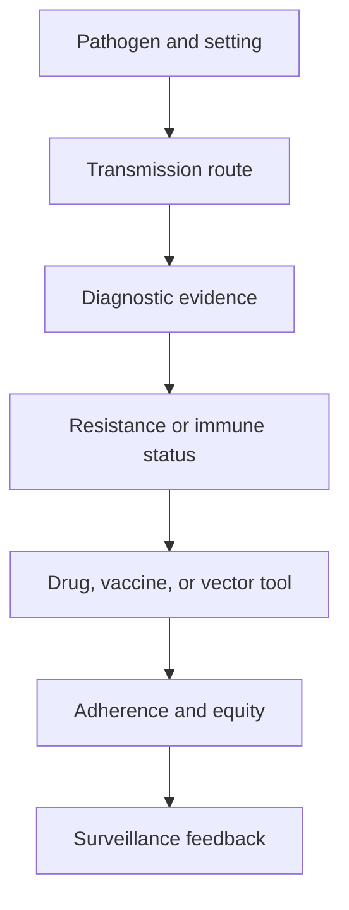

# Antimicrobial Resistance and Epidemiology

\label{sec:unit_VII_antimicrobial_resistance_and_epidemiology}

<!-- chapter-metadata-badge -->
> Level 2/3 · 35 min read · 45 min lecture · Prerequisites: \cref{sec:unit_VII_host_immunity_and_vaccines}

## Learning Objectives

1. Classify antibiotic-resistance mechanisms in multidrug-resistant pathogens.
2. Interpret epidemic curves, R0, and herd-immunity thresholds.
3. Compare stewardship, surveillance, and public-health interventions.
4. Evaluate resistance evolution under selection and horizontal gene transfer.

5. Propose a stewardship intervention that lowers resistance selection without blocking necessary treatment.
6. Model resistance spread with selection coefficients and horizontal gene transfer.
7. Interpret surveillance datasets such as GLASS reports with explicit sampling limits.

<!-- curriculum-scaffold-start -->
### Study Blueprint

- **Big idea:** Antimicrobial resistance and epidemic dynamics emerge from pathogen evolution and transmission networks.
- **Core concepts:** antibiotic resistance, R0, transmission, surveillance.
- **Framework alignment:** Vision & Change: Evolution, Systems, Structure and function; AP Biology: Evolution, Systems Interactions; NGSS-style topics: Structure and Function, Interdependent Relationships in Ecosystems.
- **Model or quantitative lens:** R0, resistance-mechanism, and outbreak-trajectory calculations.
- **Data skill:** Interpret resistance assays and outbreak curves.
- **Practice cadence:** Questions and Methods, Representing and Describing Data, Argumentation.
- **Common misconception to repair:** R0 is not a fixed property of a pathogen alone; it depends on host behavior and environment.
- **Primary lab:** \nameref{sec:lab_unit_VII_antimicrobial_resistance_and_epidemiology}.
- **Question bank:** \nameref{sec:q_unit_VII_antimicrobial_resistance_and_epidemiology}.
- **Transfer task:** Transfer resistance and epidemiology reasoning to stewardship and public-health policy.
- **Bridge to computation:** `biology.microbiology.microbiology.sir_model`.
<!-- curriculum-scaffold-end -->

---

> **Opening Vignette — A Resistance Gene Is Not a Transmission Rate**
>
> In a hypothetical surveillance comparison, two isolates share a resistance determinant but occur in different host and treatment settings. The genotype alone does not determine susceptibility, treatment outcome, or epidemic growth. This chapter separates molecular mechanisms, isolate-specific measurements, transmission models, and the sampling limits of surveillance.


## Antibiotic Resistance Mechanisms in Multidrug-Resistant Pathogens

Antibiotic resistance can be classified into five mechanistic categories. Most clinically important multi-drug-resistant pathogens combine multiple mechanisms; an isolate may simultaneously hydrolyse β-lactams, modify aminoglycosides, methylate ribosomal RNA, and pump out fluoroquinolones.

### Mechanism 1: Enzymatic Inactivation

Direct destruction of the drug by hydrolysis or modification.

**β-lactamases** are the most clinically important and most diverse resistance enzymes. They hydrolyse the β-lactam ring (with the active-site serine — a tetrahedral covalent intermediate — or via a metallo-zinc mechanism) before the drug reaches its PBP target. The Ambler classification:

: Mechanism 1: Enzymatic Inactivation: Class and Mechanism. {#tbl:unit_VII_antimicrobial_resistance_and_epidemiology_mechanism_1_enzymatic_inactivation}
| Class | Mechanism | Spectrum / antibiotic-activity context | Inhibitor sensitivity | Examples |
| --- | --- | --- | --- | --- |
| **Class A** (serine) | Active-site serine (Ser70) | Spectrum is enzyme-specific: penicillinases, ESBLs and carbapenemases differ | Older inhibitors inhibit many penicillinases/ESBLs, not classA universally; tazobactam does not inhibit KPC. Newer inhibitors such as avibactam inhibit KPC, but isolate-specific AST remains necessary \citep{idsa2026amr} | TEM-1, SHV-1; CTX-M ESBLs; KPC carbapenemases |
| **Class B** (metallo-β-lactamase, MBL) | Zn$^{2+}$ active site; hydroxide nucleophile | Hydrolyzes penicillins, cephalosporins and carbapenems; aztreonam is spared by MBL chemistry but vulnerable to co-produced serine β-lactamases | EDTA inhibition is an in-vitro clue. Avibactam does not inhibit NDM; it can protect aztreonam against co-produced serine enzymes \citep{idsa2026amr} | NDM, VIM, IMP |
| **Class C** (AmpC) | Active-site serine | Cephalosporins including3GC; cefepime/carbapenem activity depends on measured susceptibility and coexisting mechanisms | Poor inhibition by clavulanate; inhibition depends on the specific newer inhibitor | Chromosomal inducible AmpC in some Enterobacterales and *Pseudomonas*; plasmid-borne CMY |
| **Class D** (oxacillinase, OXA) | Active-site serine | Variable, including carbapenem hydrolysis by some enzymes | Enzyme-specific inhibitor susceptibility | OXA-48-like, OXA-23; enzyme identity alone does not establish pan-resistance |

**Other inactivating enzymes:**

- **Aminoglycoside-modifying enzymes (AMEs)** — acetyltransferases (AAC), phosphotransferases (APH) and nucleotidyltransferases (ANT) modify amino or hydroxyl groups on susceptible drugs, reducing ribosome binding. Many determinants occur on mobile elements; the affected drug spectrum depends on the enzyme, not just the family label.
- **Chloramphenicol acetyltransferase (CAT)** — acetylates the drug.
- **Macrolide esterases / phosphotransferases** (Ere, Mph) — less common than ribosomal methylation.
- **β-glucuronidases** that activate the cancer drug irinotecan into its toxic form (gut bacteria; relevant for drug-drug-microbiome interactions).

### Mechanism 2: Target Modification

Altering the drug target so the antibiotic no longer binds.

: Mechanism 2: Target Modification: Antibiotic and Original target. {#tbl:unit_VII_antimicrobial_resistance_and_epidemiology_mechanism_2_target_modification}
| Antibiotic | Original target | Modified target | Resistance mechanism |
|------------|-----------------|------------------|----------------------|
| **β-lactams** | PBP2 (transpeptidase) | **PBP2a** in MRSA (encoded by *mecA*) | Low-affinity transpeptidase that performs cross-linking even when normal PBPs are inhibited; SCC*mec* cassette mobile element |
| **Vancomycin** | D-Ala-D-Ala terminus of Lipid II | **D-Ala-D-Lac** (VanA, VanB) or **D-Ala-D-Ser** (VanC) | Altered precursor chemistry reduces binding; D-Lac and D-Ser substitutions must not be assigned one shared affinity-loss factor without matched binding measurements |
| **Macrolides, lincosamides, streptogramin B (MLS$_B$)** | 23S rRNA peptidyl-transferase center | **Methylated A2058 of 23S rRNA** by Erm methylase | Single methyl group blocks the three drug classes — cross-resistance |
| **Aminoglycosides (high-level)** | 16S rRNA A-site | **16S rRNA methylation** by ArmA, RmtB, RmtC, RmtD | Acquired methylases can confer high-level resistance to multiple aminoglycosides; the spectrum is enzyme- and drug-specific, not automatically every member of the class |
| **Linezolid** | 23S rRNA, U2504 | **G2576T or T2500A 23S rRNA mutation**; **cfr methylase** (methylates A2503) | Cfr also confers cross-resistance to phenicols, lincosamides, streptogramins, oxazolidinones (PhLOPS$_A$) |
| **Fluoroquinolones** | DNA gyrase (GyrA, GyrB), topoisomerase IV (ParC, ParE) | **Mutations in QRDR (quinolone-resistance-determining region)**: GyrA Ser83, Asp87 | Stepwise mutations: each step adds resistance; *qnr* genes encode gyrase-protecting proteins (low-level) |
| **Rifampin** | RNA polymerase β subunit (RpoB) | **RpoB mutations**, especially Ser531Leu, His526Tyr | Single mutations confer high-level resistance |
| **Trimethoprim** | DHFR (dihydrofolate reductase) | Acquired *dfr* genes encoding drug-resistant DHFR; chromosomal mutations | Bypass through alternative DHFR |
| **Sulfonamides** | DHPS (dihydropteroate synthase) | Acquired *sul* genes; chromosomal mutations | Bypass through alternative DHPS |
| **Colistin (polymyxin)** | LPS lipid A | **mcr-1 phosphoethanolamine transferase** (plasmid-borne, 2015 discovery, China); chromosomal *pmrAB / phoPQ* mutations | Modifies lipid A phosphates → reduced affinity for cationic colistin |

The drug spectrum can be tested directly rather than inferred from a class label. \citet[Table~2]{galimand2003arma} compared an E. coli cloning host with and without an armA-bearing plasmid using agar-dilution MICs after 18 hours at 37°C. INVαF′ had an amikacin MIC of 1 µg/mL versus 512 µg/mL with pAT781, whereas apramycin remained at 0.5 µg/mL in both. That preparation-specific comparison refutes resistance to every aminoglycoside from ArmA alone; it does not identify a treatment for another isolate.

**MRSA mechanism in detail.** *S. aureus* resistant to methicillin and most earlier β-lactams can carry **mecA** on **SCC*mec*** (staphylococcal cassette chromosome mec). It encodes **PBP2a**, an alternative transpeptidase that binds many traditional β-lactams poorly and can sustain cell-wall cross-linking when other PBPs are inhibited. Quantitative binding comparisons require a specified antibiotic, protein preparation and assay. Ceftaroline and ceftobiprole can retain activity against susceptible MRSA isolates, but activity must be assessed for the specific isolate and clinical context.

### Mechanism 3: Efflux Pumps

Active export of antibiotics out of the cell, often accomplishing **multi-drug resistance** through a single pump system.

: Mechanism 3: Efflux Pumps: Pump family and Energy source. {#tbl:unit_VII_antimicrobial_resistance_and_epidemiology_mechanism_3_efflux_pumps}
| Pump family | Energy source | Drugs effluxed | Examples |
|-------------|---------------|----------------|----------|
| **RND (Resistance-Nodulation-Division)** | Proton motive force | β-lactams, fluoroquinolones, tetracyclines, chloramphenicol, macrolides | **AcrAB-TolC** (*E. coli*); **MexAB-OprM**, **MexCD-OprJ**, **MexEF-OprN**, **MexXY-OprM** (*P. aeruginosa*); **AdeABC** (*Acinetobacter*) |
| **MFS (Major Facilitator Superfamily)** | PMF | Tetracyclines (TetA, TetB), macrolides (Mef), fluoroquinolones | TetA, TetB; MdfA |
| **MATE** | PMF / Na$^+$ gradient | Fluoroquinolones, aminoglycosides | NorM (*V. parahaemolyticus*) |
| **SMR (Small Multidrug Resistance)** | PMF | QACs, lipophilic cations | EmrE |
| **ABC (ATP-Binding Cassette)** | ATP | Macrolides, ketolides | LmrA |

**RND tripartite pumps** in Gram-negatives are particularly devastating because they span the entire cell envelope: an inner-membrane efflux transporter (e.g., AcrB) coupled via a periplasmic adaptor (AcrA) to an outer-membrane channel (TolC). The pump exports drugs straight from the cytoplasm or inner membrane into the extracellular space, bypassing the periplasm. *P. aeruginosa* MexAB-OprM is the textbook example: constitutive expression confers intrinsic resistance to multiple drug classes; mutations in regulators (e.g., *nfxB*, *mexR*) cause overexpression and clinical failure.

### Mechanism 4: Reduced Permeability

Decreasing drug uptake by altering cell-envelope permeability.

- **Porin loss** in Gram-negatives: deletions or down-regulation of OmpF, OmpC, OprD — particularly important for hydrophilic β-lactams and carbapenems. **OprD loss in *P. aeruginosa*** confers imipenem resistance.
- **LPS modification** in Gram-negatives: reduces hydrophobic-drug entry.
- **Mycobacterial cell wall**: the mycolic-acid layer is intrinsically impermeable; *M. tuberculosis* is naturally resistant to most antibiotics.

### Mechanism 5: Bypass / Target Overproduction

Producing more target or alternative target to dilute drug action.

- **Trimethoprim resistance via** *dfr* genes that encode a drug-insensitive DHFR (target replacement).
- **Sulfonamide resistance via** *sul* genes that encode a drug-insensitive DHPS.
- **Methotrexate resistance** in cancer cells via DHFR overexpression — same principle in eukaryotes.

### Resistance in Action: A Composite Multidrug-Resistant *Klebsiella pneumoniae*

The following synthetic composite resistance profile illustrates mechanisms that can coexist; it is not a documented isolate from a named 2019 outbreak:

: Composite resistance mechanisms in Klebsiella pneumoniae; pan-resistance is not established without a defined tested panel. {#tbl:unit_VII_antimicrobial_resistance_and_epidemiology_resistance_in_action_a_pan_resistant_klebsiella_pneumoniae}
| Mechanism | Genetic determinant | Drug class affected |
|-----------|---------------------|---------------------|
| **NDM-1** (Class B MBL) | *bla*$_\text{NDM-1}$ on plasmid | Penicillins, cephalosporins, and carbapenems; aztreonam is spared by MBL chemistry but vulnerable to co-produced ESBLs |
| **CTX-M-15** ESBL (Class A) | *bla*$_\text{CTX-M-15}$ | Cephalosporins (residual) |
| **OXA-48** (Class D) | *bla*$_\text{OXA-48}$ | Carbapenems (residual) |
| **mcr-1** | *mcr-1* | Colistin |
| **Aac(6')-Ib-cr** | Plasmid | Aminoglycosides + ciprofloxacin |
| **rmtB** | Plasmid | Multiple aminoglycosides; determine the drug-specific susceptibility profile |
| **AcrAB-TolC overexpression** | *ramA* mutation | Multiple |
| **GyrA Ser83Leu** | Chromosome | Fluoroquinolones |
| **OmpK35 loss** | Chromosome | Reduced β-lactam entry |

Such isolates may have no reliable standard single-agent option, so treatment depends on isolate-specific susceptibility testing, source control and expert consultation. Options can include cefiderocol or ceftazidime-avibactam plus aztreonam for some MBL-producing isolates, with other agents considered only when activity and clinical evidence support them; phage therapy remains investigational. The case illustrates that resistance determinants can accumulate, sometimes arriving together on linked mobile elements. Antibiotic stewardship, infection control, diagnostics and drug development address different parts of that process.

> **Concept Check 6b:**
> A *K. pneumoniae* isolate carries KPC-2, RamA-dependent AcrAB overexpression and GyrA/ParC mutations. Standardized broth microdilution gives colistin MIC 0.5 µg/mL and ceftazidime-avibactam MIC 1/4 µg/mL. Under the 2026 CLSI criteria summarized by IDSA, colistin is intermediate (there is no susceptible category), whereas ceftazidime-avibactam meets the susceptible breakpoint \citep{idsa2026amrbreakpoints}. Explain how avibactam's activity against KPC differs from its lack of activity against NDM. Why do enzyme assays or molecular identification and isolate-specific AST provide different evidence, and why is a category not a guarantee of clinical response?


## Epidemiology of Resistance and Transmission

### Key Epidemiological Metrics

: Key Epidemiological Metrics: Metric and Definition. {#tbl:unit_VII_antimicrobial_resistance_and_epidemiology_key_epidemiological_metrics}
| Metric | Definition | Significance |
|--------|-----------|-------------|
| $R_0$ (basic reproduction number) | Expected secondary infections per primary infection in a defined fully susceptible population/contact setting | $R_0>1$ permits initial growth under that model; not a pathogen-only constant |
| $R_e$ (effective reproduction number) | Expected secondary infections under current susceptibility, behavior and interventions | $R_0(1-p)$ is only the homogeneous immunity-only approximation; aim below1 |
| CFR (case-fatality ratio) | Disease-attributed deaths in a defined case cohort divided by cases in that cohort, with case definition and outcome follow-up specified | Missed mild cases can raise the observed ratio relative to IFR; missed deaths or unresolved outcomes can bias downward |
| IFR (infection-fatality ratio) | Disease-attributed deaths among all infected people, including undiagnosed/asymptomatic infections, for a defined population and period | Representative serology is one estimation method, not a definitional requirement or guarantee of accuracy \citep{who2020fatalitydefinitions} |
| Incubation period | Time from infection to symptom onset | Informs follow-up together with infectiousness and detection evidence |
| Serial interval | Time between symptom onsets in successive linked cases | Not the infection-to-infection generation interval; its mean alone does not determine $R_0$ |

### Worked Example: Estimating R0 from an Epidemic Curve

**Problem:**
Early in an outbreak, confirmed cases double every $T_d = 3.0$ days. For this synthetic calculation, assume a fixed generation interval $T_s=5.0$ days between infection events. A mean serial interval between symptom onsets is not sufficient to specify that distribution. Estimate the basic reproduction number $R_0$, then the herd-immunity threshold.

**Solution:**

1. **Exponential growth rate $r$ from the doubling time.** Early case counts grow as $N(t) = N_0\,2^{t/T_d} = N_0\,e^{rt}$, so equating exponents gives $r = \ln 2 / T_d$:

$$ r = \frac{\ln 2}{T_d} = \frac{0.6931}{3.0} = 0.2310 \text{ day}^{-1} \label{eq:unit_VII_infectious_disease_item_3}$$

2. **Convert growth rate to $R_0$.** For the stipulated fixed (delta-distributed) generation interval, the renewal equation gives $R_0 = e^{r T_s}$:

$$ R_0 = e^{r T_s} = e^{0.2310 \times 5.0} = e^{1.155} = 3.17 \label{eq:unit_VII_infectious_disease_item_4}$$

   An exponential generation-interval distribution with the same mean instead gives $R_0=1+5r\approx2.155$. This is a different model, not a universal lower-bound formula. The mean alone does not determine $R_0$.

3. **Herd-immunity threshold.** Substituting $R_0 = 3.17$ into the herd-immunity relation $p_c = 1 - 1/R_0$ from \cref{eq:unit_VII_herd_immunity}:

$$ p_c = 1 - \frac{1}{3.17} = 0.685 \;\rightarrow\; 68.5\,\% \label{eq:unit_VII_infectious_disease_item_5}$$

**Interpretation:** Under the specified fixed generation interval, $r=\ln2/3$ and $R_0=2^{5/3}\approx3.1748$, giving ideal immune threshold about 68.50%. An exponential interval with the same mean gives a different answer; observed epidemic growth does not uniquely determine transmission without the generation-interval model.

### Worked Example: Herd Immunity Threshold and Required Vaccination Coverage

**Problem:** Compare two hypothetical homogeneous transmission models, $R_0=15$ with stipulated transmission-blocking efficacy $\varepsilon_T=.97$, and $R_0=4$ with stipulated $\varepsilon_T=.95$. These are mathematical assumptions, not substitution of symptomatic-disease efficacy for prevention of infection or transmission. Compute $p_c=1-1/R_0$ and $V_c=p_c/\varepsilon_T$; then contrast a disease-only vaccine with no transmission effect.

**Solution:**

1. **Ideal immune threshold in the first stipulated model** ($R_0=15$):

   $$ p_c^{\text{measles}} = 1 - \frac{1}{R_0} = 1 - \frac{1}{15} = 0.933 \;\rightarrow\; 93.3\,\% \label{eq:unit_VII_infectious_disease_worked_herd_1} $$

2. **Coverage in the first stipulated model**, accounting for transmission-blocking efficacy:

   $$ V_{\text{measles}} = \frac{p_c}{\varepsilon_T} = \frac{14/15}{0.97} \approx 0.96220 = 96.22\,\% \label{eq:unit_VII_infectious_disease_worked_herd_2} $$

   The first model gives 96.22% coverage at the equality boundary. Real program targets require locally validated endpoints, contact structure and durability; an equality threshold is not a guarantee of elimination.

3. **Ideal immune threshold in the second stipulated model** ($R_0=4$):

   $$ p_c^{\text{COVID}} = 1 - \frac{1}{4} = 0.75 \;\rightarrow\; 75\,\% \label{eq:unit_VII_infectious_disease_worked_herd_3} $$

4. **Coverage in the second stipulated transmission model**:

   $$ V_{\text{COVID}} = \frac{0.75}{0.95} \approx 0.789 = 78.9\,\% \label{eq:unit_VII_infectious_disease_worked_herd_4} $$

5. **Sensitivity to stipulated transmission efficacy.** The following are mathematical scenarios, not dated estimates of variant-specific effectiveness:

   - For $R_0=6$ and stipulated $\varepsilon_T=.85$, $V_c=(5/6)/.85\approx.98039$.
   - For $R_0=9$ and stipulated $\varepsilon_T=.50$, $V_c=(8/9)/.50=1.7778$, so this vaccine alone cannot reach the model threshold.

**Interpretation.** Reaching the equality boundary is impossible when $p_c/\varepsilon_T>1$, equivalently $\varepsilon_T<p_c$. If $\varepsilon_T=p_c$, full coverage only gives $R_e=1$; vaccine-only decline requires $\varepsilon_T>p_c$ and coverage above $p_c/\varepsilon_T$. A vaccine with 95% disease protection but zero transmission effect leaves $R_e=4$ at 100% coverage in the second model. In the first model, uniform 3% refusal from otherwise full coverage gives effective immune fraction $.97\times.97=.9409>.93333$ and $R_e=.8865$; it does not by itself cross the homogeneous boundary. Clustering, waning or lower starting coverage can change that conclusion and must be specified.


### Major Infectious Diseases and Intervention Contexts

**Tuberculosis** (*Mycobacterium tuberculosis*):

- Global burden: an estimated 10.7 million people fell ill with TB in 2024 and 1.23 million died, including 150,000 people with HIV \citep{who2025tb}. TB remains the leading cause of death from a single infectious agent and a major contributor to AMR-associated mortality.
- Transmission: inhalation of infectious airborne particles; persistence and exposure depend on ventilation and other environmental conditions, not a single particle-size cutoff.
- Pathogenesis: bacilli can survive in macrophages by altering phagosome maturation and host defense. The extent of acidification depends on cell state, organism and sampling time; phagosomal pH alone does not universally determine survival or killing.
- **Granuloma**: Hallmark of TB pathology -- organized aggregate of infected macrophages, epithelioid cells, multinucleated giant cells, and T cells; hypoxic caseous necrotic center; both contains and protects the bacilli
- Progression: without preventive treatment, about 5–10% of people infected with TB bacteria develop TB disease over their lifetimes. This includes progression after recent infection and later disease, not exclusively reactivation; risk depends on host factors and time since infection \citep{cdc2025ltbi}.
- Treatment: the classical drug-susceptible pulmonary regimen is 2HRZE/4HR (two months isoniazid, rifampicin, pyrazinamide and ethambutol, then four months isoniazid/rifampicin). Shorter regimens are available for eligible patients; CDC's April 2025 guidance describes 4-, 6- and 9-month options depending on regimen and clinical context. Susceptibility, eligibility, interactions and adherence support remain necessary \citep{cdc2025dstbtreatment}.
- **MDR/RR-TB** (multidrug-resistant or rifampicin-resistant TB), **pre-XDR-TB** (MDR/RR-TB with fluoroquinolone resistance), and **XDR-TB** (MDR/RR-TB plus resistance to a fluoroquinolone and at least one additional Group A drug such as bedaquiline or linezolid) remain major AMR threats. WHO's 2025 treatment guidance keeps short, fully oral regimens central for eligible MDR/RR-TB patients, retains BPaLM/BPaL use where appropriate, and adds a 6-month bedaquiline-delamanid-linezolid-levofloxacin-clofazimine (BDLLfxC) option for selected patients; longer individualized regimens may be needed when resistance, toxicity, pregnancy/age limits, extrapulmonary disease, or poor early response make shorter regimens unsuitable \citep{who2025tbtreatmentmodule4}.


<!-- alt: Flowchart showing TB regimen decision schematic. WHO's shorter BPaLM/BPaL and BDLLfxC options are eligibility-dependent tools for MDR/RR-TB, not a comprehensive replacement for susceptibility testing, toxicity monitoring, or individualized care. -->

*TB regimen decision schematic. WHO's shorter BPaLM/BPaL and BDLLfxC options are eligibility-dependent tools for MDR/RR-TB, not a comprehensive replacement for susceptibility testing, toxicity monitoring, or individualized care \citep{who2025tbtreatmentmodule4}.*

**Malaria:**

- Global burden: an estimated 282 million cases and 610,000 deaths in 2024 across 80 countries \citep{who2025malaria}. The WHO African Region still accounts for the overwhelming majority of cases and deaths, with young children carrying the greatest mortality burden.
- Species: *P. falciparum* carries the greatest malaria mortality burden; the exact global death fraction is not supplied here by a year-, geography- and species-attribution dataset. *P. vivax* hypnozoites can cause relapse; other human malaria parasites include *P. malariae*, *P. ovale* and zoonotic *P. knowlesi*.
- Transmission: Female *Anopheles* mosquito vector; sporozoites injected during blood meal
- Life cycle: Sporozoites -> liver (hepatocyte invasion, asymptomatic) -> merozoites -> erythrocyte invasion (clinical disease: cyclic fever every 48-72 hours synchronized with schizogony) -> some become gametocytes (taken up by mosquito)
- Immune evasion: *P. falciparum* erythrocyte membrane protein 1 (PfEMP1) expressed on infected RBC surface mediates cytoadherence (sticking to endothelium, avoiding splenic clearance) and rosetting; ~60 *var* genes enable antigenic variation
- Vaccine: RTS,S/AS01E (Mosquirix): first WHO-recommended malaria vaccine (2021; a WHO recommendation is not the same event as national regulatory approval); targets circumsporozoite protein; protection is partial and wanes without booster dosing. R21/Matrix-M became the second WHO-recommended malaria vaccine on October 2, 2023; both are best understood as additions to bed nets, chemoprevention, diagnosis, and vector control rather than replacements \citep{who2025malaria}.
- Treatment: artemisinin-based combination therapy (ACT). Artemisinin partial resistance (delayed parasite clearance, associated with some K13 mutations) is established in Southeast Asia and increasingly concerning in Africa; WHO's 2025 report records confirmation or suspicion in at least 8 African countries. Partial resistance is not automatically failure of the entire ACT regimen; partner-drug activity matters \citep{who2025malaria}.
- Vector control frontier: WHO issued a 2025 conditional recommendation for indoor **spatial emanators** (also called spatial repellents) as an additional tool in areas with ongoing transmission, used alongside insecticide-treated nets rather than replacing them. These devices release active ingredients such as transfluthrin into indoor air to repel, disorient, or kill mosquitoes, with evidence strongest for added indoor protection and remaining gaps for standalone use, outdoor protection, humanitarian settings, and resistance management \citep{who2025spatialemanators}.


<!-- alt: Flowchart showing malaria vector-control comparison. Spatial emanators add an indoor airspace tool to nets and spraying, but local programs still need entomological surveillance, insecticide-resistance monitoring, and equity-aware deployment. -->

*Malaria vector-control comparison. Spatial emanators add an indoor airspace tool to nets and spraying, but local programs still need entomological surveillance, insecticide-resistance monitoring, and equity-aware deployment.*

**HIV/AIDS**:

- Global burden: an estimated 40.8 million people were living with HIV at the end of 2024, with about 1.3 million new infections in 2024 and AIDS-related deaths far below their early-2000s peak but still above global targets \citep{unaids2025factsheet}.
- Pathogenesis: progressive CD4$^+$ T-cell depletion impairs immune defense. In adult/adolescent HIV staging, a CD4 count below 200 cells/μL or an AIDS-defining illness can establish advanced disease; pediatric staging requires age-specific interpretation.
- **ART** (antiretroviral therapy): an individualized active combination can suppress viral replication and improve survival; selected eligible patients may use dolutegravir/lamivudine, whereas others require different combinations. Assay detection limits, viral-suppression definitions and transmission-study thresholds are not interchangeable. Suppression does not eliminate latent integrated provirus, and neither life expectancy nor reservoir persistence has one universal duration for every patient.
- **PrEP** (pre-exposure prophylaxis): Oral TDF/FTC or TAF/FTC remains highly effective when taken as prescribed; long-acting injectable cabotegravir and twice-yearly lenacapavir add adherence-sparing options. FDA approved lenacapavir PrEP in 2025, and CDC guidance reports trial efficacy of 100% in a cisgender-female trial and 96% in a primarily male trial over 52 weeks \citep{cdc2025lenacapavirprep}.
- **U=U** (Undetectable = Untransmittable): Individuals with sustained undetectable viral load on ART cannot sexually transmit HIV (PARTNER study, HPTN 052)

**Influenza**:

- RNA virus (Orthomyxoviridae); 8 segmented (-)ssRNA genome segments
- Surface glycoproteins: hemagglutinin (HA, 18 subtypes) and neuraminidase (NA, 11 subtypes); nomenclature: H1N1, H3N2, etc.
- See "Antigenic Variation" section above for full discussion of drift and shift.

> **Concept Check (Analysis — Influenza Antigenic Drift vs. Shift):** The count 18 HA × 11 NA = 198 is a combinatorial product, not evidence that all pairs are viable or circulate. (a) Compare point-mutation drift with reassortment between co-infecting influenza A viruses. Why does antigenic novelty confer pandemic potential only together with suitable human transmission and population conditions? (b) No specified HA alignment or neutralization dataset supports a universal percentage identity between 1918 H1N1 and 1957 H2N2, an annual H3N2 identity percentage or an epitope substitution rate here. Design the sequence and antigenic-assay comparison needed to estimate each; do not invent those measurements. Genetic and antigenic distance need not change proportionally \citep{smith2004antigenicmapping}. (c) Explain how functional constraints on receptor binding interact with antibody selection without assuming every receptor-pocket substitution abolishes function. (d) Compare phylogenies for multiple genome segments plus dates and exposure data: an HA tree alone does not prove reassortment or a historical spillover route.

### One Health and Emerging Pathogens

The **One Health** framework recognizes the interconnection of human, animal, and environmental health:

- A historical study of 335 emergence events during 1940–2004 classified 60.3% as zoonotic; 71.8% of those zoonotic events originated in wildlife. The denominator is emergence events in that dataset, not all contemporary infections or pathogen species \citep{jones2008eid}.
- Drivers of emergence: deforestation and habitat destruction (increasing human-wildlife contact), wildlife trade (live animal markets), climate change (expanding vector ranges), intensive animal agriculture (influenza reassortment, AMR selection).
- Examples require different certainty labels. WHO/SAGO's June 2025 assessment found the weight of available evidence supports zoonotic spillover for SARS-CoV-2, directly from bats or via an intermediate host, while the precise source/route remains unconfirmed \citep{who2025sagoorigins}. Ebola-virus natural reservoirs remain unknown, with fruit bats among candidate hosts; the mpox reservoir likewise remains unknown despite susceptibility documented in several small mammals \citep{who2025ebolareservoir,who2024mpoxreservoir}. Nipah's Malaysian pig-amplification pathway is outbreak-specific, not a universal route.
- AMR as a One Health issue: antibiotic exposure in people, food animals, aquaculture, and shared environments selects for resistance genes that can move through water, soil, food chains, plasmids, and mobile genetic elements. Stewardship therefore has to cover prescribing, veterinary practice, sanitation, surveillance, and access to effective treatment \citep{cdc2025antibioticuse,who2024bppl}.
- Fungal disease also belongs in the AMR frame: the WHO fungal priority pathogens list highlights *Candida auris*, *Aspergillus fumigatus*, *Cryptococcus neoformans*, and other fungi where limited diagnostics, few drug classes, immunocompromised hosts, and agricultural azole exposure make resistance a One Health problem rather than a hospital-confined issue \citep{who2022fungalpriority}. CDC guidance treats *Candida auris* as a healthcare-transmissible yeast that is often multidrug-resistant, can colonise patients without symptoms, persists on surfaces, requires sequencing or mass spectrometry for reliable identification, and should be treated primarily when causing clinical infection; echinocandins remain typical initial adult therapy, but echinocandin-resistant and pan-resistant reports are increasing \citep{cdc2026candidaauris,cdc2024candidaauristreatment}. Mechanistically, the warning is that AMR phenotypes are assembled from enzymes, target changes, efflux, permeability shifts, biofilms, tolerance states, and mobile genetic elements; the same resistance label can hide different treatment constraints.

**Spillover risk factors.** Associations in a defined dataset are not deterministic source-route tests:

1. **Host relatedness and viral traits** — a 2017 mammalian host–virus analysis associated zoonotic potential with phylogenetic relatedness, host taxonomy and human populations within host ranges after accounting for research effort. It does not establish a universal primate–rodent–invertebrate ranking \citep{olival2017spillover}.
2. **Receptor compatibility** — evaluate the particular virus, host species and assay. Binding or a receptor-preference change alone does not demonstrate efficient human transmission, pandemic potential or the historical route. WHO found no sustained human-to-human transmission associated with recently reported H5N1 infections in its assessment through October 7, 2026 \citep{who2026influenzaassessment}.
3. **Exposure opportunity** — measure human–animal contacts, host density, shedding and environmental pathways rather than treating habitat proximity as proof.
4. **Host diversity and ascertainment** — host–virus databases require controls for sampling effort; detection counts are not individual spillover probabilities \citep{olival2017spillover}.
5. **Anthropogenic change** — land use and agriculture can alter contacts and selection, but proposed pathways require outbreak-specific ecological and epidemiological evidence.

**PREDICT and Global Virome Project approaches** use surveillance to characterize viral diversity and investigate emergence risks; they are not interchangeable datasets. A dated primary project dataset defining genomes, sampled hosts, unique viruses and receptor-feature criteria is not supplied, so no aggregate 2026 sequencing or candidate-virus count is asserted here. Detection or sequence similarity alone does not establish human infectivity or spillover probability.

> **Clinical Connection: Antibiotic Stewardship and Real-Time Resistance Surveillance**
> **Clinical Connection: Stewardship and surveillance evidence.** An estimated 1.27 million deaths were directly attributable to bacterial AMR in 2019 \citep{murray2022amr}. O’Neill’s 10-million-deaths-per-year 2050 scenario is a historical policy warning, not a measured current burden or inevitable forecast \citep{oneill2016amr}. WHO GLASS aggregates organism–drug susceptibility surveillance with sampling and reporting limits \citep{who2025glass}; it is not, on that evidence alone, a genomic plasmid-tracking network. Tracking carbapenemases or mcr-bearing plasmids requires linked molecular assays or genomic datasets with their own provenance, host assignment and time/place metadata.

> **Concept Check 7:**
> Trace a potential emergence pathway following habitat change in Southeast Asia. Identify ecological exposure evidence, molecular assays that inform but do not determine human transmissibility, early-warning observations and One Health interventions. What observations would distinguish spillover from subsequent sustained transmission?

> **Concept Check (Evaluate — One Health Quantification of Nipah Spillover Risk):** Nipah outbreaks have included pig amplification in Malaysia and bat-contaminated date-palm sap exposure in Bangladesh; person-to-person transmission also occurs, so neither route should be assigned to every case. WHO's February 11, 2026 bulletin reports 348 Nipah disease cases and 250 deaths in Bangladesh since 2001 as of February 4, 2026: 250/348 ≈ 71.8% reported-case fatality, not an IFR. Annual proportions vary and this is a dated snapshot \citep{whosearo2026nipah}. Spillover probability per unit time can be represented conceptually as:

$$ P_{\text{spillover}} = f(\text{contact rate}, \text{viral shedding load in reservoir}, \text{human/intermediate-host susceptibility}). $$

(a) **Separate mechanism from measurement.** Habitat change can alter contact, reservoir infection and human exposure, but this paragraph supplies no empirical 10–100-fold estimate or distance cutoff. Do not treat proximity as proof of a specific spillover route.

(b) **Complete synthetic comparison.** A teaching survey records 20 contact events per 100 farm-days before a barrier and 8 per 100 farm-days after, with unchanged observation effort. A contemporaneous untreated comparison records 18 then 16 per 100 farm-days. Compute the treated relative reduction 60% and the difference-in-differences $(8-20)-(16-18)=-10$ events per 100 farm-days. Discuss seasonal changes, nonrandom allocation and detection bias; these are not Malaysian outbreak measurements.

(c) **Synthetic cost-effectiveness.** Intervention A costs 50,000 USD/year and is stipulated to avert 100 DALYs/year: 500 USD/DALY. Intervention B costs 200,000 USD/year and averts 500 DALYs/year: 400 USD/DALY. Their incremental ratio is 150,000/400 = 375 USD per additional DALY if mutually exclusive and comparable. These assumptions do not establish real cost-effectiveness; uncertainty in averted DALYs and opportunity costs must be reported.

(d) **Transfer boundary.** Contact reduction is not directly equivalent to infection or mortality reduction. Require actual reservoir, exposure and outcome data before applying this scenario to policy, and compare prevention, surveillance and outbreak response without pretending a single distance or rank works everywhere.


---

## Computational Bridge

Early outbreak growth is often sketched with discrete exponential models:

```python
from biology.ecology import exponential_growth

series = exponential_growth(N0=20.0, r=0.3, t_end=12.0, steps=12)
print(round(series.populations[-1], 2))
```

> **Clinical / systems note:** Vaccine effects on transmission can lower effective growth in these models; protection against disease alone need not do so. Contact-network heterogeneity breaks the homogeneous approximation.

---

### mRNA Vaccine Platforms: From Lab Curiosity to Global Deployment

Messenger RNA vaccines combine rapid antigen-sequence design with clinical evaluation, manufacturing validation and regulatory review. Pfizer-BioNTech received FDA emergency authorization on December 11, 2020; Comirnaty received full FDA approval on August 23, 2021. Roughly 11 months from initial sequence availability to emergency authorization is not 11 months of trials, and platform modularity was not the sole cause of rapid deployment \citep{fda2021comirnatyapproval}. Symptomatic-disease efficacy, infection prevention and effects on onward transmission remain distinct trial endpoints.

Three molecular innovations illustrate the platform. **(1) Nucleoside modification:** N1-methylpseudouridine in the Pfizer/Moderna COVID-19 examples reduces innate RNA recognition; experimental modified RNAs activate OAS less efficiently and are more resistant to RNase-L cleavage. Expression depends on sequence, purification, delivery and cell type, not a universal fold gain or absolute pathway blockade \citep{anderson2011oas,kariko2011purification}. **(2) LNP delivery:** ionizable lipid, phospholipid, cholesterol and PEG-lipid protect RNA and facilitate cellular delivery and endosomal escape. **(3) Antigen design:** prefusion stabilization can preserve neutralizing epitopes. Manufacturing output depends on RNA dose, reaction yield, purification/formulation losses, scheduling and fill–finish capacity. Kis and colleagues' 2021 techno-economic model assumed a 30 L reaction-scale limit and distinguished drug-substance output from filled doses. This is a model with stated assumptions, not a measured single-run finished-dose yield \citep{kis2021rnaproduction}.

**Status and storage are product-specific.** FDA approved influenza mRNA-1010/MFLUSIVA on August 5, 2026 for adults ≥50; the ≥65 indication uses accelerated approval based on immune responses and requires clinical-benefit confirmation \citep{fda2026mflusiva,fda2026mflusivareview}. RSV mRNA-1345 was first FDA-approved in 2024. mRNA-4157/V940 is an investigational phase III melanoma example, not an approved cancer vaccine. Self-amplifying RNA ARCT-154/Kostaive received EU authorization on February 12, 2025. Its EMA label updated October 22, 2026 specifies frozen unopened-vial storage at −15 to −25°C and a 6-hour post-puncture use period at 2–25°C after preparation, not general refrigerator stability \citep{ema2025kostaive,ema2026kostaivelabel}.

**Safety and durability require denominators.** FDA's June 25, 2025 communication estimated unadjusted myocarditis/pericarditis incidence during days 1–7 after 2023–24 mRNA COVID-19 formulations at approximately 27 per million doses in males aged 12–24. This is not an excess-risk estimate or a rate for every mRNA product, including MFLUSIVA. Persistent cardiac-MRI abnormalities were observed after vaccine-associated myocarditis; their prognostic significance remains uncertain \citep{fda2025mrnamyocarditis}. Antibody levels and protection change over time, but additional-dose timing depends on product, age, immune status, vaccination history and current jurisdictional guidance, not a universal six-month rule \citep{cdc2026covidschedule}.

### cGAS–STING: Innate Cytosolic DNA Sensing and Anti-Tumor Immunity

**Cyclic GMP–AMP synthase (cGAS)** is a DNA sensor identified in 2013 (Chen lab) that binds double-stranded DNA non-sequence-specifically and, upon DNA engagement, synthesizes the second messenger **2'3'-cyclic GMP–AMP (2'3'-cGAMP)** from ATP and GTP. 2'3'-cGAMP binds the ER-resident adaptor **STING (Stimulator of Interferon Genes)**, driving TBK1 phosphorylation of IRF3 and **Type I interferon (IFN-α/β)** transcription. The pathway can respond to pathogen-derived or mislocalized self-DNA. Compartmentalization and DNA clearance constrain stimulatory self-DNA rather than establishing universal cytosolic absence: an earlier study found endogenous retroelement-derived DNA accumulation and interferon-linked autoimmunity in Trex1-deficient cells, before cGAS itself was identified \citep{stetson2008trex1}.

**Translational contexts:** **(1) Cancer immunotherapy** — tumor-derived DNA can activate cGAS–STING in antigen-presenting cells and support T-cell priming; DNA damage from radiation can contribute. STING agonists have entered early-phase oncology studies: MK-1454 record NCT03010176 is phase I/completed (updated October 29, 2025), and ADU-S100 record NCT03172936 is phase Ib/terminated by sponsor decision (updated May 3, 2022) \citep{nct03010176,nct03172936}. These records establish neither a current aggregate trial count nor a phase III milestone for the class; a dated registry enumeration defining agents, phases, statuses and duplicates is missing. **(2) Autoimmunity** — gain-of-function STING mutations cause SAVI, illustrating that persistent pathway activation can injure host tissues. **(3) Antiviral defense** — pathway activation and viral antagonism are mechanistic research topics; clinical benefit from agonism requires separate evidence. Do not conflate STING-agonist trials with the distinct phase III mRNA-4157 melanoma program.

---

## Current Evidence and Frontier Biology: Antimicrobial Resistance and Epidemiology

For **Antimicrobial Resistance and Epidemiology**, frontier biology belongs inside the evidence logic of
the chapter. Microbiology and infectious disease now require One Health reasoning across people, animals, environments, genomics, and antimicrobial stewardship. The core reading question is this: infectious-disease reasoning should connect pathogen biology, transmission, immunity, diagnostics, interventions, and equity.

- **What to verify:** identify the observation, model, assay, or dataset that
  would make the claim stronger or weaker.
- **What to qualify:** state the scale, organism, cell type, environmental
  condition, or population where the claim is expected to hold.
- **What to compare:** test at least one alternative explanation, baseline, or
  null model before treating the pattern as causal.
- **What to cite:** distinguish primary evidence, review synthesis, public
  dataset, and institutional guidance; for recent or numeric claims, prefer
  the source closest to the measurement and state what has changed since it was
  published.

For resistance or outbreak claims, name the organism, determinant, selection pressure, transmission route, and surveillance evidence \citep{who2024bppl,cdc2025antibioticuse,murray2022amr}.

**Source practice:** For pathogen, resistance, and intervention claims, tie statements to organism-resistance pairs, surveillance evidence, official guidance, and trial/regulatory status \citep{who2024bppl,who2025tb,who2025malaria,cdc2025lenacapavirprep,cdc2026candidaauris}.

### Current Evidence Map: Intervention Choice Across Pathogens


<!-- alt: Flowchart showing TB regimens, malaria spatial emanators, lenacapavir PrEP, Candida auris control, and Long COVID mechanisms are cases where intervention choices depend on evidence and setting. -->

*TB regimens, malaria spatial emanators, lenacapavir PrEP, Candida auris control, and Long COVID mechanisms are cases where intervention choices depend on evidence and setting. \citep{who2025tb,who2025spatialemanators,cdc2025lenacapavirprep,cdc2026candidaauris,longcovid2026mechanisms}.*

## Summary

- **Koch's postulates** remain foundational for establishing disease causation but have important limitations (asymptomatic carriers, unculturable organisms, polymicrobial disease). Molecular Koch's postulates extend the framework to virulence genes.
- **Virulence factors** include adhesins (pili, FimH), invasion machinery (T3SS), toxins (A-B exotoxins: cholera, diphtheria, tetanus, botulinum; endotoxin/LPS), capsules, and immune evasion strategies (protein A, antigenic variation, phagosome arrest).
- **[Innate immunity](#gl:innate-immunity)** provides immediate, non-specific defense: barriers (skin, mucus, acid, lysozyme, defensins), PRRs (TLRs, NLRs, RIG-I, cGAS-STING) → NF-κB + IRF3 → cytokines + type I IFN; **complement** with three pathways (classical via C1q, lectin via MBL/MASPs, alternative via spontaneous C3 tickover) converging at C3 convertase, then C5 cleavage and MAC formation; cellular effectors (neutrophils with MPO/HOCl oxidative burst and NETosis, macrophages M1/M2, NK cells with missing-self via inhibitory KIRs and induced-self via NKG2D).
- **Adaptive immunity**: V(D)J recombination generates diverse TCRs and BCRs; MHC-I presents endogenous peptides to CD8$^+$ CTLs; MHC-II presents exogenous peptides to CD4$^+$ T helpers (Th1, Th2, Th17, Treg, Tfh); B cells undergo germinal center reactions (SHM, affinity maturation, CSR) producing high-affinity class-switched antibodies and long-lived memory.
- **Vaccines** exploit immunological memory through overlapping platform families. MMR protection is pathogen- and dose-specific; mumps protection can wane \citep{cdcmmreffectiveness}. In the homogeneous durable transmission-blocking model, $p_c=1-1/R_0$ is the $R_e=1$ immune-fraction boundary, not program coverage. Stipulated $R_0$ values 15, 5 and 2.5 give 93.33%, 80% and 60%; vaccination coverage additionally requires a transmission-relevant effect $E_T$. Disease protection alone cannot supply it.
- **Antigenic variation** includes influenza drift and antigenically important segment reassortment. Reassortment can create pandemic potential but does not ensure a pandemic; 1918 is not an established reassortment-origin example. Genetic distance is not a fixed proxy for antigenic distance \citep{smith2004antigenicmapping}. HIV's within-host diversity complicates antiviral and vaccine design.
- **Antibiotic resistance** falls into five categories: enzymatic inactivation (β-lactamases — Class A/B/C/D Ambler; AMEs; CAT; ESBLs and carbapenemases KPC/NDM/OXA-48); target modification (PBP2a in MRSA; D-Ala-D-Lac in VRE; 23S methylation in MLS; gyrase QRDR mutations); efflux (RND tripartite pumps AcrAB-TolC, MexAB-OprM, AdeABC); reduced permeability (porin loss); and bypass / target overproduction (Dfr, Sul). Pan-resistant ESKAPE isolates combine multiple mechanisms simultaneously.
- **Major infectious diseases**: TB (granuloma, phagosome arrest, MDR/XDR crisis), malaria (erythrocyte invasion, PfEMP1 antigenic variation, artemisinin resistance), HIV (CD4 depletion, latent reservoir, ART, PrEP, U=U), influenza (antigenic drift/shift, pandemic potential).
- **One Health and emerging pathogens:** Jones and colleagues classified 60.3% of 335 historical 1940–2004 emergence events as zoonotic; 71.8% of those had wildlife origins \citep{jones2008eid}. Surveillance detections do not establish human infectivity, reservoirs or historical routes; compare host, exposure, genomic and epidemiological evidence with explicit uncertainty.
- **Connections:** See \cref{sec:unit_VII_bacteria_archaea_viruses} for pathogen biology, \cref{sec:unit_VII_microbial_ecology} for microbiome colonization resistance, and \cref{sec:unit_X_population_ecology} for demographic models.

---

## Review Questions

1. Apply Koch's postulates to *Helicobacter pylori* and peptic ulcer disease. Barry Marshall famously fulfilled these postulates by self-experimentation in 1984. Identify which postulate was most difficult to satisfy and explain why the medical establishment was initially skeptical.

2. Compare the mechanisms of action of cholera toxin and diphtheria toxin. Both use A-B structure and ADP-ribosylation, but they target different host proteins. Explain how the same enzymatic mechanism (ADP-ribosylation) produces completely different clinical outcomes.

3. A patient with terminal complement component deficiency (C5-C9) presents with recurrent *Neisseria meningitidis* infections. Explain why this specific pathogen is problematic in MAC deficiency while most other bacterial infections are handled normally. What does this tell you about the relative importance of opsonization versus MAC lysis for different pathogens?

4. Describe the molecular events of T cell activation, including the three signals. Explain why Signal 2 (co-stimulation) is critical for preventing autoimmunity, and predict what would happen if a pharmaceutical agent blocked B7-CD28 interaction globally.

5. Maternal IgG crosses the placenta and can provide antigen-specific passive protection that wanes after birth. Explain why persistence varies with antibody specificity, maternal levels and infant factors, and why active vaccination follows product- and jurisdiction-specific schedules rather than one universal starting age. How does breast-milk IgA contribute to mucosal protection?

6. **Herd immunity calculation.** In a stipulated homogeneous model with durable transmission-blocking immunity, use $R_0=8$ and $E_T=.90$. Calculate $p_c$ and vaccination coverage $V_c=p_c/E_T$ at the $R_e=1$ boundary; explain why declining transmission requires exceeding it. Would 90% efficacy against disease alone justify the same coverage inference?

7. Explain why TB requires combination therapy, using metabolically slow bacilli, granuloma drug penetration and resistance selection. Compare the classical six-month 2HRZE/4HR regimen with shorter regimens available for eligible patients; what susceptibility and eligibility evidence prevents treating one duration as universal?

8. **Drift vs shift.** Compare antigenic drift and antigenic shift in influenza. Explain why antigenic shift can produce pandemics while antigenic drift produces seasonal epidemics. Why is influenza A (but not influenza B) capable of antigenic shift, and what role do animal reservoirs play? How does the HIV quasi-species cloud differ mechanistically from influenza, and why does each strategy defeat conventional vaccine design?

9. Distinguish symptomatic-disease efficacy from infection and transmission endpoints for mRNA COVID-19 vaccines. Explain the mechanism, how waning and antigenic evolution can change protection, why additional-dose timing requires current product/population-specific guidance, and how N1-methylpseudouridine can improve RNA expression without a universal fold effect.

10. Using the One Health framework, explain how deforestation in Southeast Asia could lead to a novel pandemic. Trace the pathway from habitat destruction to zoonotic spillover, identifying the ecological, virological, and epidemiological factors at each step.
11. Derive the herd immunity threshold $p_c = 1 - 1/R_0$ from the next-generation intuition and relate to Question 6.
12. Explain **antigenic sin** and how it might bias booster responses after sequential variant exposure.
13. **Resistance mechanism integration.** A teaching *K. pneumoniae* profile uses standardized broth-microdilution MICs (µg/mL): meropenem ≥16 (R), ceftazidime-avibactam 1/4 (S), cefepime 8 (susceptible-dose-dependent), ciprofloxacin ≥4 (R), gentamicin ≥16 (R), tigecycline 0.5 (S under FDA criteria), colistin 0.5 (intermediate; no susceptible category). Use 2026 CLSI M100 criteria as summarized by IDSA, except tigecycline, for which IDSA lists FDA rather than unavailable CLSI criteria \citep{idsa2026amrbreakpoints}. Sequencing finds KPC-2, AAC(6')-Ib-cr, GyrA Ser83Leu, ParC Ser80Ile and RamA overexpression. (a) Link plausible mechanisms to the results without asserting every phenotype has a unique proven cause. (b) Explain why KPC inhibition is consistent with ceftazidime-avibactam susceptibility. (c) Why must imipenem-relebactam and meropenem-vaborbactam susceptibility be measured rather than clinical response guaranteed from KPC identity?
14. **Vaccine platform comparison.** A new pathogen emerges with seasonal transmission and mild illness in adults, severe in infants, no available therapy. Compare the trade-offs for a (a) live-attenuated, (b) inactivated, (c) subunit-VLP, (d) mRNA, and (e) viral-vector vaccine platform decision, given a 9-month timeline to first dose.
15. **Innate immunity integration.** A patient with AIDS (CD4 < 50) develops disseminated *Mycobacterium avium complex* infection. Explain why both adaptive and innate arms of immunity have failed despite intact NK cells, neutrophils, complement, and antibodies. What is the role of granuloma formation, and why is IFN-γ critical?

## Further Reading and Source Notes: Antimicrobial Resistance and Epidemiology

- Janeway, Travers, Walport & Shlomchik (latest ed.). *Janeway's Immunobiology*. Garland Science.
- Medzhitov & Janeway (2000). Innate immunity. *New England Journal of Medicine*, 343.
- Plotkin (2010). Correlates of protection induced by vaccination. *Clinical and Vaccine Immunology*, 17.
- Anderson & May (1991). *antimicrobial resistance and epidemiologys of Humans: Dynamics and Control*. Oxford University Press.
- Kermack & McKendrick (1927). A contribution to the mathematical theory of epidemics. *Proceedings of the Royal Society A*, 115.
- Davies, Spagnolo & Walsh (2010). Origins and evolution of antibiotic resistance. *Microbiology and Molecular Biology Reviews*, 74.
- WHO (latest). *Global Antimicrobial Resistance and Use Surveillance System (GLASS) Report*. World Health Organization.

---

## Key Terms

: Current Evidence Map: Intervention Choice Across Pathogens: Term and Definition. {#tbl:unit_VII_antimicrobial_resistance_and_epidemiology_current_evidence_map_intervention_choice_across_pathogens}
| Term | Definition |
|------|-----------|
| **Koch's postulates** | Four criteria for establishing that a specific microorganism causes a specific disease |
| **Virulence factor** | Microbial product or strategy that contributes to pathogenicity (adhesins, toxins, capsules, immune evasion) |
| **Exotoxin** | Secreted bacterial protein toxin; often A-B structure (cholera, diphtheria, tetanus, botulinum) |
| **Endotoxin (LPS)** | Gram-negative outer membrane component released upon lysis; activates TLR4; causes fever, septic shock |
| **PAMP** | Pathogen-Associated Molecular Pattern -- conserved microbial structure detected by host PRRs |
| **[Toll-like receptor (TLR)](#gl:toll-like-receptor)** | Membrane-bound PRR that recognizes PAMPs and initiates innate immune signaling |
| **Inflammasome** | Intracellular multiprotein complex (NLRP3-ASC-caspase-1) that processes IL-1β and IL-18 and triggers pyroptosis |
| **Complement** | Plasma protein cascade with three pathways (classical via C1q-antibody, lectin via MBL-carbohydrate, alternative via spontaneous C3 hydrolysis) converging at the C3 convertase |
| **C3 convertase** | Central enzyme of complement (C4b2a or C3bBb) that cleaves C3 into C3a (anaphylatoxin) and C3b (opsonin) |
| **MAC** | Membrane attack complex (C5b-C9$_n$); 10-nm pore that osmotically lyses Gram-negative bacteria |
| **Factor H** | Soluble alternative-pathway regulator that binds C3b on self surfaces; co-opted by *Neisseria* to evade complement |
| **NETosis** | Programmed neutrophil death pathway in which decondensed chromatin is extruded as antimicrobial extracellular traps; PAD4-dependent |
| **Missing-self hypothesis** | Ljunggren-Karre model: NK cells kill cells lacking inhibitory MHC-I signals |
| **NKG2D** | Activating NK-cell receptor recognizing stress-induced ligands (MICA/B, ULBPs); the "induced-self" sensor |
| **MHC class I** | Presents endogenous peptides to CD8$^+$ CTLs; expressed on most nucleated cells |
| **MHC class II** | Presents exogenous peptides to CD4$^+$ T helpers; expressed on professional APCs |
| **Clonal selection** | Antigen selects and expands primarily the specific lymphocyte clone with matching receptor |
| **Affinity maturation** | Progressive improvement of antibody affinity through somatic hypermutation and selection in germinal centers |
| **Class switch recombination** | AID-mediated change of antibody constant region (IgM -> IgG, IgA, or IgE) preserving antigen specificity |
| **Herd immunity threshold** | $p_c=1-1/R_0$; $R_e=1$ boundary for a durable transmission-blocking immune fraction under homogeneous mixing, not vaccination coverage or guaranteed elimination |
| **$R_0$** | Basic reproduction number; mean secondary infections per primary case in fully susceptible population |
| **Antigenic drift** | Gradual mutation of surface antigens (influenza HA/NA) producing seasonal variants |
| **Antigenic shift** | Abrupt major antigenic change in influenzaA, which can involve reassortment; pandemic potential additionally requires suitable transmission and population conditions |
| **Quasi-species** | The mutant cloud generated by an error-prone polymerase (HIV reverse transcriptase, RNA-virus RdRp) — the substrate of within-host evolution |
| **VLP (virus-like particle)** | Self-assembled viral capsid lacking genome; basis of HPV (Gardasil) and HBV vaccines |
| **mRNA vaccine** | LNP-encapsulated, nucleoside-modified mRNA that the host translates into antigen; e.g., BNT162b2, mRNA-1273 |
| **β-lactamase** | Enzyme that hydrolyses β-lactam antibiotics; Ambler classes A/C/D (serine) and B (metallo); ESBLs, KPC, NDM, OXA |
| **PBP2a** | Alternative penicillin-binding protein in MRSA, encoded by *mecA*; low β-lactam affinity |
| **AcrAB-TolC, MexAB-OprM** | Tripartite RND-family efflux pumps spanning the entire Gram-negative cell envelope; major multi-drug resistance mechanism |
| **mcr-1** | Plasmid-borne phosphoethanolamine transferase; first transferable colistin resistance gene (China, 2015) |
| **ART** | Antiretroviral therapy; combination drug regimen that suppresses HIV viral load to undetectable levels |
| **One Health** | Framework recognizing the interconnection of human, animal, and environmental health in infectious disease and AMR |

---

## Companion Source Module: Antimicrobial Resistance and Epidemiology

**Antimicrobial Resistance and Epidemiology** should leave a reproducible trail from a biological claim to
the code, figure, diagram, or paper-based activity that can test it. Use the
surfaces below to inspect the chapter's assumptions, rerun the relevant model,
or compare the manuscript explanation with companion labs and figures.

: Companion source surfaces for Antimicrobial Resistance and Epidemiology. {#tbl:unit_VII_antimicrobial_resistance_and_epidemiology_companion_source_surfaces}
| Surface | Use it for |
| --- | --- |
| `src/biology/microbiology/microbiology.py` (`basic_reproduction_number`, `sir_model`, `mic_fold_dilution`) | Reproduce transmission and antimicrobial-resistance calculations. |
| `src/biology/ecology/ecology.py` (`exponential_growth`) | Compare early outbreak growth with ecological growth models. |
| `src/mermaid/biology_diagrams.py` (`immune_response_diagram`, `viral_replication_cycle_diagram`) | Connect pathogen life cycle to host response. |

**Reproducibility check:** identify pathogen, host population, transmission route, diagnostic window, intervention, and surveillance source before comparing disease claims. **Cross-reference:** connect with \cref{sec:unit_VII_bacteria_archaea_viruses}, \cref{sec:unit_IX_endocrine_signaling,sec:unit_IX_immune_system_defense}, and \cref{sec:unit_X_community_interactions,sec:unit_X_biodiversity_and_food_webs}.
