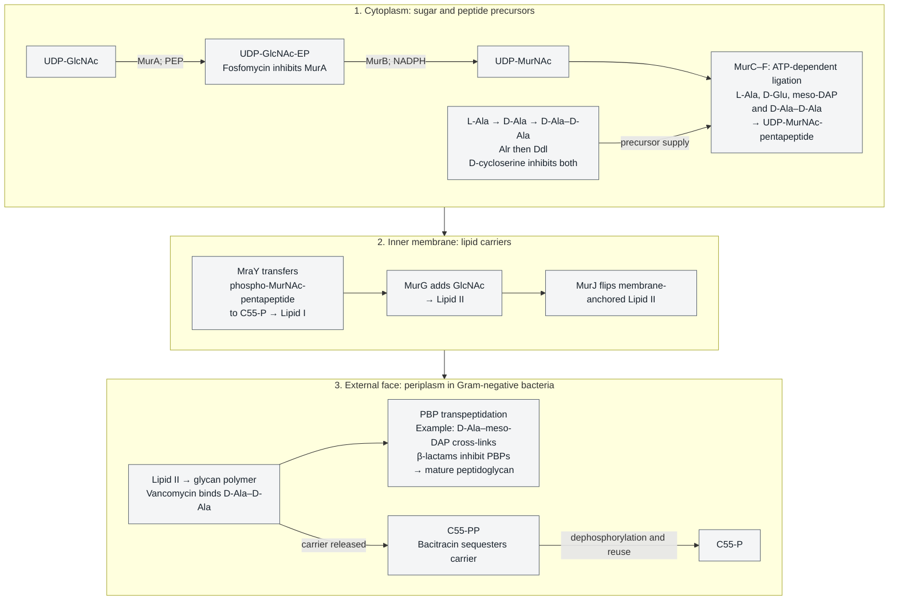
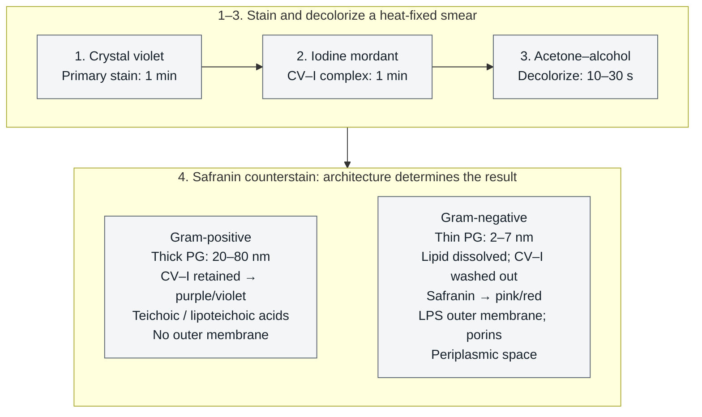
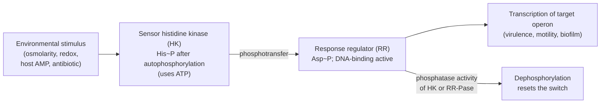
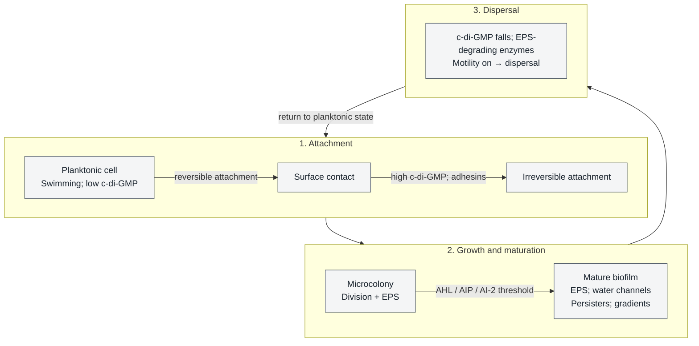
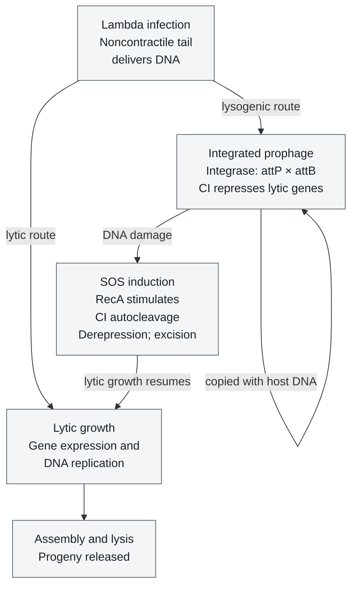
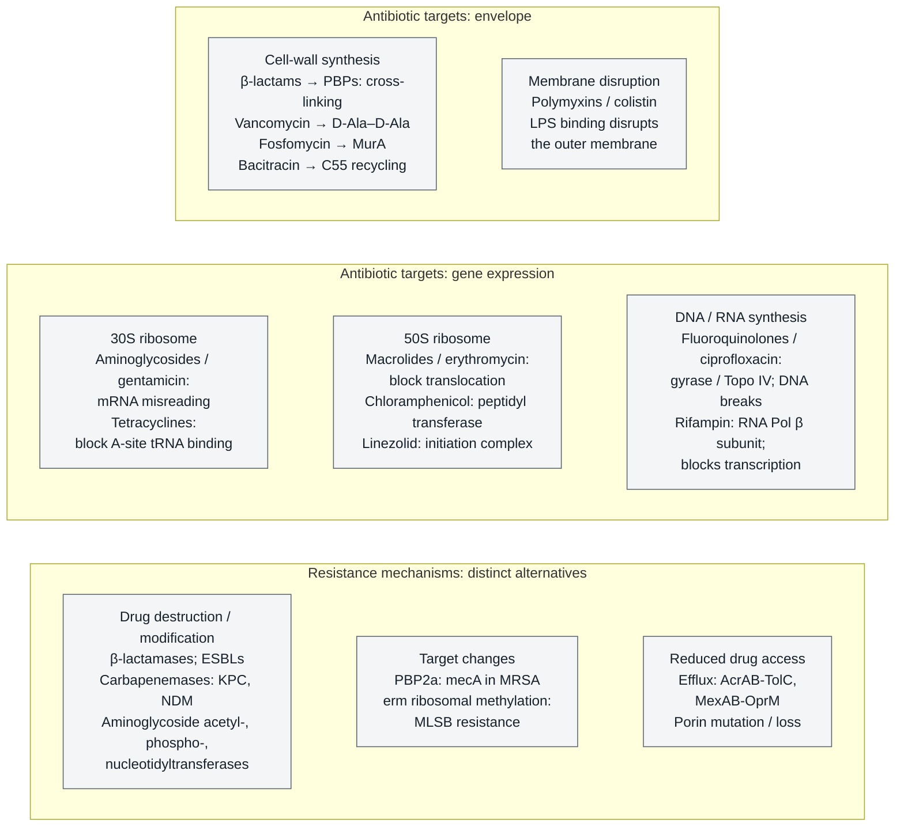
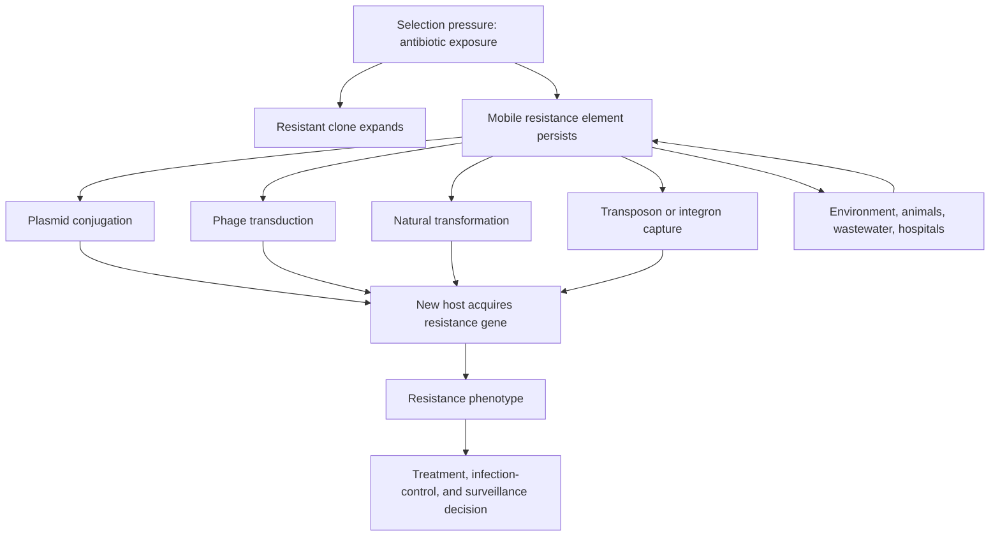
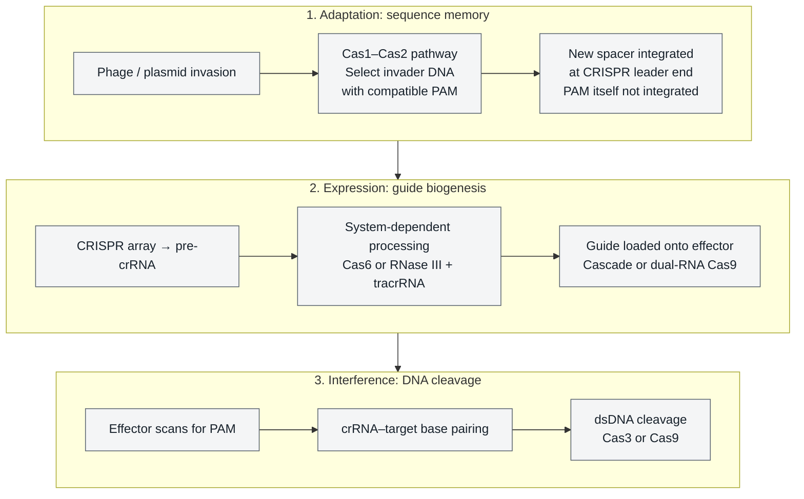
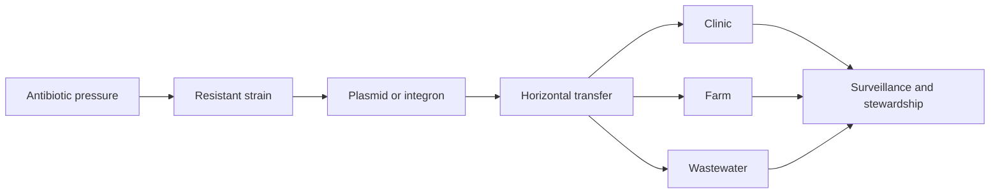

# Bacteria, Archaea, and Viruses

\label{sec:unit_VII_bacteria_archaea_viruses}


<!-- chapter-metadata-badge -->
> Level 2/3 · 65 min read · 75 min lecture · Prerequisites: \cref{sec:unit_II_cell_structure}

## Learning Objectives

By the end of this chapter, you should be able to:

1. Compare the three domains \citep{woese1977} of life and explain how rRNA phylogeny established the Bacteria-[**Archaea**](#gl:archaea)-Eukarya classification.
2. Describe bacterial cell structure including peptidoglycan architecture, Gram staining outcomes, and the clinical significance of LPS.
3. Trace **peptidoglycan assembly** through precursor synthesis, lipid I/lipid II, translocation and wall assembly; locate selected antibiotic targets and distinguish target inhibition, resistance mechanisms and measured susceptibility.
4. Classify bacteria by morphology, arrangement, and metabolic type, and identify major pathogenic groups.
5. Explain horizontal [**gene**](#gl:gene) transfer mechanisms (transformation, transduction, conjugation) and their role in bacterial evolution and antibiotic resistance \citep{lawrence1998}.
6. Describe **two-component signal transduction**, **biofilm** formation, and **quorum sensing** as the molecular basis of bacterial sociality, and link them to chronic infections and device-associated disease.
7. Distinguish Archaea from Bacteria at the molecular level, including ether-linked isoprenoid lipids and tetraether monolayers, and describe the significance of Asgard archaea for eukaryotic origins.
8. Compare the Baltimore classification of viruses, contrast lytic and lysogenic cycles, and describe the HIV life cycle and its drug targets.
9. Explain CRISPR-Cas as a bacterial adaptive immune system, compare Types I/II/III, and assess **phage therapy** as a clinical alternative to antibiotics.
10. Apply the bacterial growth equation $N(t) = N_0 \cdot 2^{t/t_d}$ to predict cell densities from generation time and infer doubling time from optical-density data.

<!-- curriculum-scaffold-start -->
### Study Blueprint

- **Big idea:** Microbial diversity reflects different cell architectures, genomes, metabolisms, and evolutionary histories.
- **Core concepts:** prokaryotic structure, archaea, viruses, horizontal gene transfer.
- **Framework alignment:** Vision & Change: Evolution, Systems, Structure and function; AP Biology: Evolution, Systems Interactions; NGSS-style topics: Structure and Function, Interdependent Relationships in Ecosystems.
- **Model or quantitative lens:** Growth-rate, genome-size, and dilution calculations.
- **Data skill:** Interpret microbial observations from growth, sequence, or structural evidence.
- **Practice cadence:** Questions and Methods, Representing and Describing Data, Argumentation.
- **Common misconception to repair:** Viruses are not simply tiny bacteria; they use fundamentally different replication logic.
- **Primary lab:** \nameref{sec:lab_unit_VII_bacteria_archaea_viruses}.
- **Question bank:** \nameref{sec:q_unit_VII_bacteria_archaea_viruses}.
- **Transfer task:** Apply microbial diversity reasoning to antibiotics, biotechnology, ecology, and outbreaks.
- **Bridge to computation:** `biology.microbiology.microbiology.bacterial_growth_curve`.
<!-- curriculum-scaffold-end -->

---

> **Opening Vignette — The Rebel Biologist Who Turned Bacteria into [**Organelle**](#gl:organelle)s**
> 
> In 1966, Lynn Margulis — an unknown 28-year-old junior faculty member at Boston University — submitted a paper proposing that mitochondria and [**chloroplast**](#gl:chloroplast)s were once free-living bacteria engulfed by a host cell \citep{margulis1967}. The serial [**endosymbiosis**](#gl:endosymbiosis) hypothesis was rejected by more than fifteen journals before *Journal of Theoretical Biology* finally published it. Her evidence: the matching size and [**ribosome**](#gl:ribosome) type of mitochondria and bacteria, their independent division by binary fission, and the circular DNA they share with prokaryotes. When molecular sequencing arrived in the 1970s, it confirmed everything — mitochondria are phylogenetically embedded within the α-Proteobacteria, and chloroplasts within the Cyanobacteria. Margulis had been completely right. The bacterial origin of eukaryotic organelles is now foundational to cell biology, and stands as one of the most important corrections to the naive view that bacteria are too simple to matter for complex life.

## Bacteria -- Domain Overview and Cell Structure


\begin{figure}[htbp]
\centering
\includegraphics[width=0.85\textwidth]{../figures/bacterial_growth.png}
\caption{Continuous piecewise bacterial growth: lag, exponential increase and a stationary plateau at the population reached at the specified onset (or an earlier capacity ceiling). The illustrated model does not include death or a logistic transition.}
\label{fig:unit_VII_bacterial_growth}
\end{figure}
<!-- alt: Bacterial cell number versus time shows a flat lag, continuous exponential growth and a plateau without an instantaneous jump; no death phase is modeled. -->


### The Three Domains of Life

In 1977, Carl Woese and George Fox revolutionized our understanding of life's diversity by analyzing ribosomal RNA (rRNA) sequences across organisms \citep{woese1977}. Their phylogenetic analysis revealed that life comprises three fundamental domains: **Bacteria**, **Archaea**, and **Eukarya**. This replaced the older five-kingdom system that had grouped bacteria and archaea together as "Monera."

The 16S rRNA gene (in prokaryotes) and 18S rRNA gene (in [**eukaryote**](#gl:eukaryote)s) serve as molecular chronometers because they are:

- Almost universally present in most cellular life
- Functionally constrained (slow evolutionary rate in conserved regions)
- Sufficiently variable in hypervariable regions (V1-V9) for taxonomic resolution
- Rarely subject to horizontal gene transfer

### Prokaryotic Cell Features

Bacteria and Archaea share the prokaryotic cell plan, which differs fundamentally from the eukaryotic organization:

: Representative cell-plan comparisons; cytosolic ribosomes, chromosome organization, division and motility must be assigned to the stated cellular system. {#tbl:unit_VII_bacteria_archaea_viruses_prokaryotic_cell_features}
| Feature | Bacterial and archaeal examples | Typical nucleated eukaryotic examples |
|---------|-------------|------------|
| Nucleus | No membrane-bound nucleus; nucleoid region | Membrane-bound nucleus with nuclear pores |
| Cytosolic ribosomes | 70S, assembled from 30S and 50S subunits | 80S, assembled from 40S and 60S subunits; organellar systems differ |
| [**Chromosome**](#gl:chromosome) | *E. coli* illustrates one circular chromosome with nucleoid-associated proteins; other bacterial/archaeal architectures and chromatin proteins occur | Nuclear chromosomes are typically linear and histone-associated |
| Cell division | *E. coli* binary fission uses FtsZ; archaeal division machineries vary | Mitosis and associated spindle mechanisms in the stated cell cycle |
| Internal membranes | Thylakoids in many cyanobacteria are one example; organization varies | ER, Golgi and other endomembrane compartments |
| Motility structures | Bacterial flagella use ion gradients; archaeal archaella are distinct ATP-driven assemblies | Motile 9+2 cilia/flagella bend through ATP-dependent dynein activity |

The bacterial flagellum is a remarkable molecular machine. Unlike eukaryotic flagella, which bend in a wave-like motion powered by ATP-dependent dynein motors, the bacterial flagellum rotates like a propeller. The basal body contains a rotary motor driven by the proton motive force (or Na$^+$ gradient in some marine species), spinning at up to 1,700 revolutions per second in some species. The flagellar motor can reverse direction, enabling the "run and tumble" chemotaxis behavior in *E. coli*.

### Bacterial Cell Wall: Peptidoglycan

The bacterial cell wall is composed of **peptidoglycan** (also called murein), a mesh-like polymer unique to bacteria. Its structure consists of:

- **Glycan strands**: Alternating units of N-acetylglucosamine (NAG) and N-acetylmuramic acid (NAM) linked by β-1,4 glycosidic bonds
- **Tetrapeptide side chains**: Attached to NAM; typically L-Ala -- D-Glu -- meso-DAP (or L-Lys) -- D-Ala
- **Cross-links**: Peptide bridges connecting adjacent glycan strands, catalyzed by transpeptidases (penicillin-binding proteins, PBPs)

The presence of **D-amino acids** (D-glutamate, D-alanine) is unusual in biology -- most proteins use exclusively L-amino acids. D-amino acids confer resistance to host proteases, which evolved to cleave L-amino acid [**peptide bond**](#gl:peptide-bond)s.

### Peptidoglycan Assembly and Selected Antibiotic Targets

Peptidoglycan assembly links cytoplasmic precursor synthesis, membrane-associated lipid carriers and assembly on the external face of the cytoplasmic membrane. In Gram-negative bacteria that external compartment is the periplasm. Selected antibiotics inhibit enzymes, bind substrates or interfere with carrier recycling; not every biosynthetic step below is assigned a therapeutic drug. The scheme begins with **UDP-N-acetylglucosamine (UDP-GlcNAc)** and follows a representative stem/cross-link architecture, not an invariant sequence of eleven druggable reactions.


<!-- alt: Three panels trace cytoplasmic precursors, membrane-associated lipid I and lipid II, and external wall assembly. Alr and Ddl supply D-Ala–D-Ala and are inhibited by D-cycloserine. Fosfomycin inhibits MurA. MurJ flips lipid II; a separate branch after polymerization releases C55-PP for dephosphorylation and reuse, blocked by bacitracin binding. Vancomycin recognizes D-Ala–D-Ala and beta-lactams inhibit PBP transpeptidation. The external compartment is the periplasm in Gram-negative bacteria. -->

*Peptidoglycan precursor synthesis, membrane translocation, external assembly and a distinct carrier-recycling branch. EP denotes the sugar-bound enolpyruvyl group, not free lactate; Alr/Ddl supply the D-Ala–D-Ala branch. MurJ-mediated flipping is not carrier recycling or lysobactin binding. Bacitracin sequesters released C55-PP and limits reuse; vancomycin recognizes the precursor terminus and β-lactams inhibit PBP transpeptidation. The shown meso-DAP stem/cross-links are selected examples; species differ. This author-created biochemical schematic is not a susceptibility or treatment algorithm.*

: Peptidoglycan assembly and selected inhibitor examples. Rows organize targets, not an invariant reaction count or current drug inventory; a dash means no inhibitor selected here. {#tbl:unit_VII_bacteria_archaea_viruses_peptidoglycan_biosynthesis_a_step_by_step_antibiotic_atlas}
| Item | Enzyme / process | Selected inhibitor example | Biosynthetic process / inhibitor action | Evidence boundary |
|------|------------------|----------------------------|-----------------------------------------|-------------------|
| 1 | MurA | **Fosfomycin** | Transfers an enolpyruvyl group from PEP to UDP-GlcNAc; fosfomycin covalently modifies a susceptible active-site cysteine | Target chemistry is not an isolate's clinical susceptibility |
| 2 | MurB | — | NADPH/FAD-dependent reduction yields the sugar-bound lactyl moiety of UDP-MurNAc, not free D-lactate | Enzyme kinetics \citep{benson1997murbkinetics} |
| 3 | MurC–F | — | ATP-dependent ligation adds L-Ala, D-Glu, meso-DAP or L-Lys, then intact D-Ala–D-Ala to build the stem | Distinct ligases, not a verified shared inhibitor class |
| 4 | Alr / Ddl | **D-cycloserine** | Alr supplies D-Ala; Ddl ligates D-Ala–D-Ala. Inhibition involves a PLP-derived Alr adduct versus phosphorylated cycloserine bound to *E. coli* DdlB | Different measured mechanisms \citep{fenn2003cycloserine,batson2017cycloserine} |
| 5 | MraY | **Tunicamycin** | Transfers phospho-MurNAc-pentapeptide to C55-P, forming lipid I; tunicamycin inhibits MraY | Structural research, not a regimen \citep{chung2013mray,hakulinen2017mray} |
| 6 | MurG | — | Transfers GlcNAc from UDP-GlcNAc to lipid I, forming lipid II | Biosynthetic reaction, not an unnamed inhibitor claim |
| 7 | Carrier recycling | **Bacitracin** | Sequesters external membrane-associated C55-PP, preventing dephosphorylation and limiting usable C55-P regeneration | Substrate binding, not direct phosphatase inhibition \citep{economou2013bacitracin} |
| 8 | Lipid II translocation | **MTSES with engineered MurJ** | Chemical modification of selected single-Cys MurJ variants blocks flipping of membrane-anchored lipid II | *E. coli* experimental tool, not a general drug \citep{sham2014murj} |
| 9 | Lipid II recognition | **Vancomycin; lysobactin** | Vancomycin recognizes D-Ala–D-Ala; lysobactin binds precursor substrate, not MurJ | Lysobactin's *S. aureus* cellular assays support impaired surface utilization \citep{lee2016lysobactin} |
| 10 | PBP transpeptidation | **Beta-lactams** | Acylate a susceptible PBP's active-site serine and inhibit peptide cross-linking | Compound, PBP and resistance context matter |
| 11 | Membrane / precursor interactions | **Daptomycin; nisin** | Daptomycin acts at the membrane; nisin recognizes lipid II and forms pores | Different mechanisms; in-vitro activity is not a shared indication |

**Target affinity, cellular inhibition and fitness are different endpoints.** VanA-type pathways replace D-Ala-D-Ala-ending precursors with D-Ala-D-Lac-ending precursors and reduce the susceptible precursor pool. In a defined ligand-binding study, loss of an amide hydrogen bond and an unfavorable lone-pair interaction both contributed to reduced vancomycin affinity; that binding result is not a universal MIC ratio or a fixed energy per hydrogen bond \citep{mccomas2003vancomycinbinding}. MRSA's modified PBPs can bind many traditional beta-lactams poorly, while beta-lactamases hydrolyze particular beta-lactam substrates; their substrate spectra differ rather than constituting an inevitable sequence that defeats each newer drug. A biochemical binding measurement, an isolate's growth-inhibition endpoint and competitive fitness require different experiments and conditions.

> **Clinical Connection: Altered Precursors, Alternative Targets and Fitness Costs**
> Resistance is not automatically cost-free. In experiments with a VanB/Tn1549 system, non-induced carriage and induced or constitutive expression had different growth, competition and mouse-colonization consequences; the findings depended on genetic background and experimental conditions and are not a universal numerical cost for VanA resistance \citep{foucault2010induciblefitness}. Daptomycin illustrates a different target: bacterial membrane association and depolarization rather than vancomycin's precursor recognition. It does not bypass resistance entirely: the dated 2025 prescribing information documents nonsusceptible isolates and separates in-vitro activity from established clinical indications \citep{cubicinrf2025label}. Neither this mechanism comparison nor a stain substitutes for isolate- and infection-specific clinical assessment.

### Gram Staining: Envelope Phenotypes and Diagnostic Limits

The [**Gram stain**](#gl:gram-stain), developed by Hans Christian Gram in 1884, is a differential staining procedure that reveals typical envelope-associated phenotypes. It is neither definitive species identification nor an antibiotic susceptibility test. The usual patterns follow from cell wall architecture and sample preparation:


<!-- alt: A staining panel shows crystal violet for one minute, iodine for one minute and acetone-alcohol decolorization for 10–30 seconds. A second panel compares outcomes after safranin: thick-walled Gram-positive bacteria retain the CV–I complex and remain purple; thin-walled Gram-negative bacteria lose the complex during decolorization and become pink. Architecture and colors are explicitly labeled. -->

*Gram staining in two panels: the ordered primary-stain, mordant and decolorization steps lead to a comparison of wall-dependent outcomes after safranin. Thick peptidoglycan retains the crystal violet–iodine complex in Gram-positive cells; Gram-negative cells lose it during decolorization and take the pink/red counterstain. The two result cards are alternatives, not successive steps.*

- **Lipid A**: The toxic moiety; embedded in the outer membrane; activates TLR4 on innate immune cells
- **Core oligosaccharide**: Short sugar chain linking Lipid A to the O-antigen
- **O-antigen**: Variable polysaccharide extending outward; serotype-specific; target of antibodies

LPS released from Gram-negative bacteria can activate innate immunity through the TLR4-MD2 receptor complex, contributing to cytokine signaling, systemic inflammation, coagulation abnormalities and septic shock. This mechanism does not establish a universal mortality percentage or prove that Gram-negative infections are intrinsically more dangerous than Gram-positive infections; clinical severity depends on pathogen, host, infection site and care context.

> **Clinical Connection: Meningitis Clues Are Not a Treatment Algorithm**
> In cerebrospinal fluid, Gram-positive diplococci can suggest *Streptococcus pneumoniae* and Gram-negative diplococci can suggest *Neisseria meningitidis*, but morphology is not definitive identification or susceptibility testing. WHO's 2025 guideline for acute community-acquired meningitis in children older than one month, adolescents and adults requires integrated interpretation: CSF Gram stain, white-cell count, protein and glucose findings cannot individually confirm or exclude meningitis, while culture and antimicrobial susceptibility testing have distinct roles. It also emphasizes that diagnostic delays must not delay indicated empiric treatment \citep{who2025meningitis}. The scope excludes neonatal and health-care-associated meningitis; this teaching comparison supplies neither a universal turnaround time nor a morphology-only regimen.

> **Concept Check 1:**
> A novel bacterium from a deep-sea hydrothermal vent gives a reproducible pink Gram-stain result with appropriate controls. Describe the typical envelope architecture consistent with that phenotype and explain the decolorization step. What additional evidence would be needed to establish its actual envelope, identity and antibiotic susceptibility rather than treating the stain as proof?

> **Concept Check 1b:**
> A clinical microbiology lab tests a bacterial isolate against six wall-targeted antibiotics. The isolate is resistant to vancomycin (MIC > 256 μg/mL) but susceptible to ampicillin, fosfomycin, and bacitracin. Sequencing reveals a *vanA* operon. Using the peptidoglycan biosynthesis pathway, explain (a) which step is altered, (b) why vancomycin fails, and (c) why ampicillin still works.

> **Concept Check 1c:**
> Fosfomycin is a phosphoenolpyruvate (PEP) analog that covalently inactivates MurA. *Pseudomonas aeruginosa* is intrinsically resistant to fosfomycin despite having a functional MurA. Hypothesize two non-target-based resistance mechanisms (think about how the drug enters the cell) and propose an experiment using a *P. aeruginosa* MurA-knockout complemented with the *E. coli* allele to test whether MurA is responsible.

---

## Bacterial Morphology and Metabolic Diversity

### Morphology and Arrangement

Bacterial cells exhibit characteristic shapes that aid in identification:

: Morphology and Arrangement: Shape and Description. {#tbl:unit_VII_bacteria_archaea_viruses_morphology_and_arrangement}
| Shape | Description | Examples |
|-------|-------------|----------|
| Coccus | Spherical | *Staphylococcus aureus*, *Streptococcus pyogenes* |
| Bacillus | Rod-shaped | *Escherichia coli*, *Bacillus subtilis* |
| Spirillum | Rigid spiral | *Campylobacter jejuni*, *Helicobacter pylori* |
| Spirochete | Flexible helix with axial filaments | *Treponema pallidum*, *Borrelia burgdorferi* |
| Vibrio | Comma-shaped | *Vibrio cholerae*, *Vibrio parahaemolyticus* |
| Pleomorphic | Variable shape | *Mycoplasma pneumoniae* (no cell wall) |

Cell arrangements reflect division plane and post-division adhesion patterns:

- **Diplo-** (pairs): *Diplococcus*, *Neisseria*
- **Strepto-** (chains): *Streptococcus* -- divides in one plane, cells remain attached
- **Staphylo-** (grape-like clusters): *Staphylococcus* -- divides in multiple planes
- **Tetrad** (groups of 4): *Micrococcus* -- divides in two perpendicular planes
- **Sarcina** (cuboidal packets of 8): *Sarcina ventriculi* -- divides in three planes

### Metabolic Diversity and Energy Harvesting

Bacteria exhibit unparalleled metabolic diversity -- far exceeding that of eukaryotes combined. This diversity is classified by energy source (photo- vs chemo-) and carbon source (auto- vs hetero-):

**Photoautotrophs** use light energy to fix CO$_2$:

- *Cyanobacteria* (oxygenic [**photosynthesis**](#gl:photosynthesis)): Use water as electron donor; produce O$_2$; responsible for the Great Oxidation Event (~2.4 Ga); ancestors of chloroplasts
- Purple and green sulfur bacteria (anoxygenic): Use H$_2$S or S$^0$ as electron donor; no O$_2$ production; bacteriochlorophyll absorbs at longer wavelengths (800-1050 nm)

**Chemoautotrophs (lithotrophs)** derive energy from inorganic chemical oxidation:

- *Nitrosomonas*: NH$_3$ -> NO$_2^-$ (ammonia oxidation; [**nitrification**](#gl:nitrification) step 1)
- *Nitrobacter*: NO$_2^-$ -> NO$_3^-$ (nitrite oxidation; nitrification step 2)
- *Thiobacillus*: S$^0$ -> SO$_4^{2-}$ (sulfur oxidation)
- *Acidithiobacillus ferrooxidans*: Fe$^{2+}$ -> Fe$^{3+}$ (iron oxidation; used industrially in bioleaching of copper and gold ores)

**Heterotrophs** (the vast majority) obtain carbon from organic compounds. They are further classified by oxygen relationship:

: Metabolic Diversity and Energy Harvesting: Type and O_2 Requirement. {#tbl:unit_VII_bacteria_archaea_viruses_metabolic_diversity_and_energy_harvesting}
| Type | O$_2$ Requirement | Example |
|------|-------------------|---------|
| Obligate aerobe | Requires O$_2$ | *Mycobacterium tuberculosis* |
| Obligate anaerobe | Killed by O$_2$ | *Clostridium botulinum* |
| Facultative anaerobe | Grows with or without O$_2$ | *Escherichia coli* |
| Aerotolerant anaerobe | Does not use O$_2$ but tolerates it | *Lactobacillus* |
| Microaerophilic | Requires low O$_2$ (2-10%) | *Campylobacter jejuni*, *Helicobacter pylori* |

### Major Pathogenic Groups

: Major Pathogenic Groups: Phylum and Key Pathogens. {#tbl:unit_VII_bacteria_archaea_viruses_major_pathogenic_groups}
| Phylum | Key Pathogens | Gram Stain | Clinical Significance |
|--------|---------------|------------|----------------------|
| Proteobacteria | *E. coli*, *Salmonella*, *Helicobacter*, *Vibrio*, *Neisseria*, *Pseudomonas* | Gram-negative | UTIs, enteric infections, peptic ulcers, cholera, meningitis, nosocomial infections |
| Firmicutes | *Streptococcus*, *Staphylococcus*, *Clostridium*, *Enterococcus* | Gram-positive | Pharyngitis, skin infections, tetanus, botulism, hospital-acquired infections |
| Actinobacteria | *Mycobacterium tuberculosis*, *M. leprae*, *Corynebacterium* | Gram-positive (acid-fast) | Tuberculosis, leprosy, diphtheria |
| Spirochaetes | *Treponema pallidum*, *Borrelia burgdorferi*, *Leptospira* | Poorly staining | Syphilis, Lyme disease, leptospirosis |

*Mycobacterium* species deserve special mention: their cell walls contain **mycolic acids** -- long-chain ($C_{60}$-$C_{90}$) branched fatty acids that form a waxy, hydrophobic barrier. This barrier makes them resistant to Gram staining (they are classified as **acid-fast** bacteria, stained with the Ziehl-Neelsen method using carbol fuchsin), resistant to many antibiotics, and resistant to desiccation -- contributing to *M. tuberculosis* survival in aerosolized droplet nuclei for hours.

> **Concept Check 2:**
> *Helicobacter pylori* \citep{marshall1984} is a microaerophilic, spiral-shaped, Gram-negative bacterium that colonizes the human stomach. Explain how its oxygen requirement and morphology are adaptive for its ecological [**niche**](#gl:niche), and predict what would happen if you tried to culture it under standard [**aerobic**](#gl:aerobic) conditions on a typical agar plate.

---

## Bacterial Genetics, Signaling and Sociality

### Binary Fission and Exponential Growth

**Binary fission, using *E. coli* as a specified example:** its circular chromosome normally initiates bidirectional replication at *oriC*, the cell elongates, and FtsZ-associated division machinery coordinates septum formation before daughter cells separate. This is not a universal bacterial chromosome topology, origin inventory or division apparatus. Under an idealized constant-generation-time model without death or resource limitation, completed divisions double cell number; actual generation times depend on organism and conditions:

- *Escherichia coli*: ~20 minutes under optimal conditions (37 degrees C, rich media)
- *Mycobacterium tuberculosis*: 12-24 hours (contributing to slow disease progression and prolonged treatment)
- *Treponema pallidum*: ~33 hours (cannot be cultured in vitro)

Population growth during exponential phase follows the **bacterial growth equation**:

\begin{equation}
N(t) = N_0 \cdot 2^{t/t_d}
\label{eq:unit_VII_bacterial_growth}
\end{equation}

where $N_0$ is the initial population, $t$ is time, and $t_d$ is the doubling (generation) time. Equivalently, the natural-log form $\ln N(t) = \ln N_0 + \mu t$ with $\mu = (\ln 2)/t_d$ (the **specific growth rate**, units of $\text{time}^{-1}$) gives a linear plot of $\ln N$ versus $t$ during exponential phase, whose slope is the experimentally measured μ.

*(Note: the exponent $t/t_d$ is often represented as $n$, the number of generations).*

### Worked Example: Calculating Bacterial Growth

**Problem:**
A microbiologist inoculates a broth with $N_0 = 100$ cells of *Vibrio natriegens*, which has a generation time of $t_d = 15$ minutes under optimal conditions. Assuming the culture immediately enters the exponential growth phase and maintains it without nutrient depletion, how many cells will be present after 2 hours?

**Solution:**

1. **Calculate the total time ($t$) in consistent units:**
   $$ t = 2 \text{ hours} = 120 \text{ minutes}  \label{eq:unit_VII_bacteria_archaea_viruses_item_1}$$


2. **Calculate the number of generations ($n$):**
   $$ n = \frac{t}{t_d} = \frac{120}{15} = 8 \text{ generations}  \label{eq:unit_VII_bacteria_archaea_viruses_item_2}$$


3. **Calculate the final population size $N(t)$ from \cref{eq:unit_VII_bacterial_growth}:**
   $$ N(t) = 100 \cdot 2^8  \label{eq:unit_VII_bacteria_archaea_viruses_item_3}$$

   $$ N(t) = 100 \cdot 256 = 25,600 \text{ cells}  \label{eq:unit_VII_bacteria_archaea_viruses_item_4}$$

   
After 2 hours, the population will reach **25,600 cells**. The rapid doubling of bacteria means that even a small initial inoculum can quickly reach high densities in favorable environments. After 4 hours (16 generations), the same culture would reach $\approx 6.5 \times 10^6$ cells; after 6 hours (24 generations), $\approx 1.7 \times 10^9$ cells — at which point nutrient limitation forces the culture into stationary phase.

### Worked Example: Inferring Generation Time from an OD Growth Curve

**Problem:**
A microbiology student grows *E. coli* in LB broth at 37 °C and reads optical density at 600 nm ($\mathrm{OD}_{600}$) every 30 minutes:

: Inferring Generation Time from an OD Growth Curve. {#tbl:unit_VII_bacteria_archaea_viruses_worked_example_inferring_generation_time_from_an_od_growth_curve}
| Time (min) | 0 | 30 | 60 | 90 | 120 | 150 |
|------------|---|----|----|----|-----|-----|
| $\mathrm{OD}_{600}$ | 0.05 | 0.10 | 0.20 | 0.40 | 0.80 | 1.60 |

Estimate the generation time $t_d$ during exponential growth.

**Solution:**

During exponential phase, $\mathrm{OD}_{600}$ is proportional to cell density, so $\mathrm{OD}(t) = \mathrm{OD}_0 \cdot 2^{t/t_d}$. Take the natural log of both sides:

$$ \ln \mathrm{OD}(t) = \ln \mathrm{OD}_0 + \frac{t}{t_d}\ln 2  \label{eq:unit_VII_bacteria_archaea_viruses_item_5}$$


A plot of $\ln \mathrm{OD}$ versus $t$ has slope $\mu = (\ln 2)/t_d$. Using the first and last points,

$$ \mu = \frac{\ln(1.60) - \ln(0.05)}{150 - 0} = \frac{0.470 - (-2.996)}{150} = \frac{3.466}{150} \approx 0.0231\ \mathrm{min}^{-1}.  \label{eq:unit_VII_bacteria_archaea_viruses_item_6}$$


Therefore,

$$ t_d = \frac{\ln 2}{\mu} = \frac{0.693}{0.0231} \approx 30\ \mathrm{minutes}.  \label{eq:unit_VII_bacteria_archaea_viruses_item_7}$$


The doubling time is **about 30 minutes**, consistent with rich-media growth at 37 °C. Inspection of the table confirms the answer: $\mathrm{OD}_{600}$ doubles every 30 min from $t = 30$ onwards. Real growth curves deviate at the extremes (lag at the start, stationary plateau at the end), as the full four-phase curve in \cref{fig:unit_VII_bacterial_growth} shows; the linear-on-log-plot region is the main window where $t_d$ is well defined.

### Horizontal Gene Transfer

While binary fission produces clonal offspring, **horizontal gene transfer (HGT)** is the major driver of bacterial evolution and genetic diversity \citep{lawrence1998}. Three mechanisms operate:

**Transformation** involves the uptake of naked DNA from the environment. Some species are naturally competent -- they express surface proteins that bind, import, and integrate exogenous DNA. *Streptococcus pneumoniae* was the organism in Griffith's famous 1928 experiment demonstrating transformation (the "transforming principle," later identified as DNA by Avery, MacLeod, and McCarty in 1944). In molecular biology, artificial competence is induced by treating *E. coli* with CaCl$_2$ and heat shock (42 degrees C for 45 seconds), which transiently increases membrane permeability.

**Transduction** is phage-mediated DNA transfer between bacteria:

- *Generalized transduction*: During lytic replication, bacterial DNA fragments are accidentally packaged into phage capsids instead of phage DNA. These defective phage particles inject bacterial DNA into new host cells, where it can recombine into the chromosome.
- *Specialized transduction*: A lysogenic phage (e.g., bacteriophage λ) excises imprecisely from the host chromosome, carrying flanking bacterial genes (*gal* or *bio* genes flanking the λ *attB* site). These hybrid phage particles transduce specific genes at high frequency.

**Conjugation** requires direct cell-to-cell contact via a sex pilus encoded by the **F factor** (fertility [**plasmid**](#gl:plasmid)). The F$^+$ donor cell extends an F pilus that contacts an F$^-$ recipient, retracting to bring cells together. A single strand of the F plasmid is transferred and replicated in the recipient, converting it to F$^+$. When the F factor integrates into the chromosome, the cell becomes **Hfr** (high frequency [**recombination**](#gl:recombination)), and conjugation can transfer chromosomal genes to the recipient at high frequency.

**R-factor plasmids** (resistance plasmids) carry multiple antibiotic resistance genes and are transferred by conjugation -- this is the primary mechanism by which antibiotic resistance spreads among bacterial populations, including between different species.

### Plasmids and Mobile Genetic Elements

: Plasmids and Mobile Genetic Elements: Plasmid Type and Example. {#tbl:unit_VII_bacteria_archaea_viruses_plasmids_and_mobile_genetic_elements}
| Plasmid Type | Example | Significance |
|--------------|---------|--------------|
| R-plasmids | NDM-1 (New Delhi metallo-β-lactamase) | Carbapenem resistance; global spread |
| [**Virulence**](#gl:virulence) plasmids | pINV (*Shigella*) | Encode invasion machinery |
| Ti plasmid | *Agrobacterium tumefaciens* | Crown gall disease; used in plant biotechnology for gene transfer |
| Col plasmids | ColE1 | Encode bacteriocins (antimicrobial peptides) |
| Metabolic plasmids | TOL (*Pseudomonas putida*) | Toluene degradation; bioremediation |

**Transposons** (mobile genetic elements) contribute to [**genome**](#gl:genome) plasticity. Insertion sequences (IS elements) are the simplest, encoding primarily transposase flanked by inverted repeats. Composite transposons (e.g., Tn3 carrying ampicillin resistance) consist of a resistance gene flanked by IS elements. Transposons can "jump" between chromosome and plasmid, facilitating the assembly of multi-drug resistance cassettes.

### Two-Component Signal Transduction

Bacteria sense their environment through ubiquitous **two-component systems (TCS)** — the prokaryotic equivalent of receptor-tyrosine-kinase + transcription-factor cascades in eukaryotes. Each system is built from just two proteins:

1. A membrane-anchored **sensor histidine kinase** (HK) with an extracellular sensing domain and a cytoplasmic kinase domain. Stimulus binding induces ATP-dependent **autophosphorylation** of a conserved histidine residue in the HK dimer (the phosphate is transferred from the γ-phosphate of ATP to the imidazole nitrogen of the histidine sidechain — a high-energy phospho-amide bond, $\Delta G \approx -50$ kJ/mol on hydrolysis).
2. A cytoplasmic **response regulator** (RR) with a receiver domain and an output (usually DNA-binding) domain. The HK transfers its phosphate to a conserved aspartate on the RR (a phospho-anhydride; faster hydrolysis kinetics, $t_{1/2} \sim$ seconds to minutes), activating it as a transcription factor (or, less commonly, as an enzyme or motor regulator).


<!-- alt: Flowchart showing two-component signal transduction. Stimulus → HK autophosphorylation on histidine → phosphotransfer to RR aspartate → DNA binding and gene regulation; intrinsic phosphatase activity resets the system. -->

*Two-component signal transduction. Stimulus → HK autophosphorylation on histidine → phosphotransfer to RR aspartate → DNA binding and gene regulation; intrinsic phosphatase activity resets the system.*

The two-component circuit is therefore a **molecular switch** with three states (off / phosphorylated / phosphatase-reset), tunable by the relative kinase versus phosphatase activities of the HK. Some HKs ("classical" HKs like EnvZ and PhoQ) act as kinase under stimulus and phosphatase otherwise — a single protein computing both ON and OFF, with the stimulus ratio shifting the equilibrium. This bifunctionality makes the steady-state level of RR~P a near-linear readout of the input — exactly what is wanted for analog signal processing inside a cell.

: Two-Component Signal Transduction: Two-component system and Stimulus. {#tbl:unit_VII_bacteria_archaea_viruses_two_component_signal_transduction}
| Two-component system | Stimulus | Output | Clinical/biological significance |
|----------------------|----------|--------|----------------------------------|
| **EnvZ–OmpR** (*E. coli*) | Osmolarity | Switches porin expression OmpC ↔ OmpF | Outer-membrane permeability; β-lactam entry |
| **PhoQ–PhoP** (*Salmonella*) | Low Mg²⁺, antimicrobial peptides, low pH (phagosome) | Lipid A modification; *pmrHFIJKLM* | Resistance to host defensins and polymyxins |
| **AgrC–AgrA** (*S. aureus*) | Autoinducing peptide AIP (quorum) | RNAIII; toxin production | Switches biofilm OFF, virulence ON |
| **VraS–VraR** (*S. aureus*) | Cell-wall stress (β-lactams, vancomycin) | Cell-wall stimulon | Vancomycin tolerance |
| **CheA–CheY** (chemotaxis) | Attractants/repellents | Flagellar motor switching (CW ↔ CCW) | Run-and-tumble swimming |
| **WalK–WalR** (*B. subtilis*, *S. aureus*) | Cell-wall integrity | Autolysin and PG-synthesis genes | Essential — drug target lead |

Key features that make TCSs central to bacterial biology: they are **modular** (HKs and RRs from one organism often work with components from another), they are **fast** (sub-second response), and there are **typically 30–80 systems per genome**, allowing combinatorial integration of many environmental signals. The minimal *Mycoplasma genitalium* genome has 0 TCSs (it lives in a stable host environment); free-living soil bacteria like *Myxococcus xanthus* encode > 100. Several recent antibacterial leads (e.g., walkmycin against the WalK kinase, an essential cell-wall TCS) target HKs precisely because they are absent from human cells.

### Biofilms and Quorum Sensing

**Biofilms** are surface-associated, matrix-encased microbial communities. The diagram illustrates attachment, growth and dispersal, not an obligatory cycle for every bacterium. **Quorum sensing (QS)** responds to autoinducer concentrations shaped by production, transport and degradation as well as population density; additional environmental and regulatory inputs affect biofilm and virulence phenotypes.


<!-- alt: Three panels show attachment, division and EPS-mediated growth into a mature biofilm, then dispersal returning cells to a planktonic state. Labels retain c-di-GMP, adhesins, autoinducer thresholds, matrix gradients, persisters, EPS degradation and motility. This is an illustrative pathway, not an obligatory cycle or a universal quorum-triggered dispersal rule. -->

*Illustrative biofilm progression wraps through attachment, growth and maturation, and dispersal panels. Intracellular c-di-GMP, adhesins and EPS influence attachment and matrix development; AHL/AIP/AI-2 signaling is shown at maturation, while falling c-di-GMP, EPS degradation and motility accompany dispersal. The return arrow denotes a planktonic state, not an obligatory cycle for all bacteria; quorum sensing is one of several regulatory inputs.*

- **Exopolysaccharides** (PIA in *S. aureus*; alginate, Pel, Psl in *P. aeruginosa*; cellulose and PNAG in enterics) — provide structural cohesion and protection.
- **Extracellular DNA (eDNA)** — can be released by cell lysis, contribute to matrix structure and provide substrate for transformation by competent cells. Transfer frequency depends on organism and conditions; biofilm membership alone does not specify a universal multiplier.
- **Matrix proteins** — amyloid-like curli fibers (*E. coli*), Bap proteins, type IV pili.
- **Lipids and outer-membrane vesicles** — concentrate hydrolytic enzymes and signaling molecules.

**Quorum sensing molecules.**

: Biofilms and Quorum Sensing: QS class and Signal molecule. {#tbl:unit_VII_bacteria_archaea_viruses_biofilms_and_quorum_sensing}
| QS class | Signal molecule | Producers | Receptor | Output |
|----------|-----------------|-----------|----------|--------|
| **AHLs** | N-acyl-homoserine-lactones (e.g., 3-oxo-C₁₂-HSL) | Gram-negatives (*P. aeruginosa* LasI/LasR, *V. fischeri* LuxI/LuxR) | LuxR-family TF | Bioluminescence, virulence, biofilm |
| **AIPs** | Cyclic autoinducing peptides (5–10 aa, thiolactone bridge) | Gram-positives (*S. aureus* Agr, *S. pneumoniae* ComD) | Membrane HK (TCS) | Virulence/biofilm switch |
| **AI-2** | Furanosyl-borate diester (LuxS) | Cross-species | LuxP/LsrB | Inter-species coordination |
| **PQS** | Pseudomonas quinolone signal (2-heptyl-3-hydroxy-4-quinolone) | *P. aeruginosa* | PqsR | Iron acquisition, virulence |
| **DSF** | cis-2-unsaturated fatty acids | *Xanthomonas*, *Burkholderia* | RpfC HK | Biofilm dispersal, virulence |

**Biofilm antibiotic survival: transport and killing are different endpoints.** Biofilms contribute to chronic and device-associated infections, but a universal prevalence or tolerance multiplier cannot be inferred without a population, comparator and assay. Jefferson and colleagues studied defined *S. aureus* laboratory biofilms with fluorescent vancomycin: deep cells were labeled slowly, including in a PNAG-negative preparation. Mixing affected access, so this was not a universal 100-fold change in the drug's diffusion coefficient caused by matrix polysaccharide. Separate viable-count assays, defining bactericidal activity as a 99.9% reduction, reported biofilm/planktonic vancomycin MBC ratios of 250–600 under that study's protocols; biofilm and planktonic exposure periods differed. These are substantial, preparation-specific killing results, not MIC ratios or clinical dosing recommendations \citep{jefferson2005biofilmvancomycin}.

In *P. aeruginosa* FRD1 colony biofilms, Walters and colleagues found that ciprofloxacin and tobramycin penetrated yet produced limited killing. Oxygen-limited, low-activity interiors were associated with tolerance, and dispersed cells regained susceptibility. Delivery, physiological tolerance and heritable resistance therefore require separate tests; these experiments establish neither a universal persister fraction nor an enzyme-concentration multiplier \citep{walters2003biofilmtolerance}. Biofilms are relevant to cystic-fibrosis lung infections, prosthetic devices, catheter-associated infections, chronic wounds and dental plaque, but an individual patient's outcome cannot be assigned to one mechanism from treatment duration alone.

**Quorum quenching as a therapeutic hypothesis.** Lactonases/acylases can reduce active AHL, receptor antagonists can alter signal response, and other circuit perturbations can change specified virulence phenotypes. Reduced direct killing does not guarantee weak resistance selection: resistance to an antivirulence quorum-quenching compound was demonstrated experimentally in *Pseudomonas aeruginosa* \citep{maeda2012quorumresistance}. Signal stability also depends on pH, temperature and chain chemistry \citep{yates2002ahllactonolysis}. Measure signal, growth, phenotype and resistance; clinical stage or benefit requires a named compound, trial and endpoint, none supplied for a class-wide claim here.

### Endospores and Dormancy Under Stress

Some endospore-forming bacteria, including lineages traditionally grouped in *Bacillus* and *Clostridium*, enter a resistant dormant state during unfavorable conditions. Resistance varies with organism, preparation, agent and exposure; endospores are not a universal maximum of resistance to every treatment:

- **Core**: Dehydrated [**cytoplasm**](#gl:cytoplasm); calcium-dipicolinic acid complex stabilizes DNA; small acid-soluble spore proteins (SASPs) protect DNA from UV and desiccation
- **Resistance:** Spores can survive exposures that inactivate vegetative cells; heat, desiccation, UV and chemical resistance must be stated with the preparation and exposure conditions.
- **Steam sterilization:** Effective processing requires steam contact and a validated cycle appropriate to the device, load, wrapping and sterilizer. CDC's guideline distinguishes different temperature/time combinations and load-dependent penetration; a single 121-°C, 15–20-minute recipe is not a general guarantee. This description is not an operating protocol \citep{cdc2023steamsterilization}.
- **Germination**: Triggered by favorable conditions (nutrients, water); rapid return to vegetative growth

> **Clinical Connection: Spores and Validated Infection-Control Processes**
> *Clostridioides difficile* spores create an environmental infection-control challenge. CDC's 13 May 2026 acute-care guidance combines contact precautions, recommended hand hygiene, environmental cleaning with an appropriate *C. difficile* sporicidal agent, and antibiotic stewardship; it does not reduce prevention to an unconditional soap-and-bleach rule. Environmental products and equipment processing must follow their validated instructions and institutional protocols, not a teaching paragraph \citep{cdc2026cdiprevention}.

> **Concept Check 2b:**
> A research lab knocks out the *agrA* gene (response regulator of the Agr quorum-sensing TCS) in *S. aureus*. The mutant forms thicker, more persistent biofilms in vitro but is dramatically less virulent in a mouse skin-abscess model. Reconcile these two observations using the AgrA on/off switch between biofilm and toxin production.

> **Concept Check 2c:**
> A synthetic catheter-associated *Staphylococcus aureus* infection has planktonic vancomycin MIC 1 µg/mL but persists with a retained device. Explain why biofilm growth, physiological gradients, persisters and source control complicate interpretation of a planktonic MIC. Distinguish tolerance from a heritable MIC increase. Do not substitute *Pseudomonas aeruginosa*, whose Gram-negative envelope intrinsically excludes vancomycin, or infer a guaranteed clinical cure from catheter removal alone.

---

## Archaea and Extremophile Cell Biology

### Distinguishing Archaeal Features

Archaea are prokaryotes that were long classified with bacteria but differ fundamentally at the molecular level:

: Selected bacterial, archaeal and eukaryotic molecular examples; shared folds and characteristic chemistry do not make every lineage identical. {#tbl:unit_VII_bacteria_archaea_viruses_distinguishing_archaeal_features}
| Feature | Bacterial examples | Archaeal examples | Eukaryotic examples |
|---------|----------|---------|---------|
| Membrane lipids | Ester-linked fatty acids | **Ether-linked isoprenoid (phytanyl) chains**; some form tetraether monolayers | Ester-linked fatty acids |
| Cell wall | Peptidoglycan in many lineages; wall-less forms occur | No bacterial NAG–NAM peptidoglycan; S-layers, pseudomurein in selected methanogens, other envelopes or no wall | Cellulose/chitin in plant/fungal examples; animal cells have no wall |
| RNA polymerase | *E. coli* omega-containing core has five chains of four types; preparation matters | Pol-II-related multisubunit machinery with lineage-dependent composition, including a characterized 11-chain enzyme \citep{jun2014archaealpolymerase} | Nuclear Pol I/II/III are standard examples; specialized and organellar systems are not enumerated here |
| Initiator amino acid | Formyl-methionine in standard bacterial cytosolic systems | Methionine in studied archaeal initiation systems \citep{schmitt2020archaealinitiation} | Methionine in standard nuclear-encoded cytosolic translation |
| Chromatin proteins | HU/H-NS in *E. coli*; genuine histones also occur in studied bacteria \citep{hocher2023bacterialhistones} | Histones or other chromatin proteins depending on lineage; assemblies differ \citep{mattiroli2017archaealchromatin,guo2008cren7} | Conventional nucleosomes contain H2A/H2B/H3/H4 core histones; linker H1 is distinct |
| [**Intron**](#gl:intron)s | Occur in selected genes, including bacterial tRNA examples | Some tRNAs contain introns; incidence and processing vary by lineage | Spliceosomal pre-mRNA introns and other intron classes; not every gene contains an intron |

### Archaeal Lipids: Architecture, Permeability and Thermal Limits

Characteristic archaeal glycerophospholipids combine ether-linked isoprenoid chains with *sn*-glycerol-1-phosphate, contrasting with common bacterial/eukaryotic ester-linked fatty acids on *sn*-glycerol-3-phosphate. These are useful biosynthetic comparisons, not a complete inventory of every membrane or a standalone taxonomic test. Three chemical and structural properties must be distinguished:

1. **Linkage chemistry:** ether and ester bonds have different hydrolytic susceptibilities. Ether linkage can contribute to stability under specified conditions; it is not immunity to oxidation, heat or chemical damage.
2. **Hydrocarbon architecture:** branched isoprenoid chains, membrane-spanning lipids, polar headgroups and packing influence material properties. Their combined behavior cannot be inferred from the word "archaeal" alone.
3. **Glycerol stereochemistry:** the characteristic G-1-P/G-3-P contrast is a lipid divide that informs hypotheses about early membrane evolution. It does not by itself date separate biosynthetic origins to after LUCA. Engineered *E. coli* with a hybrid heterochiral membrane remained viable in the cited experiment; that result does not reconstruct LUCA \citep{caforio2018hybridmembrane}.

Some archaea produce **glycerol-dialkyl-glycerol-tetraether (GDGT)** lipids. A canonical GDGT core has two glycerol moieties connected by two C40 biphytanyl chains through four ether linkages. An extended GDGT molecule can span the membrane; two GDGT molecules are not a required spanning unit. Many such molecules form a membrane, not one covalently linked, indestructible sheet. GDGT-producing mesophilic lineages also occur, so a hyperthermophile-monolayer/mesophile-bilayer binary is not valid \citep{zeng2019gdgtcyclization}.

**Measured permeability is preparation-specific.** Komatsu and Chong examined isolated *Sulfolobus acidocaldarius* polar lipid fraction E liposomes using fluorescent-dye leakage and proton-permeability assays over 25–85 °C. Dye leakage depended strongly on surface charge and packing; the approximately 60-nm liposomes had low but finite proton permeability in the reported 25–82-°C comparison \citep{komatsu1998tetraetherpermeability}. These results do not establish zero leakage, water/ATP permeability rankings, universal bacterial failure at 60 or 100 °C, or intact-cell ATP synthesis at 100 °C. GrsA/GrsB experiments identify GDGT ring-forming activities, not instantaneous reversible removal of rings from an existing membrane \citep{zeng2019gdgtcyclization}. Controlled *S. acidocaldarius* cultures also changed lipid composition with specific growth rate at fixed temperature and pH; temperature is not the sole explanatory variable \citep{quehenberger2020archaeallipids}.

### Selected Archaeal Lineages and Metabolic Examples

The following traditional group names organize selected examples, not an exhaustive current classification or a ladder of environmental extremity. Organism growth, isolated-membrane behavior and an enzyme's thermal performance are different endpoints. Traditional **Euryarchaeota** examples include:

- **Methanogens:** anaerobic archaea with lineage-specific substrate use. The balanced **hydrogenotrophic** example is $\text{CO}_2 + 4\text{H}_2 \rightarrow \text{CH}_4 + 2\text{H}_2\text{O}$: H₂ supplies electrons and CO₂ is reduced to methane. Other methanogens use acetate or methylated substrates, as demonstrated in *Methanosarcina barkeri* \citep{hutten1980methanogens}. Habitats include wetlands, rice paddies, landfills and animal digestive systems; *Methanobrevibacter smithii* is a well-studied human-gut example, not a guaranteed dominant archaeon in every person \citep{samuel2007smithii}. Gross microbial production, oxidation before release, atmospheric emissions and metric-weighted anthropogenic greenhouse-gas accounting have different boundaries. Neither a balanced reaction nor an unscoped global production estimate establishes a percentage of climate emissions \citep{saunois2025methanebudget}.

- **Extreme halophiles:** *Halobacterium salinarum* illustrates regulated KCl-rich salt-in adaptation, not a fixed intracellular concentration in every condition \citep{strahl2008halophile}. Separately, bacteriorhodopsin can use light to build a proton gradient that supports ATP synthesis; the cited *H. halobium* experiments measured this response in a defined preparation \citep{danon1974photophosphorylation}. Halophily describes salt adaptation, not an energy pathway, and retinal-based phototrophy alone does not demonstrate CO₂ fixation. Protein adaptation includes surface hydration and solvent exposure as well as common acidic-residue enrichment; charge alone does not guarantee folding \citep{tadeo2009halophilicproteins}.

- **Thermoacidophiles:** *Thermoplasma acidophilum* is a wall-less archaeal example described in cultures with an optimum near 59 °C and acidic pH; its historical description used a different taxonomic label \citep{darland1970thermoplasma}. A wall-less organism is not evidence that every archaeal envelope has the same architecture.

Traditional **Crenarchaeota** examples include thermophilic lineages; the selected culture descriptions below are not universal growth ranges or a current life-record table:

- *Sulfolobus solfataricus* P2 (also called *Saccharolobus solfataricus*): a thermoacidophilic model described with optima near 80 °C and acidic pH around 3. These are named-strain growth conditions, not every species' limit or an instruction to substitute a culture-collection recovery temperature \citep{barry2006sulfolobus}.
- *Pyrolobus fumarii*: its 1997 description reported growth up to 113 °C, optimum 106 °C and a pH range of 4.0–6.5. These are organism/culture observations, not an isolated *Pyrodictium* membrane assay at pH 1 \citep{blochl1997pyrolobus}.
- *Thermoproteus tenax*: anaerobic and sulfur-dependent, with reported optima near 86 °C and pH 5.6. The cited study compared autotrophic CO₂/H₂ growth and heterotrophic glucose growth in strain Kra 1 / DSM 2078; autotrophy is not its sole supported mode \citep{zaparty2008thermoproteus}.
- Reverse gyrase introduces positive supercoils and contributes to thermal fitness in studied systems, but it also occurs in bacteria and is not an obligatory above-80-°C switch \citep{atomi2004reversegyrase,brochier2007reversegyrase}.

### Asgard Archaea: Genomic Homology, Cellular Experiments and Ancestry

Asgard research connects genomic inference with experimental cell biology. Spang and colleagues' 2015 study reconstructed Lokiarchaeal genomic material from Arctic deep-sea sediment near Loki's Castle, rather than isolating a cell from vent fluid \citep{spang2015asgard}. The 2017 Asgard study grouped related Loki-, Thor-, Odin- and Heimdall-associated lineages \citep{zaremba2017asgard}. Historical names and ranks are used here as reported; they are not an exhaustive current nomenclature or genome census.

Early discoveries were largely based on metagenome-assembled genomes. Such assemblies support sequence and gene-content comparisons but require controls for completeness, contamination, paralogy and horizontal transfer. A lineage's label or a list of homologs does not demonstrate its whole-cell architecture.

**Eukaryotic signature proteins (ESPs)** are an evidence category, not proof that an Asgard cell already contains eukaryotic organelles. The table distinguishes genomic assignments, experiments on selected proteins or cells, and the established eukaryotic role. Distribution and demonstrated functions vary among lineages and preparations:

: Selected Asgard protein-family evidence; the eukaryotic-role column does not establish the same whole-cell function in every archaeal lineage. {#tbl:unit_VII_bacteria_archaea_viruses_asgard_archaea_the_closest_living_relatives_of_eukaryotes}
| Protein family | Evidence in named Asgard material | Established eukaryotic role |
| --- | --- | --- |
| **Actin** | Lokiactin is a genuine name; an actin-associated cytoskeleton was visualized in cultured *Candidatus Lokiarchaeum ossiferum* \citep{rodrigues2023asgardactin} | Cytoskeletal organization and mechanics |
| **Profilin homologs** | Selected purified Asgard profilins regulate mammalian/rabbit actin in vitro; this is not an identity test of every Asgard actin \citep{akil2018asgardprofilin} | Regulation of actin assembly |
| **Ras-superfamily GTPases** | Rab-like assignments use sequence/structural evidence; deeper family assignment and native trafficking functions require further tests \citep{surkont2016rabs} | Context-specific signaling and membrane traffic |
| **ESCRT components** | Selected Asgard ubiquitin/ESCRT proteins show binding and intercomponent interactions in structural/biochemical studies \citep{hatano2022ubiquitinescrt} | Membrane remodeling and cargo-sorting processes |
| **Tubulin homologs** | Heimdallarchaeales α/β-like tubulin from specified genomic material formed four-protofilament microtubules after recombinant expression in vitro \citep{tran2026asgardtubulin} | Microtubule architecture and dynamics |
| **Ubiquitin-system homologs** | Genomic and selected biochemical evidence supports homologous modification/sorting components, not a generic "Loki SAMP" pathway \citep{spang2015asgard,hatano2022ubiquitinescrt} | Protein modification and sorting, including degradation pathways |
| **Additional ribosomal proteins** | The 2015 study assigned a putative L22e homolog in its Lokiarchaeal material; annotation is not a native functional assay \citep{spang2015asgard} | Ribosomal components |

**Phylogenetic placement is model-dependent at finer scales.** Phylogenomic analyses strongly support an Asgard-related archaeal ancestry for the eukaryotic nuclear lineage, consistent with two-domain models in which eukaryotes emerge within Archaea. Studies differ in the closest sampled branch: the corrected 2023 analysis supports a position beside Hodarchaeales within Heimdallarchaeia, whereas a 2025 study supports sisterhood to sampled Heimdallarchaeia \citep{eme2023heimdall,eme2026correction,zhang2025asgard}. Taxon sampling, marker selection, paralogy and evolutionary models affect that inference. These results concern the sampled eukaryotic clade, not a relationship to "most eukaryotes"; they do not themselves demonstrate an engulfment mechanism or the order of events in eukaryogenesis. Mitochondrial bacterial ancestry is a separate contribution.

**A cultivation case, not observed eukaryogenesis.** In 2020, Imachi and colleagues reported *Candidatus Prometheoarchaeum syntrophicum* strain MK-D1 after a 12-year study, beginning with methane-fed sediment enrichment and followed by slow amino-acid/peptide-based cultures. MK-D1 produced hydrogen and formate during amino-acid degradation; partners removed these products, and high added product concentrations suppressed growth. Early cultures contained *Halodesulfovibrio* and *Methanogenium*, but a pure co-culture with *Methanogenium* was obtained and another methanogen could substitute. The reported doubling time was approximately 14–25 days and cells were around 0.5 μm, with long, sometimes branching protrusions. The investigators did not observe an organelle-like inclusion or endosymbiont engulfment. Their entangle–engulf–endogenize (E3) account was a hypothetical model; hydrogen delivery specifically through protrusions was not demonstrated \citep{imachi2020asgard}.

**Experimental complexity is not a resolved ancestral movie.** Subsequent work on other Asgard cultures visualized an actin-associated cytoskeleton and, in 2026, dynamic protrusions and surface crawling under defined observation conditions \citep{rodrigues2023asgardactin,radler2026asgardmotility}. These genuine cellular findings should not be reduced to sequence prediction, but they do not retroactively establish MK-D1 tentacle-mediated hydrogen delivery or ancient engulfment. Homology, gene distributions and functional tests support pre-eukaryotic origins of components of cellular systems; reconstructing an ancestral inventory, cell architecture and event order still requires models, alternatives and independent evidence.

### Thermostable Polymerases: Named Enzymes and Assay Boundaries

Thermophilic bacteria and archaea supply enzymes for thermal-cycling and other applications. Organism growth, enzyme activity, survival after heat exposure and replication fidelity are distinct measurements:

- **Taq polymerase** from the bacterium *Thermus aquaticus*: a thermostable enzyme that simplified an existing PCR procedure by permitting repeated high-temperature cycling without replenishing enzyme after every denaturation step \citep{saiki1988taq}.
- **Pfu polymerase** from *Pyrococcus furiosus*: has 3′→5′ proofreading activity; its fidelity advantage over Taq was measured under specified PCR assay conditions, not as an invariant property of every buffer or template \citep{cline1996pcrfidelity}.
- **Vent polymerase** from *Thermococcus litoralis*: a characterized thermostable enzyme with 3′→5′ exonuclease activity \citep{kong1993vent}.
- **KOD polymerase:** recombinant enzyme from the organism now called *Thermococcus kodakarensis* was characterized after expression in *E. coli*, with a reported activity optimum of 75 °C and 3′→5′ exonuclease activity. That enzyme endpoint is not the organism's growth optimum or a genomic DNA melting temperature \citep{takagi1997kod}.
- Industrial applications: archaeal proteases, lipases, and amylases for high-temperature industrial processes; extremophilic enzymes for detergents, food processing, and biofuel production

> **Concept Check 3:**
> Bacterial peptidoglycan-target mechanisms require the appropriate substrate or enzyme; archaeal envelopes lack bacterial NAG–NAM peptidoglycan. Explain why this difference can remove a specified target without making lipid stereochemistry or domain membership a complete susceptibility test. What independent evidence would establish an isolate's actual response?

> **Concept Check 3b:**
> The cited *S. acidocaldarius* PLFE-liposome study measured fluorescent-dye leakage and proton permeability over 25–85 °C, with low but finite proton leakage in a reported 25–82-°C comparison. Explain how reduced proton leak could help preserve a chemiosmotic gradient. Why do those measurements not establish water/ATP permeability rankings or intact-cell ATP synthesis at 100 °C? Identify the preparation, endpoint and additional evidence needed rather than assigning all hyperthermophiles and mesophiles one membrane type.

> **Concept Check 3c:**
> Asgard genomes encode actin and actin-regulator homologs, and an actin-associated cytoskeleton has been observed in a cultured Asgard archaeon. What homology and gene-distribution patterns would support cytoskeletal components predating mitochondrial acquisition? Design a comparative-genomic test that considers horizontal transfer, gene loss, paralogy and assembly completeness; distinguish that historical inference from a direct assay of a purified protein or extant cell.

> **Concept Check (Evaluate — Thermal Fitness, DNA Topology and PCR Evidence):** In Atomi and colleagues' *T. kodakarensis* KOD1 batch-culture experiment, a reverse-gyrase deletion strain still grew at 90 °C, with a specific growth rate 0.46 of the host rate. Host extracts, unlike mutant extracts, showed ATP-dependent positive supercoiling of plasmid DNA in a separate assay \citep{atomi2004reversegyrase}. Takagi and colleagues reported a 75-°C activity optimum for recombinant KOD polymerase and detected 3′→5′ exonuclease activity \citep{takagi1997kod}. In Cline and colleagues' PCR forward-mutation assay, reported average error rates were $1.3\times10^{-6}$ for Pfu and $8.0\times10^{-6}$ for Taq, per base pair per duplication; assay conditions affected fidelity \citep{cline1996pcrfidelity}. (a) What does the viable deletion strain establish about necessity versus contribution at 90 °C? (b) Why do growth, a plasmid-topology assay, enzyme activity and genomic DNA melting require different preparations/endpoints? Negative supercoiling can favor local strand opening under specified mechanical conditions; do not treat it as a universal stabilizing melting-temperature shift \citep{vlijm2015supercoiling}. (c) Calculate the reported Taq/Pfu error-rate ratio for that assay. What additional matched-buffer, template, cycling and heat-survival evidence would be needed to compare enzymes for a particular PCR application? Explain why neither these results nor a general charge argument establishes an unmeasured 95-versus-87-°C genomic melting comparison.

---

## Viruses as Genome-Delivery Replicators

### Viral General Features and Host Dependence

Viruses are obligate intracellular [**parasite**](#gl:parasite)s that cannot carry out metabolism independently. They lack ribosomes, cannot generate ATP, and require host cell machinery for replication. Whether viruses are "alive" remains a philosophical and definitional question -- they exhibit heredity and evolution but not autonomous metabolism or cellular organization.

A complete virus particle (virion) consists of:

- **Genome**: DNA or RNA (rarely both); single-stranded or double-stranded; linear or circular; segmented or non-segmented
- **Capsid**: Protein shell assembled from capsomeres; icosahedral (20 triangular faces -- *adenovirus*), helical (*tobacco mosaic virus*), or complex (*bacteriophage T4*)
- **Envelope** (some viruses): Lipid bilayer derived from host cell membrane during budding; contains viral glycoproteins essential for host cell attachment and entry

### Baltimore Classification by Genome Type and Replication Strategy

David Baltimore (Nobel Prize 1975) classified viruses by genome type and replication strategy into seven classes:

: Baltimore Classification by Genome Type and Replication Strategy: Class and Genome. {#tbl:unit_VII_bacteria_archaea_viruses_baltimore_classification_by_genome_type_and_replication_strategy}
| Class | Genome | Replication Strategy | Examples |
|-------|--------|---------------------|----------|
| I | dsDNA | DNA -> mRNA (host RNA Pol) | Herpesviruses, adenoviruses, poxviruses, bacteriophage T4 |
| II | ssDNA | ssDNA -> dsDNA -> mRNA | Parvoviruses, bacteriophage φX174 |
| III | dsRNA | dsRNA -> mRNA (viral RdRp) | Reoviruses, rotaviruses |
| IV | (+)ssRNA | RNA serves directly as mRNA | Poliovirus, rhinovirus, SARS-CoV-2, hepatitis C |
| V | (-)ssRNA | RNA -> mRNA (viral RdRp) | Influenza, rabies, Ebola, measles |
| VI | (+)ssRNA-RT | RNA -> DNA (reverse transcriptase) -> mRNA | HIV, HTLV |
| VII | dsDNA-RT | dsDNA -> RNA -> dsDNA (reverse transcriptase) | Hepatitis B |

### Bacteriophage Life Cycles


<!-- alt: Flowchart showing lambda-specific lytic and lysogenic alternatives. CI represses lytic genes while the integrated prophage is copied with host DNA. DNA damage activates the SOS response; RecA stimulates CI autocleavage, followed by lytic derepression and prophage excision. The diagram omits detailed switch regulation and makes no fixed cycle-time or burst-size claim. Lambda's noncontractile tail differs from the separate T4 example below; these alternatives do not describe all phages or viruses. -->

*Lambda-specific lytic and lysogenic alternatives. CI represses lytic genes while the integrated prophage is copied with host DNA. DNA damage activates the SOS response; RecA stimulates CI autocleavage, followed by lytic derepression and prophage excision. The diagram omits detailed switch regulation and makes no fixed cycle-time or burst-size claim. Lambda's noncontractile tail differs from the separate T4 example below; these alternatives do not describe all phages or viruses.*

**Separate lytic example — T4 (not lambda):** The following seven steps describe a contractile-tailed, obligately lytic T4 phage; the preceding decision diagram describes temperate lambda.

1. **Adsorption**: T4 tail fibers bind host surface receptors on *E. coli*.
2. **DNA injection**: The tail sheath contracts like a syringe, driving the tail tube through the outer membrane and injecting ~169 kb of linear dsDNA
3. **Early gene expression**: Host RNA polymerase is hijacked; phage-encoded anti-sigma factors redirect [**transcription**](#gl:transcription); host DNA is degraded by phage nucleases (recycling [**nucleotide**](#gl:nucleotide)s)
4. **DNA replication**: Phage DNA replicates using phage-encoded DNA polymerase; hydroxymethylcytosine replaces cytosine (subsequent glycosylation of modified cytosines helps protect T4 DNA against host restriction)
5. **Late gene expression**: Structural proteins (head, tail, tail fibers, baseplate) are synthesized
6. **Assembly**: Heads are filled with DNA (headful packaging); tails are assembled separately; components join spontaneously
7. **Lysis**: Holin creates pores in the inner membrane; endolysin (lysozyme) degrades peptidoglycan; ~100-200 progeny phage released per cell; entire cycle takes ~25 minutes

**Bacteriophage lambda (λ) lysogeny** represents a molecular decision switch:

- After infection, λ integrase catalyzes site-specific recombination between phage *attP* and bacterial *attB* sites, inserting the phage genome into the host chromosome
- The **CI repressor** (λ repressor) binds operator sequences, repressing lytic genes and maintaining lysogeny -- the prophage replicates passively with the host
- Upon DNA damage (UV exposure, mitomycin C), the SOS response activates **RecA**, which stimulates CI repressor autocleavage, derepressing lytic genes and initiating the lytic cycle
- Imprecise excision during induction can produce specialized transducing phage carrying *gal* or *bio* genes

> **Concept Check (Analysis — Bacteriophage λ as a Bistable Genetic Switch):** The λ lysis–lysogeny decision is governed by a competition between two regulators — **CI (λ repressor)** and **Cro** — that bind cooperatively to three operator sites ($O_R 1$, $O_R 2$, $O_R 3$) within the right operator region. CI has highest affinity for $O_R 1$ and represses transcription of *cro* (favoring lysogeny); Cro has highest affinity for $O_R 3$ and represses transcription of *cI* (favoring lysis). (a) Analyze why this mutual-repression architecture creates a **bistable switch** with two stable steady states (CI-dominant lysogeny vs. Cro-dominant lysis) and a metastable unstable point in between. (b) Multiplicity of infection (MOI) biases the initial conditions: at **low MOI** few CII protein molecules are produced and CII is rapidly degraded by FtsH protease, so the system settles into the **Cro-dominant lytic state**; at **high MOI** CII accumulates above the FtsH degradation threshold and activates the $P_{RE}$ promoter to produce a burst of CI, pushing the system into the **lysogenic state**. Explain why this MOI-dependence is **evolutionarily adaptive** for the phage. (c) Predict what happens to the population dynamics if a host expresses a **constitutively active CI variant** (resistant to RecA-mediated autocleavage) under a low-copy plasmid promoter immediately after infection. Consider both the immediate fate of the infecting phage and the long-term stability of the lysogen against UV induction. (d) Connect this to **synthetic biology**: bistable switches built from CI/Cro analogs (Gardner, Cantor & Collins, *Nature* 2000) were among the first engineered genetic circuits — what does this reveal about the relationship between natural evolution and synthetic design?

### Animal Virus Replication

Animal viruses follow a general replication strategy with virus-specific variations:

1. **Attachment**: Viral surface protein binds specific host receptor (tropism determinant)
   - Influenza: hemagglutinin (HA) binds sialic acid residues
   - HIV: gp120 binds CD4 + CCR5 or CXCR4 coreceptor
   - SARS-CoV-2: spike protein binds ACE2 receptor
2. **Penetration**: Receptor-mediated [**endocytosis**](#gl:endocytosis) (most non-enveloped viruses) or membrane fusion (enveloped viruses)
3. **Uncoating**: Capsid disassembly releases genome into cytoplasm (or nucleus)
4. **Biosynthesis**: Genome replication and protein synthesis (location depends on virus type)
5. **Assembly**: New virions assembled in cytoplasm or nucleus
6. **Release**: Budding through host membrane (enveloped viruses -- acquiring lipid envelope) or cell lysis (non-enveloped viruses)

### The HIV Life Cycle

HIV (human immunodeficiency virus) is a Class VI retrovirus with a complex life cycle and multiple drug targets:

1. **Attachment and fusion:** gp120 binds CD4 and a coreceptor matched to the viral variant, CCR5 or CXCR4; gp41 mediates fusion. CCR5 use is common in transmission, but CXCR4 use does not follow a universal late-stage schedule.
2. **Reverse transcription**: ssRNA genome -> dsDNA via reverse transcriptase (RT); RT lacks proofreading ($\sim 10^{-4}$ errors per base per cycle), generating enormous genetic diversity
3. **Nuclear import**: Pre-integration complex enters nucleus through nuclear pores
4. **Integration**: Integrase inserts viral dsDNA into host chromosome, creating the **provirus** -- a permanent part of the host genome; preferentially integrates into actively transcribed regions
5. **Transcription and [**translation**](#gl:translation)**: Host RNA Pol II transcribes viral mRNA; Tat protein enhances transcription 100-fold; Rev protein exports unspliced mRNA from nucleus
6. **Assembly and budding**: Gag and Gag-Pol polyproteins assemble at plasma membrane; budding acquires lipid envelope with gp120/gp41 spikes
7. **Maturation**: Viral protease cleaves Gag-Pol polyprotein into functional proteins; immature virion becomes infectious

**Antiretroviral therapy (ART)** targets multiple steps:

: The HIV Life Cycle: Drug Class and Target. {#tbl:unit_VII_bacteria_archaea_viruses_the_hiv_life_cycle}
| Drug Class | Target | Examples |
|-----------|--------|----------|
| NRTIs (nucleoside RT inhibitors) | Reverse transcriptase | Tenofovir, emtricitabine, zidovudine (AZT) |
| NNRTIs (non-nucleoside RT inhibitors) | RT [**allosteric**](#gl:allosteric) site | Efavirenz, rilpivirine |
| Protease inhibitors | Viral protease | Ritonavir, darunavir |
| Integrase inhibitors | Integrase | Dolutegravir, raltegravir |
| Entry inhibitors | CCR5 coreceptor | Maraviroc |
| Fusion inhibitors | gp41 | Enfuvirtide |

### Prions and Protein-Based Infectious States

**Prions** are infectious agents composed entirely of misfolded protein -- they contain no nucleic acid. The normal cellular prion protein (PrP$^C$, predominantly α-helical) is converted to the pathogenic scrapie form (PrP$^{Sc}$, predominantly β-sheet) through templated conformational change. PrP$^{Sc}$ serves as a seed, converting neighboring PrP$^C$ molecules in a chain reaction that produces amyloid fibrils.

Prion diseases (transmissible spongiform encephalopathies) include:

- **Creutzfeldt-Jakob disease (CJD)**: Sporadic (most common), familial, or iatrogenic
- **Variant CJD (vCJD)**: Transmitted from bovine spongiform encephalopathy (BSE/"mad cow disease") via contaminated beef
- **Fatal familial insomnia**: Autosomal dominant; progressive insomnia leading to death
- **Kuru**: Transmitted among the Fore people of Papua New Guinea through ritual endocannibalism; studied by Gajdusek (Nobel Prize 1976)
- **Chronic wasting disease (CWD)**: Affects cervids (deer, elk); spreading across North America

Stanley Prusiner received the Nobel Prize in 1997 for his prion hypothesis -- initially controversial because it challenged the central dogma that most infectious agents require nucleic acid for replication.

> **Clinical Connection: Recovery During Combined Phage and Conventional Care**
> In the 2016 Patterson case, published in 2017, recovery followed personalized phage mixtures during antibiotics, drainage and intensive support, and phage-resistant isolates required reformulation \citep{schooley2017phagecase}. The 2018 correction specifies that one component was purchased from DSMZ rather than isolated by the Navy team; report component-specific provenance instead of assuming one isolation history for the entire treatment \citep{schooley2018phagecorrection}. Isolate specificity can support precision targeting, but microbial-community effects, safety and clinical benefit still require measurement.

### Phage Therapy: Historical Cases, Models and Evidence Limits

Phage treatment has a long pre-antibiotic history, but a modern clinical claim requires a named product or preparation, population, comparator and endpoint. The cases below are evidence of observed combined care, not an unnamed current trial census or a claim that approval follows from compassionate use.

**Why phages are appealing as therapeutics:**

- **Replication in susceptible hosts** — local amplification is possible, but burst size, adsorption, bacterial physiology and clearance determine whether it occurs; increasing bacterial density does not guarantee effective therapy.
- **Isolate specificity** — candidate phages require matched-isolate testing. Narrow host range can spare non-target organisms but does not itself establish a whole-microbiome or safety benefit.
- **Evolution and reformulation** — bacteria and phages can evolve, but useful adaptation is not automatic on a patient's timescale. Resistance emerged even to both initial cocktails in the Patterson case \citep{schooley2017phagecase}.
- **Engineering** — the Dedrick case used engineered lytic derivatives and host-range variants. Their activity against the matched isolate did not generalize to other clinical *M. abscessus* isolates \citep{dedrick2019phagecase}.

**Named case evidence and requirements for comparative studies:**

: Phage treatment: observed case endpoints and prospective comparative evidence requirements. {#tbl:unit_VII_bacteria_archaea_viruses_phage_therapy_a_pre_antibiotic_idea_returns_to_the_clinic}
| Evidence object | Organism/context | Observed endpoint | What it cannot establish |
| --- | --- | --- | --- |
| Ferry et al., 2022, DOI 10.1038/s41467-022-31837-9 | One patient with pandrug-resistant spinal Pseudomonas infection | Healing after surgery, antibiotics and personalized local/intravenous phages | A phage-alone effect or population response rate |
| Matched-isolate testing | Patient isolate versus candidate phages | In-vitro susceptibility and escape | Clinical efficacy or safety by itself |
| A future comparative trial | Prespecified population, comparator and registration required | Named efficacy and adverse-event endpoints | No result is asserted here without an identified trial report |

A case report can document feasibility and clinical course during adjunctive treatment, but concurrent care and the absence of a comparator prevent attribution of a phage-alone effect. Population efficacy, safety and superiority of cocktails require identified comparative evidence, not extrapolation from these cases.

**Phage population dynamics: an explicit toy model.** A one-compartment drug model can assume $C(t)=C_0e^{-k_e t}$; that is an assumption, not a universal description of every antibiotic. Phage dynamics can additionally depend on susceptible bacterial hosts, adsorption, replication and clearance. To isolate this feedback, consider the following Lotka–Volterra-like coupled ODE rather than treating it as a validated patient model:

$$ \frac{dB}{dt} = rB - kBP, \qquad \frac{dP}{dt} = bkBP - mP  \label{eq:unit_VII_bacteria_archaea_viruses_item_8}$$


Here $B$ is bacterial density, $P$ phage density, $k$ adsorption coefficient, $b$ burst parameter and $m$ clearance rate. For this specified toy ODE, $dP/dt=(bkB-m)P$ and $B^*=m/(bk)$. At $B=0.5B^*$ the phage population declines; at $B=2B^*$ it grows. Raising initial $P$ does not change that sign, although passive killing can still depend on dose. A bacterial proliferation threshold is not a minimum phage concentration or proof of therapeutic success; adsorption, immunity and host heterogeneity require additional data.

**Pharmacokinetic and regulatory challenges that distinguish phages from small molecules:**

1. **Resistance and dependence between escape routes** — a stipulated model with three independent escape events of probability $10^{-7}$ each gives $(10^{-7})^3=10^{-21}$. This is a synthetic probability calculation, not a measured clinical mutation/escape rate. Different receptor names do not prove independence: shared pathways, cross-resistance, host heterogeneity and treatment history require experiments. The Patterson case documents escape despite an initial cocktail \citep{schooley2017phagecase}.
2. **Immune responses** — binding antibodies and functional neutralization are different endpoints. Dedrick and colleagues detected weak antibody responses but no serum phage-neutralization in the tested follow-up samples; a universal 10-day neutralization rule is unsupported by that case. Patient, phage, route and exposure matter \citep{dedrick2019phagecase}.
3. **Host-dependent amplification and clearance** — in the stated toy ODE, net phage growth changes sign at $B^*=m/(bk)$. Patient PK and useful PK/PD endpoints require preparation- and compartment-specific evidence; antibiotic AUC/MIC targets cannot simply be transferred as validated phage targets.
4. **Manufacturing and regulation** — identity, purity, potency and safety require controlled assessment; applicable manufacturing and authorization requirements depend on jurisdiction and the current pathway. An individual compassionate-use report is not regulatory approval for routine use.
5. **Lysogenic phages can transduce virulence/resistance genes** (Shiga toxin in STEC came from a lambdoid phage); therapeutic phages must be obligately lytic and toxin-free.

**Adjunctive combinations are hypotheses to test, not automatic synergy.** Phage-plus-antibiotic treatment can be evaluated with matched isolates, single-agent and combination controls, resistance tracking and identified clinical endpoints. Matrix disruption, persister re-sensitization and suppression of resistant escape cannot be assumed for every combination; the reported clinical cases included several simultaneous interventions \citep{schooley2017phagecase,dedrick2019phagecase,doub2022phagepseudomonas}.

> **Concept Check 4:**
> HIV reverse transcriptase lacks proofreading activity, producing approximately one [**mutation**](#gl:mutation) per genome per replication cycle. Explain why this high mutation rate is both advantageous for the virus (immune evasion, drug resistance) and why it also constrains the maximum genome size of retroviruses compared to DNA viruses like herpesviruses (~150 kb genome).

> **Concept Check 4b:**
> **Synthetic evidence scenario:** Stipulate that a cystic-fibrosis lung isolate of *P. aeruginosa* shows a 100-fold load decrease by day 5 and rebound by day 14 during a hypothetical phage cocktail, with *galU* mutations in rebound isolates. (a) What adsorption, receptor-complementation and phage-susceptibility evidence would connect the mutation to escape? (b) What matched fitness and virulence measurements would test a possible cost, rather than assuming one? (c) Design phage-only, tobramycin-only and combination comparisons to test suppression of rebound; neither the stipulated time course nor the mutation alone proves a clinical combination benefit.

---

## Antibiotic Mechanisms and Resistance

### Antibiotic Classes by Mechanism

Antibiotics exploit the structural and biochemical differences between prokaryotic and eukaryotic cells. Each class targets a specific essential process:


<!-- alt: Three compact rows compare envelope targets, ribosomal and nucleic-acid targets, and resistance mechanisms. Each drug class is paired with its target in a labeled card. Resistance cards distinguish drug destruction or modification, target changes and reduced access; the rows are not a causal sequence or a one-to-one drug-resistance map. -->

*Antibiotic-target atlas arranged as envelope, gene-expression and resistance panels, not a sequential pathway. Labels pair each selected class with its target; β-lactams include penicillins, cephalosporins and carbapenems, and linezolid is an oxazolidinone. Resistance alternatives include drug destruction or modification, target changes, efflux and reduced permeability; their placement does not assign each mechanism to every drug shown.*

### Selective Toxicity and Therapeutic Index

The foundation of antibiotic therapy is **selective toxicity** -- targeting structures present in bacteria but absent or sufficiently different in human cells:

- Peptidoglycan (absent in human cells) -> beta-lactams, vancomycin
- 70S ribosomes (vs. human 80S) -> aminoglycosides, tetracyclines, macrolides
- Bacterial DNA gyrase (vs. human topoisomerase II) -> fluoroquinolones
- Bacterial RNA polymerase (structurally distinct from human Pol II) -> rifampin
- LPS outer membrane (absent in human cells) -> polymyxins

### Resistance Mechanisms in Detail

**Beta-lactamases** are the most clinically important resistance mechanism. These enzymes hydrolyze the beta-lactam ring, inactivating the antibiotic before it reaches its PBP target. Evolution of beta-lactamases tracks the history of antibiotic development:

- Penicillinase (TEM-1, SHV-1) -> resistance to penicillins
- Extended-spectrum beta-lactamases (ESBLs: CTX-M, TEM variants) -> resistance to 3rd-generation cephalosporins
- Carbapenemases (KPC, NDM-1, OXA-48) -> resistance to carbapenems (last-resort beta-lactams)

**MRSA** (*methicillin-resistant Staphylococcus aureus*) carries the **mecA** or **mecC** gene encoding PBP2a/PBP2c, altered penicillin-binding proteins with low affinity for most traditional beta-lactam antibiotics. The gene resides on SCC*mec* (staphylococcal cassette chromosome), acquired by horizontal gene transfer. Treatment depends on syndrome and susceptibility: vancomycin, daptomycin, linezolid, or ceftaroline/ceftobiprole in settings where anti-MRSA cephalosporins are appropriate.

**Efflux pumps** actively transport antibiotics out of the cell. The AcrAB-TolC system in *E. coli* and MexAB-OprM in *Pseudomonas aeruginosa* are tripartite pumps spanning the inner membrane, periplasm, and outer membrane, conferring resistance to multiple drug classes simultaneously.


<!-- alt: Flowchart showing AMR horizontal-gene-transfer map. Resistance spreads by both clonal expansion and mobile genetic elements, so stewardship must be paired with infection control, wastewater/environmental surveillance, and organism-resistance-pair reporting. -->

*AMR horizontal-gene-transfer map. Resistance spreads by both clonal expansion and mobile genetic elements, so stewardship must be paired with infection control, wastewater/environmental surveillance, and organism-resistance-pair reporting \citep{who2024bppl,cdc2025antibioticuse}.*

### WHO Priority Pathogens (ESKAPE)

The WHO 2024 Bacterial Priority Pathogens List keeps AMR triage grounded in public-health burden, resistance trend, transmissibility, treatability, and pipeline scarcity \citep{who2024bppl}. The **ESKAPE** mnemonic remains a useful bedside memory aid, but the WHO list is broader: it separately prioritizes carbapenem-resistant *Acinetobacter baumannii*, carbapenem- or third-generation-cephalosporin-resistant Enterobacterales, drug-resistant *Mycobacterium tuberculosis*, and other pathogen-resistance pairs.

: WHO Priority Pathogens (ESKAPE): Pathogen and Key Resistance. {#tbl:unit_VII_bacteria_archaea_viruses_who_priority_pathogens_eskape}
| Pathogen | Key Resistance | Clinical Setting |
|----------|---------------|-----------------|
| *Enterococcus faecium* | VRE (vancomycin-resistant) | Bloodstream infections, UTIs |
| *Staphylococcus aureus* | MRSA (methicillin-resistant) | Skin, soft tissue, bacteremia |
| *Klebsiella pneumoniae* | ESBL, KPC carbapenemase | Pneumonia, UTIs, sepsis |
| *Acinetobacter baumannii* | Pan-resistant; OXA carbapenemases | Ventilator-associated pneumonia |
| *Pseudomonas aeruginosa* | Intrinsic resistance; efflux pumps | Burn wounds, CF lung infections |
| *Enterobacter* spp. | AmpC beta-lactamase (inducible) | Nosocomial infections |

> **Clinical Connection: The Antibiotic Resistance Crisis**
> The WHO has declared antimicrobial resistance one of the top 10 global public health threats. An estimated 1.27 million deaths were directly attributable to bacterial AMR in 2019, with many more associated deaths \citep{murray2022amr}. The O'Neill review's 10-million-deaths-per-year scenario remains a warning about unchecked resistance rather than a forecast that must occur \citep{oneill2016amr}. Major drivers include unnecessary human antibiotic prescribing, incomplete access to diagnostics, antibiotic use in food-animal production, and a thin discovery pipeline in which truly novel antibacterial classes are rare rather than absent \citep{cdc2025antibioticuse,who2024bppl}.

> **Concept Check 5:**
> A hospital isolate of *Klebsiella pneumoniae* is resistant to most beta-lactams including carbapenems, aminoglycosides, and fluoroquinolones. Primarily colistin (polymyxin) remains effective. Explain why colistin resistance, which has recently emerged via the plasmid-borne mcr-1 gene (encoding a phosphoethanolamine transferase that modifies lipid A), is particularly alarming from a public health perspective.

---

## CRISPR-Cas: Bacterial Adaptive Immunity

**CRISPR** (Clustered Regularly Interspaced Short Palindromic Repeats) arrays and associated Cas systems can provide adaptive, heritable resistance to phages and plasmids in bacteria and archaea. Barrangou and colleagues experimentally linked spacer changes to phage resistance in 2007; this was evidence for an immune function, not the first observation of the repeat arrays \citep{barrangou2007immunity}. For CRISPR-Cas immunity, distinguish **adaptation**, **expression (biogenesis)** and **interference**: acquisition of sequence memory, production of guide components and action against a matching invader.

The diagram illustrates representative **DNA-targeting Type I/II pathways**, not every CRISPR-Cas system. Type III systems use RNA-triggered activities and signaling; do not extend the diagram's PAM-scanning route to them.


<!-- alt: Flowchart showing representative DNA-targeting Type I/II CRISPR-Cas workflow: spacer acquisition, natural guide maturation and loading, then PAM-dependent DNA recognition and cleavage. Type III RNA-triggered signaling is outside this diagram. -->

*Representative DNA-targeting Type I/II CRISPR-Cas workflow: spacer acquisition, natural guide maturation and loading, then PAM-dependent DNA recognition and cleavage. Type III RNA-triggered signaling is outside this diagram.*

### Stage 1 — Spacer Acquisition (Adaptation)

In the illustrated DNA-targeting examples, a Cas1-Cas2 adaptation pathway integrates a system-dependent fragment of invader DNA as a new **spacer**, often at the leader end of the CRISPR array. A compatible **PAM** in the invader can help select the source sequence; the PAM itself is not the acquired spacer. Integrated spacer DNA can be inherited by descendants, but spacer gain and loss mean that this memory is not irrevocable \citep{barrangou2007immunity}.

\begin{equation}
\text{invader DNA with compatible PAM} \xrightarrow{\text{Cas1-Cas2 pathway}} \text{new spacer in CRISPR array}
\label{eq:bacteria_archaea_viruses_2}
\end{equation}

For canonical SpCas9 duplex targeting, **PAM recognition** helps distinguish an invader's protospacer flank from the repeat-flanked spacer in the CRISPR array \citep{doudna2012}. This is not a universal self/non-self test for all CRISPR types; the Type III comparison below has a different RNA-triggered mechanism.

### Stage 2 — crRNA Biogenesis

The CRISPR array is transcribed as a long pre-CRISPR RNA (pre-crRNA), but guide maturation depends on the system:

- **Type I-F example**: Cas6f recognizes and cleaves repeat-derived RNA stem-loops to generate crRNAs for the Csy surveillance complex \citep{chowdhury2017suppression}.
- **Type II-A (canonical *S. pyogenes*)**: tracrRNA base-pairs with pre-crRNA repeats; host RNase III and Cas9 participate in guide maturation \citep{deltcheva2011maturation}. Natural Cas9 interference uses a **crRNA-tracrRNA pair**. The fused **single-guide RNA (sgRNA)** is an engineered substitute demonstrated in the purified-system study, not the natural maturation product \citep{doudna2012}.

### Stage 3 — Interference (Targeting)

The crRNA guides an effector complex to matching foreign nucleic acid. The table compares representative Types I-III; it is neither an exhaustive current classification nor a ranking of biological importance.

: Stage 3 — Interference (Targeting): Feature and Type I. {#tbl:unit_VII_bacteria_archaea_viruses_stage_3_interference_targeting}
| Feature | **Type I** | **Type II** | **Type III** |
| ------- | ---------- | ----------- | ------------ |
| Effector | Multi-subunit **Cascade** complex (Cas5–Cas8) + Cas3 helicase-nuclease | Single **Cas9** nuclease | **Cas10**-Csm/Cmr complex |
| Target | dsDNA | dsDNA | ssRNA + transcribed DNA |
| Cleavage mechanism | Cas3 unwinds and **degrades dsDNA processively** | Canonical SpCas9 duplex schematic: break about 3 bp upstream of PAM; product geometry depends on substrate and conditions | Co-transcriptional ssRNA cleavage by Csm/Cmr; signaling output |
| PAM requirement | Yes (recognized by Cas8 of Cascade) | Yes (NGG for SpCas9; varies by ortholog) | None for RNA target; protospacer-flanking-sequence (PFS) for DNA |
| Guide RNA | crRNA primarily | Natural crRNA + tracrRNA; engineered fused sgRNA | crRNA primarily |
| Signal molecule | — | — | **cyclic oligoadenylate (cA₄, cA₆)** activates non-specific RNase Csm6 |
| Anti-CRISPR susceptibility | AcrIF and AcrIE examples | AcrIIA and AcrIIC examples | Inhibitors and signaling antagonists require system-specific evidence; see native-expression counterexample below |
| Clinical / biotech use | Cas3 large-deletion editing; phage therapy design (Locus crPhage) | **Genome editing (Cas9)**; base editors; prime editors | Target-triggered cyclic-oligoadenylate research assays, distinct from Cas13-based SHERLOCK \citep{athukoralage2020ringnuclease,gootenberg2017sherlock} |

**Type II (Cas9)** supplied a route to engineered RNA-guided DNA targeting: the 2012 purified-system study demonstrated programmable duplex cleavage and proposed genome-editing uses \citep{doudna2012}. For canonical SpCas9, a compatible flanking PAM and guide-target sequence are required; changing the guide does not make a genomic position automatically accessible or guarantee an edit. In cells, a nuclease-induced break can undergo end joining or template-dependent repair, with outcomes depending on cell and repair context. Base and prime editors use different chemistries; a prime-editing pegRNA also encodes the edit template, so "no donor DNA" is not "no template" \citep{anzalone2019}. Cas12 and Cas13 systems have distinct DNA/RNA substrate properties. Eukaryotic RNA interference is another small-RNA-based system \citep{fire1998}, not an identical mechanism to Type II DNA cleavage.

### Anti-CRISPR Proteins

Phages and archaeal viruses encode **anti-CRISPR (Acr)** proteins with different targets. Distinguish inhibition of guide-target recognition from destruction of a downstream signal:

- **AcrIF1 (called AcrF1 in the cited Type I-F study)** binds the **Cas7f backbone**, blocking guide-target hybridization; AcrF2 occupies a different Cas8f/Cas7f interface \citep{chowdhury2017suppression}.
- **AcrIIA4 (SpCas9 inhibitor)** binds the guide-loaded complex at its PAM-DNA recognition surface. In the cited binding assays it reduced target-DNA association but did not increase DNA release from a preformed catalytically inactive Cas9 (dCas9)-sgRNA-DNA complex \citep{shin2017dnamimic}.
- **AcrIII-1 ring nuclease** degrades **cA4**, rather than acting as a Cas9 PAM blocker. The 2020 study demonstrated signal hydrolysis and inhibition in heterologous or plasmid-expression settings \citep{athukoralage2020ringnuclease}. A 2025 native-context study found that SIRV1 gp29 and SIRV2 gp37 did not provide anti-CRISPR activity at their native middle/late expression timing; the accompanying reply distinguishes the biochemical activity from its infection context \citep{martinez2025nativeacr,athukoralage2025reply}. Enzyme activity or overexpression therefore does not establish native antiviral escape.

> **Clinical Connection: CRISPR-Based Therapies (2023–2026)**
> The first CRISPR-based medicines have now been approved. **Casgevy** (exagamglogene autotemcel), developed by Vertex and CRISPR Therapeutics, received FDA approval in December 2023 for sickle cell disease and January 2024 approval for transfusion-dependent β-thalassemia; a July 2026 supplemental approval expanded both indications from patients 12 years and older to patients **2 years and older** \citep{fda2023casgevy,fda2024casgevythalassemia,fda2026casgevy}. The ex vivo approach edits patient HSCs to reactivate fetal hemoglobin (HbF) by disrupting the BCL11A erythroid enhancer, compensating for defective adult hemoglobin. Simultaneously, Bluebird Bio's lentiviral gene therapy Lyfgenia was approved for SCD; its FDA product page should be treated as regulatory evidence distinct from ClinicalTrials.gov trial status and from the Casgevy editing mechanism \citep{clinicaltrials2026,fda2026lyfgenia}. By 2026, CRISPR therapies for transthyretin amyloidosis (intellia NTLA-2001, in vivo hepatic editing) and [**heterozygous**](#gl:heterozygous) familial hypercholesterolaemia are in Phase III trials.

**Concept Check 6:**
> A Type II CRISPR-Cas9 system fails to cleave a target sequence despite perfect spacer-target complementarity. List three molecular explanations for this failure, relating each to a specific step in the CRISPR mechanism (adaptation, biogenesis, or interference).

> **Concept Check 6b:**
> A bacterial population is challenged with a phage cocktail. After 5 generations, surviving bacteria are sequenced — 70% have new spacers in their CRISPR array matching the phage; 20% have escape mutations in essential phage genes (no new spacer); 10% have constitutively expressed Cas9 with broader PAM specificity. Explain which adaptation strategy is most evolutionary stable, and predict the population dynamics if a second, immunologically distinct phage is then introduced.

### Worked Example: Designing a CRISPR-Cas9 Guide RNA for Targeted Cleavage

**Problem:** Design a *Streptococcus pyogenes* Cas9 (SpCas9) guide RNA adjacent to a PAM beginning at nucleotide 451, and locate the approximate cut, and quantify the predicted on-target vs. off-target activity given a candidate off-target site that differs from the on-target site by **2 mismatches within the 12-nt PAM-proximal seed region**. Assume measured SpCas9 on-target cleavage efficiency = 60 % and that 2 seed-mismatches reduce cleavage probability by roughly **100-fold**.

**Design and quantitative analysis:**

1. **PAM identification.** SpCas9 requires a **5'-NGG-3'** PAM immediately 3' of the 20-nt protospacer (= target genomic sequence). Scan the genomic context around position 450 in gene X for an NGG motif. Suppose the genomic sequence at positions 430–453 reads:

   `5'-... ATG CTG ACG TAA GCA TGC AAT CGG ...-3'`

   The `CGG` trinucleotide at positions 451–453 is an NGG PAM. The corresponding 20-nt protospacer occupies positions 431–450 (the 20 nt immediately 5' of the PAM):

   **Protospacer (PAM-bearing genomic strand, positions 431–450): `TGCTGACGTAAGCATGCAAT`** (20 nt)

2. **Guide RNA design.** The 20-nt **spacer** of the sgRNA is the same sequence as the protospacer (with T → U for RNA): `5'-UGCUGACGUAAGCAUGCAAU-3'`. This is fused to the **tracrRNA scaffold** (~80 nt) that engages Cas9. The PAM itself is **not** included in the sgRNA — it is recognized by Cas9 in the target DNA.

3. **Seed region.** The 12 nucleotides proximal to the PAM (positions 9–20 of the spacer, counted from the PAM-distal 5' end; equivalently the last 12 nt before the PAM in the protospacer) form the **seed region** critical for target engagement. Mismatches here disproportionately disrupt cleavage.

4. **On-target vs. off-target ratio.** Given the assumptions:

   - On-target cleavage probability: $P_{\text{on}} = 0.60$.
   - Off-target candidate has 2 seed mismatches, reducing cleavage ~100-fold: $P_{\text{off}} \approx P_{\text{on}} / 100 = 0.006 = 0.6\,\%$.

   On-target : off-target ratio:

   $$ \frac{P_{\text{on}}}{P_{\text{off}}} = \frac{0.60}{0.006} = 100 \;:\; 1 \label{eq:bacteria_archaea_viruses_worked_crispr_1} $$

5. **Specificity scoring tools.** In practice, gRNA design uses computational off-target predictors — e.g., **CFD (Cutting Frequency Determination)** scores, the **MIT specificity score**, **CRISPOR**, or **Benchling**. These tools enumerate genome-wide off-target candidates (allowing up to 4 mismatches and NAG-permissive PAMs) and combine per-position mismatch penalties into an aggregate specificity score. A well-designed gRNA typically achieves a CFD/MIT score ≥ 70 and shows no off-targets with fewer than 3 mismatches in the seed.

6. **Mismatch-tolerance asymmetry.** PAM-distal mismatches (positions 1–7 of the spacer) reduce cleavage modestly (often less than 2-fold per mismatch). Seed mismatches (positions 9–20, including the 12 nt closest to the PAM) reduce cleavage 10–100-fold each. This asymmetry is **exploited by anti-CRISPR proteins** (which often block the seed-loading step) and **by engineered high-fidelity variants** (eSpCas9, SpCas9-HF1, evoCas9) that introduce contacts disrupted by mismatch-induced structural strain, raising the discrimination threshold.

**Interpretation.** SpCas9 typically cleaves approximately three base pairs upstream of the PAM, here near the bond between positions 447 and 448, not automatically at position 450. The stipulated probabilities yield 100:1, but mismatch effects depend on sequence, nuclease, cell type and assay; no universal clinical acceptance ratio follows. High-fidelity nucleases and base editors are different modalities, and the named Cas9 therapies should not be described as base editing. Genome-wide off-target and rearrangement assays must be product- and context-specific.


---

## Computational Bridge

The `bacterial_growth_curve` helper samples continuous piecewise lag/exponential/plateau growth, not a logistic ODE. A stationary onset freezes the population then reached; a capacity can cap growth earlier. For the figure parameters N0=10,000, doubling 0.5 h, lag 1 h, onset 7 h, the plateau is 40,960,000 cells, not an instantaneous jump to 5 billion. Death is not included:

```python
from biology.microbiology import bacterial_growth_curve

curve = bacterial_growth_curve(N0=1e5, doubling_time_hr=0.5, t_end_hr=6.0)
print(curve.populations[-1] > curve.populations[0])
```

> **Clinical / systems note:** Time-kill curves and $\mathrm{MIC}$ testing in the clinic are empirical cousins of these growth models; combination therapy is designed to keep effective populations below invasion thresholds.

---

### SARS-CoV-2 Variant Evolution: Real-Time Darwin in a Global Population

The four-year trajectory of SARS-CoV-2 (late 2019 – present) is the best-documented example of **adaptive viral evolution** in biological history. Public sequencing through GISAID now archives > 16 million viral genomes, enabling phylogenetic tracking at daily resolution. The lineage diversification follows a textbook evolutionary pattern: **(1) a narrow founder bottleneck** (Wuhan-Hu-1 reference, December 2019); **(2) geographic diffusion** with local [**founder effect**](#gl:founder-effect)s (D614G rose to global dominance by June 2020, conferring ~20 % higher infectivity via an allosteric receptor-binding-domain (RBD) "open" state); **(3) escape-driven positive selection** as population immunity accumulated, favoring RBD mutations that evade neutralizing antibodies without compromising ACE2 binding.

Five variants of concern (VOCs) illustrate distinct evolutionary forces. **Alpha (B.1.1.7, late 2020)** carried N501Y — a single RBD mutation increasing ACE2 affinity ~10×. **Beta (B.1.351)** and **Gamma (P.1)** added E484K, which partially escapes antibodies. **Delta (B.1.617.2, mid-2021)** carried L452R + T478K and doubled transmissibility. **Omicron (B.1.1.529, November 2021)** was the punctuated-evolution event of the pandemic — **32 spike mutations at once**, not a gradual lineage from Delta but a sudden saltation, likely from a long-term infection in an immunocompromised host (a natural "mutator" environment). Omicron escaped most pre-existing neutralizing antibodies but attenuated lung tropism via reduced TMPRSS2-mediated entry, shifting the disease toward upper respiratory infection. Subsequent sub-lineages (BA.2, BA.5, XBB, JN.1, KP.3) follow continuous antigenic drift — the **"influenza-like future"** of SARS-CoV-2 is now the expected trajectory.

Quantitatively: **Ka/Ks ratios** on the RBD exceed 1.5 across the pandemic (positive selection), versus ~0.1 for housekeeping ORFs (purifying selection); **estimated substitution rate** is ~2 × 10⁻³ per site per year (2× SARS-CoV-1), consistent with RNA-virus fidelity limits and increased by population-scale chronic infections. Public-health surveillance now runs phylogenetic tools (Nextstrain, Pango) in near-real-time; [**vaccine**](#gl:vaccine) reformulation (WHO TAG-CO-VAC) follows the influenza-flu-shot paradigm. The pandemic has transformed biology teaching: evolution is no longer a fossil-record inference but a live, observable process with weekly GenBank updates.

---

## Current Evidence and Frontier Biology: Bacteria, Archaea, and Viruses

For **Bacteria, Archaea, and Viruses**, frontier biology belongs inside the evidence logic of
the chapter. Microbiology and infectious disease now require One Health reasoning across people, animals, environments, genomics, and antimicrobial stewardship. The core reading question is this: microbial claims should identify taxonomy, genome architecture, metabolism, resistance mechanism, and environment.

- **What to verify:** identify the observation, model, assay, or dataset that
  would make the claim stronger or weaker.
- **What to qualify:** state the scale, organism, cell type, environmental
  condition, or population where the claim is expected to hold.
- **What to compare:** test at least one alternative explanation, baseline, or
  null model before treating the pattern as causal.
- **What to cite:** distinguish primary evidence, review synthesis, public
  dataset, and institutional guidance; for recent or numeric claims, prefer
  the source closest to the measurement and state what has changed since it was
  published.

For microbial-resistance claims, name the organism, resistance determinant, drug pressure, transmission route, and surveillance source \citep{who2024bppl,cdc2025antibioticuse,murray2022amr}.

**Source practice:** For microbial and AMR claims, tie statements to organism-resistance pairs, surveillance evidence, genome data, official guidance, and stewardship context \citep{who2024bppl,cdc2025antibioticuse,murray2022amr}.

### Current Evidence Map: AMR Movement Across One Health


<!-- alt: Flowchart showing WHO priority lists are most useful when students connect the organism-resistance pair to selection pressure, transmission route, and stewardship action. -->

*WHO priority lists are most useful when students connect the organism-resistance pair to selection pressure, transmission route, and stewardship action \citep{who2024bppl,murray2022amr}.*

## Summary

- **Three domains of life** (Bacteria, Archaea, Eukarya) were established by Woese's rRNA phylogeny \citep{woese1977}. Bacteria and Archaea share the prokaryotic cell plan but differ fundamentally in membrane lipids, cell wall chemistry, and transcriptional machinery.
- **Peptidoglycan assembly and membrane function** provide different antibiotic targets. Selected wall-biosynthesis examples include MurA inhibition, D-Ala pathway inhibition, lipid-carrier recycling, precursor recognition and PBP inhibition; daptomycin acts at the membrane rather than being a peptidoglycan-synthesis enzyme inhibitor. Typical Gram-positive and Gram-negative staining patterns reflect envelope differences, not guaranteed drug responses or a ranking of infection severity. LPS can activate TLR4 signaling, but severe infection is not confined to Gram-negative organisms.
- **Bacterial growth equation** $N(t) = N_0 \cdot 2^{t/t_d}$ (\cref{eq:unit_VII_bacterial_growth}) describes exponential phase; the natural-log form gives a linear plot whose slope is the specific growth rate $\mu = (\ln 2)/t_d$.
- **Bacterial metabolic diversity** exceeds most eukaryotes: photoautotrophs, chemoautotrophs (lithotrophs), and heterotrophs with varied oxygen relationships.
- **Two-component systems** couple sensor histidine kinases to response regulators in many bacterial signaling pathways. **Biofilms** and **quorum sensing** contribute to microbial community behavior and chronic/device-associated infection, but prevalence, antibiotic survival and regulatory mechanisms depend on the system; no universal clinical percentage or tolerance multiplier is established here.
- **Horizontal gene transfer** (transformation, transduction, conjugation) drives bacterial evolution \citep{lawrence1998} and antibiotic resistance spread via R-plasmids and transposons.
- **Archaea** include lineages with characteristic ether-linked isoprenoids and Pol-II-related transcription, but envelopes, histones, metabolic routes and membrane architectures vary. **Asgard** genomic and experimental evidence supports related cellular components and archaeal-host ancestry; it does not by itself demonstrate eukaryotic organelles, an invariant closest branch or historical engulfment.
- **Viruses** (Baltimore classes I–VII) are obligate intracellular replicators; bacteriophage and HIV life cycles illustrate replication strategies and drug targets. **Phage therapy** is re-emerging as a clinical adjunct, with reported combined-care cases rather than proof of routine phage-alone efficacy; resistance, immune responses and combination effects require case-specific testing \citep{schooley2017phagecase,dedrick2019phagecase,doub2022phagepseudomonas}. In the stated toy ODE, the phage proliferation threshold is the bacterial density $B^*=m/(bk)$, not a clinical dosing threshold.
- **CRISPR-Cas** is a heritable bacterial adaptive immune system (adaptation–expression–interference); Types I (Cas3), II (Cas9), and III (Cas10) differ in effector architecture, target nucleic acid, and PAM requirements. Type II Cas9 has been repurposed as the dominant genome-editing technology and now drives FDA-approved therapeutics (Casgevy, 2023–2026 FDA records).
- **Antibiotic resistance** mechanisms (enzymatic inactivation, target modification, efflux, reduced permeability) spread via HGT; ESKAPE organisms remain a useful mnemonic, but current AMR triage should use pathogen-resistance pairs and WHO BPPL priority categories rather than a single threat list.
- **Connections:** See \cref{sec:unit_VI_phylogenetics} for phylogeny of mobile elements, \cref{sec:unit_VII_antimicrobial_resistance_and_epidemiology} for host immunity, and \nameref{sec:unit_III_unit_intro} for metabolic targets of antibiotics.

---

## Key Terms

: Current Evidence Map: AMR Movement Across One Health: Term and Definition. {#tbl:unit_VII_bacteria_archaea_viruses_current_evidence_map_amr_movement_across_one_health}
| Term | Definition |
|------|-----------|
| **Peptidoglycan** | Bacterial cell wall polymer of NAG-NAM glycan strands cross-linked by tetrapeptide chains; target of beta-lactam antibiotics |
| **Lipid II** | Lipid-anchored peptidoglycan precursor (undecaprenyl-PP-MurNAc-pentapeptide-GlcNAc); recognized by vancomycin and nisin. Distinct from daptomycin's membrane action |
| **Lipopolysaccharide (LPS)** | Gram-negative outer membrane component (lipid A + core + O-antigen); endotoxin that activates TLR4 and can cause septic shock |
| **Gram stain** | Differential stain yielding typical purple or pink envelope phenotypes; neither definitive organism identification nor antibiotic susceptibility testing |
| **Two-component system (TCS)** | Sensor histidine kinase + response regulator pair that converts an environmental stimulus into a transcriptional output via His→Asp phosphotransfer |
| **Biofilm** | Surface-associated, matrix-encased microbial community; antibiotic survival depends on organism, drug, physiology and assay |
| **c-di-GMP** | Cyclic-di-guanosine-monophosphate; master second messenger that switches between motile (low) and biofilm (high) lifestyles |
| **Quorum sensing** | Cell-density-dependent gene regulation via secreted autoinducer molecules (AHL, AIP, AI-2) |
| **Persister cells** | A subpopulation surviving a specified bactericidal exposure without stable genetic resistance; not a synonym for every low-activity biofilm interior cell |
| **Binary fission** | Asexual bacterial reproduction; chromosome replication followed by septum formation and cell division |
| **Specific growth rate (μ)** | $\mu = (\ln 2)/t_d$; instantaneous fractional growth rate in exponential phase, units of $\text{time}^{-1}$ |
| **Horizontal gene transfer** | Transfer of genetic material between organisms by mechanisms other than vertical (parent-to-offspring) inheritance |
| **Transformation** | Uptake of free DNA from the environment by competent bacteria |
| **Transduction** | Bacteriophage-mediated transfer of bacterial DNA between cells |
| **Conjugation** | Direct cell-to-cell DNA transfer via F pilus; primary mechanism for R-plasmid spread |
| **Endospore** | Dormant, highly resistant structure formed by Bacillus and Clostridium; contains calcium-dipicolinic acid |
| **Bacteriophage** | Virus that infects bacteria; follows lytic (cell lysis) or lysogenic (genome integration) cycle |
| **Lysogeny** | Integration of phage DNA into host chromosome as a prophage; maintained by CI repressor |
| **Phage therapy** | Therapeutic use of bacteriophages (often as cocktails) to treat bacterial infections, especially multi-drug-resistant ones |
| **Phage proliferation threshold** | In the stated toy ODE with positive parameters, bacterial density $B^*=m/(bk)$ separates net phage decline from growth for $P>0$; not a validated patient or dosing threshold |
| **Baltimore classification** | System classifying viruses into seven classes based on genome type and replication strategy |
| **Reverse transcriptase** | RNA-dependent DNA polymerase; used by retroviruses (HIV) to convert RNA genome to dsDNA |
| **Prion** | Infectious misfolded protein (PrP$^{Sc}$) that templates conversion of normal PrP$^C$; no nucleic acid |
| **MRSA** | Methicillin-resistant *Staphylococcus aureus*; *mecA*/*mecC*-associated modified PBPs (PBP2a/PBP2c) can support resistance to many traditional beta-lactams; responses remain drug- and isolate-specific |
| **ESKAPE pathogens** | Six priority antibiotic-resistant organisms: Enterococcus, S. aureus, Klebsiella, Acinetobacter, Pseudomonas, Enterobacter |
| **Asgard archaea** | Related archaeal lineages central to investigating eukaryotic nuclear-host ancestry; finer placement and ancestral cell architecture require model- and evidence-specific interpretation |
| **Eukaryotic signature proteins (ESPs)** | Homologous protein families initially associated with eukaryotic complexity; distinguish genomic assignment, selected protein/cell experiments and demonstrated native functions |
| **GDGT lipids** | Glycerol-dialkyl-glycerol-tetraether molecules with two glycerol groups and two C40 biphytanyl chains; they can span membranes, while material properties depend on composition and conditions |
| **CRISPR-Cas** | Bacterial/archaeal RNA-guided adaptive immune system (adaptation–expression–interference); repurposed for genome editing |
| **PAM** | Protospacer adjacent motif; short sequence flanking the target that licenses CRISPR-Cas cleavage and ensures self/non-self discrimination |

---

## Review Questions

1. Compare typical Gram-positive and Gram-negative envelopes. Explain how LPS can activate TLR4-mediated inflammation, and why that mechanism alone cannot rank infection severity or select an antibiotic regimen from a Gram-stain result.

2. A researcher observes a prokaryotic microorganism from a hot spring (85 °C, pH 3) with ether-linked lipids, no bacterial peptidoglycan, and a 12-chain RNA polymerase in the examined preparation. Which domain is best supported by the combined molecular evidence, and what additional evidence would test that classification? Explain why the specified twelve-chain observation is not a universal archaeal count or a classification based on habitat alone.

3. Explain how a single conjugation event involving an R-plasmid carrying genes for beta-lactamase (bla), aminoglycoside acetyltransferase (aac), and a tetracycline efflux pump (tet) can convert a susceptible bacterium into a multidrug-resistant pathogen in a single step. Why is this more concerning than resistance arising through chromosomal mutation?

4. Compare generalized and specialized transduction. For each, describe the molecular error that leads to bacterial DNA being packaged in phage particles, and explain why specialized transduction transfers primarily specific genes while generalized transduction can transfer any gene.

5. The HIV provirus can remain latent in resting memory CD4$^+$ T cells for decades, even in patients on suppressive ART. Explain why this latent reservoir prevents cure and why the "shock and kill" strategy (reactivating latent virus with latency-reversing agents while the patient is on ART) has been proposed.

6. Draw the lytic cycle of bacteriophage T4 and calculate the following: if a single T4 phage infects an *E. coli* culture containing $10^6$ cells, the burst size is 150, and the lytic cycle takes 25 minutes, how many phage particles will be present after 3 complete lytic cycles (assuming most released phage successfully infect new cells)?

7. Explain why *Mycobacterium tuberculosis* is neither truly Gram-positive nor Gram-negative despite being classified in the Gram-positive phylum Actinobacteria. What cell wall component is responsible for this anomaly, and what alternative staining method is used?

8. Distinguish phylogenomic support for an Asgard-related archaeal host from genomic homolog assignments and experiments on selected proteins or extant cells. How do these evidence types inform two-domain models, and why do they not by themselves settle the closest sampled branch, an identical complete endomembrane system or the historical engulfment mechanism?

9. A hospital laboratory reports that a *Klebsiella pneumoniae* isolate is resistant to meropenem (a carbapenem) with an MIC of 32 μg/mL. The resistance is mediated by a plasmid-borne KPC-2 carbapenemase. Describe three infection control measures that should be implemented immediately, and explain why carbapenem resistance is considered a "sentinel event" in infectious disease.

10. Compare the replication strategies of influenza virus (Class V, segmented (-)ssRNA) and SARS-CoV-2 (Class IV, non-segmented (+)ssRNA). Explain why influenza can undergo antigenic shift through reassortment while coronaviruses cannot, and discuss the implications for pandemic preparedness.
11. **Synthetic culture calculation.** With $t_d=30$ min and $N_0=5\times10^3$ CFU/mL, calculate time to a stipulated culture target $10^9$ CFU/mL. Then model a hypothetical instantaneous four-log reduction and a 60-minute lag before regrowth. These are artificial culture assumptions, not a clinical dosing model: sepsis is not defined by a universal circulating CFU threshold.
12. Estimate phage amplification after three rounds if burst size $B=150$ and every virion infects --- relate to the logistic assumptions that break down in real cultures.
13. Why are archaeal antibiotics rare compared with bacterial antibiotics, given clinical need?
14. **Peptidoglycan pathway integration.** Place fosfomycin, D-cycloserine, bacitracin, vancomycin and ampicillin at their selected targets. Distinguish enzyme inhibition, substrate binding and altered-target resistance. Why can neither pathway position nor a single resistance mechanism alone establish the breadth of cross-resistance or an isolate's clinical susceptibility?
15. **Two-component systems and antibiotic stewardship.** PhoQ-PhoP modifies lipid A in response to host antimicrobial peptides. Explain how this TCS contributes to colistin resistance and why a PhoQ inhibitor would be expected to "re-sensitize" *Salmonella* to polymyxins.
16. **Biofilm endpoints and causal evidence.** A patient with a *S. aureus* prosthetic-device infection remains culture-positive during vancomycin treatment. Propose distinguishable hypotheses involving access, bacterial physiology, inherited resistance and source control. Which laboratory transport, MIC and viable-count measurements would distinguish them, and why can neither treatment duration nor a biofilm MBC ratio alone identify the cause of the patient's outcome or prescribe a combination?
17. **Synthetic cocktail-escape model.** Assume three independent escape events each have probability $10^{-7}$ in a stipulated population model. Calculate full escape probability, then explain why different receptor names do not establish independence in actual bacteria. What cross-resistance and matched-isolate experiments, followed by identified comparative clinical evidence, would be needed before claiming cocktails outperform a single phage?
18. **CRISPR types comparison.** A biotech company wants to develop a phage-therapy product that itself targets multi-drug-resistant *E. coli* CRISPR-immune to the original phage. Compare Type I (Cas3, processive degradation) and Type II (Cas9, blunt DSB) approaches for this application, and justify your choice based on (a) target size, (b) delivery, and (c) likelihood of bacterial escape.

## Further Reading and Source Notes: Bacteria, Archaea, and Viruses

- Woese & Fox (1977). Phylogenetic structure of the prokaryotic domain: The primary kingdoms. *Proceedings of the National Academy of Sciences*, 74.
- COVID-19} (2022). The Lancet Commission on lessons for the future from the COVID-19 pandemic. *The Lancet*, 400.
- Sagan (1967). On the origin of mitosing cells. *Journal of Theoretical Biology*, 14.
- Madigan et al. (latest ed.). *Brock Biology of Microorganisms*. Pearson.
- Jinek, Chylinski, Fonfara, Hauer, Doudna & Charpentier (2012). A programmable dual-RNA-guided DNA endonuclease in adaptive bacterial immunity. *Science*, 337.
- Barrangou et al. (2007). CRISPR provides acquired resistance against viruses in prokaryotes. *Science*, 315.
- Spang et al. (2015). Complex archaea that bridge the gap between prokaryotes and eukaryotes. *Nature*, 521.

---

## Companion Source Module: Bacteria, Archaea, and Viruses

**Bacteria, Archaea, and Viruses** should leave a reproducible trail from a biological claim to
the code, figure, diagram, or paper-based activity that can test it. Use the
surfaces below to inspect the chapter's assumptions, rerun the relevant model,
or compare the manuscript explanation with companion labs and figures.

: Companion source surfaces for Bacteria, Archaea, and Viruses. {#tbl:unit_VII_bacteria_archaea_viruses_companion_source_surfaces}
| Surface | Use it for |
| --- | --- |
| `src/biology/microbiology/microbiology.py` (`bacterial_growth_curve`, `doubling_time`, `ViralReplicationResult`) | Check growth, doubling, and viral-replication assumptions. |
| `src/visualization/plots.py` (`plot_bacterial_growth`) | Inspect growth phases and axis scaling. |
| `src/mermaid/biology_diagrams.py` (`viral_replication_cycle_diagram`) | Link genome strategy to replication cycle. |

**Reproducibility check:** specify taxon, environment, growth phase, genome type, and measurement method before generalizing microbial claims. **Cross-reference:** connect with \cref{sec:unit_VII_microbial_ecology} and \cref{sec:unit_VII_host_immunity_and_vaccines,sec:unit_VII_antimicrobial_resistance_and_epidemiology}.
