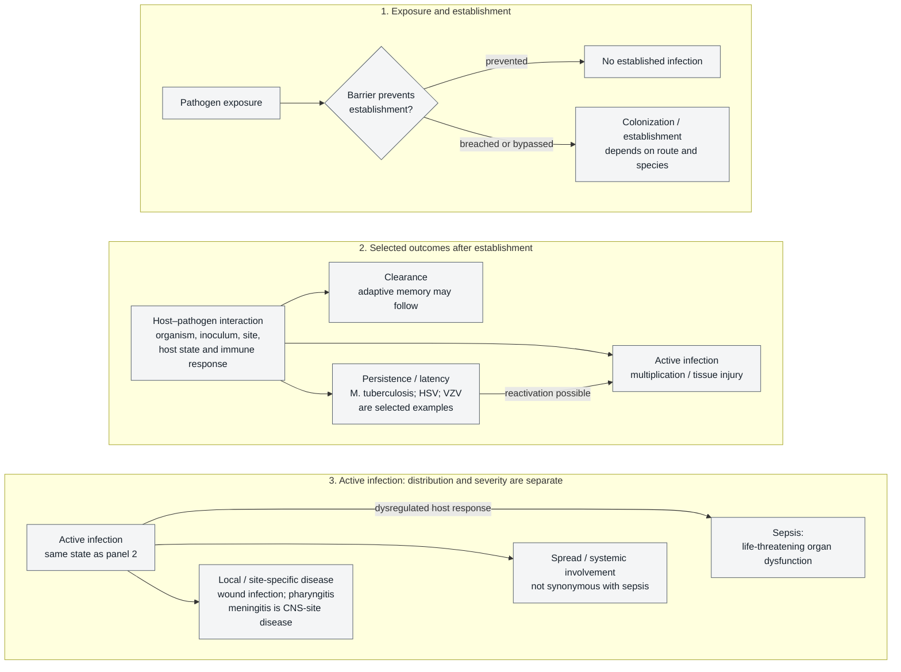
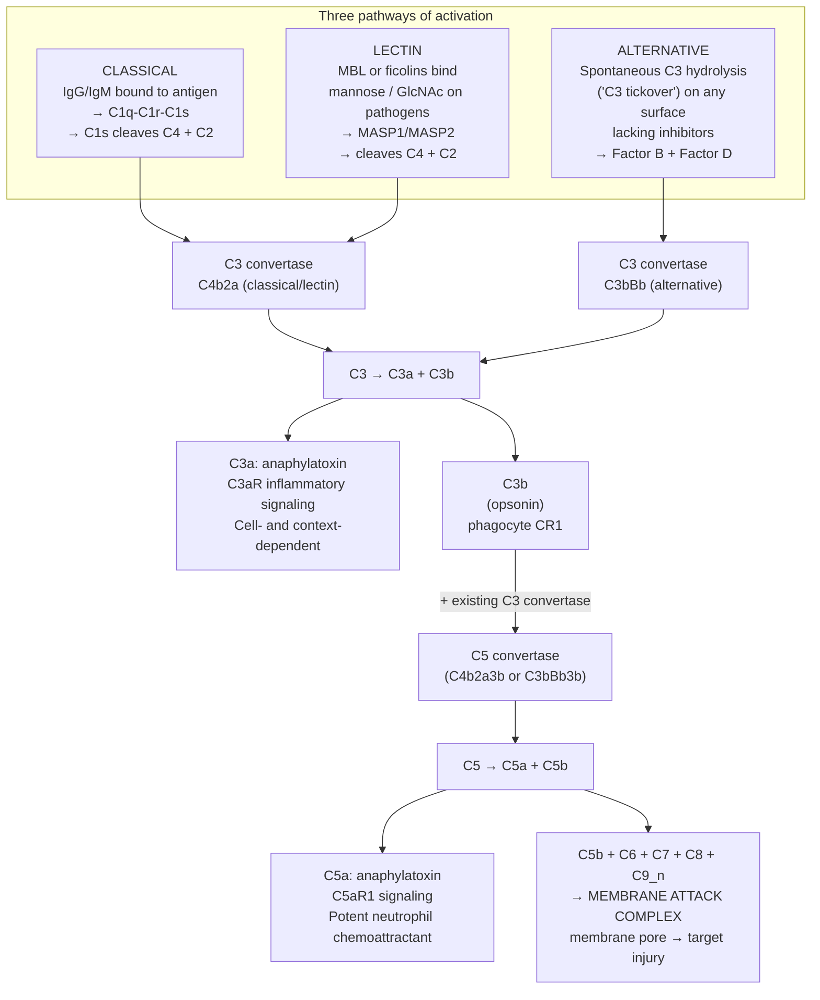
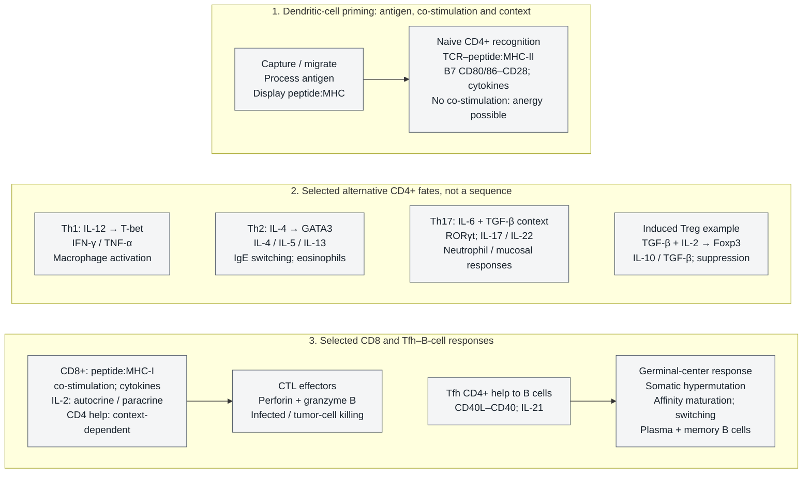
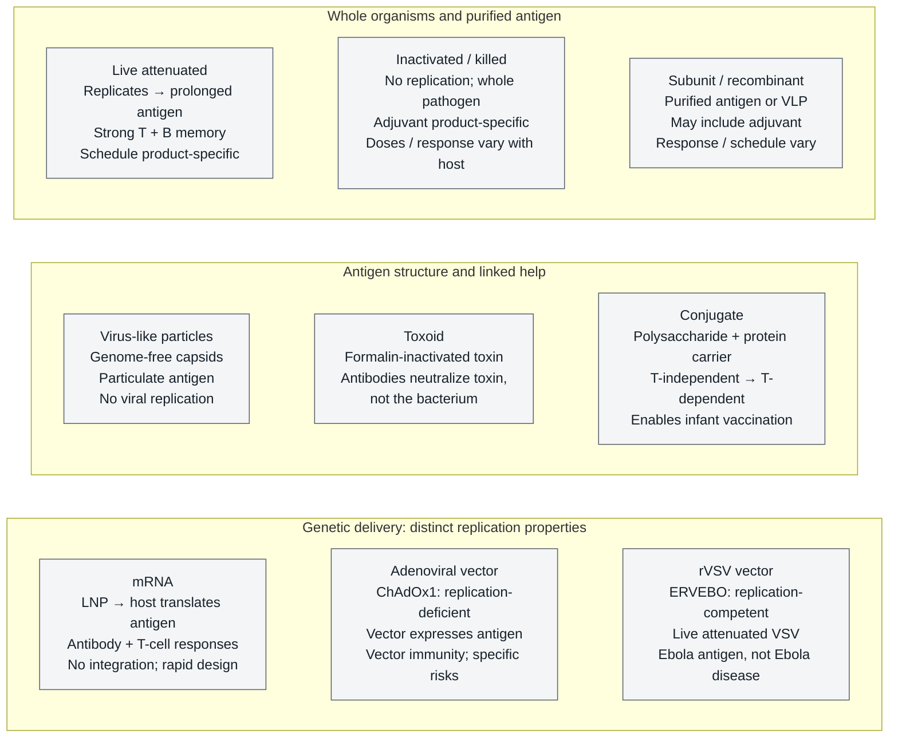
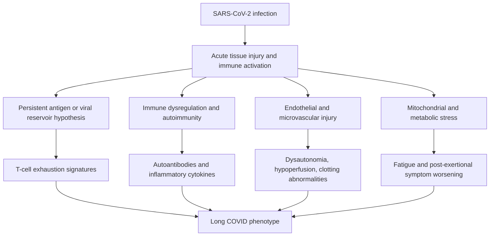
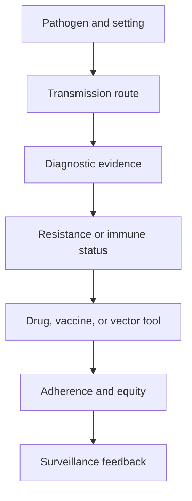

# Host Immunity and Vaccines

\label{sec:unit_VII_host_immunity_and_vaccines}

<!-- chapter-metadata-badge -->
> Level 2/3 · 30 min read · 40 min lecture · Prerequisites: \cref{sec:unit_VII_bacteria_archaea_viruses}

## Learning Objectives

By the end of this chapter, you should be able to:

1. Apply Koch's postulates and molecular Koch's postulates to evaluate evidence for microbial causation of disease, and identify their limitations.
2. Describe [**virulence**](#gl:virulence) factors (adhesins, toxins, invasion machinery, immune evasion strategies) used by major bacterial, viral, and eukaryotic pathogens.
3. Explain innate immune defenses including physical barriers, pattern recognition receptors (TLRs, NLRs, RIG-I, cGAS-STING), the three complement pathways and their convergence at C3, and cellular effectors (neutrophils with NETosis, macrophages, NK cells with missing-self recognition).
4. Describe adaptive immunity including V(D)J [**recombination**](#gl:recombination), MHC restriction, T helper cell subsets, cytotoxic T cell killing mechanisms, B cell activation, affinity maturation, and antibody class switching.
5. Compare the eight major [**vaccine**](#gl:vaccine) platforms (live attenuated, inactivated, subunit, virus-like-particle, toxoid, conjugate, mRNA, viral vector) and apply the [**herd immunity**](#gl:herd-immunity) equation $p_c=1-1/R_0$ to stated measles-, polio- and COVID-like models while distinguishing immune fractions, disease protection and transmission-relevant coverage.
6. Describe antigenic variation in influenza (drift vs shift) and HIV (reverse-transcriptase quasi-species clouds), and connect this to vaccine reformulation and pandemic risk.
7. Classify the principal antibiotic-resistance mechanisms (β-lactamases including ESBLs and carbapenemases, efflux pumps, target modification including PBP2a in MRSA and 23S rRNA methylation in MLS-resistant streptococci, reduced permeability, bypass pathways) and link each to specific drug classes.
8. Describe the epidemiology and pathogenesis of major infectious diseases including tuberculosis, malaria, HIV/AIDS, and influenza, and explain the One Health framework.

<!-- curriculum-scaffold-start -->
### Study Blueprint

- **Big idea:** Host immunity and vaccination can change individual disease risk and, when they affect infection or infectiousness, population transmission.
- **Core concepts:** innate immunity, adaptive immunity, vaccination, herd immunity.
- **Framework alignment:** Vision & Change: Evolution, Systems, Structure and function; AP Biology: Evolution, Systems Interactions; NGSS-style topics: Structure and Function, Interdependent Relationships in Ecosystems.
- **Model or quantitative lens:** Herd-immunity threshold and basic immunological reasoning.
- **Data skill:** Interpret antibody, cellular, and vaccine-response evidence.
- **Practice cadence:** Questions and Methods, Representing and Describing Data, Argumentation.
- **Common misconception to repair:** Immunity is not binary; timing, dose, and variant matter.
- **Primary lab:** \nameref{sec:lab_unit_VII_host_immunity_and_vaccines}.
- **Question bank:** \nameref{sec:q_unit_VII_host_immunity_and_vaccines}.
- **Transfer task:** Transfer immunity reasoning to outbreak response and clinical decision-making.
- **Bridge to computation:** `biology.microbiology.microbiology.sir_model`.
<!-- curriculum-scaffold-end -->

\begin{figure}[htbp]
\centering
\includegraphics[width=0.85\textwidth]{../figures/sir_model.png}
\caption{Illustrative closed-population SIR simulation with 10,000 individuals, 25 initially infected, transmission coefficient 0.45 per day and recovery coefficient 0.12 per day ($R_0=3.75$). Susceptible abundance declines, infected abundance rises and later falls, and recovered abundance accumulates from the start while infected individuals remain. Peak timing and height depend on rates and initial conditions.}
\label{fig:unit_VII_sir_model}
\end{figure}

<!-- alt: Time-series curves show susceptible, infected, and recovered individuals over 180 days. Infected abundance rises to a peak and then falls; recovered abundance increases during both the rising and falling phases of infection. -->

---

> **Opening Vignette — The Pandemic That Shaped Modern Immunology**
> 
> The 1918–19 influenza pandemic infected an estimated 500 million people — about one-third of the world's population — and killed at least 50 million worldwide. Mortality was unusually high among healthy young adults, but also high in young children and older adults; this was not evidence that most victims were healthy young adults. Viral injury, host responses and secondary bacterial pneumonia contributed. A retrospective analysis of autopsy evidence implicated bacterial pneumonia in most fatalities, rather than establishing a universal cytokine-storm explanation \citep{cdc2018pandemichistory,morens2008bacterialpneumonia}. The pandemic exposed the importance of studying pathogen damage and host defenses together. Isolation, masking and limits on gatherings were applied unevenly, without influenza vaccines or antibiotics for secondary bacterial infections. Modern surveillance can compare viral [**genome**](#gl:genome)s and link them to clinical and exposure data, but sequences alone still do not determine severity or transmission. When SARS-CoV-2 emerged, this historical experience informed renewed investigation of public-health measures, immunity and vaccine development. The chapter follows that evidence chain from microbial virulence and innate recognition to adaptive memory and population-level protection.

The companion SIR model uses coupled forward-Euler transfers in a closed population, not independent compartment clipping. Its equal grid ends at the requested duration. It rejects unsafe steps when beta×dt or gamma×dt exceeds one; admissibility preserves nonnegativity and total population but is not an accuracy guarantee. It is a teaching model, not an individual clinical forecast.

## Host-Pathogen Relationships and Virulence

### Koch's Postulates

In 1884, Robert Koch formalized criteria for establishing that a specific microorganism causes a specific disease. These four postulates remain foundational in infectious disease \citep{koch1884}:

1. The microorganism must be found in most cases of the disease but not in healthy individuals
2. The microorganism must be isolated from the diseased host and grown in pure culture
3. The cultured microorganism must cause the same disease when inoculated into a healthy, susceptible host
4. The same microorganism must be re-isolated from the experimentally infected host

**Limitations of Koch's postulates** have become apparent with advancing knowledge:

- **Asymptomatic carriers**: *Salmonella typhi* (Typhoid Mary), *Neisseria meningitidis* -- healthy carriers exist, violating postulate 1
- **Unculturable organisms**: Viruses (until cell culture), *Treponema pallidum*, *Mycobacterium leprae* -- cannot fulfill postulate 2
- **Ethical constraints**: Human experimentation with lethal pathogens is prohibited
- **Polymicrobial disease**: Periodontal disease, bacterial vaginosis -- caused by community shifts, not single organisms
- **Host factors**: Without preventive treatment, about 5–10% of people infected with *Mycobacterium tuberculosis* develop TB disease over their lifetimes; risk varies with time since infection and host factors. This is a progression estimate, not proof that every remaining person retains viable bacilli lifelong \citep{cdc2025ltbi}.

### Molecular Koch's Postulates

In 1988, Stanley Falkow proposed a molecular framework for identifying virulence determinants:

1. The virulence [**gene**](#gl:gene) (or its product) should be found in pathogenic strains but not in non-pathogenic relatives
2. Inactivation of the gene (by [**mutation**](#gl:mutation) or deletion) should reduce virulence in an appropriate model
3. Complementation (restoration of the gene) should restore virulence

This framework has been essential for identifying virulence factors through targeted gene knockouts and complementation studies in model organisms.

### The Infection Continuum

<!-- alt: Three panels distinguish exposure/establishment, selected clearance/persistence/active-infection outcomes, and disease distribution versus severity. Latency can reactivate. Repeated active-infection boxes refer to the same state; panel order is organizational rather than a universal disease timeline. Sepsis is organ dysfunction from a dysregulated host response, not a synonym for dissemination or meningitis. -->

*Selected pathogen-exposure outcomes, not a diagnostic decision rule or universal chronological sequence. Establishment, persistence and disease depend on route, organism, inoculum and host context; not every branch proceeds to later panels. Repeated active-infection boxes mark continuation of the same state. Localized disease can be severe, meningitis identifies an infection site, and sepsis is life-threatening organ dysfunction caused by a dysregulated host response to infection rather than a requirement for bloodstream dissemination. Recovery, persistent injury or death depend on the specific course; clearance does not guarantee adaptive memory \citep{rudd2020sepsis}.*

Not every exposure leads to colonization, not every colonization leads to infection, and not every infection leads to disease. The outcome depends on pathogen virulence, inoculum size, route of entry, and host immune status.

### Virulence Factors and Host-Tissue Damage

Pathogens deploy specific molecular tools to adhere to host tissues, invade cells, obtain nutrients, and evade immune defenses, while host pattern-recognition systems translate microbial signatures into inflammatory and adaptive responses \citep{medzhitov2007recognition}:

**Adhesins** mediate initial attachment to host surfaces:

- **Type IV pili** (*Neisseria gonorrhoeae*, *N. meningitidis*): Retractile pili that mediate attachment to epithelial surfaces and facilitate twitching motility
- **FimH** (*E. coli*): Type 1 fimbrial adhesin that binds mannose residues on uroepithelial cells, enabling urinary tract infection
- **Fibronectin-binding [**protein**](#gl:protein)s** (*Staphylococcus aureus*): Mediate attachment to extracellular matrix, enabling wound infections and endocarditis

**Invasion factors**:

- **Type III secretion system (T3SS)**: *Salmonella enterica* SPI-1 (Salmonella Pathogenicity Island 1) encodes a molecular syringe that injects effector proteins (SopE, SipA) directly into host epithelial cells, triggering [**actin**](#gl:actin) [**cytoskeleton**](#gl:cytoskeleton) rearrangement and bacterial internalization via membrane ruffling
- **Internalins** (*Listeria monocytogenes*): InlA binds E-cadherin, InlB binds Met receptor; trigger receptor-mediated [**endocytosis**](#gl:endocytosis); once internalized, Listeria escapes the phagosome (listeriolysin O) and propels itself through the [**cytoplasm**](#gl:cytoplasm) using actin polymerization (ActA recruits host Arp2/3 complex)

**Capsules**: Polysaccharide capsules (*Streptococcus pneumoniae*, *Neisseria meningitidis*, *Haemophilus influenzae* type b) can inhibit phagocytosis by reducing complement deposition and obscuring surface antigens. Pneumococcal capsular diversity motivates multivalent conjugate vaccines; PCV13 and PCV20 illustrate inclusion of selected serotypes rather than every capsule type.

### Toxins and Molecular Mechanisms of Pathogenesis

**Exotoxins** are secreted proteins with specific mechanisms of action. Many have the A-B structure: the B (binding) subunit binds a host cell receptor, and the A (active) subunit enters the cell to exert its toxic effect:

: Toxins and Molecular Mechanisms of Pathogenesis: Toxin and Organism. {#tbl:unit_VII_host_immunity_and_vaccines_toxins_and_molecular_mechanisms_of_pathogenesis}
| Toxin | Organism | B-Subunit Target | A-Subunit Activity | Clinical Effect |
|-------|----------|-------------------|-------------------|----------------|
| Cholera toxin | *V. cholerae* | GM1 ganglioside | ADP-ribosylates Gsα -> constitutive adenylyl cyclase activation -> cAMP $\uparrow$ | Cl$^-$/H$_2$O secretion -> profuse watery diarrhea and dehydration |
| Diphtheria toxin | *C. diphtheriae* | HB-EGF receptor | ADP-ribosylates EF-2 -> halts protein synthesis | Pseudomembrane in throat; myocarditis |
| Tetanospasmin | *C. tetani* | Gangliosides (retrograde transport) | Zinc metalloprotease cleaves VAMP/synaptobrevin | Blocks inhibitory neurotransmitter release (glycine, GABA) -> spastic paralysis |
| Botulinum toxin | *C. botulinum* | Gangliosides (peripheral nerve) | Zinc metalloprotease cleaves SNARE proteins (SNAP-25, syntaxin) | Blocks ACh release at NMJ -> flaccid paralysis |
| Shiga toxin | *Shigella*, STEC *E. coli* | Gb3 (globotriaosylceramide) | N-glycosidase cleaves 28S rRNA | Halts protein synthesis; HUS (hemolytic uremic syndrome) |

**Endotoxin (LPS)**: Unlike exotoxins, endotoxin is not secreted but released upon bacterial lysis. Lipid A activates TLR4 on macrophages, triggering release of TNF-α, IL-1β, and IL-6. At high concentrations (Gram-negative bacteremia), this causes fever, hypotension, disseminated intravascular coagulation (DIC), multi-organ failure, and septic shock.

**Immune evasion strategies**:

- **Protein A** (*S. aureus*): Binds the Fc region of IgG in the "wrong" orientation, preventing opsonization and ADCC
- **IgA protease** (*N. gonorrhoeae*, *H. influenzae*): Cleaves secretory IgA at mucosal surfaces
- **Antigenic variation**: *Trypanosoma brucei* switches expression among variant surface glycoprotein (VSG) genes, changing the surface recognized by an existing antibody response. Repertoire counts depend on the strain and on whether genes, pseudogenes and recombined variants are counted.
- **Phagosome arrest**: *M. tuberculosis* inhibits phagosome-lysosome fusion via LAM (lipoarabinomannan)

> **Concept Check 1:**
> *Vibrio cholerae* produces cholera toxin that causes massive fluid secretion, yet the bacterium rarely invades beyond the intestinal epithelium. Explain why this non-invasive strategy is advantageous for the pathogen's transmission, and predict what would happen to cholera epidemiology if the toxin were eliminated by gene deletion.

---

## Innate Immunity and Rapid Pattern Recognition

### Physical and Chemical Barriers

The first line of defense prevents pathogen entry into sterile body compartments:

A barrier is not just a wall; it is an active ecological and immunological interface. Skin acidity, mucus flow, antimicrobial peptides, secretory IgA, iron sequestration, and resident microbiota create selection pressures that pathogens must evade. Barrier failure can therefore come from physical breach, altered chemistry, disrupted microbial competition, or medical devices that bypass normal surfaces.

: Physical and Chemical Barriers: Barrier and Mechanism. {#tbl:unit_VII_host_immunity_and_vaccines_physical_and_chemical_barriers}
| Barrier | Mechanism | Pathogens That Breach It |
|---------|-----------|------------------------|
| **Skin** | Intact keratin layer; acidic surface [**pH**](#gl:ph); fatty acids; defensins; commensal [**microbiota**](#gl:microbiota) | Burns, wounds, catheter insertion bypass skin |
| **Mucociliary escalator** | Respiratory mucus traps particles; coordinated ciliary beating propels mucus | *P. aeruginosa* [**biofilm**](#gl:biofilm) in CF; influenza NA cleaves sialic acid; HA binds it in mucus |
| **Gastric acid** | Acidic lumen supports pepsin activation and inhibits many ingested microbes; pH varies with feeding and secretion | *H. pylori*: urease produces NH$_3$ to neutralize local pH |
| **Lysozyme** | Muramidase: cleaves NAG-NAM bonds in peptidoglycan | Present in tears, saliva, nasal secretions, breast milk |
| **Lactoferrin** | Iron sequestration (bacteriostatic) | Found at mucosal surfaces; deprives bacteria of essential iron |
| **Defensins** | Antimicrobial peptides (AMPs); form pores in microbial membranes | Produced by epithelial cells and neutrophils; α-defensins (Paneth cells), β-defensins (skin, respiratory) |
| **Resident microbiota** | Colonization resistance (nutrient competition, bacteriocins, bile acid metabolism) | *C. difficile* exploits antibiotic-disrupted microbiota |

### Pattern Recognition Receptors (PRRs)

The innate immune system detects conserved microbial structures -- **pathogen-associated molecular patterns (PAMPs)** -- through germline-encoded PRRs. This system provides immediate recognition without prior exposure:

: Pattern Recognition Receptors (PRRs): PRR and Location. {#tbl:unit_VII_host_immunity_and_vaccines_pattern_recognition_receptors_prrs}
| PRR | Location | PAMP Recognized | Signaling Pathway | Outcome |
|-----|----------|----------------|-------------------|---------|
| **TLR4** | Plasma membrane | LPS (lipid A) | MyD88 -> NF-κB; TRIF -> IRF3 | Pro-inflammatory cytokines + type I IFN |
| **TLR2** | Plasma membrane | Peptidoglycan, lipoteichoic acid, zymosan | MyD88 -> NF-κB | Pro-inflammatory cytokines |
| **TLR3** | Endosome | dsRNA | TRIF -> IRF3 | IFN-β (antiviral state) |
| **TLR7/8** | Endosome | ssRNA | MyD88 -> NF-κB + IRF7 | Type I IFN + cytokines |
| **TLR9** | Endosome | Unmethylated CpG DNA | MyD88 -> NF-κB | Type I IFN + cytokines |
| **RIG-I / MDA5** | Cytoplasm | Viral RNA (5'-ppp, long dsRNA) | MAVS -> IRF3 | IFN-β |
| **NLRP3** | Cytoplasm | DAMPs (ATP, uric acid, cholesterol crystals) | ASC -> [**Caspase**](#gl:caspase)-1 | IL-1β, IL-18, gasdermin D -> pyroptosis |
| **cGAS-STING** | Cytoplasm-ER | Cytoplasmic dsDNA | cGAMP -> STING -> IRF3 | IFN-β; critical for DNA virus detection |

Key signaling outcomes of PRR activation:

- **NF-κB pathway**: [**Transcription**](#gl:transcription) of pro-inflammatory cytokines (IL-1β, IL-6, TNF-α, IL-8/CXCL8) and chemokines
- **IRF3/7 pathway**: Type I interferons (IFN-α/β) -> JAK-STAT signaling -> interferon-stimulated genes (ISGs: OAS/RNase L, Mx proteins, PKR) -> antiviral state in neighboring cells

### The Complement System: Three Pathways, One Cascade

The complement system comprises soluble and membrane-associated proteins that support opsonization, inflammatory signaling and lysis of susceptible targets. Three pathways converge on C3 cleavage by **C3 convertases**, producing C3a (anaphylatoxin) and C3b (opsonin). Protein counts depend on whether regulators and receptors are included, so a component inventory is not itself a measure of cascade activity.

<!-- alt: Classical, lectin and alternative complement pathways converge on C3 cleavage. C3a supports cell- and context-dependent inflammatory signaling through C3aR; C3b supports opsonization. C5 cleavage produces the potent neutrophil chemoattractant C5a and C5b, which initiates C5b–C9 membrane-attack-complex assembly. C3a is not assigned unconditional neutrophil recruitment. -->

*Three complement pathways converge on C3 cleavage, generating C3b for opsonization and C3a for cell- and context-dependent inflammatory signaling. C5 cleavage generates the potent neutrophil chemoattractant C5a and C5b for membrane-attack-complex assembly. Isolated-human-neutrophil studies distinguish C5a chemotaxis from C3a responses under their tested conditions; this does not exclude indirect or other context-dependent effects of C3a on recruitment \citep{ehrengruber1994c3ac5a,muldur2021neutrophils}.*

- **C3a** — an anaphylatoxin that signals through C3aR and contributes to inflammatory responses; effects depend on the responding cell and context.
- **C3b** — an opsonin that covalently binds suitable surfaces and is recognized by complement receptors such as CR1 (CD35), promoting phagocytic clearance.

In isolated-human-neutrophil assays, C5a induced chemotaxis whereas C3a did not in the tested preparations \citep{ehrengruber1994c3ac5a}. In microfluidic gradients, responses to 0.1–10 µM C3a in the source chambers were not significantly different from medium controls, whereas C5a induced chemotaxis \citep{muldur2021neutrophils}. These results qualify the cell type, assay and concentration range; they do not show that C3a can never affect recruitment indirectly or in other tissues.

A second cleavage step generates:

- **C5a** — a potent neutrophil chemoattractant that signals through C5aR1; potency comparisons require a specified assay and concentration range.
- **C5b** — initiates the **membrane attack complex (MAC)**: C5b, C6, C7, C8 and polymerized C9 assemble a transmembrane pore. Susceptibility depends on the target envelope and complement regulation; Gram-positive peptidoglycan limits direct MAC access. Terminal-complement deficiencies (C5–C9) strongly predispose to invasive neisserial disease, rather than establishing that every infection in such a person must be neisserial.

**Complement regulation.** Self cells avoid complement attack via membrane-bound and soluble regulators:

: The Complement System: Three Pathways, One Cascade: Regulator and Action. {#tbl:unit_VII_host_immunity_and_vaccines_the_complement_system_three_pathways_one_cascade}
| Regulator | Action | Defect → disease |
|-----------|--------|-------------------|
| **CD46 (MCP, membrane cofactor protein)** | Cofactor for Factor I cleavage of C3b/C4b | Atypical hemolytic uremic syndrome (aHUS) |
| **CD55 (DAF, decay-accelerating factor)** | Accelerates decay of C3 and C5 convertases | Paroxysmal nocturnal haemoglobinuria (PNH; CD55+CD59 GPI loss) |
| **CD59 (protectin)** | Blocks C9 polymerization (MAC) | PNH (hemolysis) |
| **Factor H** | Inhibits alternative pathway on self surfaces | aHUS; age-related macular degeneration (AMD) |
| **C1 inhibitor** | Blocks C1r/C1s and MASPs | Hereditary angioedema (HAE) |

In the meningococcal strains studied by \citet{madico2006factorh}, **factor H–binding protein (fHbp, then called GNA1870)** recruited host factor H. Deleting the gene reduced factor H binding and increased C3 deposition and serum killing; increased expression enhanced serum resistance. This provides a mechanistic rationale for fHbp-targeted meningococcal vaccine design. It does not establish that every *Neisseria* species recruits factor H through the same surface protein.

### Phagocytosis and Cellular Effectors

#### Neutrophil Killing: Oxidative Burst and NETosis

**Neutrophils** are abundant circulating leukocytes that can be recruited rapidly to infection sites. Their blood residence, tissue survival and measured proportions depend on physiological state, inflammatory signals and the measurement method. Recruitment, microbial killing and subsequent clearance by apoptosis help limit infection and collateral tissue injury; one fixed lifespan is not a universal property of every neutrophil.

**Oxidative burst (respiratory burst).** Upon phagosome formation, the **NADPH oxidase complex (NOX2)** assembles at the phagosome membrane:

$$ 2\text{O}_2 + \text{NADPH} \xrightarrow{\text{NOX2}} 2\text{O}_2^- + \text{NADP}^+ + \text{H}^+  \label{eq:unit_VII_infectious_disease_item_1}$$

Superoxide ($O_2^-$) is converted to hydrogen peroxide ($H_2O_2$) by superoxide dismutase. **Myeloperoxidase (MPO)** — abundant in neutrophil azurophilic granules — can then catalyze hypochlorous-acid formation:

$$ \text{H}_2\text{O}_2 + \text{Cl}^- \xrightarrow{\text{MPO}} \text{HOCl} + \text{OH}^-  \label{eq:unit_VII_infectious_disease_item_2}$$

**HOCl (hypochlorous acid, household-bleach chemistry)** can oxidize microbial proteins, lipids and DNA. Neutrophil vacuoles also contain antimicrobial peptides and proteases. Their pH changes with oxidase activity and maturation: initially neutral or alkaline oxidase-active neutrophil vacuoles must not be assigned the acidic pH of a macrophage phagolysosome. One human-neutrophil experiment measured a rise to approximately pH 9; this is an assay-specific observation, not a fixed pH at every stage \citep{levine2015neutrophilph}. Pathogens can persist by altering maturation, resisting reactive species or escaping vacuoles.

### Worked Example: Quantifying the Neutrophil Oxidative Burst

**Problem:** For a synthetic stoichiometric upper bound, stipulate that NOX2 consumes an amount of cytosolic NADPH equal to 0.5 mmol/L times a reference phagosome volume of $2.0\times10^{-15}$ L. NADPH supplies electrons from the cytosolic side; this is not a measured NADPH pool in the lumen. Assume complete superoxide dismutation, abundant chloride and complete MPO conversion with no competing reactions. Estimate maximum $H_2O_2$ in mmol and the same-volume upper bound on HOCl concentration using \cref{eq:unit_VII_infectious_disease_item_1,eq:unit_VII_infectious_disease_item_2}.

**Solution.**

1. **Stipulated NADPH amount.** $n=0.5\,\text{mmol L}^{-1}\times2.0\times10^{-15}\,\text{L}=1.0\times10^{-15}\,\text{mmol}=1.0\times10^{-18}\,\text{mol}$.

2. **Stoichiometry.** Each NADPH yields one $H_2O_2$ after dismutase: $n(H_2O_2) = 1.0 \times 10^{-18}\,\text{mol} = 1.0 \times 10^{-15}\,\text{mmol}$.

3. **Upper bound, not a measured time course.** At most one HOCl forms per $H_2O_2$, giving $1.0\times10^{-15}$ mmol HOCl and, divided by the reference volume, 0.5 mM. Competing reactions reduce availability; no residence time or microsecond pulse follows from these inputs. CGD markedly reduces oxidase-derived reactive intermediates, but residual activity depends on the mutation and is associated with disease severity \citep{kuhns2010cgd}.

**Interpretation.** Stoichiometry bounds an amount under explicit assumptions; it does not establish an in-vivo concentration, killing rate or pH-dependent reaction yield.

**NETosis.** Discovered in 2004 (Brinkmann *et al.*, *Science*), NETosis is a programmed neutrophil death pathway in which the cell releases its decondensed [**chromatin**](#gl:chromatin) — decorated with citrullinated [**histone**](#gl:histone)s, neutrophil elastase, MPO, defensins, and granule contents — to form **neutrophil extracellular traps (NETs)** that physically capture and chemically kill extracellular bacteria, fungi, and large parasites. The molecular pathway:

1. Activation by PAMPs / immune complexes / cytokines triggers ROS production by NOX2.
2. **PAD4 (peptidylarginine deiminase 4)** citrullinates histone H3 (Arg → citrulline), neutralizing positive charge and decompacting chromatin.
3. Nuclear membrane breaks down; chromatin enters cytoplasm; granule contents bind to chromatin.
4. Plasma membrane lyses, releasing the NET into the extracellular space (cell death).

NETs are evolutionarily ancient (zebrafish neutrophils, *Drosophila* haemocytes, even sea-anemone amoebocytes form similar traps). Pathological NETosis is now implicated in **immunothrombosis** in severe COVID-19 (NETs trap platelets and trigger coagulation, contributing to microvascular clots), in autoimmune diseases (citrullinated histones drive ACPA antibodies in rheumatoid arthritis; anti-NET antibodies in lupus), and in chronic wound failure.

**Macrophages** are tissue-resident phagocytes with diverse functions:

- Tissue-specific names: Kupffer cells (liver), alveolar macrophages (lung), microglia (brain), osteoclasts (bone), Langerhans cells (skin -- actually dendritic cells)
- **M1 polarization** (IFN-γ + LPS): Pro-inflammatory; produces iNOS -> nitric oxide (NO); secretes TNF-α, IL-12; activates Th1 responses against intracellular pathogens
- **M2 polarization** (IL-4, IL-13): Anti-inflammatory; produces arginase; secretes IL-10, TGF-β; promotes wound healing, tissue repair, and fibrosis

#### NK Cells: Missing-Self and Induced-Self Recognition

**Natural killer (NK) cells** are innate lymphocytes that can kill infected and transformed cells without prior antigen-specific priming. They detect altered host-cell states through receptor signals rather than requiring a conserved microbial structure on the target surface. Their proportion in blood is population- and assay-dependent, not a fixed diagnostic percentage.

NK-cell killing is governed by an **integration of inhibitory and activating receptor signals** — the "balance hypothesis." A cell is killed when activating signals exceed inhibitory signals.

**Missing-self hypothesis (Ljunggren and Karre, 1990).** Healthy cells display abundant MHC class I on their surface, presenting peptides for surveillance by CD8$^+$ T cells. NK cells carry **inhibitory KIRs (killer immunoglobulin-like receptors; KIR2DL, KIR3DL)** that recognize self MHC-I. Engagement delivers an **inhibitory signal** through ITIMs (immunoreceptor tyrosine-based inhibitory motifs), suppressing the NK-cell killing program. Many viruses (CMV, HIV, KSHV) and tumors **downregulate MHC class I** to avoid CD8$^+$ T cell detection — but this loss removes the inhibitory signal to NK cells, unmasking the cell for NK-mediated killing. The strategy has trade-offs: CMV has evolved decoy MHC-I-like proteins (UL18) that bind inhibitory NK receptors to mimic self.

**Induced-self via NKG2D.** A complementary mechanism detects cellular stress. **NKG2D** is an activating receptor on NK cells (and on subsets of CD8$^+$ T cells, γδ T cells, NKT cells) that recognizes **stress-induced ligands**: **MICA, MICB** (MHC class I chain-related), **ULBP1–6** (UL16-binding proteins). These ligands are **absent on healthy cells** but induced by:

- DNA damage (ATR/ATM pathway) — common in transformed cells.
- Viral infection.
- Heat shock response.
- Oxidative stress.

NKG2D ligands are MHC-I-like in fold but lack peptide-binding groove and β2-microglobulin association. Their induction provides a "danger signal" that bypasses normal MHC-I inhibition. NKG2D engagement signals through DAP10/DAP12 adaptors to activate cytotoxicity. Many cancers shed soluble MICA/MICB into circulation as a decoy that downmodulates surface NKG2D — an immune escape mechanism now targeted by anti-MICA-shedding antibodies in cancer immunotherapy.

**NK-cell killing mechanisms** (shared with CTLs):

- **Perforin/granzyme** — perforin polymerizes in target membrane (similar to MAC); granzymes (especially granzyme B) enter and cleave caspase-3/7 → [**apoptosis**](#gl:apoptosis).
- **Death receptor ligands** — FasL, TRAIL on NK cell engage Fas, DR4/DR5 on target → DISC → caspase-8 → apoptosis.
- **Antibody-dependent cellular cytotoxicity (ADCC)**: NK cell **CD16 (FcγRIII)** binds IgG bound to target cell surface → directed degranulation. ADCC is the principal mechanism by which anti-tumor antibodies (rituximab, trastuzumab) kill cancer cells, and a substantial fraction of vaccine-induced antiviral protection.

### Inflammation and Vascular Recruitment of Immune Cells

The cardinal signs of inflammation (rubor, calor, tumor, dolor -- redness, heat, swelling, pain) result from vascular changes triggered by innate immune activation:

- **Mast cell degranulation**: Histamine, tryptase, leukotrienes -> vasodilation + increased vascular permeability
- **Cytokine cascade**: IL-1β (fever, endothelial activation); TNF-α (fever, hypotension, acute-phase response); IL-6 (hepatic acute-phase proteins: CRP, fibrinogen, complement, ferritin); IL-8/CXCL8 (neutrophil chemotaxis)
- **Acute-phase response**: Liver produces C-reactive protein (CRP), which binds phosphocholine on bacterial surfaces and activates complement

> **Clinical Connection: Sepsis and Cytokine Storm**
> Sepsis is defined as life-threatening organ dysfunction caused by a dysregulated host response to infection (Sepsis-3 criteria, 2016). A Global Burden of Disease analysis estimated 48.9 million incident sepsis cases and 11.0 million sepsis-related deaths worldwide in 2017; these are modeled estimates for that year, not a current annual census \citep{rudd2020sepsis}. In sepsis, inflammatory injury, endothelial dysfunction, capillary leak and coagulopathy can coexist with impaired immune function. The SOFA (Sequential Organ Failure Assessment) score quantifies organ dysfunction. Cytokine release syndrome following CAR-T therapy and inflammatory injury in severe COVID-19 provide related but clinically distinct contexts; an IL-6-blockade mechanism does not establish universal benefit across these syndromes.

> **Concept Check 2:**
> A child with CGD has a mutation in the gp91phox subunit of NADPH oxidase. Explain the susceptibility to organisms such as *S. aureus* and *Aspergillus*, distinguishing a bacterium from a fungus. How could residual oxidase activity alter severity? Explain why catalase status alone is not a complete prediction of infection risk.

> **Concept Check 2b:**
> A patient with paroxysmal nocturnal hemoglobinuria has a PIGA-mutant clone lacking GPI-anchored CD55/CD59. Explain why reduced complement regulation increases hemolysis and how eculizumab blocks C5 cleavage and terminal complement activation. Why is reducing complement-mediated hemolysis not eradication of the mutant clone or a cure? Discuss meningococcal prevention and residual infection risk using current product guidance, not a promise that vaccination abolishes risk.

---

## Adaptive Immunity: Antigen Presentation, T Cells, and Clonal Specificity

The adaptive immune system provides antigen-specific responses with immunological memory. Its defining features include the coordinated innate-to-adaptive handoff that determines which lymphocyte programs are selected \citep{chaplin2010immuneresponse,iwasaki2015innateadaptive}:

- **Specificity**: Each lymphocyte clone bears a unique antigen receptor (TCR or BCR) generated by somatic recombination
- **Diversity**: V(D)J recombination, junctional variation and receptor-chain pairing generate large potential repertoires; the number of possible receptors is not the number of distinct specificities present in one individual.
- **Clonal selection**: Antigen selects and expands primarily those lymphocyte clones with matching receptors
- **Memory**: Long-lived memory cells mount faster, stronger secondary responses upon re-encounter
- **Self-tolerance**: Autoreactive clones are eliminated (central tolerance) or suppressed (peripheral tolerance)

### MHC Molecules and Antigen Presentation

Major histocompatibility complex (MHC) molecules present peptide fragments to T cells, providing the context for antigen recognition:

**MHC class I** (HLA-A, HLA-B, HLA-C in humans):

- Expressed on **most nucleated cells**
- Present **endogenous peptides** (from cytoplasmic proteins): proteasome -> peptide fragments -> TAP transporter -> ER -> peptide loading onto MHC-I -> cell surface
- Recognized by **CD8$^+$ T cells** (cytotoxic T lymphocytes)
- Presents viral antigens and tumor antigens from within the cell

**MHC class II** (HLA-DR, HLA-DP, HLA-DQ):

- Expressed on **professional antigen-presenting cells (APCs)**: dendritic cells, macrophages, B cells
- Present **exogenous peptides** (from phagocytosed material): endosomal/lysosomal degradation -> CLIP removal by HLA-DM -> peptide loading onto MHC-II -> cell surface
- Recognized by **CD4$^+$ T cells** (helper T cells)

HLA loci carry many [**allele**](#gl:allele)s whose peptide-binding differences diversify antigen presentation across people. A database count requires a named release and definition of included alleles; diversity does not guarantee that every pathogen peptide will be presented in every host, or prevent immune evasion.

### T Cell Activation and Differentiation

<!-- alt: Three broad rows distinguish dendritic priming, four alternative CD4 differentiation examples, and CD8 versus Tfh–B-cell outputs. Antigen recognition, co-stimulation, cytokine context and possible anergy remain distinct. IL-2 sources/CD4-help dependence and induced-Treg scope are explicit; invisible row ordering does not assert that every helper fate precedes every effector response. -->

*T-cell activation and selected effector outcomes in compact panels. Dendritic cells provide antigen, co-stimulation and cytokine context; the four CD4$^+$ differentiation cards are alternatives, not successive stages. The CD8$^+$ card distinguishes recognition/co-stimulation from context-dependent cytokine support: IL-2 can have autocrine or paracrine sources, and CD4-help requirements differ across priming and inflammatory settings. The Treg card illustrates peripheral induction, not every thymic or peripheral developmental route. Tfh help supplies CD40L and IL-21 for B-cell germinal-center responses. Panel order is instructional, not a claim that all four helper subsets precede every cytotoxic or antibody response \citep{toumi2022il2,davidson2007treg}.*

- **Signal 1**: TCR recognition of peptide:MHC complex (specificity signal)
- **Signal 2**: A named co-stimulatory route is CD28 on the T cell binding APC B7 molecules (CD80/CD86). Antigen recognition without appropriate co-stimulation can produce anergy or other nonproductive/tolerance outcomes, depending on the cell and context; it is not a universal deterministic fate rule.
- **Signal 3**: The cytokine environment helps shape effector-subset differentiation alongside antigen-receptor and other cellular inputs.

The source and timing of IL-2 matter: in the studied inflammatory infection models, antigen-specific CD8$^+$ cells produced IL-2 largely independently of CD4 licensing of dendritic cells; primary expansion and later memory-recall potential were distinct endpoints \citep{toumi2022il2}. In the studied CD4$^+$Foxp3$^-$ induction setting, IL-2 had a nonredundant role in TGF-β-induced Foxp3 expression. That induction result is not the same as a requirement for continued Foxp3 expression after induction, and it does not replace thymic Treg development with one cytokine recipe \citep{davidson2007treg}.

**T helper cell subsets**:

: T Cell Activation and Differentiation: Subset and Inducing Cytokines. {#tbl:unit_VII_host_immunity_and_vaccines_t_cell_activation_and_differentiation}
| Subset | Inducing Cytokines | Master Transcription Factor | Signature Cytokines | Primary Function |
|--------|-------------------|---------------------------|-------------------|-----------------|
| Th1 | IL-12, IFN-γ | T-bet | IFN-γ, TNF-α | Macrophage activation; intracellular pathogens |
| Th2 | IL-4 | GATA3 | IL-4, IL-5, IL-13 | B cell IgE switching; eosinophils; helminths; allergy |
| Th17 | IL-6 + TGF-β + IL-23 | RORγt | IL-17, IL-22 | Neutrophil recruitment; mucosal defense; fungi |
| Induced Treg (example) | TGF-β + IL-2 | Foxp3 | IL-10, TGF-β | Suppress excessive inflammation; maintain tolerance |
| Tfh | IL-6, IL-21 | Bcl6 | IL-21, CXCL13 | B cell help in germinal centers |

**Cytotoxic T lymphocytes (CTLs, CD8$^+$)** recognize viral or tumor antigens on MHC-I and kill target cells through:

- **Perforin/granzyme pathway**: Perforin polymerizes in the target membrane, forming pores; granzyme B enters and activates caspase-3/7 -> apoptosis
- **Fas-FasL pathway**: CTL-expressed FasL binds Fas (CD95) on target -> DISC formation -> caspase-8 -> apoptosis
- **Serial killing**: A CTL can engage and kill successive targets through directed degranulation at immunological synapses; the number depends on the CTL, target and observation period.
- **Exhaustion**: In chronic infections (HBV, HCV, HIV), persistent antigen exposure leads to upregulation of inhibitory receptors (PD-1, TIM-3, LAG-3) and progressive loss of effector function -- the basis for PD-1/PD-L1 checkpoint inhibitor therapy in cancer

> **Concept Check 3:**
> Explain why an adult with HIV and a CD4$^+$ T cell count below 200 cells/μL is susceptible to opportunistic infections. Describe which arm of the immune response is compromised and why both cellular and humoral immunity are affected despite B cells and CD8$^+$ T cells being present. This adult teaching threshold is not a universal pediatric diagnostic rule.

---

## B Cells and Antibodies

### B Cell Activation

B cell activation pathways differ depending on the nature of the antigen:

**T-dependent antigens** (protein antigens): BCR binds and internalizes antigen -> processes and presents peptides on MHC-II -> recognized by cognate Tfh cell -> CD40L-CD40 interaction + IL-21 -> B cell activation, proliferation, and entry into the germinal center reaction. This pathway produces high-affinity antibodies, class-switched isotypes, and long-lived memory.

**T-independent antigens** (repetitive polysaccharides, LPS): Cross-link multiple BCRs on the B cell surface -> activation without T cell help. Produces primarily IgM; limited affinity maturation; poor memory response. This is why polysaccharide vaccines (pneumococcal, meningococcal) are poorly immunogenic in children under 2 years (immature T-independent response) and why **conjugate vaccines** were developed.

### Germinal Center Reaction

The germinal center (GC) in secondary lymphoid organs is the site of antibody optimization:

1. **Clonal expansion**: Activated B cells (centroblasts) proliferate rapidly in the dark zone
2. **Somatic hypermutation (SHM)**: Activation-induced cytidine deaminase (AID) initiates targeted mutation in immunoglobulin variable (V) regions by deaminating cytidine to uridine in DNA. Base-excision and mismatch-repair pathways process these lesions into diverse mutations. A rate per division and a fold contrast with background mutation require matched loci, cell populations and denominators; they are not universal constants.
3. **Affinity maturation**: Mutant B cells (centrocytes) migrate to the light zone, where they compete for antigen displayed on follicular dendritic cells (FDCs). Primarily B cells with improved BCR affinity receive survival signals; the rest undergo apoptosis. This Darwinian selection process progressively increases antibody affinity over successive rounds.
4. **Class switch recombination (CSR)**: AID also introduces double-strand breaks in switch (S) regions upstream of constant region genes, enabling recombination that changes the antibody class from IgM to IgG, IgA, or IgE while preserving antigen specificity. Cytokine signals determine which class is selected: IL-4 -> IgE; IFN-γ -> IgG1; TGF-β -> IgA.

The GC reaction produces two important outputs: **long-lived plasma cells** (some migrate to bone marrow and sustain antibody secretion) and **memory B cells** (persist and can reactivate upon antigen re-encounter). Persistence varies with antigen, compartment and host; longevity of a population does not by itself measure the lifespan of each cell.

### Antibody Structure and Function

An antibody molecule consists of two identical heavy (H) chains and two identical light (L) chains, each containing variable (V) and constant (C) domains:

- **Fab region** (fragment antigen-binding): Contains the variable domains (VH + VL) that form the antigen-binding site (paratope). The three complementarity-determining regions (CDR1, CDR2, CDR3) within each variable domain make direct contact with antigen.
- **Fc region** (fragment crystallizable): The constant domains that determine antibody class and mediate effector functions (complement activation, Fc receptor binding on phagocytes and NK cells, placental transfer).
- **Hinge region**: Provides flexibility between Fab and Fc, allowing bivalent binding to spatially separated epitopes.

### Antibody Classes and Effector Functions

: Antibody Classes and Effector Functions: Isotype and Structure. {#tbl:unit_VII_host_immunity_and_vaccines_antibody_classes_and_effector_functions}
| Isotype | Structure | Location | Key Functions |
|---------|-----------|----------|--------------|
| **IgM** | Pentamer (10 binding sites) | Blood (primary response) | First antibody produced; efficient complement activation via classical pathway; low affinity compensated by high avidity |
| **IgG** | Monomer (4 subclasses) | Blood, extravascular; **crosses placenta** via FcRn | Most abundant serum antibody; opsonization; ADCC (via CD16 on NK cells); complement; neonatal passive immunity |
| **IgA** | Dimer (secretory IgA with secretory component) | Mucosal surfaces: saliva, tears, breast milk, intestinal lumen | Abundant mucosal antibody; neutralization and immune exclusion; a daily production estimate requires a defined physiological and measurement context |
| **IgE** | Monomer | Bound to mast cells and basophils via high-affinity FcεRI | Very low serum concentration; cross-linking by allergen -> mast cell degranulation -> immediate hypersensitivity; anti-helminth defense (eosinophil ADCC) |
| **IgD** | Monomer | Naive B cell surface (co-expressed with IgM) | BCR signaling; poorly understood effector function |

**Immunological memory** — the basis of vaccination — results from persistent plasma-cell and memory-cell populations. A secondary response can be:

- **Faster**: Memory cells can reactivate more rapidly than naive cells; timing depends on antigen, exposure route and the measured endpoint.
- **Stronger**: Antibody titers can rise more strongly, but no fixed fold increase applies across antigens, assays and sampling times.
- **Higher affinity**: Memory B cells express somatically hypermutated, affinity-matured BCRs
- **Class-switched**: Predominantly IgG (or IgA at mucosal surfaces)

> **Concept Check 4:**
> Conjugate vaccines (e.g., PCV13) link bacterial polysaccharide antigens to protein carriers (e.g., CRM197, a nontoxic diphtheria toxoid). Explain the immunological rationale: why does conjugation convert a T-independent antigen into a T-dependent antigen, and why is this critical for vaccinating infants?

---

## Vaccines and Immunological Memory

### Vaccine Platforms: Eight Strategies for Inducing Memory

Vaccines induce protective memory through several antigen-delivery strategies. The eight broad platform families below overlap (for example, VLPs are recombinant subunits); viral vectors are subdivided by replication competence rather than assumed to share one mechanism or precaution profile. Historical exemplars illustrate mechanisms, not current availability in every jurisdiction.

<!-- alt: Nine cards in three rows compare eight broad vaccine platform families with viral vectors split into replication-deficient adenoviral and replication-competent rVSV examples. Each card combines antigen delivery with selected immune consequences. Rows are comparison groups, not a pathway; product examples and precautions are detailed in the adjacent table. -->

*Eight broad vaccine platform families in three comparison rows; the vector family is split by replication competence. Cards combine delivery mechanism and selected consequences, not a sequence or efficacy ranking. Historical examples in the adjacent table include MMR/varicella/yellow fever/OPV (live), IPV/IIV/hepatitis A (inactivated), HBsAg/HPV/acellular pertussis (subunit or VLP), tetanus/diphtheria toxoids, Hib/PCV/meningococcal conjugates and BNT162b2/mRNA-1273. ChAdOx1 and ERVEBO retain their distinct vector properties. Mechanism alone does not determine product-specific precautions.*

: Vaccine Platforms: Eight Strategies for Inducing Memory: Platform and Examples. {#tbl:unit_VII_host_immunity_and_vaccines_vaccine_platforms_eight_strategies_for_inducing_memory}
| Platform | Examples | Antigen form | Strengths | Limitations |
|----------|----------|--------------|-----------|-------------|
| **Live attenuated** | MMR, varicella (Varivax), yellow fever17D, oral polio (OPV), BCG, rotavirus | Weakened replicating organism | T + B memory; some products induce mucosal immunity | Reversion risk for some products (OPV → cVDPV); eligibility depends on vaccine, pregnancy guidance and type/severity of immunosuppression \citep{cdc2024alteredimmunocompetence} |
| **Inactivated / killed** | IPV (Salk), inactivated influenza (IIV), hepatitis A (Havrix), rabies, whole-cell pertussis (legacy) | Killed whole organism | No pathogen replication; usable in altered immunocompetence with product-specific review | Often multiple doses; adjuvants are product-specific, not universal: IPV contains none \citep{cdc2024pinkbookpolio} |
| **Subunit / recombinant protein** | Hepatitis B (HBsAg), acellular pertussis (aP), zoster (Shingrix gE + AS01) | Purified protein antigen, sometimes with adjuvant | No infectious organism; targeted antigen presentation | Immunogenicity, adjuvant use and schedule depend on product |
| **Virus-like particles (VLPs)** | HPV (Gardasil, Cervarix), HBV (also classified as subunit) | Self-assembled capsid proteins (no genome) | Particulate, highly immunogenic; structurally identical to virus | Difficult to engineer for some viruses |
| **Toxoid** | Tetanus (TT), diphtheria (DT, Tdap), botulism toxoid | Formalin-inactivated toxin | Anti-toxin antibodies neutralize the *toxin*, not the bacterium | No antibacterial protection; periodic boosters needed |
| **Conjugate** | Hib, PCV13, PCV20 (pneumococcal), meningococcal ACWY (Menactra) | Bacterial polysaccharide covalently linked to a protein carrier (CRM197, TT) | Converts T-independent → T-dependent response; enables infant immunization; affinity-matured response | Carrier-specific T cells diverted; serotype replacement after PCV introduction |
| **mRNA** | BNT162b2, mRNA-1273; mRNA-1345 (RSV, first FDA approval 2024); mRNA-1010 (MFLUSIVA, FDA approval August 5, 2026 for adults ≥50) | LNP-encapsulated nucleoside-modified mRNA encoding antigen | Rapid sequence design; antibody and T-cell responses; no genome integration | Product-specific storage, adverse events and durability; MFLUSIVA's ≥65 indication uses accelerated approval with required confirmation of clinical benefit \citep{fda2026mflusiva} |
| **Viral vector: replication-deficient adenovirus** | ChAdOx1-S (Vaxzevria; historical COVID-19 example) | Replication-deficient chimpanzee adenovirus expresses SARS-CoV-2 spike | Antigen expression stimulates humoral and cellular responses | Vector immunity and product-specific adverse events; Vaxzevria labeling identified very rare thrombosis with thrombocytopenia. EU authorization was withdrawn in March 2024 at the manufacturer's request for commercial reasons \citep{ema2024vaxzevria} |
| **Viral vector: replication-competent rVSV** | rVSV-ZEBOV (ERVEBO) | Live attenuated recombinant VSV expresses Ebola glycoprotein | Induces immunity against Ebola virus, not other orthoebolavirus species | CDC specifies component-allergy and live-vaccine risk considerations, including assessment in immunocompromised people and pregnancy; vaccine virus RNA detection is not proof of person-to-person transmission \citep{cdc2025ervebo} |

ERVEBO's VSV vector can replicate, but it contains an Ebola gene rather than the whole Ebola virus and cannot cause Ebola disease. Replication-deficient adenoviral products must not be grouped with it as non-replicating VSV. Consult the specific product label and risk–benefit guidance: neither a blanket contraindication nor a blanket safety assurance transfers across all vector vaccines \citep{cdc2025ervebo,ema2024vaxzevria}.

**mRNA vaccines** are the newest platform and represented a paradigm shift during the COVID-19 pandemic:

- Once a target sequence is available, an mRNA candidate can be redesigned without growing the pathogen; sequence design is distinct from manufacturing, testing and regulatory review.
- N1-methylpseudouridine replaces uridine in the Pfizer/Moderna COVID-19 examples. Modified nucleosides can reduce innate RNA sensing and OAS/RNase-L pathway activation and improve expression in tested systems. Effect sizes depend on RNA sequence, modification, purification, delivery and cell type; substitution alone does not guarantee a universal fold increase or complete pathway blockade \citep{anderson2011oas,kariko2011purification}.
- Lipid nanoparticle (LNP) encapsulation protects mRNA from extracellular nucleases and facilitates uptake. Common formulations combine an ionizable lipid, phospholipid, cholesterol and PEG-lipid; particle-size distributions depend on formulation and the measurement method.
- Upon injection, host cells (predominantly muscle and dendritic cells at the injection site) translate the mRNA into spike protein, which is presented on MHC-I (activating CD8$^+$ CTLs) and secreted/surface-displayed (activating B cells and CD4$^+$ T cells).
- The vaccine mRNA functions as a transient cytoplasmic translation template, not a DNA-integration system. Detectable RNA, translated antigen and functional expression are different endpoints, so their persistence must be measured separately rather than assigned one universal hours-to-days clearance interval.
- Spike is locked in the prefusion conformation by two proline substitutions (**2P mutation**) that preserve neutralizing epitopes.

Influenza mRNA-1010 (**MFLUSIVA**) received FDA approval on August 5, 2026 for prevention of influenza disease caused by represented strains in adults aged 50 and older. The indication for adults ≥65 uses accelerated approval based on immune responses and requires a confirmatory clinical-benefit study; approval is not evidence of transmission blocking \citep{fda2026mflusiva,fda2026mflusivareview}. RSV mRNA-1345 was first FDA-approved in 2024; personalized mRNA-4157/V940 remains an investigational phase III melanoma example, distinct from approved infectious-disease vaccines.

### Antigenic Variation: How Pathogens Outpace Antibody Responses

The single greatest challenge for vaccine development against many viruses is that the immune target itself **evolves under the selection pressure of the population's own immune response**. Two paradigmatic examples illustrate the strategies and the resulting public-health consequences.

**Influenza A: drift and shift.** Influenza A is a Class V segmented (-)ssRNA virus with 8 genome segments. Its surface glycoproteins **hemagglutinin (HA, 18 subtypes)** and **neuraminidase (NA, 11 subtypes)** are the primary targets of neutralizing antibodies. Influenza A undergoes two distinct mechanisms of antigenic change:

: Antigenic Variation: How Pathogens Outpace Antibody Responses: Feature and Antigenic drift. {#tbl:unit_VII_host_immunity_and_vaccines_antigenic_variation_how_pathogens_outpace_antibody_responses}
| Feature | **Antigenic drift** | **Antigenic shift** |
|---|---|---|
| Mechanism | Point mutations in HA (and NA) accumulating during replication | **Reassortment** of whole genome segments during co-infection of one cell by two influenza A strains (often in pigs as the "mixing vessel") |
| Rate | Ongoing sequence evolution; rate depends on lineage, sequence region and observation period | Episodic introduction of antigenically distinct segments |
| Consequence | Antigenic mismatch with prior immunity → **seasonal epidemics** | Novel HA subtype unseen by population → **pandemic potential** |
| Vaccine response | Annual reformulation (WHO twice-yearly recommendation) | Requires entirely new pandemic vaccine |
| Why influenza A primarily? | Influenza B drifts but does not reassort with animal reservoirs at meaningful frequency; influenza A has a wide animal host range | Influenza A naturally infects birds, swine, humans, and other mammals — sustaining a reservoir of segments for reassortment |

**Pandemic history:**
- **1918 H1N1** ("Spanish flu") — at least 50 million estimated deaths; its devastating phenotype and precise origin remain incompletely understood, not an established reassortment-origin example \citep{cdc2018pandemichistory}.
- **1957–1958 H2N2** ("Asian flu") — CDC's archived account, reviewed January 2, 2019, estimates 1.1 million deaths worldwide. The pandemic virus combined avian-origin segments, including H2 and N2, with a human influenza-virus background \citep{cdc2019h2n2history}.
- **1968 H3N2** ("Hong Kong flu") — CDC's archived account, also reviewed January 2, 2019, estimates 1 million deaths worldwide; the virus acquired avian-origin segments including H3 while retaining N2 from the preceding H2N2 lineage \citep{cdc2019h3n2history}. These are historical estimates, not laboratory-confirmed death censuses or current surveillance counts.
- **2009 H1N1** (pandemic) — Dawood and colleagues modeled 201,200 respiratory plus 83,300 cardiovascular deaths (284,500 combined) during each country's first 12 months of circulation. This is a modeled influenza-associated endpoint, not a laboratory-confirmed death count \citep{dawood2012h1n1mortality}.
- **H5N1 highly pathogenic avian influenza (HPAI)** — animal outbreaks continued into 2026; USDA reported a dairy-herd detection in Indiana on November 2, 2026 \citep{usda2026hpailivestock}. WHO's October 7, 2026 table records 479 deaths among 1,005 reported laboratory-confirmed human cases since 2003 (47.7%). Its US 2024–25 onset entries total 70 detections and 1 death (1.43%), a different reported-case population. These dated proportions are not infection-fatality estimates and cannot be transferred between outbreaks. WHO includes some US A(H5) reports, asymptomatic detections and detections where infection versus transient contamination remains inconclusive \citep{who2026h5n1cumulative}. WHO's assessment through October 7 found no sustained human-to-human transmission associated with recent reported H5N1 infections; that observation is dated, not a guarantee about future evolution \citep{who2026influenzaassessment}.

**HIV variation: the quasi-species cloud.** Mutation-rate and production estimates depend on their assays and models. \citet{mansky1995mutation} measured a forward mutation rate of $3.4\times10^{-5}$ per base pair per cycle in a single-cycle HIV-1 lacZα reporter assay, about twentyfold lower than purified reverse-transcriptase error on the same target. It is not a universal purified-enzyme error rate.

\citet{perelson1996dynamics} fitted a viral-dynamics model to viral-load changes in five infected individuals after protease-inhibitor administration and inferred average total production of $10.3\times10^9$ virions per day. Drug-perturbed kinetics and model assumptions enabled that estimate; it is neither direct virion counting during treatment nor a universal rate for every untreated patient. Together these studies illustrate substantial mutation supply, but combining their means does not establish that every possible single or double mutant is present, viable or available for transmission. Related within-host variants form the population often termed a **quasi-species**.

Consequences:

1. **Resistance can pre-exist or evolve under treatment.** Combination ART suppresses replication and escape, but regimen choice is patient-specific. Eligible patients can receive a recommended two-drug regimen such as dolutegravir/lamivudine; hepatitis B coinfection or unknown HBV status, relevant resistance, unavailable reverse-transcriptase genotype results, or a planned rapid start before required results can exclude that option. Prior long-acting cabotegravir exposure also requires the guideline's integrase-resistance assessment; do not infer eligibility from viral load alone. NIH guidance updated September 24, 2026 removed the prior baseline viral-load cutoff for eligible DTG/3TC \citep{nih2026initialart}. The dated eligibility criteria, not an older universal rule, must be consulted. There is no universal requirement for at least three drugs or proof that escape always needs simultaneous independent mutations.
2. **Antibody escape can evolve**: variation in env (gp120/gp41) can change recognition by neutralizing antibodies. The variants that spread depend on antibody selection, replication fitness and the host environment, not a fixed replacement schedule for each variable loop.
3. **Vaccine difficulty**: narrow antibody recognition leaves opportunities for escape. Broadly neutralizing antibodies (bNAbs) targeting conserved sites such as the CD4-binding site or fusion peptide motivate vaccine research, but inducing them and demonstrating clinical protection are separate tasks.

Within-host evolution is one hypothesis for the unusually divergent early Omicron lineage. Prolonged infection, cryptic transmission and an animal-reservoir history are alternatives; sequence divergence alone does not make one origin almost certain. Longitudinal precursor sequences, epidemiology and reservoir sampling would discriminate among them.

### Herd Immunity and Population-Level Protection

Immunity that reduces infection or onward transmission can indirectly protect susceptible people. In the homogeneous, durable transmission-blocking immunity model, the **herd-immunity threshold** is:

\begin{equation}
p_c = 1 - \frac{1}{R_0}
\label{eq:unit_VII_herd_immunity}
\end{equation}

Here $p_c$ is the equality boundary for the transmission-blocking immune fraction and $R_0$ is the expected secondary infections in a defined fully susceptible population and contact setting. In this immunity-only approximation, $R_e=R_0(1-p)$. Setting $R_e=1$ gives $p_c=1-1/R_0$; declining transmission requires $p>p_c$. Equality does not ensure elimination or prevent every outbreak. \cref{fig:unit_VII_sir_model} illustrates a closed SIR model. Neither protection against symptoms alone nor a positive antibody assay supplies the needed transmission endpoint.

### Worked Example: Calculating Herd Immunity Threshold (Three Pathogens)

**Problem:** For stipulated measles-like ($R_0=15$), polio-like ($R_0=5$) and original-strain COVID-like ($R_0=2.5$) teaching models, compute the ideal immune threshold from \cref{eq:unit_VII_herd_immunity}. These are exercise inputs, not newly validated empirical pathogen estimates. Identify what additional endpoint evidence is required for a vaccination-coverage inference.

**Solution:**

: Calculating Herd Immunity Threshold (Three Pathogens): Pathogen and R_0. {#tbl:unit_VII_host_immunity_and_vaccines_worked_example_calculating_herd_immunity_threshold_three_pathogens}
| Stipulated scenario | $R_0$ | Ideal immune threshold $p_c$ | Transmission-relevant input | Coverage inference |
| --- | --- | --- | --- | --- |
| Measles-like teaching model | 15 | 0.93333 | Assume $E_T=0.97$ prevents infection/transmission durably | $V_c=0.96220$ under homogeneous mixing |
| Polio-like teaching model | 5 | 0.80 | No quantified intestinal/transmission endpoint supplied for IPV | Cannot infer an IPV coverage threshold from paralysis protection |
| Original-strain COVID-like model | 2.5 | 0.60 | 0.95 efficacy against symptomatic disease is not $E_T$ | Cannot infer transmission interruption from this endpoint |
| High-$R_0$ hypothetical model | 10 | 0.90 | Stipulate $E_T=0.50$, not an empirical variant estimate | $V_c=1.8$, unattainable by this vaccine alone |

**Interpretation:** $V_c=p_c/E_T$ requires a transmission-relevant effect and a specified model, not simply any vaccine efficacy percentage. The homogeneous, durable-protection, equal-exposure approximation ignores clustering, waning, age structure and changes in infectiousness among breakthrough cases. A disease-only vaccine can prevent severe illness without reducing $R_e$: if $R_0=4$ and $E_T=0$, then $R_e=4$ even at 100% coverage despite 95% protection against disease.

CDC's Pink Book poliomyelitis chapter (May 1, 2024) distinguishes protection from paralysis from intestinal immunity: IPV-only recipients can still shed poliovirus in stools after exposure, with shedding similar to unvaccinated people who have not encountered live poliovirus. Therefore 80% IPV coverage is not established as sufficient to stop transmission. This does not diminish IPV's substantial direct protection against paralytic disease.

A one-percentage-point reduction in the ideal immune fraction raises $R_e$ by $0.01R_0$ in this **linear** model. The change from controlled spread to sustained growth at $R_e=1$ is a threshold effect, not nonlinearity of that equation. Local clustering can sustain outbreaks even when national averages exceed a simple threshold.

### R$_0$ Comparison: Why Pathogens Differ

: Pathogen comparisons require source-specific transmission evidence. {#tbl:unit_VII_host_immunity_and_vaccines_r_0_comparison_why_pathogens_differ}
| Pathogen/context | Evidence required before using an empirical $R_0$ range | Why a generic coverage threshold is not supplied |
| --- | --- | --- |
| **Measles** | Primary outbreak/contact study specifying population, period and estimation model | Disease effectiveness is not automatically durable transmission efficacy |
| **Mumps** | Population, vaccination history, period and contact structure | Protection and waning differ from measles despite combined MMR delivery |
| **Pertussis** | Age/contact setting, case ascertainment and generation-interval model | Disease prevention need not imply equivalent transmission prevention |
| **Diphtheria** | Susceptible contact population and infection ascertainment | Toxoid protection and bacterial transmission are different endpoints |
| **Polio** | Route, sanitation, prior live-virus exposure and study period | IPV paralysis protection does not establish intestinal transmission blocking |
| **Smallpox** | Historical outbreak, susceptible population and intervention timing | Historical estimates do not describe every contact setting |
| **Rubella** | Age structure, susceptible population and observation period | An immune-fraction boundary is not itself program coverage |
| **HIV** | Transmission network, behavior, untreated duration and model | A homogeneous respiratory-contact model does not transfer automatically |
| **Seasonal influenza** | Season, subtype, prior immunity and method for separating $R_0$ from $R_e$ | Annual disease effectiveness is not a fixed transmission effect |
| **1918 influenza** | Place, wave, historical reporting and generation-interval assumptions | Historical case series require ascertainment and timing limits |
| **Original SARS-CoV-2** | Place, dates, contact conditions and interval distribution | Symptomatic-disease trial efficacy cannot supply $E_T$ |
| **Delta** | Lineage, place, period, immunity and estimation model | Growth advantage alone is not an intrinsic $R_0$ |
| **Omicron BA.5** | Lineage, immune history, place, period and model separating escape from transmission | Immune escape changes effective susceptibility; no universal threshold follows |
| **Mpox cladeIIb,2022** | Contact-network population, period, ascertainment and interventions | Network-specific transmission cannot be reduced to a universal population fraction |

**Source limitation:** This comparison lacks matched primary population/time/method sources for empirical numerical ranges for these fourteen pathogen contexts. No numerical range or converted threshold is asserted here. Empirical comparison requires the specific studies listed above, including uncertainty and the distinction between basic and effective reproduction numbers; the separate worked examples supply only stipulated mathematical inputs, not replacement empirical estimates.

### Adjuvants and Innate Immune Activation

Adjuvants amplify the innate immune response to vaccine antigens, improving adaptive immunity:

- **Aluminum salts (Alum)**: Oldest adjuvant (since 1926); activates NLRP3 inflammasome; depot effect (slow antigen release); used in most childhood vaccines
- **AS04** (Alum + monophosphoryl lipid A): TLR4 agonist; used in Cervarix (HPV vaccine)
- **MF59**: Oil-in-water squalene emulsion; enhances antigen uptake by APCs; used in some influenza vaccines
- **CpG oligodeoxynucleotides**: TLR9 agonist; used in Heplisav-B (hepatitis B vaccine)
- **Matrix-M** (saponin-based): Used in Novavax COVID-19 vaccine; potent Th1 and CTL response
- **AS01** (liposomal MPL + QS-21): Used in Shingrix (zoster) and RTS,S (malaria); strong Th1 response

> **Clinical Connection: SARS-CoV-2 and the COVID-19 Pandemic**
> SARS-CoV-2 enters cells via spike binding ACE2, with TMPRSS2 facilitating membrane fusion in relevant cell contexts. Variants accumulated changes affecting transmission and/or immune escape. Omicron-lineage viruses substantially escaped neutralizing antibodies from vaccination and prior infection, while population immunity and viral evolution changed severe-disease risk. Rapid mRNA sequence design did not replace trials, manufacturing validation or regulatory review: Pfizer-BioNTech received FDA emergency authorization on December 11, 2020, and Comirnaty received full FDA approval on August 23, 2021. The roughly 11 months from initial sequence availability to emergency authorization was not 11 months of clinical trials \citep{fda2021comirnatyapproval}. Long COVID is operationally a chronic condition present at least 3 months after infection; prevalence depends on cohort, variant era, vaccination and case definition. Mechanistic studies consider persistent immune activation, T-cell exhaustion signatures, metabolic dysregulation, possible antigen persistence, autoimmunity, [**microbiome**](#gl:microbiome) disruption, dysautonomia and endothelial dysfunction rather than a single cause \citep{cdc2026longcovid,longcovid2025immune}.

<!-- alt: Flowchart showing long COVID mechanism network. Current evidence supports overlapping immune, vascular, neuroautonomic, metabolic, and possible persistence mechanisms; the diagram should be read as a differential-mechanism map, not a single-cause pathway. -->

*Long COVID mechanism network. Current evidence supports overlapping immune, vascular, neuroautonomic, metabolic, and possible persistence mechanisms; the diagram should be read as a differential-mechanism map, not a single-cause pathway \citep{longcovid2026mechanisms}.*

> **Concept Check 5:**
> Under homogeneous mixing and durable transmission-blocking immunity, calculate $R_e$ for stipulated $R_0=15$ with 80% immune. How many additional percentage points reach $R_e=1$, and why does $R_e<1$ require exceeding that boundary?

> **Concept Check 5b:**
> In a hypothetical homogeneous model, stipulate $R_0=10$ and a vaccine with durable 60% transmission-blocking efficacy. Can achievable coverage produce $R_e<1$? At full coverage, what reduction in the baseline reproduction number from other measures is needed to cross below, rather than merely reach, $R_e=1$?

> **Concept Check 6:**
> Influenza A viruses can undergo antigenic shift through genomic reassortment, but SARS-CoV-2 (a non-segmented RNA virus) cannot. Despite this, SARS-CoV-2 has generated numerous variants of concern. Explain the mechanism by which SARS-CoV-2 generates antigenic diversity and why its approach, while different from influenza, has still enabled significant immune evasion.

---

## Current Evidence and Frontier Biology: Host Immunity and Vaccines

For **Host Immunity and Vaccines**, frontier biology belongs inside the evidence logic of
the chapter. Microbiology and infectious disease now require One Health reasoning across people, animals, environments, genomics, and antimicrobial stewardship. The core reading question is this: infectious-disease reasoning should connect pathogen biology, transmission, immunity, diagnostics, interventions, and equity.

- **What to verify:** identify the observation, model, assay, or dataset that
  would make the claim stronger or weaker.
- **What to qualify:** state the scale, organism, cell type, environmental
  condition, or population where the claim is expected to hold.
- **What to compare:** test at least one alternative explanation, baseline, or
  null model before treating the pattern as causal.
- **What to cite:** distinguish primary evidence, review synthesis, public
  dataset, and institutional guidance; for recent or numeric claims, prefer
  the source closest to the measurement and state what has changed since it was
  published.

For resistance or outbreak claims, name the organism, determinant, selection pressure, transmission route, and surveillance evidence \citep{who2024bppl,cdc2025antibioticuse,murray2022amr}.

**Source practice:** For pathogen, resistance, and intervention claims, tie statements to organism-resistance pairs, surveillance evidence, official guidance, and trial/regulatory status \citep{who2024bppl,who2025tb,who2025malaria,cdc2025lenacapavirprep,cdc2026candidaauris}.

### Current Evidence Map: Intervention Choice Across Pathogens

<!-- alt: Flowchart showing TB regimens, malaria spatial emanators, lenacapavir PrEP, Candida auris control, and Long COVID mechanisms are cases where intervention choices depend on evidence and setting. -->

*TB regimens, malaria spatial emanators, lenacapavir PrEP, Candida auris control, and Long COVID mechanisms are cases where intervention choices depend on evidence and setting. \citep{who2025tb,who2025spatialemanators,cdc2025lenacapavirprep,cdc2026candidaauris,longcovid2026mechanisms}.*

## Summary

- Apply Koch's postulates and molecular Koch's postulates to evaluate evidence for microbial causation of disease, and identify their limitations.
- Describe **virulence** factors (adhesins, toxins, invasion machinery, immune evasion strategies) used by major bacterial, viral, and eukaryotic pathogens.
- Explain innate immune defenses including physical barriers, pattern recognition receptors (TLRs, NLRs, RIG-I, cGAS-STING), the three complement pathways and their convergence at C3, and cellular effectors (neutrophils with NETosis, macrophages, NK cells with missing-self recognition).
- Describe adaptive immunity including V(D)J **recombination**, MHC restriction, T helper cell subsets, cytotoxic T cell killing mechanisms, B cell activation, affinity maturation, and antibody class switching.
- Compare the eight major **vaccine** platforms (live attenuated, inactivated, subunit, virus-like-particle, toxoid, conjugate, mRNA, viral vector). Apply $p_c=1-1/R_0$ only under its stated transmission model, distinguish its $R_e=1$ boundary from declining transmission and require a transmission-relevant effect before inferring vaccination coverage.
- Describe antigenic variation in influenza (drift vs shift) and HIV (reverse-transcriptase quasi-species clouds), and connect this to vaccine reformulation and pandemic risk.
- Classify the principal antibiotic-resistance mechanisms (β-lactamases including ESBLs and carbapenemases, efflux pumps, target modification including PBP2a in MRSA and 23S rRNA methylation in MLS-resistant streptococci, reduced permeability, bypass pathways) and link each to specific drug classes.
- Describe the epidemiology and pathogenesis of major infectious diseases including tuberculosis, malaria, HIV/AIDS, and influenza, and explain the One Health framework.

## Further Reading and Source Notes: Host Immunity and Vaccines

- Control & Prevention} (2026). Long COVID Basics.
- Aid et al. (2026). Long COVID involves activation of proinflammatory and immune exhaustion pathways. *Nature Immunology*, 27.
- Faghy et al. (2026). Current status and future perspectives on the mechanistic and pathophysiological understanding of long COVID. *Communications Medicine*, 6.

---

## Companion Source Module: Host Immunity and Vaccines

**Host Immunity and Vaccines** should leave a reproducible trail from a biological claim to
the code, figure, diagram, or paper-based activity that can test it. Use the
surfaces below to inspect the chapter's assumptions, rerun the relevant model,
or compare the manuscript explanation with companion labs and figures.

: Companion source surfaces for Host Immunity and Vaccines. {#tbl:unit_VII_host_immunity_and_vaccines_companion_source_surfaces}
| Surface | Use it for |
| --- | --- |
| `src/biology/microbiology/microbiology.py` (`basic_reproduction_number`, `sir_model`, `mic_fold_dilution`) | Reproduce transmission and antimicrobial-resistance calculations. |
| `src/biology/ecology/ecology.py` (`exponential_growth`) | Compare early outbreak growth with ecological growth models. |
| `src/mermaid/biology_diagrams.py` (`immune_response_diagram`, `viral_replication_cycle_diagram`) | Connect pathogen life cycle to host response. |

**Reproducibility check:** identify pathogen, host population, transmission route, diagnostic window, intervention, and surveillance source before comparing disease claims. **Cross-reference:** connect with \cref{sec:unit_VII_bacteria_archaea_viruses}, \cref{sec:unit_IX_endocrine_signaling,sec:unit_IX_immune_system_defense}, and \cref{sec:unit_X_community_interactions,sec:unit_X_biodiversity_and_food_webs}.
