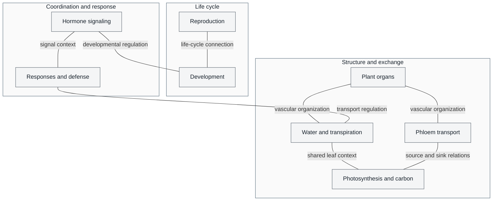

# Unit VIII — Botany — Plant Biology: Introduction {#sec:unit_VIII_unit_intro .unnumbered}


## Why This Unit Matters {.unnumbered}

Plants are the foundation of almost every terrestrial food web, major contributors to gross photosynthetic oxygen production, and the origin of many medicines in human pharmacopoeia — from aspirin (salicylate,
first identified in willow bark) to taxol (from Pacific yew, *Taxus brevifolia*), morphine, quinine,
and artemisinin. More fundamentally, plants are solar-energy collectors that translate photons into
chemical bonds, supporting much of the biosphere’s food supply. Other phototrophs and chemolithoautotrophs also contribute primary production. Gross photosynthetic fixation, net primary production after plant respiration, and net ecosystem carbon storage are different fluxes; only a specified carbon budget can connect them to atmospheric accumulation.

Plant biology is also a discipline of extremes. The tallest trees (coast redwoods, *Sequoia
sempervirens*, 115 m) move water 115 meters against gravity using primarily cohesion-tension and solar
energy, achieving flow rates in excess of 1 m/hour. Some desert plants survive total desiccation and
revive on rehydration. Others flower in response to photoperiod cues measured in the phytochrome
system with a resolution of minutes. The *Arabidopsis thaliana* genome was the first plant genome
sequenced (2000), and this small weed has since become the \"*E. coli* of plant biology\" — a model
organism for the molecular dissection of everything from root development to pathogen resistance.

This unit integrates anatomy (vascular organization, meristems, root-shoot polarity), physiology
(transpiration, water potential, phloem loading), reproductive biology (alternation of generations,
angiosperm diversity, seed development), and signaling (phytohormones: auxin, gibberellin, cytokinin,
abscisic acid, ethylene). The quantitative spine is water potential ($\Psi = \Psi_s + \Psi_p$) and
transpiration modeled by the van den Honert equation.

---

## Landmark Discoveries {.unnumbered}

| Discoverer(s) | Year | Journal / Source | Discovery | Significance |
| ------------- | ---- | ---------------- | --------- | ------------ |
| Jan Ingenhousz | 1779 | \citep{ingenhouss1779} | Light-dependent oxygen production in plants | Distinguished light-dependent gas exchange; plant respiration is not restricted to darkness |
| Julius von Sachs | 1862 | \citep{sachs1862} | Starch as first visible product of photosynthesis | Linked CO₂ fixation to carbohydrate storage in chloroplasts |
| Frits Went | 1920s bioassays; 1928 thesis | \citep{went1926} | Transferable growth-promoting activity in *Avena* coleoptile bioassays | Distinguished a diffusible growth signal from chemical isolation of IAA and later molecular transport mechanisms |
| Henry Dixon & John Joly | 1894 | \citep{dixon1894} | Cohesion-tension theory of water ascent | Explained how trees move water 100+ m with no pump |
| Chailakhyan | 1936 | \citep{chailakhyan1936} | Florigen hypothesis (day-length controls flowering) | Proposed a systemic flowering stimulus; later identified as FT protein |
| *Arabidopsis* Genome Initiative | 2000 | \citep{arabidopsis2000} | First plant genome sequence (125 Mb; ~25,500 genes) | Model organism for molecular plant biology; comparative genomics |
| Gómez-Roldán et al.; Umehara et al. | 2008 | \citep{gomezroldan2008strigolactone,umehara2008strigolactone} | Strigolactones linked to endogenous shoot-branching control | Parallel studies connected a known rhizosphere-signal class to plant branching regulation; no arbitrary hormone-class ordinal is implied |

---

## Plant transport, development, and environmental response {.unnumbered}


<!-- alt: Graph showing plant organization connects transport and carbon metabolism with reproduction, development, and environmental response. Labeled arrowless connectors identify selected relationships, not a required process sequence or reading order. Shared signaling ideas do not imply identical plant and animal receptors. -->

*Plant organization connects transport and carbon metabolism with reproduction, development, and environmental response. Labeled arrowless connectors identify selected relationships, not a required process sequence or reading order. Shared signaling ideas do not imply identical plant and animal receptors.*

---

## Current Evidence Thread {.unnumbered}

In this unit, treat plant biology as a body of evidence: each claim about structure, water transport, environmental response, or reproduction should rest on physiological measurement, in vivo imaging, or a field or engineering trial, not on description alone. Plant biology links molecular regulation to climate stress, water limitation, crop resilience, phenology, and ecosystem feedbacks. As you
move through the chapters, keep a two-column note: **claim** on the left,
**evidence that would change my confidence** on the right. By the end of the
unit, each major idea should be tied to a measurement, model, citation, or
paper-based lab decision.

## Chapter Roadmap {.unnumbered}

| Chapter | Central question | Quantitative lens |
| --- | --- | --- |
| \cref{sec:unit_VIII_plant_structure_and_water} | How does structure constrain transport? | Water potential and mole-fraction gradients |
| \cref{sec:unit_VIII_plant_reproduction} | How do ploidy and developmental programs produce seeds? | Ploidy accounting and saturating growth |
| \cref{sec:unit_VIII_plant_responses} | How are environmental cues converted into responses? | Hormone dose-response and phytochrome |

---

## Connections Across the Textbook {.unnumbered}

- **Photosynthesis** (\cref{sec:unit_III_photosynthesis}) provides the C₃, C₄, and CAM context revisited here in relation to leaf carbon metabolism and plant responses.
- **Water potential and osmosis** (\cref{sec:unit_I_water_and_life}; \cref{sec:unit_II_membrane_transport}) provide context for the transpiration stream model.
- **Plant hormone signaling** revisits receptor-mediated regulation introduced in \nameref{sec:unit_II_unit_intro}. Compare the specified auxin and ABA pathways rather than assuming shared functions imply identical receptor classes.
- **Plant-pollinator, myrmecochory, and plant-mycorrhizal interactions** connect to \nameref{sec:unit_X_unit_intro} (community ecology, mutualism, co-evolution).
- **Secondary metabolites as medicines** (alkaloids, terpenoids) link to \nameref{sec:unit_I_unit_intro} (functional groups) and \nameref{sec:unit_VII_unit_intro} (antimicrobial compounds).

> **Key vocabulary introduced here:** meristem, apical dominance, cohesion-tension, water potential (Ψ), transpiration, turgor pressure, phloem, xylem, stomata, guard cell, photoperiodism, phytochrome, auxin, gibberellin, cytokinin, abscisic acid (ABA), ethylene, alternation of generations, angiosperm, gymnosperm, double fertilization.


## Computational Toolbox — Unit VIII {.unnumbered}

```python
from biology.botany import water_potential, transpiration_flux, photosynthesis_rate

# Water potential: mesophyll cell with 0.30 M solutes and 0.20 MPa turgor
psi = water_potential(solute_concentration_M=0.30, turgor_pressure_MPa=0.20)
print(f"Cell water potential Ψ = {psi.water_potential_MPa:.2f} MPa")
# Expected: Ψ ≈ -0.54 MPa
# Water moves from higher Ψ (soil, ≈ -0.03 MPa) to lower Ψ (leaf, ≈ -1.5 MPa)

# Stomatal conductance and transpiration
# Synthetic molar air density = 40 mol/m^3: 0.5 and 0.3 mol/m^3
# become dimensionless mole fractions 0.0125 and 0.0075.
trans = transpiration_flux(
    stomatal_conductance_mol_m2_s=0.20,
    internal_vapor_mole_fraction=0.0125,
    external_vapor_mole_fraction=0.0075,
)
print(f"Transpiration flux = {trans.flux_mmol_m2_s:.1f} mmol m⁻² s⁻¹")
print(f"Net photosynthesis at PAR 1000 = {photosynthesis_rate(1000):.1f} µmol CO₂ m⁻² s⁻¹")
# Expected:
# Transpiration flux = 1.0 mmol m⁻² s⁻¹
# Net photosynthesis at PAR 1000 = 9.6 µmol CO₂ m⁻² s⁻¹
```

> **Try it yourself:** Compare `stomatal_conductance_mol_m2_s = 0.05` (drought stress, ABA-closed stomata) vs `0.3` (well-watered).
> At fixed vapor mole-fraction difference, predict the transpiration-flux ratio. The separate photosynthesis helper does not couple assimilation to stomatal conductance, so it cannot predict an assimilation change from that perturbation alone.

---

*Source note: botany helpers support water potential, transpiration, photosynthesis, and C3/C4/CAM pathway comparisons.*
*Figures: `src/visualization/` (water potential diagrams, transpiration curves); `src/mermaid/biology_diagrams.py` (plant life cycle, hormone signaling diagrams).*

## Cross-Unit Integration {.unnumbered}

Plants coordinate dispersed tissues without nervous tissue or circulating endocrine glands. Compare hormone signaling and environmental responses in \nameref{sec:unit_VIII_unit_intro} with neural and endocrine coordination in \nameref{sec:unit_IX_unit_intro}: both raise questions about signal reception, transport, response, and feedback. These are functional comparisons, not claims of identical receptor classes, control models, or evolutionary origins. The systems lens in \nameref{sec:unit_0_unit_intro} helps frame those comparisons alongside, rather than in place of, organism-specific mechanisms.
