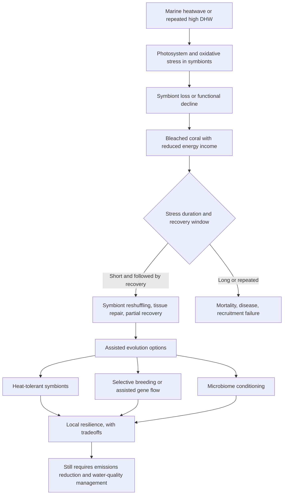
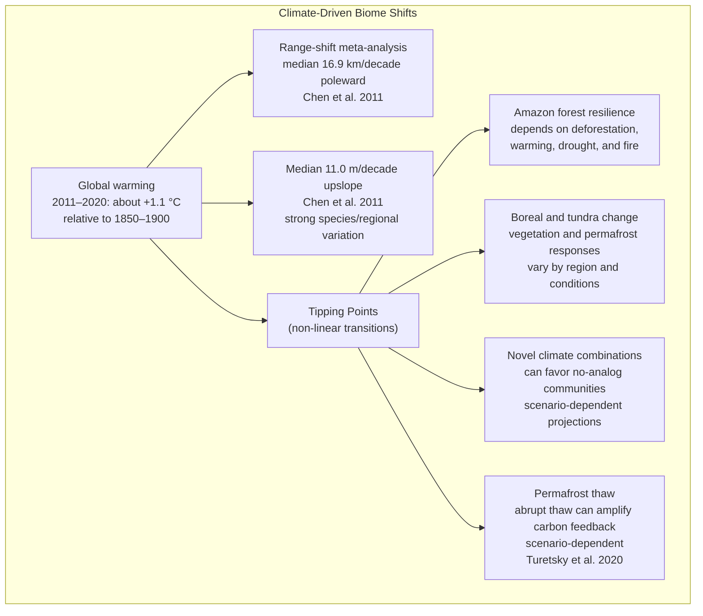
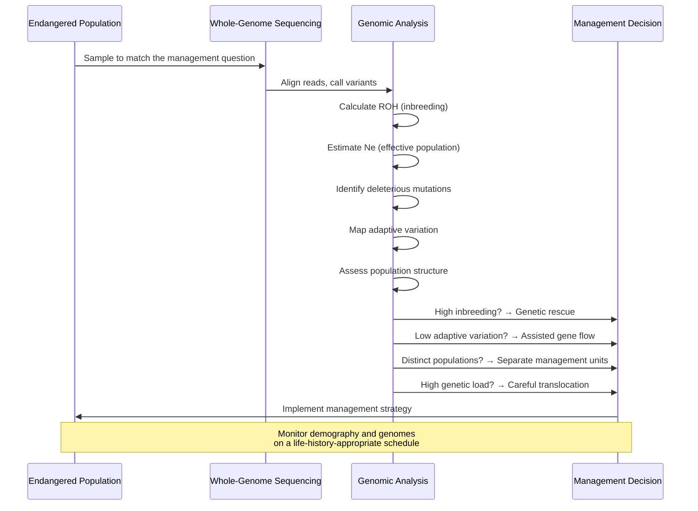
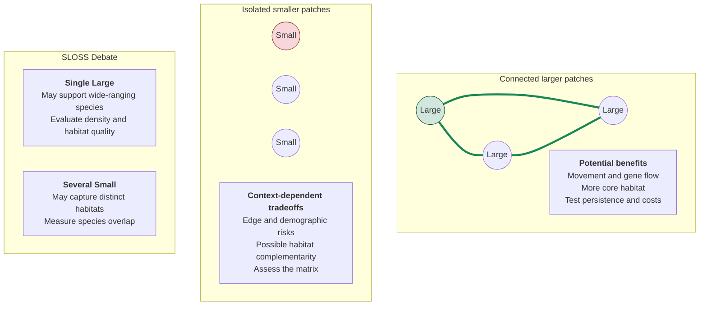
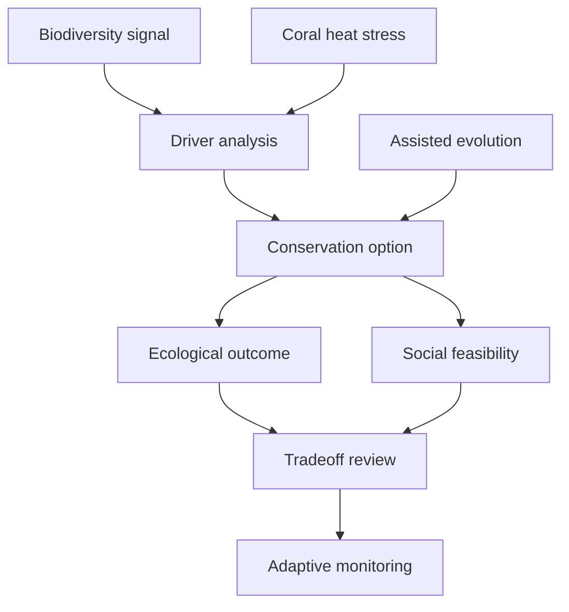

# Biomes and Conservation Biology

\label{sec:unit_X_biomes_and_conservation}


<!-- chapter-metadata-badge -->
> Level 2/3 · 70 min read · 75 min lecture · Prerequisites: \cref{sec:unit_X_ecosystem_ecology}

## Learning Objectives

1. Describe the 9 major terrestrial [**biome**](#gl:biome)s and 5 aquatic biome types with climate, NPP, and indicator species.
2. Explain climate-driven biome boundary shifts and tipping points from 2023-2025 scholarship.
3. Define the IUCN Red List categories, [**minimum viable population (MVP)**](#gl:minimum-viable-population), and the 50/500 rule.
4. Explain extinction debt and its implications for conservation timescales.
5. Design nature reserves using [**island biogeography**](#gl:island-biogeography) and SLOSS principles with quantitative examples.
6. Describe rewilding and climate-adaptive management as emerging conservation strategies.
7. Explain conservation genomics and assisted [**gene**](#gl:gene) flow as tools for managing threatened populations.
8. Evaluate the effectiveness of international conservation frameworks (CBD, 30x30, CITES).
9. Quantify IPBES findings (extinction rates, decline of vertebrate populations, drivers of biodiversity loss) and use them to evaluate conservation priorities.
10. Compute climate velocity for different landscape gradients and identify topographic, hydrological, microclimatic, and elevational refugia.
11. Compare ecosystem-based adaptation strategies (mangroves, urban greening, wetlands, coral reefs) with hard infrastructure on cost-benefit and co-benefit dimensions.

\begin{figure}[htbp]
\centering
\includegraphics[width=0.85\textwidth]{../figures/biome_distribution.png}
\caption{Illustrative climate coordinates for five terrestrial biome categories, not empirical site measurements or calibrated Whittaker boundaries. Equal-sized markers do not encode productivity or a universal biome ranking. Marine environments are excluded from this terrestrial climate comparison.}
\label{fig:unit_X_biome_distribution}
\end{figure}

<!-- alt: Five equally sized, directly labeled points locate terrestrial biome teaching categories by annual precipitation and mean annual temperature. Marker size does not represent net primary productivity; no marine rainfall coordinate is plotted. -->

<!-- curriculum-scaffold-start -->
### Study Blueprint

- **Big idea:** Biodiversity patterns and conservation decisions emerge from climate, history, disturbance, and human choice.
- **Core concepts:** biomes, biodiversity, extinction risk, conservation planning.
- **Framework alignment:** Vision & Change: Systems, Evolution, Pathways and transformations of energy and matter; AP Biology: Systems Interactions, Evolution, Energetics; NGSS-style topics: Interdependent Relationships in Ecosystems, Matter and Energy in Organisms and Ecosystems, Natural Selection and Evolution.
- **Model or quantitative lens:** Species-area, risk, and prioritization calculations.
- **Data skill:** Use maps, trend data, and threat categories to justify conservation priorities.
- **Practice cadence:** Representing and Describing Data, Statistical Tests and Data Analysis, Argumentation.
- **Common misconception to repair:** Conservation is decision-making under constraints and uncertainty, not only preserving untouched nature.
- **Primary lab:** \nameref{sec:lab_unit_X_biomes_and_conservation}.
- **Question bank:** \nameref{sec:q_unit_X_biomes_and_conservation}.
- **Transfer task:** Transfer conservation reasoning to land use, climate corridors, restoration, and environmental justice.
- **Bridge to computation:** `biology.ecology.ecology.species_area_relationship`.
<!-- curriculum-scaffold-end -->

---

> **Opening Vignette — Testing Island Recolonization**
> 
> Simberloff and Wilson's 1969 report followed terrestrial arthropod recolonization on six small Florida Bay mangrove islands for one year after methyl-bromide defaunation. By 250 days, all except the most distant island had regained species numbers and composition similar to untreated islands, while population densities remained abnormally low \citep{simberloff1969colonization}. Richness recovery therefore did not mean full demographic recovery. The experiment tested immigration–extinction equilibrium; a fitted species–area curve is a related descriptive model, not the entire theory or a complete foundation for demographic MVP, genetic management and modern reserve planning.

## Biomes as Climate-Filtered Ecological Regions

A **biome** is a large-scale ecological region characterized by climate and its vegetation and animal communities. Whittaker's climate–vegetation diagrams summarize broad associations, not fixed boundaries. Running et al. (2004, *BioScience*) describe MODIS monitoring of productivity; Beck et al. (2023, *Scientific Data*) provide 1-km Köppen–Geiger climate maps from observation-based climatologies and constrained CMIP6 projections. Climate classes are not measured biome boundaries \citep{running2004production,beck2023koppen}.

### Annual Climate Means and the Limits of Biome Classification

The distribution of biomes is determined primarily by two climate variables:

1. **Mean annual temperature (MAT)** — determines the length of the growing season and the type of vegetation (tropical vs. temperate vs. boreal)
2. **Mean annual precipitation (MAP)** — determines vegetation structure (forest vs. grassland vs. desert)

**Whittaker's biome diagram** relates temperature to precipitation. The companion figure (\cref{fig:unit_X_biome_distribution}) instead shows five illustrative coordinates, not calibrated Whittaker boundaries. Seasonality, soil, disturbance and evolutionary history also shape vegetation.

### The Nine Major Terrestrial Biomes

: Nine terrestrial biome categories and broad ecological associations. {#tbl:unit_X_biomes_and_conservation_the_nine_major_terrestrial_biomes}
| Biome | Climate association | Characteristic adaptations |
| ----- | ------------------- | -------------------------- |
| **Tropical rainforest** | Warm, wet throughout the year | Buttress roots, [**epiphyte**](#gl:epiphyte)s, drip tips, stratified canopy |
| **Tropical seasonal forest / savanna** | Warm, seasonally dry | Dry-season deciduousness; fire-adapted grasses; ungulate herding |
| **Desert** | Strong water limitation; hot or cold | CAM [**photosynthesis**](#gl:photosynthesis), nocturnal behavior, water storage |
| **Temperate grassland / prairie** | Seasonal temperatures and water limitation | Extensive roots; burrowing animals; fire-maintained grasses |
| **Temperate deciduous forest** | Seasonal temperatures with adequate growing-season water | Autumn leaf senescence; spring ephemerals; mycorrhizae |
| **Temperate rainforest** | Mild, wet maritime conditions | Tall conifers; heavy epiphytic moss cover |
| **Boreal forest (taiga)** | Long cold winters; short growing season | Conical crowns; cold tolerance; slow decomposition in cold soils |
| **Tundra (arctic)** | Cold, short growing season; permafrost in many areas | Cushion plants; cryoprotectants; shallow rooting; lichens |
| **Mediterranean shrubland (chaparral)** | Winter rain and summer drought | Sclerophyllous leaves; resprouting; fire-related adaptations |

These nine categories are a teaching classification, not a universal biome count. A matched primary dataset defining global temperature, precipitation and NPP bounds for these categories is not supplied. NPP comparisons require a named dataset, period, carbon units and consistent ecosystem boundaries; the categories alone establish no numerical global limits.

### Five Major Aquatic Biome Types

: Five aquatic teaching categories and ecological contrasts. {#tbl:unit_X_biomes_and_conservation_five_major_aquatic_biome_types}
| Biome | Key features | Indicator examples |
| ----- | ------------ | ------------------ |
| **Freshwater lakes & rivers** | Low salinity; standing versus flowing water; some lakes stratify | Trout, cattails, caddisfly larvae |
| **Wetlands** | Water table at or near surface; oxygen limitation in saturated sediments | Herons, *Sphagnum* moss, alligators |
| **Coastal/neritic marine** | Continental shelf; productivity affected by nutrients, light and mixing | Kelp, cod, sea otters, oysters |
| **Open ocean (pelagic)** | Strong regional variation; nutrient-poor subtropical gyres | [**Phytoplankton**](#gl:phytoplankton), bluefin tuna, sperm whale |
| **Coral reefs** | Reef-building coral–algal partnerships; light and temperature constraints | Brain coral, parrotfish, reef sharks |

No matched primary dataset defining category-wide aquatic NPP ranges is supplied. Productivity depends on depth, nutrient supply, season and measurement method; these categories do not provide numerical global bounds.

### Lake Stratification and Turnover

The following table describes summer stratification in a deep dimictic lake, not every temperate lake \citep{usgs2018lakes}:

: Lake Stratification and Turnover: Layer and Temperature. {#tbl:unit_X_biomes_and_conservation_lake_stratification_and_turnover}
| Layer | Temperature | Density | Characteristics |
| ----- | ----------- | ------- | --------------- |
| **Epilimnion** | Warmer surface water; varies by site and season | Lower than deeper water during summer stratification | Wind-mixed surface layer; oxygen and nutrients depend on production and mixing |
| **Thermocline** (metalimnion) | Rapid temperature change with depth | Transition | Density gradient limits vertical mixing |
| **Hypolimnion** | Colder deep water; not universally 4°C | Higher during summer stratification | May lose oxygen in nutrient-rich lakes; oligotrophic lakes can retain deep-water oxygen |

**Turnover** in dimictic lakes occurs in spring and autumn as density differences weaken and wind mixes the water column. Fresh water is densest near 4°C. Other lakes mix once annually, repeatedly, or incompletely; climate, depth, ice and wind determine the regime \citep{usgs2018lakes}.

### Coral Reef Bleaching

**Mechanism:** Heat stress can disrupt coral–Symbiodiniaceae partnerships, causing symbiont loss and reduced photosynthetic energy income. NOAA's degree heating weeks (DHW) accumulate qualifying bleaching heat stress over the most recent 12 weeks. Around 4°C-weeks indicates bleaching risk; at 8°C-weeks reef-wide bleaching with mortality of heat-sensitive corals is likely. These are cumulative heat doses, not four or eight elapsed weeks, and neither energy loss nor mortality follows a universal fixed percentage or clock \citep{noaa2025coralbleaching}.

**Global bleaching evidence:** NOAA and ICRI confirmed the fourth global bleaching event on 15 April 2024. NOAA's update of 2 June 2026 reports bleaching-level heat stress across about 84.4% of global coral reef area during 1 January 2023–30 September 2025; exposure is not a measurement of coral mortality \citep{noaa2025coralbleaching}. Separately, the IPCC 2018 assessment projected further coral-reef declines of 70–90% at 1.5°C warming above preindustrial levels (high confidence), with losses exceeding 99% at 2°C (very high confidence). That endpoint is projected reef decline, not annual severe-bleaching frequency \citep{ipcc2018sr15spm}.

**Assisted evolution caveat:** Conservation tools now include selective breeding, assisted gene flow, symbiont manipulation, and microbiome conditioning for heat tolerance. These interventions can protect specific reefs or buy time, but they do not remove the thermal driver; without emissions reduction and local water-quality management, heat-tolerant genotypes still face repeated bleaching, acidification, disease, and storm damage.


<!-- alt: Flowchart showing coral bleaching responses can test heat-tolerant hosts, symbionts, or microbiomes as local resilience tools, but those interventions remain complements to climate mitigation and reef-water-quality management. -->

*Coral bleaching responses can test heat-tolerant hosts, symbionts, or microbiomes as local resilience tools, but those interventions remain complements to climate mitigation and reef-water-quality management \citep{noaa2025coralbleaching,strader2022coralheat}.*

> **Clinical Connection — Reef-Derived Pharmaceuticals:** Reef organisms supply drug-development leads as well as approved medicines. Pseudopterosins from *Pseudopterogorgia elisabethae* showed anti-inflammatory and analgesic activity in experimental assays; this does not establish clinical wound-healing efficacy \citep{look1986pseudopterosins}. Ziconotide (Prialt) is an approved non-opioid N-type calcium-channel antagonist for intrathecal treatment of selected adults with severe chronic pain who are intolerant of or refractory to other treatments, as specified in its May 2025 label \citep{prialt2025label}. Experimental bioactivity must not be equated with approved use or treatment advice.

> **Concept Check:** What climatic variables determine whether a region supports tropical rainforest vs. tropical savanna? How does fire interact with precipitation to maintain the savanna biome?

---

## Climate Change and Biome Boundary Shifts


<!-- alt: Graph showing climate and range-shift evidence have explicit periods and scopes: assessed warming for 2011–2020, species range-shift medians from a 2011 meta-analysis, and scenario-dependent abrupt-thaw feedback, not a universal 2050 carbon flux. -->

*Climate and range-shift evidence have explicit periods and scopes: assessed warming for 2011–2020, species range-shift medians from a 2011 meta-analysis, and scenario-dependent abrupt-thaw feedback, not a universal 2050 carbon flux \citep{ipcc2021ar6wg1,chen2011ranges,turetsky2020thaw}.*

### Selected Climate-Response Evidence

: Selected climate-response evidence and its scope. {#tbl:unit_X_biomes_and_conservation_key_findings_2023_2025}
| Finding | Study | Key result |
| ------- | ----- | ---------- |
| Species range shifts in a meta-analysis | Chen et al. (2011, *Science*) \citep{chen2011ranges} | Median 16.9 km/decade poleward and 11.0 m/decade upslope; strong species/regional variation, not a universal biome-boundary rate |
| Assessed global warming | IPCC AR6 Working Group I \citep{ipcc2021ar6wg1} | About 1.1 °C in 2011–2020 relative to 1850–1900; not an undated present-day value |
| Abrupt permafrost thaw | Turetsky et al. (2020, *Nat. Geosci.*) \citep{turetsky2020thaw} | Abrupt thaw can amplify carbon feedback; magnitude depends on scenario, thaw extent, and vegetation response, not a universal 2050 flux |

### Biome Suitability Modeling

\begin{equation}
S = \sum_i w_i \cdot f_i(T, P)
\label{eq:biomes_and_conservation_1}
\end{equation}

where $w_i$ = variable weights (temperature, precipitation, seasonality index), $f_i$ = Gaussian response function centered on optimal conditions.

**Species distribution models (SDMs)** project future range shifts by correlating current distributions with climate variables and projecting onto future climate scenarios:

: Biome Suitability Modeling: Model type and Approach. {#tbl:unit_X_biomes_and_conservation_biome_suitability_modelling}
| Model type | Approach | Strengths | Limitations |
| ---------- | -------- | --------- | ----------- |
| **Bioclimatic envelope** | Correlative (climate → presence) | Simple; good for many species | Ignores dispersal, biotic interactions |
| **MaxEnt** | Machine learning; maximum entropy | High predictive power; handles sparse data | Overfitting risk; correlative primarily |
| **Process-based (e.g., LPJ-GUESS)** | Mechanistic plant physiology | Captures mechanisms; projects novel climates | Data-intensive; computationally expensive |

### Climate Velocity and Dispersal Limits

**Climate velocity** = the speed at which climate conditions shift geographically:

\begin{equation}
v_{climate} = \frac{\text{rate of temperature change (°C/yr)}}{\text{spatial temperature gradient (°C/km)}}
\label{eq:biomes_and_conservation_2}
\end{equation}

For a fixed warming rate, shallower **horizontal** temperature gradients imply faster local isotherm displacement. Actual velocities require a location, climate variable, period and scenario. Loarie et al. (2009) estimated a global mean surface velocity of 0.42 km/yr under the A1B scenario, with substantial spatial variation \citep{loarie2009velocity}.

**Migration lag:** Seed movement, successful establishment and population range expansion are different endpoints. Comparing climate velocity with dispersal requires matched geography, direction, time scale and habitat accessibility; no universal tree-dispersal rate or mismatch factor is established here.

> **Concept Check:** Lovejoy and Nobre (2018) hypothesized that interacting deforestation, warming and fire could trigger non-forest transitions in eastern, southern and central Amazonia at 20–25% deforestation \citep{lovejoy2018amazon}. Why is this a regional tipping hypothesis rather than a precisely established basin-wide threshold? Explain the feedback involving [**transpiration**](#gl:transpiration) recycling. A dated, region-defined original-forest measurement is needed before comparing any present deforestation percentage with this hypothesis.

---

## Conservation Biology Fundamentals

### IPBES Global Assessment: The Quantified Crisis

The **Intergovernmental Science-Policy Platform on Biodiversity and Ecosystem Services (IPBES)** — analogous to the IPCC for climate — released its first Global Assessment in 2019 and its Transformative Change Assessment in 2024 \citep{ipbes2019global,ipbes2024transformative}. Its findings frame contemporary conservation:

: IPBES Global Assessment: The Quantified Crisis: IPBES finding and Quantitative result. {#tbl:unit_X_biomes_and_conservation_ipbes_global_assessment_the_quantified_crisis}
| IPBES finding | Quantitative result |
| ------------- | ------------------- |
| Species threatened with extinction | ~1,000,000 in the IPBES synthesis \citep{ipbes2019global}; the IUCN Red List provides the tracked assessed-species subset \citep{iucn2025redlist} |
| Average abundance of native species in major terrestrial biomes | Declined ≥ 20% (mostly since 1900) |
| Monitored vertebrate populations | 73% decline in the Living Planet Index over 1970–2020; a weighted trend of monitored populations, not a count of individual animals \citep{wwf2024livingplanet} |
| Wetlands | IPBES 2019 synthesized over 85% historical area loss; its background specifies since 1700, with incomplete historical coverage, not a present global census \citep{ipbes2019global} |
| Forest cover | 32% below the historical baseline in the IPBES 2019 synthesis \citep{ipbes2019naturechapter} |
| Live coral cover on reefs | Approximately half lost since the 1870s in the IPBES 2019 synthesis; not half of reef geographic area \citep{ipbes2019global} |
| Insect pollinator threat | Available national Red Lists often found more than 40% of bee species may be threatened; no global insect-pollinator percentage was established \citep{ipbes2016pollinators} |
| Domesticated mammal breeds used for food and agriculture | By 2016, 559 of 6,190 breeds (over 9%) extinct and at least 1,000 more threatened \citep{ipbes2019global} |

### Quantified Drivers (IPBES 2019)

IPBES 2019 synthesized the relative importance of drivers of change in the **global state of nature**, drawing on indicators of ecosystem structure/function, community composition, species populations and traits. The analysis screened nearly 4,000 studies/databases and retained 163 priority non-redundant sources. It combined qualitative rankings and quantitative evidence, including an approximation between threat prevalence and effect-based attribution \citep{ipbes2019naturechapter}.

: Estimated relative importance in the IPBES 2019 global synthesis of nature indicators. {#tbl:unit_X_biomes_and_conservation_quantified_drivers_ipbes_2019}
| Driver | Approximate relative importance |
| ------ | ------------------------------- |
| Land/sea-use change | 30% |
| Direct exploitation | 23% |
| Climate change | 14% |
| Pollution | 14% |
| Invasive alien species | 11% |
| Other threats not clearly assigned above | 9% |

The published rounded values sum to 101%; they are not an exact partition of biodiversity loss, percentages of threatened species, or absolute impact magnitudes. They synthesize recent historical trends (the assessment emphasizes change since 1970), not a common experimental denominator or a forecast. Realm-specific results differ: land-use change led terrestrial and freshwater estimates (30.5% each), followed by exploitation (21% and 20%); marine exploitation led (29%), followed by land/sea-use change. Climate change was not among the top two overall drivers in any realm in that synthesis. Climate impacts are projected to increase, but their future relative importance varies by scenario and region; the assessment does not establish a universal reversal by 2050 \citep{ipbes2019naturechapter,ipbes2019global}.

The Transformative Change Assessment (IPBES 2024) emphasizes fundamental shifts in views, structures and practices to address underlying causes of biodiversity loss. Reform of harmful subsidies, incentives and governance can reinforce place-based conservation and restoration; systemic change is not a reason to dismiss useful incremental actions, nor a forecast that every individual area target must fail \citep{ipbes2024transformative}.

Pollinator decline requires careful interpretation. Managed honey bee colonies can increase in some agricultural regions while wild bees, butterflies, moths, flies, beetles, birds, or bats decline locally; those are different indicators, not contradictory facts. IPBES links pollinator risk to land-use change, pesticide exposure, pathogens, invasive species, climate change, and reduced floral/nesting resources \citep{ipbes2016pollinators}. Crop studies also show that wild pollinator visitation can improve fruit set even when honey bees are present, so conservation targets should include habitat heterogeneity, floral continuity, nesting substrate, pesticide timing, and disease spillover rather than hive counts alone \citep{garibaldi2013wild}.

Food systems are a useful place to make "transformative change" concrete. FAO, IFAD, UNICEF, WFP, and WHO report that high food-price inflation continues to undermine access to healthy diets, especially for low-income populations \citep{fao2025sofi}. Conservation biology therefore cannot treat agricultural landscapes as outside nature: agroecology, diversified crop rotations, soil-carbon restoration, pollinator habitat, reduced food waste, sustainable fisheries, and equitable market access are biodiversity strategies and food-security strategies at the same time. The claim is not that agroecology alone solves hunger; it is that biodiversity, nutrition, farm livelihoods, and climate resilience are coupled enough that single-objective policies often fail.

### The Sixth Mass Extinction

Earth currently experiences the **Sixth Mass Extinction** — driven primarily by human activities:

: The Sixth Mass Extinction: Driver and Mechanism. {#tbl:unit_X_biomes_and_conservation_the_sixth_mass_extinction}
| Driver | Mechanism |
| ------ | --------- |
| **Habitat destruction** | Land-use change, deforestation, urbanization |
| **Overexploitation** | Hunting, fishing, wildlife trade |
| **Invasive species** | Competition, predation, disease introduction |
| **Pollution** | Pesticides, plastics, nutrient loading |
| **Climate change** | Range shifts, phenological mismatch, extreme events |
| **Disease** | Chytrid fungus, white-nose syndrome |

Species can face several concurrent threats. No identified primary dataset supports numerical threatened-species shares for this table; reporting threat frequencies would require a named assessed population, taxonomic coverage, time window and coding method. The IPBES relative-importance estimates above cannot substitute for those missing denominators.

**Key statistics:**
- IPBES 2019 assessed the global species-extinction rate as at least tens to hundreds of times its average over the previous 10 million years \citep{ipbes2019global}.
- IPBES 2019 Global Assessment: ~1 million species threatened with extinction
- **Living Planet Index** (WWF 2024): 73% decline over 1970–2020 in the index of monitored vertebrate populations; not 73% of individuals lost or 73% of species declining \citep{wwf2024livingplanet}
- 75% of the land surface was significantly altered in the IPBES 2019 assessment, not 75% of a count of terrestrial ecosystems \citep{ipbes2019global}.
- Historical wetland loss is the separately scoped synthesis above, not an unsupported universal 50% loss since 1900.
- 37.7% of assessed marine fish stocks were biologically unsustainable in 2021 in FAO’s 2024 report; 62.3% were sustainable, while 76.9% of landings came from sustainable stocks (a different denominator) \citep{fao2024sofia}

### IUCN Red List Categories (2025 Update)

: IUCN Red List Categories (2025 Update): Category and Code. {#tbl:unit_X_biomes_and_conservation_iucn_red_list_categories_2025_update}
| Category | Code | Quantitative threshold |
| -------- | ---- | ---------------------- |
| **Extinct** | EX | No reasonable doubt that last individual has died |
| **Extinct in the Wild** | EW | Survives only in cultivation, captivity, or naturalized populations well outside its past range |
| **Critically Endangered** | CR | Criterion A2–A4 reduction ≥80%; A1 ≥90%; other criteria can also qualify |
| **Endangered** | EN | Criterion A2–A4 reduction ≥50%; A1 ≥70%; other criteria can also qualify |
| **Vulnerable** | VU | Criterion A2–A4 reduction ≥30%; A1 ≥50%; other criteria can also qualify |
| **Near Threatened** | NT | Close to qualifying for VU; being monitored |
| **Least Concern** | LC | Evaluated and does not qualify for CR, EN, VU or NT; not necessarily widespread or abundant |
| **Data Deficient** | DD | Insufficient data to assess |

The IUCN Red List is a tracked subset of assessed species, not a census of global biodiversity. Version 2026-1 listed 175,909 assessed species, with 49,505 classified as threatened (Vulnerable, Endangered, or Critically Endangered), about 28% of assessed species \citep{iucn2025redlist}. Counts change with new assessments and reassessments, so the category logic is more durable than any single annual total.

**Criteria for listing:** Evaluate all five IUCN criteria and choose the highest category supported, not the first branch that matches \citep{iucn2012categories}. Population counts mean mature individuals. For example, 900 mature individuals plus a continuing 90% reduction within an A2 window supports CR(A2), despite also meeting the less severe VU(D1) small-population threshold. Criterion C additionally requires specified decline and population-structure conditions; VU D2 addresses very restricted populations susceptible to rapid threat-driven collapse.
- **A:** Population reduction over the longer of 10 years or three generations. A1 requires reversible, understood, ceased causes; A2–A4 cover other past/future/combined windows and use different thresholds. Future projection windows have a 100-year cap; use the full criterion-specific definitions.
- **B:** EOO below 100/5,000/20,000 km² or AOO below 10/500/2,000 km² (CR/EN/VU), plus at least two of: severe fragmentation/few threat-defined locations (≤1/5/10 respectively); continuing decline; extreme fluctuations. Range alone is insufficient.
- **C:** Small population size ($N < 10,000$ for VU; $N < 2,500$ for EN; $N < 250$ for CR) with decline
- **D:** Very small population ($N < 1,000$ for VU; $N < 250$ for EN; $N < 50$ for CR)
- **E:** Quantitative analysis showing extinction probability ≥10% within 100 years (VU), ≥20% within 20 years or five generations, whichever is longer (EN), or ≥50% within 10 years or three generations, whichever is longer (CR); CR/EN windows are capped at 100 years.

> **Concept Check:** A bird species has a global population of 8,000 mature individuals with a documented 35% decline over the past 15 years (approximately 3 generations). Under which IUCN criteria and category would this species be listed?


<!-- alt: Flowchart showing IUCN Red List assessment is a criteria-based risk workflow: the category follows the strongest supported evidence, then conservation triage weighs urgency, feasibility, and monitoring needs. -->

*IUCN Red List assessment is a criteria-based risk workflow: the category follows the strongest supported evidence, then conservation triage weighs urgency, feasibility, and monitoring needs.*

---

## Demographic Viability Versus Genetic Population-Size Guidance

### Minimum Viable Population (MVP)

The **minimum viable population** is the smallest population estimated to meet a specified persistence probability over a specified horizon under explicit PVA assumptions. Neither 95% nor 100 generations is a universal definition \citep{frankham2014revised}. Relevant uncertainty includes:

: Minimum Viable Population (MVP): Stochasticity type and Mechanism. {#tbl:unit_X_biomes_and_conservation_minimum_viable_population_mvp}
| Stochasticity type | Mechanism | Effect on small populations |
| ------------------ | --------- | -------------------------- |
| **Demographic** | Random variation in births/deaths | Even when $r > 0$, small $N$ → high extinction probability |
| **Environmental** | Weather, food fluctuations | Entire population experiences same bad conditions |
| **Genetic** | Inbreeding depression, drift | Idealized normalized inbreeding rate $\Delta F = 1/(2N_e)$; accumulated $F$ depends on previous inbreeding and elapsed generations |
| **Catastrophes** | Fire, disease epidemic, storm | Sudden >50% mortality events; frequency matters |

### Franklin's 50/500 Rule

**Franklin (1980) and \citet{franklinsoule1980}:**

- **$N_e \geq 50$:** Short-term genetic guideline — limits expected inbreeding accumulation, not guaranteed demographic viability
  - Inbreeding rate: $\Delta F = \frac{1}{2N_e} \leq 1\%$ per generation
  - This does not imply a safe accumulated-$F$ threshold: in naturally outbreeding populations, adverse fitness effects can occur for $F>0$ \citep{frankham2014revised}.

- **$N_e \geq 500$:** Long-term genetic guideline — aims to retain adaptive variation under model assumptions
  - Genetic variance lost per generation: $\frac{1}{2N_e} = 0.1\%$
  - Mutation, selection and drift jointly determine variation; $N_e=500$ is not an exact mutation-balance cutoff \citep{frankham1995,frankham2014revised}.

**Revised 100/1000 recommendation:** Frankham, Bradshaw and Brook (2014) revisited the genetic guidelines \citep{frankham2014revised}. These are $N_e$ guidelines, not census thresholds or species-independent MVP estimates. A PVA must state its extinction endpoint, horizon, and demographic/environmental assumptions.

**$N_e$ vs. census $N$:** Effective population size is typically much smaller than census size:

\begin{equation}
N_e = \frac{4N_m N_f}{N_m + N_f}
\label{eq:biomes_and_conservation_3}
\end{equation}

For a worked conversion only, **assume** $N_e/N=0.10$–$0.25$: achieving a genetic target $N_e=500$ then requires $N=2,000$–$5,000$. This is not a universal vertebrate ratio or an MVP. Actual ratios depend on life history, demography, estimator and whether $N$ counts adults, breeders or all individuals \citep{frankham1995,frankham2014revised}.

### Population Viability Analysis (PVA)

**PVA** uses species-specific demographic data and stochastic simulation models (VORTEX, RAMAS) to project extinction probability:

**Inputs:** age/sex-specific survival, fecundity, variance in vital rates, carrying capacity, catastrophe frequency, inbreeding coefficients, habitat area.

**Outputs:** extinction probability over specified time horizon, mean time to extinction, quasi-extinction threshold probability.

**Case study — Florida panther** (*Puma concolor coryi*):
- In 1995, models estimating a 95% likelihood of extinction within two decades helped motivate introduction of eight female Texas pumas; this was a risk projection, not a prediction of certain extinction.
- Johnson et al. (2010) analyzed 591 individuals sampled over 1978–2009 and reported population growth, improved survival and reduced inbreeding correlates \citep{johnson2010panther}.
- Estimated $N_e$ rose from 16.4 in 1995 to 32.1 by 2007; mean individual STR heterozygosity rose from 18.4% in 1993 to about 25%. These dated study endpoints do not establish a 2023 census or present ancestry fraction.
- Habitat loss, infection and persistent inbreeding remained concerns; genetic rescue did not establish long-term demographic safety.

> **Clinical Connection — Founder Effects and Human Genetics:** A founder *EVC* variant occurs in the Amish population of Lancaster County, Pennsylvania; GeneReviews notes that the exact prevalence of Ellis–van Creveld syndrome is unknown \citep{dasilva2023evc}. A population-specific carrier study would be needed to quantify carrier frequency; syndrome prevalence is not carrier probability. The [**founder effect**](#gl:founder-effect) illustrates sampling of genetic variation, but wildlife-management goals must not be transferred to human reproduction. Human genetic services center voluntary counseling, privacy and informed individual decisions, not management of a community's allele frequencies.

---

## Extinction Debt and Its Conservation Implications

**Extinction debt** is delayed species loss following past environmental change if the altered conditions persist. Slow population turnover, recruitment failure, reduced connectivity and demographic processes can produce lags; there is no universal 50–500-year clock. Restoration can change the eventual outcome \citep{vellend2006debt,ipbes2019naturechapter}.

### Mathematical Framework for Extinction Debt

\begin{equation}
\text{Conditional equilibrium richness loss} = S_{\text{pre-fragmentation}} - c \cdot A_{\text{remaining}}^z
\label{eq:biomes_and_conservation_4}
\end{equation}

Here $A_{\text{remaining}}$ is total remaining habitat area **only if an aggregate-area equilibrium SAR is explicitly assumed**, with unchanged quality and applicable $c,z$. The difference is a model-conditional richness loss, not a measured extinction count or automatically the outstanding debt. Outstanding debt compares currently surviving species with the supported future equilibrium; patch unions additionally require species-overlap and connectivity information (\cref{fig:unit_X_species_area}).

\begin{figure}[htbp]
\centering
\includegraphics[width=0.85\textwidth]{../figures/species_area_relationship.png}
\caption{Illustrative species--area curves $S=cA^z$ on log--log axes. Mainland-fragment and oceanic-island scenarios both use $c=7$, with $z=0.15$ and $0.35$ respectively; a dotted reference uses $c=2.5$ and $z=0.25$. These are prescribed model curves, not fits to observed sites.}
\label{fig:unit_X_species_area}
\end{figure}

<!-- alt: Three straight lines show modeled species richness versus habitat area on logarithmic axes. The island scenario is steeper than the mainland scenario. The dotted reference has an intermediate slope but a lower intercept and lies below both scenario curves over the plotted area range. -->

### Relaxation Time After Habitat Loss

**Relaxation** describes the approach toward a post-change community state, not a predetermined date of the last extinction. Its pace depends on:
- Longevity and recruitment of the focal organisms
- Generation time and population turnover
- Habitat quality of remaining fragments
- Connectivity between patches (rescue effect)

### Case Studies of Delayed Extinction

: Study-specific evidence for delayed responses to fragmentation. {#tbl:unit_X_biomes_and_conservation_case_studies_of_delayed_extinction}
| System | Actual study scope and endpoint | Reference |
| ------ | ------------------------------- | --------- |
| Grassland plants | Historical landscape connectivity is the subject of the study; the full primary text needed to establish a numerical debt fraction and horizon was not accessible here | Lindborg & Eriksson 2004 \citep{lindborg2004} |
| Central Amazonian forest fragments | Review of 32 years in 1–100-ha fragments; edge effects, matrix change and disturbance alter persistence; not a measured 30–50% canopy-tree debt over 100–500 years | \citep{laurance2011fragments} |
| Kakamega forest birds, Kenya | Five fragments; modeled relaxation with about a 50-year half-life for roughly 1,000-ha fragments, not a percentage of all African endemics | \citep{brooks1999relaxation} |
| Forest plants in UK/Belgian landscapes | Occupancy analysis supports debt persisting more than a century in slow-turnover species; not a universal percentage in fragments below 1 ha | \citep{vellend2006debt} |

**Conservation implication:** A snapshot of current presence can overstate long-term persistence under continued degradation. Longitudinal data, landscape history and an explicit counterfactual are needed to estimate outstanding debt; timely restoration and reconnection can prevent some delayed losses.

> **Concept Check:** A 10,000-ha forest loses area, leaving ten 100-ha patches. With the stipulated $S=20A^{0.25}$, calculate intact richness and per-patch richness (200 and about 63.25). Why can neither unique landscape richness nor extinction debt be calculated from these alone? If an aggregate remaining-area SAR is additionally stipulated, use 1,000 ha to obtain about 112.47 species and 87.53 conditional losses; explain why this is a separate assumption, not the sum or union of patch lists. What connectivity evidence would change the prediction?

---

## Reserve Design for Area, Connectivity, and Edge Effects

### Island Biogeography Applied to Conservation

MacArthur-Wilson island biogeography theory provides the theoretical foundation for reserve design:

**[Species-area relationship](#gl:species-area-relationship):** $S = cA^z$ (see Community Ecology chapter for derivation)

```python
from biology.ecology import species_area_relationship

# Compare large vs. small reserves
S_large = species_area_relationship(A=10_000, c=7, z=0.26)
S_small = species_area_relationship(A=100, c=7, z=0.26)
print(f"Large reserve (10,000 ha): {S_large:.0f} species")
print(f"Small reserve (100 ha):    {S_small:.0f} species")
print(f"Per-patch richness reduction at constant c,z (not total landscape loss): {((S_large-S_small)/S_large)*100:.0f}%")
```

### SLOSS Debate Resolution

: SLOSS Debate Resolution: Design principle and When it applies. {#tbl:unit_X_biomes_and_conservation_sloss_debate_resolution}
| Design principle | When it applies | Example |
| --------------- | -------------- | ------- |
| **Single large** preferred | Area-demanding species; interior habitat specialists; low landscape connectivity | Amazon: large reserves protect jaguar, harpy eagle |
| **Several small** preferred | Different habitat types in different patches; high beta diversity; patches protect local endemics | Caribbean islands: each island has unique endemic reptiles |
| **Core-corridor-matrix** | Useful when focal-species movement, habitat quality and matrix management can be integrated | Yellowstone-to-Yukon landscape planning |

### Diamond's Design Principles (1975, updated)

: Diamond's Design Principles (1975, updated): Principle and Reasoning. {#tbl:unit_X_biomes_and_conservation_diamond_s_design_principles_1975_updated}
| Principle | Reasoning | Modern status |
| --------- | --------- | ------------- |
| Larger reserves | Can support more habitat and larger populations | Compare quality, cost and representation at the same objective |
| One large versus several small of equal total area | Core area versus habitat complementarity | Species overlap and area sensitivity determine the tradeoff |
| Close spacing | May increase colonization | Depends on dispersal and matrix permeability |
| Clustered versus linear arrangement | Changes routes and distances | Depends on landscape geometry and future climate paths |
| Circular versus elongated shape | A circle minimizes perimeter at fixed area | Not necessarily best for rivers, gradients or migration routes |
| Corridors versus isolation | Can facilitate movement, rescue and gene flow | Compare target-species benefits with disease, invasion and cost risks |

### Edge Effects and Fragment Microclimates

Edge responses depend on the response measured, site, matrix, edge age and disturbance. The central Amazonian fragment review reports many edge effects over roughly 10–300 m at its study sites, and some fire-related effects much farther; it does not supply universal depths for each response below \citep{laurance2011fragments}:

: Edge responses requiring site- and taxon-specific measurement. {#tbl:unit_X_biomes_and_conservation_edge_effects_and_fragment_microclimates}
| Edge effect | Potential response | Necessary boundary |
| ----------- | ------------------ | ------------------ |
| Increased light | Pioneer recruitment and altered drying | Canopy structure, orientation and season |
| Wind exposure | Tree damage and mortality | Storm regime and edge permeability |
| Temperature change | Altered understory microclimate | Temperature metric, time and canopy comparison |
| Nest predation/parasitism | Changed reproductive outcomes | Focal bird and predator community |
| Invasion | Establishment from the matrix | Propagule supply and disturbance |

For a circular reserve:

\begin{equation}
\text{Interior area} = \pi\max(r-d,0)^2
\label{eq:biomes_and_conservation_5}
\end{equation}

For the **stipulated** 200-m edge depth, a 10-ha circle ($r\approx178$ m) has zero core habitat by this geometry. It may be unsuitable for core-dependent species. An **ecological trap** additionally requires evidence that organisms preferentially settle in habitat with lower fitness; zero modeled core area alone does not establish a trap.

### Habitat Corridors and Connectivity Trade-Offs

**Evidence for corridor effectiveness:**
- Tewksbury et al. (2002) studied eight experimental South Carolina landscapes with area/shape controls: two butterfly species moved more often between connected patches; holly fruit set averaged 69% higher in connected patches. Fruit set is not a universal pollinator-movement percentage \citep{tewksbury2002corridors}.
- Movement benefits do not by themselves establish population persistence; focal-species demography and adverse connectivity effects must also be evaluated.
- Florida's 2021 Wildlife Corridor Act supports a network of conserved lands and opportunity areas, not a wholly protected strip. DEP's June 2025 overview reports over 18 million acres total, including 10 million protected conservation acres \citep{floridadep2025corridor}.

**Stepping stones:** For species that can cross moderate distances (birds, bats, strong-flying insects), stepping stone patches may be as effective as continuous corridors at lower cost.

> **Clinical Connection — Urban Green Space and Stress:** Roe et al. (2013) studied 106 adults aged 35–55 who were not in work and lived in deprived Scottish urban neighborhoods. Neighborhood green space was associated with perceived stress and diurnal salivary [**cortisol**](#gl:cortisol) patterns, with sex-specific results \citep{roe2013greenspace}. Cortisol was sampled at 3, 6 and 9 hours after waking on two weekdays. This observational design does not establish a 20% fall after a 30-minute walk, or generic greenway effects on heat, particulate matter or physical activity in other cities.

> **Concept Check:** A conservation planner has a budget to protect 1,000 ha of tropical forest. Option A: one 1,000-ha reserve. Option B: ten 100-ha reserves spread across different habitat types. Option C: five 100-ha reserves connected by 100-m-wide corridors (total 500 ha reserves + 500 ha corridors). Which design best protects: (a) a large-bodied apex predator? (b) maximum regional species richness? (c) genetic connectivity? Justify each answer using island biogeography theory.

---

## Emerging Conservation Strategies

### Rewilding and Trophic Restoration

**Rewilding** (Soule & Noss 1998; updated Jorgensen 2024, *Nat. Ecol. Evol.*): Restore ecological processes — especially trophic interactions — by reintroducing lost species, particularly apex predators and megaherbivores.

**Three types of rewilding:**

: Rewilding and Trophic Restoration: Type and Approach. {#tbl:unit_X_biomes_and_conservation_rewilding_and_trophic_restoration}
| Type | Approach | Example |
| ---- | -------- | ------- |
| **Trophic rewilding** | Reintroduce apex predators/herbivores to restore cascades | Wolves in Yellowstone (1995); lynx in UK (proposed) |
| **Pleistocene rewilding** | Use ecological proxies for extinct megafauna | Pleistocene Park, Siberia (bison, horses to create mammoth steppe) |
| **Passive rewilding** | Remove human disturbance; allow natural regeneration | European farmland abandonment → forest recovery |

**Yellowstone evidence and causal attribution:** NPS reports park-wide aerial counts of 49 beaver colonies in 1996 and 127 in 2007, not absence of beavers when wolves returned. Observer detection improved, and dispersal from neighboring reintroduction areas also matters. Willow and beaver changes involve browsing, hydrology, climate, carnivore recovery and beaver engineering; the relative roles remain debated \citep{nps2025yellowstonebeaver}. An elk count, willow-height ratio or berry trend needs its own sampling area, dates and measured endpoint before being attributed to wolves alone.

**Herbivore–permafrost hypothesis:** Beer et al. (2020) combined field observations of snow/soil temperatures with JSBACH modeling. Under sustained high herbivore-density assumptions extrapolated across the Arctic, the model retained about 80% of contemporary permafrost-affected soils (less than 10 m depth) through 2100 under RCP8.5. This is a modeled retention endpoint, not 80% less measured thaw in treatment versus control plots and not evidence of benefits from an engineered mammoth proxy. Feasible stocking densities and ecosystem side effects remain limitations \citep{beer2020herbivores}.

### Conservation Genomics for Diversity and Management

**Whole-[**genome**](#gl:genome) sequencing** of threatened populations enables:

Conservation genomics is strongest when sequencing is tied to a management decision rather than treated as an expensive description. Runs of homozygosity estimate recent inbreeding, allele-frequency outliers can nominate local adaptation, pangenome or long-read approaches can reveal structural variation, and pedigree-aware sampling can separate ancestry from recent bottlenecks. The ethical layer is inseparable: sampling permits, Indigenous data sovereignty, benefit-sharing, and the risk of over-prioritizing "genetically interesting" populations most affect whether the genomic evidence should guide action.

: Conservation Genomics for Diversity and Management: Application and Method. {#tbl:unit_X_biomes_and_conservation_conservation_genomics_for_diversity_and_management}
| Application | Method | Example |
| ----------- | ------ | ------- |
| **Inbreeding assessment** | Runs of homozygosity (ROH) analysis | Seven sampled African cheetah genomes had homozygous stretches averaging 10–15 times longer than the study's feral domestic-cat comparison; not an established 10-Mb mean \citep{dobrynin2015cheetah} |
| **Adaptive variation** | Genome-wide association (GWAS) for climate-relevant loci | Coral heat tolerance alleles in *Acropora* |
| **Management units** | Population structure (FST, admixture analysis) | Liu et al. (2018) resolved six robust clades in 32 tiger voucher specimens; genetic evidence informs management, not settled universal subspecies taxonomy \citep{liu2018tigers} |
| **Genetic rescue planning** | Identify source populations maximizing heterozygosity | Florida panther × Texas cougar |
| **Ancient DNA** | Reconstruct historical diversity; identify lost alleles | Woolly mammoth → mammoth de-extinction project |


<!-- alt: Sequence diagram showing conservation-genomics workflows connect sequencing with management choices. Sample size and monitoring duration require an objective, power analysis, life-history context and feasible repeated sampling; 30–50 individuals or 5–10 generations are not universal protocols. -->

*Conservation-genomics workflows connect sequencing with management choices. Sample size and monitoring duration require an objective, power analysis, life-history context and feasible repeated sampling; 30–50 individuals or 5–10 generations are not universal protocols.*

### Assisted Gene Flow and Assisted Migration

**Assisted gene flow:** Intentionally moving alleles from adapted to non-adapted populations of the same species:
- Coral: Palumbi et al. (2014) reciprocally transplanted corals between distinct thermal environments to distinguish acclimatization and fixed differences in heat tolerance. This experiment is evidence about mechanisms, not a demonstrated reef-scale assisted-gene-flow deployment \citep{palumbi2014resistance}.
- Trees: moving southern seed sources to northern planting sites to pre-adapt to warming (assisted migration of *Pinus contorta* in British Columbia)

**Assisted migration (managed relocation):** Moving entire species to new locations outside their historical range where future climate is suitable. Controversial due to invasion risk.

**De-extinction:** Using genomic engineering to resurrect functional analogs of extinct species:
- **Woolly mammoth project** (Colossal Biosciences): Editing Asian elephant genome with mammoth cold-adaptation genes (TRPV3, hemoglobin variants, fat deposition); goal: produce cold-adapted elephants for Arctic rewilding
- **Thylacine project** (Colossal): Reconstructing thylacine genome from museum specimens
- **Ethical debates:** Should resources be spent on de-extinction rather than preventing current extinctions?

### Climate-Adaptive Management

Traditional conservation aims to preserve historical baselines. **Climate-adaptive management** accepts that ecosystems are changing and manages for future conditions:

The hard part is deciding when to resist change, when to help a system transition, and when to redirect effort toward ecosystem function rather than historical composition. Coral reefs illustrate the tradeoff: assisted gene flow, symbiont management, shading, and local water-quality improvement can raise local resilience, but they do not remove the external heat and acidification drivers. Climate-adaptive management is therefore a portfolio problem, pairing local stress reduction with monitoring, emissions context, social feasibility, and explicit thresholds for changing strategy \citep{noaa2025coralbleaching,ipbes2024transformative}.

: Climate-Adaptive Management: Approach and Strategy. {#tbl:unit_X_biomes_and_conservation_climate_adaptive_management}
| Approach | Strategy | Example |
| -------- | -------- | ------- |
| **Protect climate refugia** | Identify and protect areas where climate change impacts are minimized | Deep canyons, north-facing slopes, groundwater-fed wetlands |
| **Increase connectivity** | Corridors for range shifts | Continental-scale corridors (Y2Y, Florida Wildlife Corridor) |
| **Managed retreat** | Accept loss of some habitats; invest in new ones | Managed realignment of coastal defenses; creating new marshland |
| **Reduce non-climate stressors** | Remove pollution, invasive species to increase resilience | Reducing sediment runoff on coral reefs |

---

### Visualizing Reserve Design Principles


<!-- alt: Graph showing reserve design compares connectivity, area, edge effects, and habitat uniqueness; large connected reserves and several smaller reserves solve different conservation problems. -->

*Reserve design compares connectivity, area, edge effects, and habitat uniqueness; large connected reserves and several smaller reserves solve different conservation problems.*

---

## Climate Velocity, Refugia, and Species Range Shifts

Loarie et al. (2009) defined a local **surface climate velocity** from temporal warming divided by a horizontal temperature gradient \citep{loarie2009velocity}. It describes displacement needed to retain a temperature, not actual movement, complete climatic-niche tracking, or extinction probability.

\begin{equation}
v_{\text{climate}} = \frac{\partial T/\partial t}{|\nabla T|}
\label{eq:unit_X_climate_velocity}
\end{equation}

The numerator is the rate of climate change at a point (°C/yr); the denominator is the local spatial temperature gradient (°C/km). Rearranging gives velocity in km/yr.

: Stipulated temperature-displacement calculations, not measured biome velocities. {#tbl:unit_X_biomes_and_conservation_visualizing_reserve_design_principles}
| Coordinate used | Assumed gradient | Displacement at +0.03°C/yr |
| --------------- | ---------------- | ------------------------- |
| Elevation | 5°C/km vertically | 0.006 km elevation/yr = 6 m elevation/yr |
| Horizontal distance | 0.5°C/km | 0.06 km/yr |
| Horizontal distance | 0.05°C/km | 0.6 km/yr |
| Horizontal distance | 0.005°C/km | 6 km/yr |
| Horizontal distance | 0.003°C/km | 10 km/yr |

An elevational lapse rate does not directly give horizontal surface velocity: terrain slope and route geometry are required. Small thermal displacement alone does not imply low extinction risk; mountaintop area, disappearing niches, barriers, recruitment and other climate dimensions can dominate. A dispersal comparison also requires species- and scenario-specific evidence.

### Refugia and Their Identification

**Climate refugia** are locations where the local climate changes more slowly than the regional average, providing temporary or permanent havens for species unable to track climate velocity. Recognized refugia types:

: Refugia and Their Identification: Type and Mechanism. {#tbl:unit_X_biomes_and_conservation_refugia_and_their_identification}
| Type | Mechanism | Examples |
| ---- | --------- | -------- |
| **Topographic** | Cold-air pooling, north-facing slopes, deep canyons buffer temperature | Klamath-Siskiyou (NW USA); Mediterranean canyons |
| **Hydrological** | Groundwater-fed streams, springs, lakes maintain cool temperatures | Spring-fed cold-water salmonid habitat |
| **Microclimatic** | Canopies buffer extremes: often cooler understories in hot conditions and warmer understories in cold conditions, not a constant cooling offset \citep{defrenne2019buffering} | Forest understories |
| **Elevational** | Mountains hold residual cool habitat above warming lowlands | Alpine ecosystems globally |
| **Coastal upwelling** | Cold-water upwelling buffers warming surface oceans | California Current; Benguela; Peru |
| **Cryptic / paleo** | Sites that remained inhabitable through Pleistocene glaciations | Many high-biodiversity hotspots map onto past refugia |

Refugia identification combines climate projections, topography, hydrology, canopy measurements and species distribution models. Finer grids do not guarantee finer ecological accuracy: the 1-km climate maps discussed above are not direct microhabitat observations. Predictions need scenario, resolution, validation and accessibility limits before informing protection.

> **Concept Check:** At 0.03°C/yr warming, compare the displacement from a 5°C/km **elevational** gradient with that from a 0.005°C/km **horizontal** gradient. What terrain information is needed to compare travel distances? Explain why neither result establishes which of two endangered birds has the greater extinction risk, and name the missing demographic and habitat evidence.

---

## Ecosystem-Based Adaptation and Climate-Resilience Planning

**Ecosystem-Based Adaptation (EbA)** uses biodiversity and ecosystem services as part of an overall adaptation strategy to help people adapt to climate change. The framework — formalised by the CBD and IUCN in 2009 — sits at the intersection of conservation and human resilience: protecting and restoring ecosystems to buffer communities against floods, storms, droughts, heat waves, and rising seas, while simultaneously sequestering carbon and conserving biodiversity.

### Major EbA Strategies

: Major EbA Strategies: Strategy and Mechanism. {#tbl:unit_X_biomes_and_conservation_major_eba_strategies}
| Strategy | Mechanism | Co-benefit |
| -------- | --------- | ---------- |
| **Mangrove restoration** | Wave attenuation depends on width, depth, vegetation, incoming waves and geomorphology; no universal 20%-per-100-m law | Carbon storage and fisheries nursery habitat |
| **Coral reef conservation/restoration** | Existing reef structure dissipates waves; restoration performance requires separate assessment | Tourism; fisheries; biodiversity |
| **Urban green infrastructure** | Shading, evapotranspiration and permeable surfaces can change heat and runoff; effects depend on site and metric | Potential health, access and habitat benefits |
| **Wetland conservation** | Floodplain water storage; nutrient filtration | Wildlife habitat; recreation |
| **Reforestation / agroforestry** | Soil retention; rainfall recycling; microclimate stabilization | Carbon storage; smallholder livelihoods |
| **Drought-tolerant agroecosystems** | Diverse cropping, perennial roots, soil organic matter | Food security; reduced N$_2$O |
| **Living shorelines** | Marsh and oyster-reef measures for suitable coastal settings | Habitat benefits; protection compared with engineering must be measured under matched exposure |

### Quantified Performance of Ecosystem-Based Adaptation

Performance claims must distinguish measured attenuation, carbon stocks, modeled avoided damage, project costs and health associations:

- **Mangroves:** Donato et al. (2011) measured whole-ecosystem carbon stocks averaging 1,023 Mg C/ha in 25 Indo-Pacific forests, including soil—not an annual sequestration rate \citep{donato2011mangroves}. Narayan et al. (2016) synthesized 69 wave measurements and 52 restoration projects; selected Vietnamese mangrove projects were three to five times cheaper than modeled submerged breakwaters for comparable low-wave attenuation. This does not establish equal storm-surge protection or Philippine seawall costs \citep{narayan2016defences}.
- **Coral reefs:** Ferrario et al. (2014) estimated mean whole-reef wave-energy reduction of 97% (95% CI 94–98%; 13 independent experiments), distinct from wave-height reduction and not a universal restoration effect \citep{ferrario2014reefs}. Beck et al. (2018) modeled over US$4 billion/year in global expected flood damages avoided by existing reefs compared with loss of their top meter of height/roughness—not a construction cost per meter \citep{beck2018reefflood}.
- **Mississippi Delta:** Day et al. (2007) describe storm- and landscape-specific wetland protection and about 100 km² converted to open water by Katrina in Breton Sound. They do not establish a universal 25% surge increase or a 100-km² restoration-to-10–15%-damage-reduction conversion \citep{day2007delta}.
- **Urban heat:** Smargiassi et al. (2009) related June–August 1990–2003 Montreal mortality to micro-urban heat using a case-crossover design and Landsat images. Higher surface-temperature areas had greater warm-day mortality risk; this was not a Vienna greening experiment or a measured 30% reduction \citep{smargiassi2009heat}.

### Limits of EbA

EbA is not a panacea. Limitations:

- **Cannot substitute for emissions reduction.** No amount of coastal restoration prevents the catastrophic outcomes of 4 °C warming.
- **Climate change itself is undermining the adapters.** Coral bleaching kills the reefs we want to use for coastal protection; mangroves face sea-level rise faster than they can build sediment.
- **Equity and tenure issues.** EbA projects fail when they ignore Indigenous land rights or displace communities.

EbA is best understood as one component of a multi-layered adaptation portfolio that also includes hard infrastructure, social systems, and aggressive emissions cuts.

> **Clinical Connection — Heat Action Plans:** Ahmedabad introduced its Heat Action Plan in 2013 after the 2010 heatwave. Hess et al. (2018) compared summertime all-cause mortality in 2014–2015 with a 2007–2010 baseline and estimated 1,190 average annualized deaths avoided (95% CI 162–2,218) \citep{hess2018heatplan}. This observational evaluation of a multi-component plan supports an association, not a generic 30% annual reduction or an effect attributable to urban ecology alone. Warning systems, outreach and other public-health measures must be distinguished from ecological interventions.

> **Concept Check:** A coastal municipality must spend its limited adaptation budget on protecting 20 km of shoreline from increasing storm surge. (a) Compare the cost-benefit profile of seawall construction vs. mangrove restoration. (b) Why is EbA not always the best choice — what conditions favor hard infrastructure? (c) How does coral bleaching complicate the math?

---

## International Conservation Frameworks

### Conservation Agreements: CITES, CBD, GBF, and Paris Agreement

: Conservation Agreements: CITES, CBD, GBF, and Paris Agreement: Framework and Year. {#tbl:unit_X_biomes_and_conservation_conservation_agreements_cites_cbd_gbf_and_paris_agreement}
| Framework | Year | Target | Evidence boundary |
| --------- | ---- | ------ | ------------- |
| **CITES** | 1975 | Regulate international wildlife trade | Appendix listings and effective dates change through treaty amendments; consult current appendices for taxa and the separate Parties register for membership \citep{cites2026appendices} |
| **CBD** (Convention on Biological Diversity) | 1992 | Conservation, sustainable use, equitable sharing | A dated official Parties/ratification register is required for current membership; no such register is supplied here |
| **Aichi Targets** | 2010 | 20 targets for 2020 | Most targets missed |
| **Kunming-Montreal Framework** (30x30) | 2022 | At least 30% conservation in terrestrial/inland-water and marine/coastal realms by 2030 | Area targets include protected areas and OECMs, with effectiveness, connectivity, representation, equity and rights requirements |
| **Paris Agreement** | 2015 | Limit global warming; pursue the 1.5°C aim | A warming projection requires a dated assessment, emissions/policy scenario, baseline and uncertainty; no matched source is supplied for a present trajectory |

### The 30x30 Target

The Kunming-Montreal Global Biodiversity Framework (GBF, 2022), Target 3, calls for at least 30% of terrestrial and inland-water areas and at least 30% of marine and coastal areas to be effectively conserved and managed by 2030. This includes protected areas and other effective area-based conservation measures (OECMs), with ecologically representative, well-connected and equitably governed systems, recognizing Indigenous and traditional territories where applicable and respecting rights \citep{cbd2022kunmingmontreal}. The area component can be written as the following targets; these are not estimates of current coverage:

\begin{equation}
\frac{A_{\mathrm{conserved,land+inland}}}{A_{\mathrm{land+inland}}} \ge 0.30 \qquad (2030)
\label{eq:biomes_and_conservation_6}
\end{equation}

\begin{equation}
\frac{A_{\mathrm{conserved,marine+coastal}}}{A_{\mathrm{marine+coastal}}} \ge 0.30 \qquad (2030)
\label{eq:biomes_and_conservation_7}
\end{equation}

**Challenges:**
- Quality vs. quantity (many protected areas are "paper parks" with no enforcement)
- Indigenous and local community rights (30x30 must not displace indigenous peoples)
- Representativeness (current protected areas biased toward "rock and ice" — high-altitude, low-productivity areas)
- A CBD synthesis dated 29 April 2021 described about US$100 billion/year in then-current biodiversity finance, US$800 billion/year in needs and a US$700 billion/year **gap**, covering more than protected areas. These are dated synthesis estimates, not present spending measurements \citep{cbd2021finance}.

### Payments for Ecosystem Services

**REDD+** links forest-related emissions reductions and enhanced carbon stocks with results-based incentives. Evaluate additionality, leakage, permanence, measurement and rights. A dated funding registry distinguishing pledges, commitments and disbursements would be required for a financing total; none is supplied here, so no global pledge amount or 2024 status is asserted.

> **Concept Check:** The Aichi Targets (2010-2020) were largely unmet. What factors contributed to their failure, and how does the Kunming-Montreal Framework attempt to address these shortcomings?

---

## Worked Example: Species-Area Prediction for Island Birds

**Problem:**
An ecologist studies bird species on an archipelago. The species-area relationship for this region follows the equation $S = cA^z$, where $c = 10$ and $z = 0.3$. Island X has an area ($A$) of $1,000\text{ km}^2$. Calculate the expected number of bird species ($S$) on Island X.

**Solution:**

**Step 1. Identify the given variables.**
- Area ($A$) = $1,000\text{ km}^2$
- Constant ($c$) = 10
- Exponent ($z$) = 0.3

**Step 2. Substitute the values into the species-area equation.**
$$S = cA^z \label{eq:unit_X_biomes_and_conservation_item_1}$$

$$S = 10 \times (1000)^{0.3} \label{eq:unit_X_biomes_and_conservation_item_2}$$


**Step 3. Calculate the exponent.**
Notice that $1000 = 10^3$. Therefore:
$$(10^3)^{0.3} = 10^{(3 \times 0.3)} = 10^{0.9} \label{eq:unit_X_biomes_and_conservation_item_3}$$

Let's approximate $10^{0.9}$. Since $10^1 = 10$ and $10^{0.5} \approx 3.16$, $10^{0.9} \approx 7.94$.
(Exact value: $10^{0.9} \approx 7.943$)

**Step 4. Solve for $S$.**
$$S = 10 \times 7.943 \label{eq:unit_X_biomes_and_conservation_item_4}$$

$$S \approx 79.43 \label{eq:unit_X_biomes_and_conservation_item_5}$$


**Answer:**
Island X is expected to support approximately **79 bird species**.

---

## Worked Example: Effective Population Size and the 50/500 Rule

**Problem:**
A captive recovery herd has $N=120$ individuals, with $N_m=20$ breeding males and $N_f=100$ breeding females. Under the idealized unequal-sex-ratio model, calculate $N_e$ and the normalized per-generation inbreeding rate $\Delta F$. Compare with historical and revised genetic guidelines without inferring demographic viability.

**Solution:**

**Step 1. Identify the given variables.**
- Breeding males ($N_m$) = 20
- Breeding females ($N_f$) = 100
- Census size ($N$) = 120

**Step 2. Substitute into the unequal-sex-ratio effective-size equation.**
$$N_e = \frac{4 N_m N_f}{N_m + N_f} \label{eq:unit_X_biomes_and_conservation_item_6}$$

$$N_e = \frac{4 \times 20 \times 100}{20 + 100} = \frac{8{,}000}{120} \approx 66.7 \label{eq:unit_X_biomes_and_conservation_item_7}$$

**Step 3. Compute the per-generation inbreeding rate.**
$$\Delta F = \frac{1}{2 N_e} = \frac{1}{2 \times 66.7} \approx 0.0075 = 0.75\%\text{ per generation} \label{eq:unit_X_biomes_and_conservation_item_8}$$

**Step 4. Evaluate against the 50/500 rule.**
With $N_e\approx67$, the herd exceeds the historical 50 guideline but remains below the revised 100 recommendation and both long-term guidelines (500/1000). These are genetic comparisons, not safe/unsafe demographic thresholds. The model considers sex ratio only; variation in reproductive success and population size can further affect effective size.

**Answer:**
$N_e\approx67$ and $\Delta F\approx0.75\%$ per generation under the stated idealized sex-ratio model. This neither predicts a persistence probability nor establishes demographic viability. It exceeds the older 50 genetic guideline but not the revised 100 suggestion; survival, fecundity, catastrophes, gene flow, and uncertainty must be evaluated separately.

---

### Minimum Viable Population and Genetic Rescue: Case Studies from Conservation Biology

An **MVP** meets a stated persistence probability and horizon under a species-specific PVA, including specified demographic, environmental, genetic and threat assumptions. Historical **50/500** and revised **100/1000** recommendations concern effective genetic size; they are not universal census MVPs or guarantees against inbreeding depression \citep{frankham2014revised}.

**Case 1 — Arabian oryx (*Oryx leucoryx*).** Marshall et al. (1999) typed 343 animals representing major captive/reintroduced groups at six selected microsatellite loci. Diversity differed among populations; several loci had five to seven alleles across contemporary samples, contradicting a maximum of two. One pre-extinction Omani specimen carried variants absent from those contemporary samples, evidence of lost neutral variation with an important one-specimen limitation. The study does not establish 70% retention of pre-bottleneck heterozygosity or a present wild census. The nine animals initially assembled at Phoenix did not all breed, and later populations included additional lineages; founder headcount is not effective founder number \citep{marshall1999oryx}.

**Case 2 — California condor (*Gymnogyps californianus*).** The USFWS census for 31 December 2024 reported 566 birds: 369 wild/free-flying and 197 captive, not a half-wild/half-captive split \citep{usfws2024condorstatus}. Ralls et al. (2000) investigated five chondrodystrophy cases among 169 fertile captive eggs; pedigrees suggested a recessive lethal allele. Their management problem was avoiding affected matings without excluding too many birds from breeding, not a genomic finding of 23 deleterious alleles with two fixed \citep{ralls2000condor}. The 2024 status report also records lead-poisoning mortality, showing why genetic management cannot replace threat reduction.

**Genetic rescue** aims to improve fitness in an inbred population through gene flow. In Johnson et al. (2010), Texas-F1 panthers had mean STR heterozygosity 0.336 versus 0.167 in the canonical Florida group; this group comparison is not a population-wide doubling within one generation. Average individual heterozygosity rose from 18.4% in 1993 to about 25% during the study, alongside improved survival and reduced inbreeding-associated [**phenotype**](#gl:phenotype)s \citep{johnson2010panther}. Nineteen gray wolves were relocated to Isle Royale between fall 2018 and fall 2019 \citep{nps2024isleroyale}. Translocations require evaluation of local adaptation, disease, outbreeding risk and subsequent demographic/genetic outcomes; neither case supplies a universal rescue protocol or current ancestry percentage.

---

### Worked Example — Island Biogeography and Species-Area Loss

**Problem:**
The MacArthur–Wilson species-area relationship in the power-law form is

$$S = c A^z$$

Here $S$ is richness and $A$ is area. Use **stipulated exercise parameters** $z=0.25$ and $c=5$ with area in km². No empirical calibration for a named mammal community is supplied; these calculations illustrate the equation rather than estimate an actual sky-island loss.

(a) Compute $S$ at $A = 100 \text{ km}^2$ (intact) and at $A = 10 \text{ km}^2$ (after 90% habitat loss). (b) What fraction of species is predicted to be lost? (c) Discuss the implication for the SLOSS (single large vs. several small) debate.

**Solution:**

**Step 1. Evaluate $S$ at intact area.**

$$S_{\text{intact}} = 5 \times 100^{0.25} = 5 \times 3.162 \approx 16 \text{ species}$$

**Step 2. Evaluate $S$ after 90% habitat loss.**

$$S_{\text{loss}} = 5 \times 10^{0.25} = 5 \times 1.778 \approx 9 \text{ species}$$

**Step 3. Predicted species loss.**

$$\Delta S = 5(100^{0.25}-10^{0.25})\approx6.92;\quad \Delta S/S_{\text{intact}}=1-0.1^{0.25}\approx0.4377\quad(43.8\%)$$

Using unrounded values, the fractional loss is $1-(10/100)^{0.25}\approx0.4377$, or 43.8%. This nonlinearity follows from the chosen exponent; it is not a universal percentage loss after 90% area reduction. Application requires an appropriate equilibrium SAR and habitat assumptions.

**Step 4. SLOSS implication.**

One 100-km² reserve gives about 15.81 species in this model; each of ten 10-km² reserves gives about 8.89. The unique union of the ten species lists cannot be computed without overlap and a regional species pool; neither adding rounded richness to obtain 90 nor asserting a union near 16 is justified. Area-sensitive species may benefit from large core habitat, while complementary small sites may protect distinct species. Compare quality, species turnover, dispersal and persistence for the actual objective.

**Answer:** Stipulated equilibrium richness is about 15.81 versus 8.89, a 43.8% reduction for the single-area loss calculation. This does not determine the unique species count across a reserve network or its extinction debt.

---

### Concept Check (Analyze) — Metapopulation Dynamics and Corridor Effects

The Levins metapopulation model is

$$\frac{dp}{dt} = m\,p\,(1 - p) - e\,p$$

Here $p$ is occupied patch fraction, $m$ the colonization coefficient and $e$ the local-extinction rate. For positive initial occupancy, the attracting physical equilibrium is $\hat p=\max(0,1-e/m)$ for $m>0$. Zero occupancy is also an absorbing equilibrium; the model assumes equivalent patches and mass-action colonization.

(a) Baseline: $e = 0.1$, $m = 0.2$. Compute $\hat{p}$. Identify the extinction threshold condition (in terms of the ratio $e/m$) at which the metapopulation collapses regionally even though individual patches remain habitable.

(b) Fragmentation doubles $e$ to 0.2 while $m=0.2$. Compute $\hat p$ and show that positive equilibrium approaches zero **continuously** as $e/m$ approaches one. Explain the change in stability at the persistence threshold and why uncertainty makes a small margin $m-e$ precarious; no finite jump in equilibrium occupancy follows.

(c) From $e=m=0.2$, compare increasing $m$ by 50% to 0.3 with reducing $e$ by 50% to 0.1. The equilibria are $1/3$ and $1/2$, respectively. Explain why neither intervention is intrinsically superior: effect size, cost, feasibility and parameter uncertainty determine the comparison.

(d) Connect the threshold to SLOSS. What patch-specific extinction, colonization, species-overlap and matrix data are needed before ranking a single large reserve against several small reserves? Explain why the identical-patch model alone cannot settle the design.

---

### Concept Check (Evaluate) — Climate Velocity and the Boreal-Tundra Tipping Point

Treeline movement varies with region, definition and establishment constraints. Kruse et al. (2019) combined Siberian genetic sampling with a vegetation model that simulated treeline advance of about 1.6 m/yr and forest-line advance of 0.6 m/yr; these are not global biome velocities \citep{kruse2019treeline}. Hugelius et al. (2014) estimated about 1,300 Pg soil organic carbon in the northern circumpolar permafrost region (uncertainty about 1,100–1,500 Pg), of which about 800 Pg was perennially frozen. The full regional stock is not all frozen or immediately releasable \citep{hugelius2014carbon}.

(a) Distinguish potential biomass uptake during woody establishment from soil-carbon release following thaw. Compute the approximate perennially frozen share of the regional estimate ($800/1300\approx62\%$). Why is this stock fraction not an annual emission rate?

(b) Explain why neither total regional stocks nor a forest–tundra standing-biomass difference determines net carbon exchange over 50 years. Specify the missing establishment and growth rates, thawed fraction, decomposition rates, soil depth/area, hydrology, disturbance and lateral carbon transport.

(c) Evaluate possible positive and negative feedbacks conditionally, including carbon dioxide/methane exchange and albedo change. Do not infer a regional feedback sign from stock size alone or assume tree canopies always warm soils.

(d) Design a monitoring study to discriminate between alternative carbon-balance and feedback hypotheses. Specify diagnostic measurements (including net ecosystem exchange, soil stocks/depth, methane, lateral transport and albedo where relevant), spatial/temporal controls and observations that would weaken each hypothesis. Explain what additional evidence and rights/feasibility considerations are needed before favoring afforestation incentives or disturbance restrictions; the stock estimates alone cannot choose the policy.

---

## Current Evidence and Frontier Biology: Biomes and Conservation Biology

For **Biomes and Conservation Biology**, frontier biology belongs inside the evidence logic of
the chapter. Ecology and conservation decisions increasingly combine field data, remote sensing, community knowledge, model uncertainty, and explicit values. The core reading question is this: conservation claims must separate ecological evidence, social values, feasibility, and uncertainty in tradeoffs.

- **What to verify:** identify the observation, model, assay, or dataset that
  would make the claim stronger or weaker.
- **What to qualify:** state the scale, organism, cell type, environmental
  condition, or population where the claim is expected to hold.
- **What to compare:** test at least one alternative explanation, baseline, or
  null model before treating the pattern as causal.
- **What to cite:** distinguish primary evidence, review synthesis, public
  dataset, and institutional guidance; for recent or numeric claims, prefer
  the source closest to the measurement and state what has changed since it was
  published.

Use conservation metrics carefully: population indices, extinction-risk categories, ecosystem services, and governance targets answer different decisions \citep{ipbes2019global,ipbes2024transformative,wwf2024livingplanet,iucn2025redlist,fao2024sofia}.

Occurrence data answer a different question from extinction-risk categories or policy synthesis. GBIF is open biodiversity occurrence infrastructure: it mobilizes where-and-when records from museums, monitoring programs, DNA barcodes, and recent observations through shared data standards such as Darwin Core. Use GBIF to ask where a taxon has been recorded; use IUCN and IPBES to ask how risk, drivers, and policy responses have been assessed. A conservation claim should filter date, coordinate uncertainty, taxonomic backbone, duplicates, and sampling bias before treating occurrence points as abundance or range evidence \citep{gbif2026,iucn2025redlist,ipbes2024transformative}.

**Source practice:** For conservation decisions, identify whether the evidence is a population index, extinction-risk assessment, ecosystem-service valuation, satellite product, or policy synthesis \citep{ipbes2024transformative,noaa2025coralbleaching,iucn2025redlist,fao2025sofi}.

### Current Evidence Map: Conservation Decision Evidence Chain


<!-- alt: Flowchart showing coral assisted-evolution and IPBES transformative-change examples show how conservation decisions combine biological evidence, values, feasibility, governance, and post-intervention monitoring. -->

*Coral assisted-evolution and IPBES transformative-change examples show how conservation decisions combine biological evidence, values, feasibility, governance, and post-intervention monitoring \citep{ipbes2024transformative,noaa2025coralbleaching,strader2022coralheat}.*

## Key Terms

: Current Evidence Map: Conservation Decision Evidence Chain: Term and Definition. {#tbl:unit_X_biomes_and_conservation_current_evidence_map_conservation_decision_evidence_chain}
| Term | Definition |
| ---- | ---------- |
| **Biome** | Large-scale ecological zone defined by climate and [**dominant**](#gl:dominant) vegetation type |
| **Net primary productivity (NPP)** | Carbon fixed by plants minus autotrophic respiration; g C/m$^2$/yr |
| **IUCN Red List** | Global system for evaluating extinction risk using quantitative criteria |
| **Minimum viable population (MVP)** | Smallest population estimated to meet a specified persistence probability and horizon under explicit PVA assumptions |
| **50/500 rule** | Historical effective-size genetic guidelines; revised 100/1000 recommendations are also not demographic viability guarantees |
| **Effective population size ($N_e$)** | Size of an idealized population with the same specified genetic drift/inbreeding behavior; conversion to census size is population- and estimator-dependent |
| **Extinction debt** | Delayed losses following past environmental change if adverse conditions continue; restoration can alter outcomes |
| **SLOSS debate** | Trade-off between single large vs. several small reserves |
| **Rewilding** | Restoration of ecological processes via reintroduction of lost species |
| **Population Viability Analysis (PVA)** | Stochastic simulation of extinction probability |
| **Conservation genomics** | Application of whole-genome analysis to conservation management |
| **Assisted gene flow** | Intentional translocation of alleles from adapted to non-adapted populations |
| **Genetic rescue** | Introduction of unrelated individuals to reverse inbreeding depression |
| **Climate velocity** | Speed at which climate conditions shift geographically (km/yr) |
| **Edge effect** | Microclimatic and biotic changes at habitat fragment boundaries |
| **Coral bleaching** | Thermal stress-induced expulsion of zooxanthellae; loss of coral energy supply |
| **30x30** | GBF Target 3: by 2030, at least 30% of terrestrial/inland-water areas and at least 30% of marine/coastal areas effectively conserved and managed, with connectivity, representation, equity and rights requirements |
| **De-extinction** | Using genomic engineering to resurrect functional analogs of extinct species |
| **Novel biome** | Ecosystem with no historical analog, arising from climate change |
| **IPBES** | Intergovernmental Science-Policy Platform on Biodiversity and Ecosystem Services; "IPCC for biodiversity" |
| **Climate refugia** | Locations where local climate changes more slowly than the regional average; havens for slow-dispersing species |
| **Ecosystem-based adaptation (EbA)** | Use of biodiversity and ecosystem services to help people adapt to climate change |
| **Living shorelines** | Marsh, oyster reef, and mangrove infrastructure replacing seawalls for coastal protection |
| **Living Planet Index** | WWF metric of mean change in monitored vertebrate populations since 1970 |
| **Heat Action Plan** | Coupled public-health and ecological response to extreme heat events |
| **Genetic load** | Accumulated deleterious alleles; heightened in bottlenecked populations; affects translocation strategies |
| **Runs of homozygosity (ROH)** | Long stretches of homozygous DNA indicating recent inbreeding; key conservation-genomic metric |

---

## Review Questions

1. With stipulated $S=6A^{0.28}$ (area in ha), calculate richness for 50,000 ha and per-patch richness in five 1,000-ha remnants. Explain why overlap data are required for unique landscape richness and why no extinction-debt clock follows. Then explicitly assume a whole-landscape remaining-area SAR with unchanged quality: use 5,000 ha to calculate a conditional equilibrium loss fraction. What evidence could support or overturn that additional model?

2. A hypothetical sea-turtle population has constant $N_e=35$ and $H_0=0.60$. (a) Compare with historical/revised genetic guidelines without declaring demographic viability. (b) Under a closed, neutral drift-only model, find the first whole generation with $H_t<0.40$ using $H_t=H_0(1-1/2N_e)^t$. (c) What evidence would justify a genetic-rescue intervention?

3. Explain Lovejoy and Nobre's 2018 hypothesis that interacting deforestation, warming and fire could produce non-forest transitions in eastern, southern and central Amazonia at 20–25% deforestation. Why is this not a measured universal trigger? Explain moisture-recycling feedbacks and geographic targeting, and identify the region definition, date, method and original-forest denominator needed for a present-day comparison.

4. Distinguish demographic, environmental, genetic and catastrophic uncertainty in PVA. Use the dated Florida panther findings to explain the intervention without claiming genetics was the only threat. Calculate idealized $\Delta F$ for the study estimates $N_e=16.4$ (1995) and $32.1$ (2007), distinguishing rate from accumulated inbreeding.

5. Compare rewilding and assisted gene flow as conservation strategies for climate change adaptation. For each, give one specific quantitative example (species, location, outcome metric, timescale).

6. A reserve-planning exercise sets a **genetic target**, not an MVP, of $N_e=500$, and assumes $N/N_e=4$. (a) Calculate the conditional census target. (b) For a deliberately simplified area budget, assign 100 km² of additional habitat per animal (half of a 200-km² nominal home range); calculate the resulting area. (c) Explain why this bookkeeping rule is not a minimum viable reserve estimate, and what density, overlap, prey, dispersal, mortality and PVA evidence is needed to compare one reserve with a connected system.

7. Explain NOAA's rolling 12-week DHW metric and why 4°C-weeks or 8°C-weeks are heat doses, not fixed mortality clocks. Distinguish the measured 84.4% global reef-area heat-stress exposure during January 2023–September 2025 from IPCC 2018's projected reef-decline endpoints at 1.5°C and 2°C. Use Beck et al. (2018) to explain the difference between modeled annual avoided flood damage and reef-restoration construction cost.

8. Evaluate GBF Target 3 separately for terrestrial/inland-water and marine/coastal areas. For a paper exercise, assume qualifying coverage of 20% and 10%, respectively; express the extra area needed as fractions of each realm's total area. These are stipulated inputs, not current measurements. Explain effectiveness, representation, connectivity, OECMs and rights constraints.

9. A mammoth-proxy proposal aims to restore large-herbivore functions in Arctic landscapes. Distinguish observed snow/soil-temperature effects from Beer et al. (2020)'s modeled 80% permafrost-soil retention through 2100 under RCP8.5 and high stocking assumptions. Why does neither establish a benefit from engineered elephants? Evaluate feasibility, animal welfare, land rights, opportunity cost and ecological side effects.

10. At 0.03°C/yr warming, calculate displacement from a 0.005°C/km horizontal gradient and a 5°C/km elevational gradient. State their different coordinates. What terrain and species data are needed to compare travel requirements and extinction risks? Do not assume montane species are categorically safer.
11. Compute `species_area_relationship` for $A \in \{1, 10, 100\}$ km$^2$ with $c=2$, $z=0.25$; discuss reserve sizing.
12. Contrast **inbreeding depression** vs. **outbreeding depression** in translocation programs.
13. Interpret IPBES 2019's global relative-importance estimates (30/23/14/14/11%, plus about 9% Other). Why are these not realm-specific causal loss shares or threatened-species frequencies, and why do rounded values sum to 101%? Compare terrestrial/freshwater and marine leading drivers. Explain scenario-dependent future climate impacts without assuming universal dominance by 2050; connect subsidy, incentive and governance reforms to local conservation action.
14. For two birds, assume warming of 0.03°C/yr, an elevational gradient of 5°C/km for one and a horizontal gradient of 0.005°C/km for the other. (a) Calculate displacement. (b) Identify what cannot be concluded about relative extinction risk. (c) Design a funding comparison that includes habitat availability, demography, routes, feasibility and uncertainty rather than ranking by this ratio alone.
15. Narayan et al. (2016) compared selected Vietnamese mangrove projects with submerged breakwaters under low-wave conditions. Express a three-to-five-times lower initial cost as a fraction of the breakwater cost. Why is that not a universal Philippine mangrove/seawall comparison? Specify maintenance, replacement timing, discounting, land costs, matched protection and failure assumptions needed for a 50-year cost-benefit analysis; the study comparison alone cannot determine those totals.
16. Explain how the 50/500 rule, conservation genomics (runs of homozygosity, genetic load), and population viability analysis converge to inform genetic rescue decisions for the Florida panther. Why was the 1995 Texas-cougar introduction successful, and what risks (e.g., outbreeding depression) had to be balanced?
17. Define a climate refugium and list four types (topographic, hydrological, microclimatic, elevational). Why is identifying refugia critical for 21st-century reserve design? What datasets (climate models, species distribution models, paleoecology) does refugium identification require?
18. Critically evaluate Target 3: (a) under the stipulated coverage fractions in question 8, express each realm's additional area requirement; (b) explain quality and equity requirements; (c) explain how implementation can recognize Indigenous stewardship and rights using IPBES 2019's estimate that at least one-quarter of global land is traditionally owned, managed, used or occupied by Indigenous Peoples. Why must this land-area denominator not be turned into a share of all biodiversity \citep{ipbes2019global,fernandezllamazares2024biodiversity}?

---


## Further Reading and Source Notes: Biomes and Conservation Biology

- Soule (1980). Thresholds for Survival: Maintaining Fitness and Evolutionary Potential. *Conservation Biology: An Evolutionary-Ecological Perspective*.
- Frankham (1995). Effective population size/adult population size ratios in wildlife: A review. *Genetical Research*, 66.
- Frankham (2014). Conservation genetics: Setting the scene. *Philosophical Transactions of the Royal Society B*, 369.

---

## Computational Bridge

The power-law S--A curve is a one-liner:

```python
from biology.ecology import species_area_relationship

for a in (1.0, 10.0, 100.0):
    print(a, round(species_area_relationship(a, c=2.0, z=0.25), 2))
```

> **Clinical / systems note:** Habitat fragmentation can inform conservation and zoonotic-emergence questions, but this species–area function returns conditional richness, not extinction probability or infection risk. Those endpoints require separate demographic or epidemiological evidence and models.

---

## Summary

- **Biome categories:** nine terrestrial and five aquatic teaching categories organize climate, vegetation and ecological contrasts; annual means do not uniquely classify sites. No matched primary dataset establishes numerical global climate/NPP bounds or universal productivity/biodiversity rankings for these categories.
- **Climate change:** biome boundaries and disturbance regimes respond unevenly to warming. Regional tipping hypotheses and abrupt permafrost-thaw feedbacks require source-, baseline-, and scenario-specific interpretation; no universal migration speed or 2050 carbon flux follows from the illustrative climate diagram.
- **Extinction risk and population change:** reported extinction-rate comparisons depend on the taxon, baseline and time window. WWF's 2024 Living Planet Index declined 73% over 1970–2020 in monitored vertebrate populations, not all individuals; IPBES 2019 estimated around one million species threatened, not one million documented extinctions.
- **Assessment scope:** IPBES's 2019 global synthesis and the expanding IUCN assessed-species subset have different denominators. Historical wetland and coral-loss estimates require their own baselines. Globally important direct drivers include land/sea-use change, exploitation, climate change, pollution and invasive species; their importance varies by ecosystem. The Transformative Change Assessment (2024) examines structural changes rather than implying that one universal percentage explains every decline.
- **Climate velocity** $v=(\partial T/\partial t)/|\nabla T|$ requires a specified spatial coordinate. The stipulated 6–10 km/yr horizontal calculations cannot be equated with 6 m/yr of elevation change or converted directly into extinction-risk rankings. Refugia require validated ecological evidence.
- **Ecosystem-based adaptation:** compare site-specific wave/flood endpoints, stocks versus fluxes, costs, performance, rights and uncertainty. Measured attenuation and modeled avoided damages do not establish universal restoration benefits or superiority to engineering; adaptation complements emissions reduction.
- **IUCN Red List:** CR can follow A2–A4 reduction ≥80% (A1 ≥90%) or other qualifying criteria; evaluate all A–E criteria; version 2026-1 listed 49,505 threatened species among 175,909 assessed, and totals change as assessments expand \citep{iucn2025redlist}.
- **MVP:** a stated persistence probability and horizon in species-specific PVA; genetic 50/500 and revised 100/1000 guidelines address effective size, not demographic persistence \citep{frankham2014revised}. Census conversion requires a justified population-specific ratio.
- **Extinction debt:** delayed loss under continued adverse conditions; study-specific time lags and restoration potential replace a universal clock. Per-patch SAR cannot determine landscape species unions.
- **Reserve design:** area, complementarity, matrix quality, edge responses and connectivity depend on focal species and objectives. Corridor movement results are not universal persistence gains; Target 3 also requires effective, equitable conservation.
- **Emerging strategies:** rewilding ([**trophic cascade**](#gl:trophic-cascade)s), conservation genomics (ROH, adaptive variation), assisted gene flow (coral heat tolerance), de-extinction (mammoth project), climate-adaptive management.
- **International frameworks:** CBD, CITES and GBF Target 3 have different scopes. GBF Goal D adopted in 2022 recognizes a US$700 billion/year biodiversity-finance gap; dated needs/finance estimates are not current protected-area spending or an observed funding commitment \citep{cbd2022kunmingmontreal,cbd2021finance}.
- **Connections:** See \cref{sec:unit_VI_phylogenetics} for phylogenetic diversity, \cref{sec:unit_X_community_interactions} for trophic rewilding, and \cref{sec:unit_V_population_genetics} for small-[**population genetics**](#gl:population-genetics).

---

---

## Companion Source Module: Biomes and Conservation Biology

**Biomes and Conservation Biology** should leave a reproducible trail from a biological claim to
the code, figure, diagram, or paper-based activity that can test it. Use the
surfaces below to inspect the chapter's assumptions, rerun the relevant model,
or compare the manuscript explanation with companion labs and figures.

: Companion source surfaces for Biomes and Conservation Biology. {#tbl:unit_X_biomes_and_conservation_companion_source_surfaces}
| Surface | Use it for |
| --- | --- |
| `src/biology/ecology/ecology.py` (`species_area_relationship`, `biodiversity_indices`, `connectance`) | Reproduce conservation metrics and tradeoff-sensitive summaries. |
| `src/visualization/plots.py` (`plot_species_area_relationship`, `plot_biome_distribution`) | Inspect species-area assumptions and biome comparisons. |
| `src/mermaid/biology_diagrams.py` (`food_web_diagram`, `nutrient_cycle_diagram`) | Connect conservation action to ecological pathways. |

**Reproducibility check:** separate ecological evidence, social objective, feasibility, uncertainty, and monitoring indicator before choosing a conservation action. **Cross-reference:** use \cref{sec:unit_X_population_ecology}, \cref{sec:unit_X_community_interactions,sec:unit_X_biodiversity_and_food_webs}, and \cref{sec:unit_X_ecosystem_ecology}.
