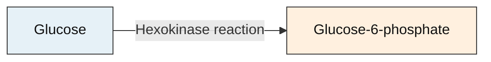
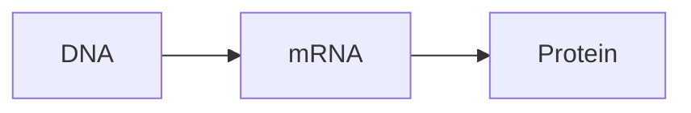

# Visualization Guide

> [!NOTE]
> **See also:** [composable_authoring.md](composable_authoring.md) for registry rules and `test_every_registered_figure_is_referenced`; [manuscript_guide.md](manuscript_guide.md#figures) for embedding/alt-text rules; [accessibility.md](accessibility.md) for the CVD policy.

---

## Table of contents

- [Visual assets, review outputs, and publication requirements](#visual-assets-review-outputs-and-publication-requirements)
- [Six-step checklist for new figures](#six-step-checklist-for-new-figures)
- [Generating figures](#generating-figures)
- [Matplotlib figure conventions](#matplotlib-figure-conventions)
- [CVD-friendly palette (exact hex)](#cvd-friendly-palette-exact-hex)
- [Wong/Okabe-Ito reference palette](#wongokabe-ito-reference-palette)
- [Mermaid diagram conventions](#mermaid-diagram-conventions)
- [Embedding in manuscript](#embedding-in-manuscript)
- [Plotting area, padded canvas, and printed size](#plotting-area-padded-canvas-and-printed-size)
- [Common mistakes](#common-mistakes)
- [Workflows](#workflows)

---

## Visual assets, review outputs, and publication requirements

The `biology_textbook` project generates **three types of visual output**:

1. **Matplotlib figures** from ALL_FIGURE_GENERATORS.
2. **Registered Mermaid diagrams** from ALL_BIOLOGY_DIAGRAMS.
3. **Inline Mermaid fences** in the configured manuscript.

Use current manifests for inventories, not fixed counts as proof. PNGs are square-padded by default; audited aspect limits admit reviewed exceptions. Missing/corrupt images are unavailable. Synthetic model plots are illustrations, not empirical measurements. After [locked setup](../README.md#standalone-quick-start), run this review recipe from the project root:

```bash
mkdir -p output/visual_review
review=$(mktemp -d "$PWD/output/visual_review/run.XXXXXX")
uv run --frozen --extra dev python scripts/generate_figures.py --output-dir "$review/figures"
uv run --frozen --extra dev python scripts/generate_diagrams.py --strict-png --size 1200 --output-dir "$review/figures/mermaid"
uv run --frozen --extra dev python scripts/audit_visual_contracts.py --figures-root "$review/figures" --output "$review/visual_manifest.json" --render-inline --check
```

The project figure and registered-diagram CLIs, as well as inline rendering/cleanup, require real destinations beneath this project's `output/`, with no symlink/non-directory ancestors. Defaults and `--output-dir` overrides share this boundary; arbitrary OS temporary directories are not admitted by these CLIs. Low-level APIs remain caller-owned directory interfaces, and report writers have their own contracts. The recipe is not an exercised pass or accessibility certification.

Visual-manifest readers consume complete adjacent physical lines, not a fixed
character window that can silently truncate long alt text or captions. Raw
figures and inline Mermaid require both metadata fields. The reader stops at
unrelated content rather than borrowing a later caption. Printed-page proofs
must reject empty text markers before searching for the actual caption.

The project-local Puppeteer profile selects CPU-only rasterization with
`--disable-gpu`. A same-source native reproduction exposed low-bit pixel drift
in headless diagram borders even when text, layout and compiler metadata matched;
the compositor-only deterministic flag also reproduced that drift. CPU-only
renders matched across both locked CLI installations in the controlled comparison.
This is a tested host profile, not a cross-platform pixel guarantee. Do not hide
drift by rounding colors, quantizing pixels or relaxing artifact comparisons.

The shared inline-source normalizer keeps HTML line breaks renderable with the
locked CLI in both standalone and template-assisted paths. A backend conversion
to literal `\n` must not leak into a printed state label. Preserve source identities
through the same normalizer in collection, rendering and hydrated-source checks.
For compact print, shorten and structure labels before increasing raster size:
a wide nine-participant sequence or an over-tall graph can still have tiny text
on the page. Review actual clipped PNG/PDF size; square padding is not legibility.

For continued-stage mechanism diagrams, label repeated carriers explicitly and distinguish physical transfer from coupling. The ETC example keeps alternative Complex I/II entries, net Complex III Q-cycle accounting, and Complex IV proton pumping separate from protons consumed in water formation; ATP synthase uses the gradient, not an incoming electron. Registered library diagrams are separately reviewed assets, not automatically printed pages. Their organism/program scope belongs in the graphic: the T4/E. coli example must not imply one gene-expression sequence for every virus.

For stacked quantitative panels, verify that the real generated line arrays remain unchanged when only geometry and typography change. Layer order is semantic in structural cartoons: centromeres, kinetochore disks and their leader tips must not be hidden by chromosome-arm strokes. Final-size inspection remains necessary after either change; source font targets and successful PNG decoding do not certify readability.

The shared matplotlib writer saves and square-pads a unique same-directory temporary before replacing its destination. Existing symlinks, hardlinks and nonregular leaves refuse without modifying their targets; failed replacement preserves the previous image and removes only the writer's temporary. Directory admission belongs to the caller. This is cooperative custody, not protection against hostile concurrent same-UID mutation. Real-plot regressions cover both alias types and publication failure; native CLI regressions exercise the default-directory boundary.

The nitrogen-cycle overview distinguishes biological nitrogenase fixation from industrial ammonia and its selected ammonium-fertilizer route. Repeated nitrate/atmospheric boxes denote shared pools; environmental effects are not material-transfer arrows. Removing untraced annual-input and uptake labels does not make the selected routes a closed global budget. Review the freshly generated source-matched graphic and its actual printed caption after changing a route.

### Meaning and limits of graphical abstracts

Unit maps are selected relationship overviews, not prerequisite graphs or causal proof. Use two or three named groups, short sentence-case labels and arrowless labeled connectors. Reserve arrows for explicitly scoped material/information transfer or an actual modeled transition. Use dark text on light fills, without emoji or color-only meaning. Caption and alt text must explain the connections and omissions, not merely name colors.

The twelve overview sources select diagram-local `layout: dagre` with the locked CLI. A native comparison exposed cluster-title crossings and narrow/tall layouts under the bundled default; the selected layout preserves the authored relationships without a global renderer or dependency change. Layout syntax is documented [upstream](https://mermaid.js.org/config/layouts.html). Inspect each actual PNG/PDF rather than inferring final-size readability from successful compilation.

Quantitative conventions: milestone dates are points, not duration bars or overlapping eras; biome climate markers are equal-sized, not NPP-area encodings; Shannon entropy (nats) and Simpson diversity 1−D (dimensionless) occupy separate panels with their own vertical scales, so bar heights are compared within each index, not between indices. Oxygen curves use stipulated P₅₀=26/32/20 mmHg with Hill n=2.7 and identify 40/100 mmHg guides, not calibrated fever/HbF states. The first selection panel reports the actual supplied AA/Aa/aa fitnesses and initial p rather than assuming a fixed directional regime; heterozygote advantage/disadvantage panels are not phenotypic stabilizing/disruptive selection models. These are source conventions, not empirical observations or a fresh layout/readability pass.

---

## Six-step checklist for new figures

Use this every time you add a new visualization. Each step maps to an enforced or advisory test.

| # | Step | Where | Enforced by |
| - | ---- | ----- | ----------- |
| 1 | Implement the domain function in the appropriate `src/visualization/plots_*.py`; return its PNG `Path` | Domain module | Numerical/behavioral tests plus editorial review; coverage alone is not scientific proof |
| 2 | Register a callable accepting `output_dir: Path`; supply required domain inputs in its wrapper | `src/visualization/plots.py` → `ALL_FIGURE_GENERATORS` | Registry/reference tests; `__init__.py` is the public facade |
| 3 | **Generate** the PNG: `uv run python scripts/generate_figures.py` | from project dir | Inspect `output/figures/<file>.png`; square padding is applied by `_save_figure` |
| 4 | **Embed** the figure in the chapter using raw-LaTeX `\begin{figure}…\label{fig:unit_X_<descriptor>}…\end{figure}` and an `<!-- alt: … -->` comment **immediately after** `\end{figure}` | `docs/manuscript/unit_<X>/<chapter>.md` | `test_accessibility.py`, `test_build_invariants.py` |
| 5 | **Cross-reference** the figure from prose with `\cref{fig:unit_X_<descriptor>}` (no hand-typed "Figure 4.2") | same chapter or any other | `test_crossref_validator.py` |
| 6 | Run relevant invariant tests and the project-output review recipe above; inspect actual assets at final size | Project root | Gate results and separate human review have different scopes |

> [!TIP]
> If a generator is registered but never embedded, `test_every_registered_figure_is_referenced` fails. Use `scripts/insert_orphan_figures.py --dry-run` to scaffold an embedding block automatically.

---

## Generating figures

From the active project directory:

```bash
uv run python scripts/generate_figures.py
ls output/figures/*.png
```

For a single figure during development:

```python
from pathlib import Path
from visualization import plot_michaelis_menten

plot_michaelis_menten(
    output_dir=Path("output/figures"),
    Vmax=10.0,
    Km=2.0,
)
```

---

## Matplotlib figure conventions

All figure generators must follow these rules (enforced by `tests/test_mermaid_and_visualization.py` and editorial review):

| # | Rule | Why |
| - | ---- | --- |
| 1 | **Headless backend.** Set `MPLBACKEND=Agg`; never call `plt.show()` in library code. | CI has no display. |
| 2 | **Font-size targets.** Titles 15–18 pt, axis labels 14 pt, ticks 12 pt, legend 11 pt before scaling. | Inspect at final physical size; these targets do not establish readability. |
| 3 | **Save/pad.** Use `_save_figure` for tight save, closure and default square padding at the configured DPI. | Canvas aspect, visible content and printed size are separate. |
| 4 | **Redundant encoding.** Import project colors from `cvd.py`; pair color with line style, shape, hatch or direct labels. | Palette selection is not all-CVD safety certification. |
| 5 | **Legends with handles.** When multiple series appear, pass explicit `handles, labels`. | Avoids fragile auto-legend ordering. |
| 6 | **Pathlib for I/O.** Use `pathlib.Path`; resolve at call time. | Cross-platform; no hardcoded `/tmp`. |
| 7 | **Deterministic.** Set `np.random.seed(42)` (or pass `seed=` argument) before any stochastic plot. | Reproducible PNGs across CI runs. |
| 8 | **No globals.** Each `plot_*` function creates its own `fig, ax` and closes them. | Prevents matplotlib state leaking between figures. |

### Canonical save pattern

```python
import matplotlib
matplotlib.use("Agg")
import matplotlib.pyplot as plt
from pathlib import Path
from visualization._scaffold import _save_figure
```

### Canonical generator skeleton

Illustrative generator template, not an existing biological API or exercised output.

```python
import numpy as np
import matplotlib.pyplot as plt
from pathlib import Path
from visualization.cvd import SERIES2
from visualization._scaffold import _save_figure

def plot_my_descriptor(
    output_dir: Path,
    *,
    seed: int = 42,
) -> Path:
    """One-line summary used by test_mermaid_and_visualization.py."""
    rng = np.random.default_rng(seed)
    x = np.linspace(0, 10, 200)
    y1 = np.sin(x)
    y2 = np.cos(x) + 0.1 * rng.standard_normal(200)

    fig, ax = plt.subplots(figsize=(6, 6))
    ax.plot(x, y1, color=SERIES2[0], linestyle="-", linewidth=2, label="Sine")
    ax.plot(x, y2, color=SERIES2[1], linestyle="--", linewidth=2, label="Noisy cosine")
    ax.set_xlabel("Time (s)", fontsize=14)
    ax.set_ylabel("Amplitude", fontsize=14)
    ax.set_title("Descriptive title", fontsize=16)
    ax.legend(fontsize=11)
    ax.grid(True, alpha=0.3)
    fig.tight_layout()

    return _save_figure(fig, output_dir, "my_descriptor.png")
```

---

## CVD-friendly palette (exact hex)

The palette is defined in `src/visualization/cvd.py`. **Always import from there** — do not hardcode hex values.

| Symbol | Hex | RGB | Use |
| ------ | --- | --- | --- |
| `BLUE`, `BAR_POS`, `SERIES2[0]` | `#0077bb` | (0, 119, 187) | Primary/positive series |
| `ORANGE`, `BAR_NEG`, `SERIES2[1]` | `#ee7733` | (238, 119, 51) | Secondary/negative series |
| `TEAL`, `SERIES3[2]` | `#009988` | (0, 153, 136) | Third series |
| `PURPLE`, `SERIES4[3]` | `#7b4ea3` | (123, 78, 163) | Fourth series |
| `GRAY` | `#666666` | (102, 102, 102) | Neutral elements |
| `PUNNETT_DOMINANT` | `#6BAED6` | (107, 174, 214) | Cool cells with redundant labels/hatching |
| `PUNNETT_RECESSIVE` | `#FDB863` | (253, 184, 99) | Warm cells with redundant labels/hatching |

### When to use which

| Situation | Strategy |
| --------- | -------- |
| Two overlapping curves | `SERIES2[0]` solid + `SERIES2[1]` dashed — color **and** line-style |
| Three overlapping curves | `SERIES3` + line styles `-`, `--`, `:` — never rely on color alone |
| Signed bar chart | `BAR_POS` for positive, `BAR_NEG` for negative |
| Punnett square cells | `PUNNETT_*` constants + hatching (`hatch="//"` / `hatch="xx"`) |
| Heatmap | `cmap="viridis"` (perceptually uniform). **Never** `cmap="RdYlGn"` without an additional channel. |
| Categorical (≥4 categories) | `cmap="tab10"` is acceptable but include direct labels on the plot |

> [!WARNING]
> Never use red/green or any hue pair as the sole distinction. The palette expresses design intent, not empirical accessibility validation; review contrast, grayscale, redundant channels and actual output. See [accessibility.md](accessibility.md).

---

## Wong/Okabe-Ito reference palette

This reference palette is distinct from the project constants above. The eight reference colors below are design options, not a guarantee that every pair remains distinguishable for all viewers, sizes or backgrounds. Use redundant encoding and actual review.

| Name | Hex | RGB | Typical use |
| ---- | --- | --- | ----------- |
| **Black** | `#000000` | (0, 0, 0) | Outlines, axes, neutral text |
| **Blue** | `#0072B2` | (0, 114, 178) | Primary series; controls; reference |
| **Orange** | `#E69F00` | (230, 159, 0) | Secondary series; treatment; perturbation |
| **Teal (bluish-green)** | `#009E73` | (0, 158, 115) | Tertiary series; "go"/positive direction |
| **Yellow** | `#F0E442` | (240, 228, 66) | Highlight; rare 4th series; **avoid as the only distinction on white background** |
| **Vermillion (red-orange)** | `#D55E00` | (213, 94, 0) | "Stop"/danger/negative direction |
| **Sky blue** | `#56B4E9` | (86, 180, 233) | Lighter tint of Blue; pairs well with Vermillion |
| **Reddish purple (pink)** | `#CC79A7` | (204, 121, 167) | 4th–5th series; gentle accent |

### Mermaid `classDef` example with light fills

````markdown


<!-- alt: Glucose is converted to glucose-6-phosphate in the hexokinase reaction; ATP coupling and downstream reactions are omitted. -->

*Selected conversion catalyzed by hexokinase; ATP coupling and subsequent glycolysis steps are omitted. This is not the pathway's committed step.*
````

> [!TIP]
> Prefer a small palette with dark text on light fills for relationship maps; add labels, line styles or shapes before adding more colors. No color here carries unique biological meaning.

---

## Mermaid diagram conventions

Factories build MermaidDiagram objects from diagram_specs.yaml through diagram_spec_loader.py. Publish real PNGs with pinned Mermaid CLI 12.2.0:

```python
from pathlib import Path
from mermaid.biology_diagrams import enzyme_kinetics_diagram
from mermaid.renderer import MermaidRenderer

diagram = enzyme_kinetics_diagram()
out = Path("output/figures/mermaid")
MermaidRenderer(out, strict_png=True).render(diagram.name, diagram.source, size=1200, square=True)
```

### Generation

```bash
# From project root; Node >=22.13.0
npm ci
export PATH="$PWD/node_modules/.bin:$PATH"
uv run --frozen --extra dev python scripts/generate_diagrams.py --strict-png --size 1200
```

The Python API uses size=1200 and square=True; the project CLI uses --size, without width/height aliases. Project-local .puppeteer.json is optional browser configuration; review host compatibility. Non-strict missing-CLI .mmd output is authoring source only, not a publication substitute. Publication requires actual PNG decoding. Every project-local PDF render freshly regenerates canonical source-matched inline assets; no template-root recipes. See pipeline_guide.md.

### Diagram type — quick reference

| Mermaid declaration | Use for |
| ------------------- | ------- |
| `flowchart LR` | Pathways and cascades (left-to-right reading) |
| `flowchart TD` | Hierarchies, classifications (top-down) |
| `sequenceDiagram` | Time-ordered actor interactions (signal cascades) |
| `stateDiagram-v2` | Discrete states with transitions (cell cycle, channel gating) |
| `pie` | Proportional composition (rare; usually a bar chart is clearer) |

For the full diagram-type → biology-content mapping, see [manuscript_guide.md#mermaid-diagrams](manuscript_guide.md#mermaid-diagrams).

### Syntax conventions

- Sentence-case node labels under 30 characters.
- Wrap labels containing `(`, `)`, `:`, `,`, `<`, `>` in double quotes: `A["Glucose (C6)"]`.
- Use shared `classDef` blocks with dark text on light fills for relationship maps. Do not encode a biological distinction only by fill color.
- Choose connectors by semantics: an unlabeled arrow must not turn a topic relationship into an implied cause, prerequisite or material flow.
- After every inline `mermaid` fence in a chapter, write exactly one `<!-- alt: ... -->` comment and exactly one short *italic* descriptive caption — `tests/test_accessibility.py` enforces both.

### Available registered diagrams

The current factory inventory is `src/mermaid/biology_diagrams.py` → `ALL_BIOLOGY_DIAGRAMS`; [API reference](api_reference.md#mermaidbiology_diagrams) curates callable examples without making a fresh availability claim.

---

## Embedding in manuscript

### Matplotlib figures

Embed with raw-LaTeX `\begin{figure}…\end{figure}` blocks — paths relative to `output/manuscript/`:

```latex
\begin{figure}[htbp]
\centering
\includegraphics[width=0.85\textwidth]{../figures/michaelis_menten.png}
\caption{Michaelis–Menten kinetics: initial velocity ($v_0$) versus substrate concentration, approaching $V_{\max}$ asymptotically as $[S] \to \infty$.}
\label{fig:unit_I_michaelis_menten}
\end{figure}
<!-- alt: Smooth saturating curve of reaction velocity versus substrate concentration, plateauing at V_max with the half-saturation point K_m marked on the substrate axis. -->
```

Reference elsewhere with cleveref:

```latex
enzyme rate follows \cref{fig:unit_I_michaelis_menten}
```

> [!WARNING]
> **Path is relative to `output/manuscript/`**, not `docs/manuscript/`. Use `../figures/<name>.png`. See [manuscript_guide.md](manuscript_guide.md#path-conventions-and-what-fails-when-they-are-wrong) for the failure messages produced by wrong paths.

### Mermaid (inline)

Drop a `mermaid` fenced block directly in the markdown; the renderer converts each block to a PNG at build time:

````markdown

<!-- alt: Flowchart showing DNA transcribed into mRNA and translated into protein. -->

*Central dogma of molecular biology: DNA template → mRNA transcript → polypeptide.*
````

The project-owned hydration adapter converts the authored caption paragraph with
Pandoc before placing it inside the LaTeX figure. The outer `*...*` line marks
the caption; inside it, Markdown emphasis, bold, inline code and links retain
their formatting. Glossary fragment links such as `[**synaptotagmin**](#gl:synaptotagmin)`
remain clickable. HTTP(S) and `mailto:` links are also admitted; other link
targets, embedded images, HTML, block content and arbitrary raw TeX are refused.
Plain prose special characters (for example `%`, `&`, braces and `#`) are escaped
by Pandoc, not passed through as TeX.

Inline code, including language-attributed spans, is rendered without syntax
highlighting so it does not introduce fragile verbatim/highlighting macros into
the moving caption argument. Strikeout is outside this supported subset and is
refused before hydration rather than emitted with an unprovided LaTeX dependency.

Natbib citations use the existing bibliography and native multi-pass compilation,
so `\citep{key1,key2}` prints resolved authors/years rather than literal commands.
The shared citation forms (`cite`, `citep`, `citet`, `citealt`, `citealp`,
`citeauthor`, `citeyear`, with optional stars) are supported. Optional pre/post
notes must be plain text without TeX commands, braces, brackets or TeX special
characters; citekeys use letters, digits and `_:.+/,-` (plus separator whitespace).
Inline dollar math such as `Na$^+$/K$^+$`, `$K_m$` and `$\frac{a}{b}$` is retained.
Math is deliberately bounded: balanced groups, ordinary mathematical characters
and the explicit Greek/typesetting/operator command set in
`biology.pipeline.rendering._CAPTION_MATH_COMMANDS` are admitted. Display math,
unknown commands, character-code escapes and raw TeX control syntax are refused;
this is not an arbitrary-TeX caption interface. Reader macro expansion is disabled
before inspecting Pandoc's AST. Caption conversion is batched into two Pandoc
processes per book, not one process per diagram.
The Unicode prose normalizer's supported `⇌`, `≲`, `∝`, `°` and `ϕ` outputs are also admitted as bounded inline math (`\rightleftharpoons`, `\lesssim`, `\propto`, `\circ`, `\varphi`). This closes the normalizer-to-caption contract; it does not admit arbitrary commands, display math or appended file-read controls. The native caption regression inspects the emitted caption rather than mistaking a preamble definition for rendered math.
These math restrictions apply to parsed math nodes. Standard Markdown text that
Pandoc does not recognize as math remains safely escaped literal prose; it is
not promoted to executable TeX. Use valid delimiters and grouping for formulas.


Alt comments are a separate **plain-text** boundary: they never enter the caption
converter, never execute citations/math/Markdown and are never used as a rich
caption fallback. Exactly one nonempty alt comment and a caption are required.
The existing literal-character alt serializer is retained, as are source/stem
matching, strict PNG identity, visible-content crop and physical print-size caps.
The native regression in `tests/test_pdf_opening_and_mermaid.py` checks compiled
caption text, distinct formatted fonts, link destinations, bibliography resolution
and an alt-text injection probe; this does not replace actual final-size inspection.

### Mermaid (registered PNG)

For reusable registered output, first generate strict PNGs, then reference the staging-relative asset:

```markdown

```

### Captioning conventions

- Captions describe **what is shown** (axes, salient features, parameter values), not just name the figure.
- Include axis labels and any important threshold values in the caption.
- For diagrams: describe the key process and what elements are connected.
- Review inline Mermaid metadata with `uv run python scripts/add_mermaid_alt_text.py --check`; duplicate, missing, or stale metadata fails review. Do not overwrite reviewed authored captions with generated text.
- Every generator registered in `ALL_FIGURE_GENERATORS` **must** be referenced at least once — `tests/test_build_invariants.py::test_every_registered_figure_is_referenced` enforces this.
- Every `\label{fig:…}` **must** have at least one prose `\cref{fig:…}` — `tests/test_build_invariants.py::test_every_figure_label_has_prose_cref` enforces this (2026-05-23 figure expansion pass).

---

## Plotting area, padded canvas, and printed size

`figsize` describes the plotting area before tight save/padding, not the delivered aspect. Default delivered PNGs are square; non-square output needs the existing reviewed-exception path. A `(12, 4)` plotting area does not imply a delivered 3:1 image.

Start with `0.85\textwidth` for a standard figure or `0.95\textwidth` for a larger panel; these are layout suggestions, not readability findings. Half-width paired panels require inspection after scaling. Inspect labels, legends, connector crossings, caption placement and unused padding in both PNG and PDF at the intended physical size; do not infer legibility from pixel dimensions alone.

> [!WARNING]
> Avoid `width=\textwidth` (no fraction). Even with 2 mm margins, content tends to bleed past expected bounds. Cap at `0.95\textwidth`.

---

## Common mistakes

| Mistake | Symptom | Fix |
| ------- | ------- | --- |
| `plt.show()` in library code | Test hangs in CI | Remove; use `_save_figure()` and `plt.close(fig)` |
| Hardcoded `/tmp/figures` path | Works locally, fails in CI | Accept `output_dir: Path` parameter |
| `plt.savefig("foo.png")` (no path) | File appears in `cwd`, not `output/figures/` | Use the `_save_figure()` helper |
| Missing `plt.close(fig)` | Memory growth across many figures | Always close after save |
| Forgetting `MPLBACKEND=Agg` | `tkinter.TclError` on headless CI | Set in `conftest.py` (already done) and `_save_figure` callers |
| Red+green only color distinction | Fails accessibility review | Use `cvd.SERIES2` / `cvd.SERIES3` + line styles |
| `cmap="RdYlGn"` for heatmap | CVD-unfriendly | Use `cmap="viridis"` |
| Hand-typed "Figure 4.2" in caption text | Number drifts on chapter reorder | Let cleveref handle: `\cref{fig:...}` in prose only |
| Forgetting `<!-- alt: ... -->` after `\end{figure}` | `test_accessibility.py` fails | Add a one-sentence visual description immediately after `\end{figure}` |
| Forgetting Mermaid alt/caption after fence | `test_accessibility.py` fails | Add one `<!-- alt: ... -->` comment and one italic caption immediately after the fence |
| Mermaid label with unquoted parens: `A[Glucose (C6H12O6)]` | mmdc render fails | Wrap: `A["Glucose (C6H12O6)"]` |
| Path `output/figures/foo.png` in `\includegraphics` | LaTeX `File not found` error | Use `../figures/foo.png` (relative to `output/manuscript/`) |
| Hardcoded hex (`color="#FF0000"`) instead of `cvd.*` | Accessibility regression | Import from `visualization.cvd`; for new diagrams use Wong/Okabe-Ito (`#0072B2`, `#E69F00`, …) |
| Mermaid node label > 30 characters | Layout breaks; text overflows | Move detail to caption / italic line; keep node label short |

---

## Workflows

### Adding a new matplotlib figure (`plot_*`)

1. Implement in the appropriate [domain module](../src/visualization/), register an `output_dir` callable in [plots.py](../src/visualization/plots.py), and expose the intended public API through `__init__.py`.
2. From the project directory: `uv run python scripts/generate_figures.py`.
3. Embed in the chapter with raw LaTeX `\begin{figure}…\includegraphics{../figures/<file>.png}…\label{fig:unit_X_<descriptor>}…\end{figure}` and an `<!-- alt: … -->` comment.
4. Reference with `\cref{fig:...}` in prose.
5. Run relevant build/accessibility tests and the project-output review recipe at the top of this guide, then inspect actual PNG/PDF output. A manifest pass is not human review.

### Adding a new registered Mermaid diagram

1. Add a specification/factory through [biology_diagrams.py](../src/mermaid/biology_diagrams.py) and register it in `ALL_BIOLOGY_DIAGRAMS`; the registry is authoritative, not a copied allowlist.
2. From the project directory: `uv run --frozen --extra dev python scripts/generate_diagrams.py --strict-png`.
3. `tests/test_mermaid_and_visualization.py` exercises the registry.
4. Reference the diagram from manuscript as required by your chapter. Inline fences need one `<!-- alt: ... -->` comment plus one italic caption; static PNGs need descriptive markdown image alt text.
5. Use balanced `flowchart TD`/`LR` directions, short wrapped labels, and subgraphs/phase blocks so the rendered PNG remains square-ish without misrepresenting sequence semantics.

---

## See also

- [composable_authoring.md](composable_authoring.md) — registry rules and authoring workflows
- [manuscript_guide.md](manuscript_guide.md) — embedding, alt text, equations, citations
- [accessibility.md](accessibility.md) — CVD policy, alt text rules, reader-profile recipe
- [api_reference.md](api_reference.md) — full list of `plot_*` and `*_diagram()` registered names
- [Manuscript contract](manuscript/AGENTS.md) — source IDs, reference types and registry ownership
